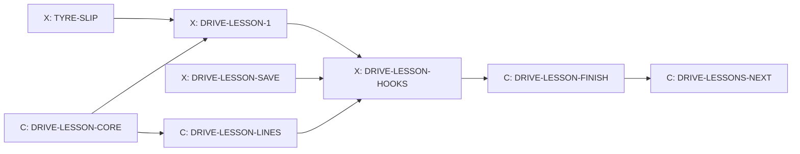

# Driving lessons

Design packet D1 for Cockpit task T-040, written 14 October 2026 by Claude
from Kyle's storyboard ("Helicopter Storyboard Ideas", sections "First
driving lesson: the sharp corner" and "Lessons stay open"). It settles
lesson 1, the sharp corner, enough to build, and the shared lesson pieces
it takes from the helicopter's lessons (H1). Lessons 2 to 4 are outlined in
section 9 and get their own short packet after lesson 1 is played. The
cards are in section 10; Kyle's answer on the reward is in section 11.
Sections 4 and 5 are written for the builder.

## 0. What the game does today (checked on integration 5047d6ff)

- **Helicopter lessons exist** (`docs/HELICOPTER.md` section 7). The
  instructor is the stock voice Brian, recorded clean and played through a
  radio filter (`createRadioChain` in `src/heli/heli-audio.js`; voice and
  lines in `src/heli/heli-radio-lines.js`). `src/heli/heli-lessons.js`
  checks each lesson's goal every step and answers "running", "passed" or
  "try again" with a radio line; `lessonOpen(done, id)` opens a lesson when
  the one before it is done; a coach timer stops the instructor nagging.
  The instructor's board (`lessonsMarkup` in `src/heli/heli-ui.js`) shows
  on the home pad and lists each lesson as open, done ("Retake") or later.
  Lessons are saved as `profile.heli.lessons`. `tools/test-heli-mode.mjs`
  checks that helicopter files import only each other and a short list of
  outside files.
- **Which sharp corners can teach sliding.** A car can turn at most
  1.35 radians a second (`src/config.js`), so its tightest circle is about
  10 m whatever its speed. Harbour Lights' Lantern Hairpin (9 m radius) is
  tighter than that: the steering, not the tyres, sets its speed, and
  coming in too fast only runs wide without a slide. A lesson about tyre
  grip needs a corner where the tyres are the limit and the approach is a
  long straight. Two owned-course hairpins fit:
  - **Panorama Ridge, The Cutting:** 110 degrees at a 20 m radius, about
    55 mph, at the end of the 912 m Mountain Straight, the Griffin Bend
    (a 110 m radius) and a 142 m straight. A big stop from high speed.
  - **Tremblant Woods, Beaver Hairpin:** 170 degrees at 22 m, about 57 mph,
    after Beaver Kink and an 80 m spur. A smaller stop.
  Tremblant Snow's Beaver Hairpin is on snow (lesson 4's place). Panorama's
  Forrest Elbow (22 m) can join later as one more row. The classic courses
  have no corner tighter than about 200 m radius. Panorama Ridge and
  Tremblant Woods cost 1,600 credits each; Pacific Canyon, the free course,
  has no hairpin.
- **Time Trial** is `startCampaign` with `mode: 'timetrial'` and no rival;
  `startHeliVisit` (`src/game.js` about 253) already starts one that way.
- **Upgrades**: seven per car, three levels each, 350, 600 and 950 credits.
  Brakes add 12% braking per level (`src/game.js:158`).
- **Ghosts** replay recorded positions, not key presses (`src/ghost.js`).
- **TYRE-SLIP** (card ready, dev switch `tyre-slip`) makes sliding cost
  grip and speed, adds `s.tyreSlip` (1.0 is the tyre's best grip), makes
  braking while turning leave 80% of the cornering grip, and makes the tyre
  squeal follow the real slide. Without it a screech costs nothing, so
  lesson 1 cannot teach the truth until it is built.

## 1. Kyle's decisions

- The instructor teaches over the radio: Brian, the same voice and the same
  scratchy radio as the helicopter lessons.
- Lessons stay open: go back to the instructor any time to retake one; new
  lessons unlock as you go. The same idea works for driving: braking before
  a corner, the racing line, the manual gearbox, driving on snow.
- Lesson 1, on a sharp hairpin of a course you own: three cones (where to
  brake, the inside of the corner, where to finish on the outside). First
  try: brake late; the tyres screech, the car slides wide, and the
  instructor shows the time you lost. Second try: brake at the first cone,
  turn in, touch the inside cone, accelerate out wide past the third.
  Challenge: beat the instructor's time through the corner three times in a
  row. That unlocks the next lesson and a brake upgrade.
- Sliding costs grip like real tyres (TYRE-SLIP), so a long screech means
  lost time.
- One keyboard; players take turns.

## 2. One instructor, one board, one voice (what is reused from H1)

Driving lessons do not build a second lesson system. Three pieces move out
of `src/heli/` into a small shared folder `src/lessons/`. The helicopter
keeps every name and behaviour it has today, so its tests pass; the one
test that changes is the helicopter import check, which gains
`../lessons/` (a reviewed changed assertion).

| Shared piece | Moves from | What both use it for |
| --- | --- | --- |
| `src/lessons/lesson-core.js` | the general parts of `heli-lessons.js` | The answer each step gives ("running", "passed" or "try again" plus a radio line id); `lessonOpen(order, done, id)`; the coach timer (at most one coaching line every 6 s); `passed(lesson, line)` and `retry(lesson, line)`, which take the radio line as an argument. `heli-lessons.js` keeps its own two-argument `lessonOpen(done, id)`, which calls the shared one with its order, and its own pass and retry lines. |
| `src/lessons/radio-voice.js` | `createRadioChain`, `RADIO_FILTER`, `softClipCurve`, `HELI_RADIO_VOICE` | Brian over the same radio filter, click and hiss. `heli-audio.js` and `heli-radio-lines.js` re-export these names, so nothing that imports them changes. |
| `src/lessons/lesson-board.js` | the list part of `lessonsMarkup` | The instructor's list: plain rows (group, id, name, open, done) in, the list out. The helipad keeps its own check that you are on the home pad, the running-lesson panel and the skip button in `heli-ui.js`. Styles move with it to `src/lessons/lesson-board.css`. |

What stays separate: the helicopter's goal checks, session and save field;
driving's goal checks (section 4), lesson run (section 5) and save field
(section 7).

**Where you meet the instructor.** In D1, on a new **Instructor** button on
the main menu, shown when both the `driving-lessons` and `tyre-slip`
switches are on. It opens the board with the Driving group. Driving lessons
never need the helicopter. Showing the Driving group on the helipad too
(and starting a driving lesson from the pad like "Race here") touches the
helicopter's session and screen, which are Claude's; it comes after lesson
1 is played, in the cards that DRIVE-LESSONS-NEXT writes.

## 3. Lesson 1, the sharp corner

### 3.1 Where

The lesson runs on a course you own that has a lesson corner; the board
lists them and you pick:

| Course | Corner | Start gate | Rolling start |
| --- | --- | --- | --- |
| Panorama Ridge | The Cutting | 180 m before turn-in, leaving Griffin Bend | 100 mph |
| Tremblant Woods | Beaver Hairpin | 150 m before Beaver Kink, on Beaver Run | 75 mph |

Panorama Ridge is first in the list (the longer, faster approach makes the
lesson clearest). If you own neither, lesson 1 shows "Opens later: buy
Panorama Ridge or Tremblant Woods". A later corner joins by adding one row
to the lesson corner table, not by changing the lesson. The course's own
braking boards stay where they are; the instructor's first line tells you
to watch the cones today.

### 3.2 The run

A lesson run is a Time Trial on that course with no rival, no traffic, no
police and no combat. It never pays credits, sets records, saves ghosts or
counts toward medals, and a crash costs no repair. Tyre slip rules are
always on in a lesson run (it teaches what TYRE-SLIP makes true). Your own
car, its upgrades and your Casual or Pro setting are used.

Each attempt is short: the car appears at the start gate already rolling
at the table's speed, you drive through the corner, and the attempt ends at
the finish gate, 60 m past the exit cone. The time is from gate to gate, to
a hundredth of a second. Between attempts the result card shows; Enter
starts the next one at the start gate again. Pause (Esc) has a Leave lesson
button. Except in try 1 (3.4), a wall hit, going off the road for more than
1 s, or stopping ends the attempt as "try again".

### 3.3 The instructor's run, the cones and the red board

Everything is computed when the lesson starts, from one run of the
instructor through the same corner that the player does not see, in **your**
car with your upgrades and setting, so the target is always fair and always
repeatable:

- The instructor follows the course's planned racing line at **92%** of
  the speed that line allows on Casual and **97%** on Pro (whichever limit
  sets it, steering or tyres), braking in a straight line and never sliding
  (TYRE-SLIP's `steerForYaw`, which never asks for more than the tyre's best
  grip). Its gate-to-gate time is the **instructor's time**.
- **Cone 1, brake here:** where the instructor starts braking, on the
  outside edge of the road.
- **Cone 2, the inside:** at the instructor's closest point to the inside
  edge, on that line.
- **Cone 3, finish wide:** where the instructor's line reaches the outside
  edge after the apex.
- **The red board** (try 1 only): **25 m after cone 1**, the same late
  braking point TYRE-SLIP's own test uses, but never past the turn-in
  point. On The Cutting it stands 25 m late, before turn-in. On Beaver
  Hairpin the instructor brakes only about 10 m before turn-in (it leaves
  Beaver Kink already slow), so the board stands at turn-in itself: braking
  there means braking as you turn, which is exactly what makes the tyres
  slide.

Cones are drawn only; they never touch race physics. A cone "counts" when
the car's centre passes within 2.5 m of it; driving right over it (within
0.8 m) tips it over in the drawing and plays the cone sound. The
instructor's own run must count all three cones.

### 3.4 Try 1: brake late

Instructor: "Let us see what happens when you leave it late. Keep your foot
down and brake at the red board." The red board and the cones show. The
try counts however it ends: at the finish gate, against a wall, or off the
road. The result card shows your time against the instructor's (or how far
you got), the time lost, and how long the tyres screeched (seconds with
`s.tyreSlip` above 1.0), for example: "You 8.42 s. Instructor 7.31 s. Lost
1.11 s. Tyres screeched 1.6 s." Then the car goes back to the start gate.
If you braked early anyway, the instructor says so and the try still counts.

### 3.5 Try 2: do it right

Instructor: "Now the right way. Brake hard at the first cone while the car
is straight, turn in, touch the inside cone, and accelerate out wide past
the third." It passes when all four hold:

1. **Braked at cone 1:** the first brake press of 50% or more comes no more
   than 15 m before and 5 m after cone 1 (the red board is 25 m after).
2. **Touched cone 2.**
3. **Finished wide:** throttle at 80% or more before cone 3, and the car
   passes cone 3 on the outside half of the road.
4. **No long screech:** `s.tyreSlip` above 1.0 for less than 0.3 s in total.

A miss gets one coaching line naming the first rule that failed, then
another go. There is no limit on goes.

### 3.6 The challenge: beat the instructor three times in a row

Instructor: "Good. Now beat my time through the corner. Three in a row."
The instructor's car runs beside you as a ghost (drawn with the existing
ghost drawing from its recorded positions). An attempt faster than the
instructor's time adds one to the streak; a slower attempt or one that ends
as "try again" resets it to 0. The cones stay as a guide but are not
checked. Three in a row passes the lesson.

### 3.7 What passing gives

- Lesson 2 (the racing line) opens.
- **A brake upgrade:** one free brake level on the car you passed in, or
  600 credits if that car's brakes are already at level 3 (Kyle, 14
  October 2026; section 11).
- The board shows the lesson as done, with your best margin over the
  instructor ("Best: 0.42 s faster"). Retaking it never pays again.

### 3.8 Why this teaches the truth

On both lesson corners the tyres, not the steering, set the corner speed.
With TYRE-SLIP, braking at the red board leaves you two bad choices: keep
braking into the turn, or turn in too fast. Braking while turning leaves
only 80% of the cornering grip, so the tyres go past their best grip, slide,
run wide and rub off speed; the screech is that slide. Turning in too fast
without braking runs wide; on the keyboard it does not slide by itself,
because a held key never steers harder than today (TYRE-SLIP amendment 5),
so the screech in the late try comes from braking into the turn. The
lesson's own test (section 10) requires the late try to screech at least
0.5 s and either lose at least 0.25 s or end against the wall or off the road,
on both corners; TYRE-SLIP's test 8
checks a similar late entry. Without TYRE-SLIP the lesson would show a
screech that costs nothing, which is why lesson 1 waits for it.

## 4. Lesson rules (for the builder: `src/lessons/drive-lessons.js`)

The driving goal checks follow the shared answer from `lesson-core.js`.
`createDriveLesson(id, {corner, instructor})` and `stepDriveLesson(lesson,
view, events, dt)` read a plain picture of the car each 120 Hz step
(distance along the course, lateral position, speed, brake, throttle,
`tyreSlip`, contact events) and answer "running", "passed" or "try again"
with a radio line id. The module also holds the lesson corner table (3.1),
the instructor's run, `placeCones(corner, instructorRun)` and the attempt
timer. It reads race state and never changes it, like drift scoring.

**The instructor's run** belongs to this module (DRIVE-LESSON-1): a run of
the race rules from the start gate, in the player's car, steering along the
course's planned racing line (`src/track-script.js` and the line the course
builds from `src/course.js`) through `steerForYaw`, with a speed plan at
92% or 97% of the speed the line allows and braking in a straight line. It
records positions (for the ghost) and the path (for the cones). It does not
use the App autopilot.

## 5. The lesson run in the game (for the builder: the hooks card)

- `startLesson({courseId, lessonId, car, difficulty})` starts a Time Trial
  through `startCampaign` with lesson options. The options turn off rival,
  traffic, police, combat, pay, records, ghost saving, medals and damage
  cost, and fix `tyreSlipRules` on for the race.
- It asks `drive-lessons.js` for the instructor's run and the cones once,
  at the start.
- Placing the car at the start gate for each attempt uses the existing safe
  reset, with the rolling speed set; the attempt timer starts at the gate.
- Cones, the red board and the instructor's ghost are drawn by the renderer
  from the lesson's lists; the result card and the lesson panel (try, rules
  met, streak 0/3) are screen elements like the race HUD. None of it
  changes race state.

## 6. Sounds and radio lines

- **Radio** (Brian, through `src/lessons/radio-voice.js`): 16 lines, below.
  Each kept take is recorded with the same voice and settings as the
  helicopter's lines, kept in `audio-src/voices/`, recorded as one entry in
  `tools/audio/catalog.json` (text, file and hash), and copied to
  `public/assets/audio/voices/` by a small build step, within the month's
  voice credits. Ids are `drive.radio.<lesson>.<step>`. Lines never name
  times or prices; the card shows numbers.
- **Cone tipped:** new cue `lesson.cone`, a soft plastic knock, a CC0
  library sound recorded in `tools/audio/catalog.json`.
- **Streak and pass:** the existing interface confirm sound; no new cue.
- **Tyres:** TYRE-SLIP's squeal, unchanged. The lesson adds nothing to it.

| Id | Line |
| --- | --- |
| `drive.radio.corner.intro` | Welcome to the track. Today is the most important corner skill there is: braking. Forget the course boards today and watch my cones. |
| `drive.radio.corner.late.start` | Let us see what happens when you leave it late. Keep your foot down and brake at the red board. |
| `drive.radio.corner.late.result` | Hear that screech? That was your tyres sliding, and sliding is slow. Look at the time you lost. |
| `drive.radio.corner.late.early` | You braked early. Good instinct, but this time I wanted you to feel it. That one still counts. |
| `drive.radio.corner.right.start` | Now the right way. Brake hard at the first cone while the car is straight, turn in, touch the inside cone, and accelerate out wide past the third. |
| `drive.radio.corner.coach.brake` | Brake at the first cone. Not before, not after. |
| `drive.radio.corner.coach.inside` | Get closer to the inside cone. Use the whole road. |
| `drive.radio.corner.coach.exit` | Back on the gas sooner, and let the car run out wide. |
| `drive.radio.corner.coach.screech` | I heard the tyres. Brake a little earlier and keep it smooth. |
| `drive.radio.corner.right.pass` | That is it. Quiet tyres, clean line, and quicker too. |
| `drive.radio.corner.challenge.start` | Good. Now beat my time through the corner. Three in a row. |
| `drive.radio.corner.challenge.one` | That is one. Again. |
| `drive.radio.corner.challenge.two` | Two. One more. |
| `drive.radio.corner.challenge.reset` | Not that time. Back to zero. You know how. |
| `drive.radio.corner.pass` | Three in a row. You have earned better brakes, and the next lesson is open. |
| `drive.radio.retake` | Back for more? Good. Practice is how the fast drivers got fast. |

## 7. The save (`save-shape`)

Optional `profile.drivingLessons` =
`{version: 1, done: {corner}, best: {corner}, rewarded: {corner}}`:
`done` and `rewarded` are true or false, `best` is the best margin over the
instructor in seconds (a number or null). Later lessons add keys (`line`,
`gears`, `snow`) to the same three maps. One line in `normalizeProfile`, a
fixture `tools/fixtures/saves/11-driving-lessons.json`, and the save
checker. An old save without the field reads as no lessons done. Nothing
else in the profile changes, except the reward (one brake level or the
credits) when lesson 1 first passes.

## 8. Switch, files, locks

- **Switch:** `driving-lessons: 'dev'` in `src/feature-flags.js`; the count
  in `tools/test-feature-flags.mjs` rises by one. It never turns on before
  `tyre-slip` is on.
- **New files:** in `src/lessons/`: `lesson-core.js`, `radio-voice.js`,
  `lesson-board.js`, `lesson-board.css`, `drive-lessons.js`,
  `drive-lesson-save.js`, `drive-radio-lines.js`, `drive-lesson-ui.js`,
  `drive-lesson-ui.css`. Tests: `tools/test-lesson-core.mjs`,
  `test-drive-lessons.mjs`, `test-drive-lesson-save.mjs`,
  `test-drive-lesson-run.mjs`, and a browser scenario. Audio: takes in
  `audio-src/voices/`, the build step `tools/audio/build-drive-lessons.mjs`,
  runtime files in `public/assets/audio/voices/`.
- **Styles:** the shared board's styles are imported from
  `src/screen-router.js` by DRIVE-LESSON-CORE, so the helipad board keeps
  its look from the first card; the hooks card adds only the lesson
  screen's own styles.
- **Locks:** `busy-game-files` once, in the hooks card (`app.js`,
  `game.js`, `render3d.js`); `save-shape` in the save card; `sound-bank` in
  the lines card (one line maps the driving cue list, as the helicopter's
  does). The shared-pieces card moves helicopter code, so it is Claude's
  (the Flying line is Claude's) and needs no lock.
- **Not touched:** race physics (TYRE-SLIP owns it), replays, world
  signatures, course registry, mastering. Race replays and world signatures
  stay identical.

## 9. Lessons 2 to 4 (outline; a short packet each after lesson 1 is played)

| Lesson | Where | The idea | Passing |
| --- | --- | --- | --- |
| 2 The racing line | Harbour Lights' Old Town Esses, or Tremblant Woods' Fir Esses | Outside, inside, outside; one smooth line through linked corners beats the shortest path | Touch each apex cone, then beat the instructor three times in a row |
| 3 The manual gearbox | Any owned course; a straight and a corner | Shift up near the red line, shift down before the corner; on Pro this is what manual drivers do | No limiter longer than 0.5 s, the right gear at the corner, beat the instructor |
| 4 Driving on snow | Tremblant Snow, Beaver Hairpin | Snow has less grip: brake earlier and turn in slower; winter tyres help | Pass on summer tyres, then see the gain on winter tyres |

Each opens the next. Their rewards are settled in their packets. The
Lantern Hairpin, too tight for tyre grip to matter, suits a later lesson on
slow corners and patience.

## 10. Cards and order

| Card | Who | Holds | What |
| --- | --- | --- | --- |
| DRIVE-LESSON-CORE | Claude | none | Section 2: move the three shared pieces out of `src/heli/`, helicopter unchanged |
| DRIVE-LESSON-SAVE | Codex | `save-shape` | Section 7 and the reward function in 3.7 |
| DRIVE-LESSON-1 | Codex | none | Sections 3 and 4: the lesson rules, corner table, instructor's run, cones, tests |
| DRIVE-LESSON-LINES | Claude | `sound-bank` | Section 6: record the lines, the cone sound |
| DRIVE-LESSON-HOOKS | Codex | `busy-game-files` | Section 5 and the menu board: Instructor button, lesson run, drawing, panel |
| DRIVE-LESSON-FINISH | Claude | none | Drive the lesson as a player, check it teaches, pictures to Kyle |
| DRIVE-LESSONS-NEXT | Claude | none | Packet for lessons 2 to 4 and the helipad entry (sections 2 and 9) |

DRIVE-LESSON-CORE and DRIVE-LESSON-SAVE start at once. DRIVE-LESSON-1 waits
for TYRE-SLIP.

**Acceptance for D1:**
- With `driving-lessons` and `tyre-slip` on and Panorama Ridge owned, a
  player can open the Instructor board from the main menu, take lesson 1,
  do the late try, pass the right way and beat the instructor three times;
  the reward lands once; lesson 2 shows as open; retaking works.
- `tools/test-drive-lessons.mjs`, on both corners, Casual and Pro, without
  drawing: the instructor's run is the same every time and at 30, 60 and
  144 FPS, and it counts all three cones; a scripted late try (brakes at the
  red board and keeps braking until it is down to the instructor's corner
  speed, steering for the line with up to full steering, not held to the
  tyre's best grip) screeches at least 0.5 s and either finishes at least
  0.25 s slower than the instructor or ends against the wall or off the
  road (a late try that does not finish counts as losing time); a scripted right try passes
  all four rules; a scripted driver at 100% of the line's speed beats the
  instructor; the streak resets on a slow attempt; nothing in a lesson run
  pays, records or damages.
- The helicopter's lesson, session, audio and screen tests pass; the only
  changed assertion is the import check's allowed list.
- Race replays, world signatures and combat balance unchanged (lane guards).
- The save checker passes with the new fixture; old saves read as no
  lessons done.
- DRIVE-LESSON-FINISH: Claude plays it on the keyboard on Casual and Pro;
  the release waits for Kyle's word, after or with TYRE-SLIP's.

## 11. Kyle's answer (14 October 2026)

"Sure, that's fine. A brake upgrade or 600." Passing lesson 1 gives one
free brake level on the car you passed it in, or 600 credits if that car's
brakes are already at level 3. The question as it was asked:

**What should "a brake upgrade" be?** Recommended: passing lesson 1 gives
one free brake level on the car you passed it in (worth 350 to 950
credits), or 600 credits if those brakes are already maxed. It fits the
upgrade system as it is and changes no race balance. The other choice is a
new fourth brake level that only the lesson opens, then bought with
credits; it needs save and balance work and makes the player brake harder
than the computer racers expect.
