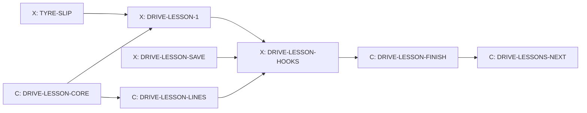
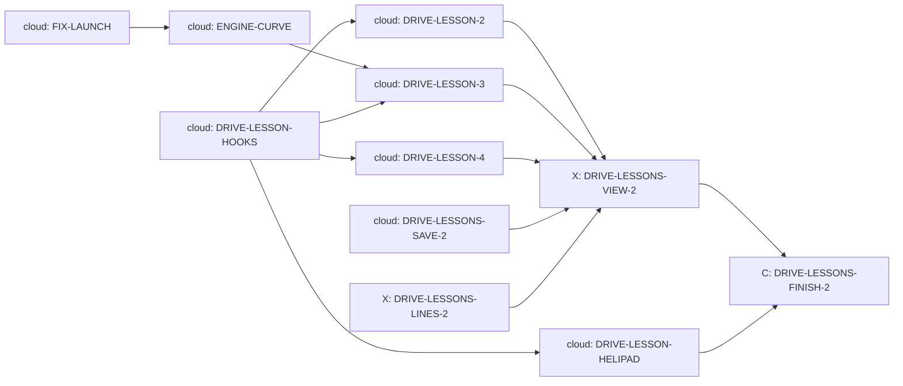

# Driving lessons

Design packet D1 for Cockpit task T-040, written 14 October 2026 by Claude
from Kyle's storyboard ("Helicopter Storyboard Ideas", sections "First
driving lesson: the sharp corner" and "Lessons stay open"). It settles
lesson 1, the sharp corner, enough to build, and the shared lesson pieces
it takes from the helicopter's lessons (H1). Lessons 2 to 4 and the helipad
entry are packet D2, section 12 (24 October 2026). The
cards are in section 10; Kyle's answer on the reward is in section 11.
Sections 4 and 5 are written for the builder.

## 0. What the game does today (checked on integration 5047d6ff)

- **Helicopter lessons exist** (`docs/HELICOPTER.md` section 7). The
  instructor is the stock voice Brian, recorded clean and played through a
  radio filter (`createRadioChain` in `src/heli/heli-audio.js`; voice and
  lines in `src/heli/heli-radio-lines.js`). `src/heli/heli-lessons.js`
  checks each lesson's goal every step and answers "running", "passed" or
  "try again" with a radio line; `lessonOpen(done, id)` opens a lesson when
  the one before it is done; a coach timer stops the instructor nagging.
  The instructor's board (`lessonsMarkup` in `src/heli/heli-ui.js`) shows
  on the home pad and lists each lesson as open, done ("Retake") or later.
  Lessons are saved as `profile.heli.lessons`. `tools/test-heli-mode.mjs`
  checks that helicopter files import only each other and a short list of
  outside files.
- **Which sharp corners can teach sliding.** A car can turn at most
  1.35 radians a second (`src/config.js`), so its tightest circle is about
  10 m whatever its speed. Harbour Lights' Lantern Hairpin (9 m radius) is
  tighter than that: the steering, not the tyres, sets its speed, and
  coming in too fast only runs wide without a slide. A lesson about tyre
  grip needs a corner where the tyres are the limit and the approach is a
  long straight. Two owned-course hairpins fit:
  - **Panorama Ridge, The Cutting:** 110 degrees at a 20 m radius, about
    55 mph, at the end of the 912 m Mountain Straight, the Griffin Bend
    (a 110 m radius) and a 142 m straight. A big stop from high speed.
  - **Tremblant Woods, Beaver Hairpin:** 170 degrees at 22 m, about 57 mph,
    after Beaver Kink and an 80 m spur. A smaller stop.
  Tremblant Snow's Beaver Hairpin is on snow (lesson 4's place). Panorama's
  Forrest Elbow (22 m) can join later as one more row. The classic courses
  have no corner tighter than about 200 m radius. Panorama Ridge and
  Tremblant Woods cost 1,600 credits each; Pacific Canyon, the free course,
  has no hairpin.
- **Time Trial** is `startCampaign` with `mode: 'timetrial'` and no rival;
  `startHeliVisit` (`src/game.js` about 253) already starts one that way.
- **Upgrades**: seven per car, three levels each, 350, 600 and 950 credits.
  Brakes add 12% braking per level (`src/game.js:158`).
- **Ghosts** replay recorded positions, not key presses (`src/ghost.js`).
- **TYRE-SLIP** (card ready, dev switch `tyre-slip`) makes sliding cost
  grip and speed, adds `s.tyreSlip` (1.0 is the tyre's best grip), makes
  braking while turning leave 80% of the cornering grip, and makes the tyre
  squeal follow the real slide. Without it a screech costs nothing, so
  lesson 1 cannot teach the truth until it is built.

## 1. Kyle's decisions

- The instructor teaches over the radio: Brian, the same voice and the same
  scratchy radio as the helicopter lessons.
- Lessons stay open: go back to the instructor any time to retake one; new
  lessons unlock as you go. The same idea works for driving: braking before
  a corner, the racing line, the manual gearbox, driving on snow.
- Lesson 1, on a sharp hairpin of a course you own: three cones (where to
  brake, the inside of the corner, where to finish on the outside). First
  try: brake late; the tyres screech, the car slides wide, and the
  instructor shows the screech. Second try: brake at the first cone,
  turn in, touch the inside cone, accelerate out wide past the third.
  Challenge: beat the instructor's time through the corner three times in a
  row. That unlocks the next lesson and a brake upgrade.
- Sliding costs grip like real tyres (TYRE-SLIP), so a long screech means
  the tyres are past their grip.
- One keyboard; players take turns.

## 2. One instructor, one board, one voice (what is reused from H1)

Driving lessons do not build a second lesson system. Three pieces move out
of `src/heli/` into a small shared folder `src/lessons/`. The helicopter
keeps every name and behaviour it has today, so its tests pass; the one
test that changes is the helicopter import check, which gains
`../lessons/` (a reviewed changed assertion).

| Shared piece | Moves from | What both use it for |
| --- | --- | --- |
| `src/lessons/lesson-core.js` | the general parts of `heli-lessons.js` | The answer each step gives ("running", "passed" or "try again" plus a radio line id); `lessonOpen(order, done, id)`; the coach timer (at most one coaching line every 6 s); `passed(lesson, line)` and `retry(lesson, line)`, which take the radio line as an argument. `heli-lessons.js` keeps its own two-argument `lessonOpen(done, id)`, which calls the shared one with its order, and its own pass and retry lines. |
| `src/lessons/radio-voice.js` | `createRadioChain`, `RADIO_FILTER`, `softClipCurve`, `HELI_RADIO_VOICE` | Brian over the same radio filter, click and hiss. `heli-audio.js` and `heli-radio-lines.js` re-export these names, so nothing that imports them changes. |
| `src/lessons/lesson-board.js` | the list part of `lessonsMarkup` | The instructor's list: plain rows (group, id, name, open, done) in, the list out. The helipad keeps its own check that you are on the home pad, the running-lesson panel and the skip button in `heli-ui.js`. Styles move with it to `src/lessons/lesson-board.css`. |

What stays separate: the helicopter's goal checks, session and save field;
driving's goal checks (section 4), lesson run (section 5) and save field
(section 7).

**Where you meet the instructor.** In D1, on a new **Instructor** button on
the main menu, shown when both the `driving-lessons` and `tyre-slip`
switches are on. It opens the board with the Driving group. Driving lessons
never need the helicopter. Showing the Driving group on the helipad too
(and starting a driving lesson from the pad like "Race here") touches the
helicopter's session and screen, which are Claude's; it comes after lesson
1 is played, in the cards that DRIVE-LESSONS-NEXT writes.

## 3. Lesson 1, the sharp corner

### 3.1 Where

The lesson runs on a course you own that has a lesson corner; the board
lists them and you pick:

| Course | Corner | Start gate | Rolling start |
| --- | --- | --- | --- |
| Panorama Ridge | The Cutting | 180 m before turn-in, leaving Griffin Bend | 100 mph |
| Tremblant Woods | Beaver Hairpin | 75 m before turn-in, on The Spur after Beaver Kink | 75 mph |

Panorama Ridge is first in the list (the longer, faster approach makes the
lesson clearest). If you own neither, lesson 1 shows "Opens later: buy
Panorama Ridge or Tremblant Woods". A later corner joins by adding one row
to the lesson corner table, not by changing the lesson. The course's own
braking boards stay where they are; the instructor's first line tells you
to watch the cones today.

### 3.2 The run

A lesson run is a Time Trial on that course with no rival, no traffic, no
police and no combat. It never pays credits, sets records, saves ghosts or
counts toward medals, and a crash costs no repair. Tyre slip rules are
always on in a lesson run (it teaches what TYRE-SLIP makes true). Your own
car, its upgrades and your Casual or Pro setting are used.

Each attempt is short: the car appears at the start gate already rolling
at the table's speed, you drive through the corner, and the attempt ends at
the finish gate, 60 m past the exit cone. The time is from gate to gate, to
a hundredth of a second. Between attempts the result card shows; Enter
starts the next one at the start gate again. Pause (Esc) has a Leave lesson
button. Except in try 1 (3.4), a wall hit, going off the road for more than
1 s, or stopping ends the attempt as "try again".

### 3.3 The instructor's run, the cones and the red board

Everything is computed when the lesson starts, from one run of the
instructor through the same corner that the player does not see, in **your**
car with your upgrades and setting, so the target is always fair and always
repeatable:

- The instructor follows the course's planned racing line at **92%** of
  the speed that line allows on Casual and **97%** on Pro (whichever limit
  sets it, steering or tyres), braking in a straight line and never sliding
  (TYRE-SLIP's `steerForYaw`, which never asks for more than the tyre's best
  grip). Its gate-to-gate time is the **instructor's time**.
- **Cone 1, brake here:** where the instructor starts braking, on the
  outside edge of the road.
- **Cone 2, the inside:** at the instructor's closest point to the inside
  edge, on that line.
- **Cone 3, finish wide:** where the instructor's line reaches the outside
  edge after the apex.
- **The red board** (try 1 only): **25 m after cone 1**, the same late
  braking point TYRE-SLIP's own test uses, but never past the turn-in
  point. On The Cutting it stands 25 m late, before turn-in. On Beaver
  Hairpin the board stays 25 m after cone 1, capped at turn-in. The 26 October
  keyboard fix starts after Beaver Kink; the brake cone is recomputed for
  that straight approach. See `docs/changes/DRIVE-LESSON-FINISH.md` for the
  measured keyboard tries.

Cones are drawn only; they never touch race physics. A cone "counts" when
the car's centre passes within 2.5 m of it; driving right over it (within
0.8 m) tips it over in the drawing and plays the cone sound. The
instructor's own run must count all three cones.

### 3.4 Try 1: brake late

Instructor: "Let us see what happens when you leave it late. Keep your foot
down and brake at the red board." The red board and the cones show. The
try counts however it ends: at the finish gate, against a wall, or off the
road. The result card shows your time against the instructor's (or how far
you got), the time lost, and how long the tyres screeched (seconds with
`s.tyreSlip` above 1.0), for example: "You 8.42 s. Instructor 7.31 s. Lost
1.11 s. Tyres screeched 1.6 s." Then the car goes back to the start gate.
If you braked early anyway, the instructor says so and the try still counts.

### 3.5 Try 2: do it right

Instructor: "Now the right way. Brake hard at the first cone while the car
is straight, turn in, touch the inside cone, and accelerate out wide past
the third." It passes when all four hold:

1. **Braked at cone 1:** the first brake press of 50% or more comes no more
   than 15 m before and 5 m after cone 1 (the red board is 25 m after).
2. **Touched cone 2.**
3. **Finished wide:** throttle at 80% or more before cone 3, and the car
   passes cone 3 on the outside half of the road.
4. **No long screech:** `s.tyreSlip` above 1.0 for less than 0.3 s in total.

A miss gets one coaching line naming the first rule that failed, then
another go. There is no limit on goes.

### 3.6 The challenge: beat the instructor three times in a row

Instructor: "Good. Now beat my time through the corner. Three in a row."
The instructor's car runs beside you as a ghost (drawn with the existing
ghost drawing from its recorded positions). An attempt faster than the
instructor's time adds one to the streak; a slower attempt or one that ends
as "try again" resets it to 0. The cones stay as a guide but are not
checked. Three in a row passes the lesson.

### 3.7 What passing gives

- Lesson 2 (the racing line) opens.
- **A brake upgrade:** one free brake level on the car you passed in, or
  600 credits if that car's brakes are already at level 3 (Kyle, 14
  October 2026; section 11).
- The board shows the lesson as done, with your best margin over the
  instructor ("Best: 0.42 s faster"). Retaking it never pays again.

### 3.8 Why this teaches the truth

On both lesson corners the tyres, not the steering, set the corner speed.
With TYRE-SLIP, braking at the red board leaves you two bad choices: keep
braking into the turn, or turn in too fast. Braking while turning leaves
only 80% of the cornering grip, so the tyres go past their best grip, slide,
run wide and rub off speed; the screech is that slide. Turning in too fast
without braking runs wide; on the keyboard it does not slide by itself,
because a held key never steers harder than today (TYRE-SLIP amendment 5),
so the screech in the late try comes from braking into the turn. The
lesson's own test (section 10) requires the late try to screech at least
0.5 s on both corners and its radio line to play; TYRE-SLIP's test 8 checks a
similar late entry. Without TYRE-SLIP there would be no screech at all, which
is why lesson 1 waits for it. Sliding throws away grip; brake at the board
and the car turns in clean. Measured (24 October 2026): on these tyres a late
entry costs screech, not time (the late try finishes 0.4 to 0.6 s *faster*
than the instructor until it hits the wall), so the lesson never promises a
time loss; the result card shows the actual numbers.

## 4. Lesson rules (for the builder: `src/lessons/drive-lessons.js`)

The driving goal checks follow the shared answer from `lesson-core.js`.
`createDriveLesson(id, {corner, instructor})` and `stepDriveLesson(lesson,
view, events, dt)` read a plain picture of the car each 120 Hz step
(distance along the course, lateral position, speed, brake, throttle,
`tyreSlip`, contact events) and answer "running", "passed" or "try again"
with a radio line id. The module also holds the lesson corner table (3.1),
the instructor's run, `placeCones(corner, instructorRun)` and the attempt
timer. It reads race state and never changes it, like drift scoring.

**The instructor's run** belongs to this module (DRIVE-LESSON-1): a run of
the race rules from the start gate, in the player's car, steering along the
course's planned racing line (`src/track-script.js` and the line the course
builds from `src/course.js`) through `steerForYaw`, with a speed plan at
92% or 97% of the speed the line allows and braking in a straight line. It
records positions (for the ghost) and the path (for the cones). It does not
use the App autopilot.

## 5. The lesson run in the game (for the builder: the hooks card)

- `startLesson({courseId, lessonId, car, difficulty})` starts a Time Trial
  through `startCampaign` with lesson options. The options turn off rival,
  traffic, police, combat, pay, records, ghost saving, medals and damage
  cost, and fix `tyreSlipRules` on for the race.
- It asks `drive-lessons.js` for the instructor's run and the cones once,
  at the start.
- Placing the car at the start gate for each attempt uses the existing safe
  reset, with the rolling speed set; the attempt timer starts at the gate.
- Cones, the red board and the instructor's ghost are drawn by the renderer
  from the lesson's lists; the result card and the lesson panel (try, rules
  met, streak 0/3) are screen elements like the race HUD. None of it
  changes race state.

## 6. Sounds and radio lines

- **Radio** (Brian, through `src/lessons/radio-voice.js`): 15 lines, below. Lessons 2 to 4 and the true late-try lines add 32 more (12.7).
  Each kept take is recorded with the same voice and settings as the
  helicopter's lines, kept in `audio-src/voices/`, recorded as one entry in
  `tools/audio/catalog.json` (text, file and hash), and copied to
  `public/assets/audio/voices/` by a small build step, within the month's
  voice credits. Ids are `drive.radio.<lesson>.<step>`. Lines never name
  times or prices; the card shows numbers.
- **Cone tipped:** new cue `lesson.cone`, a soft plastic knock, a CC0
  library sound recorded in `tools/audio/catalog.json`.
- **Streak and pass:** the existing interface confirm sound; no new cue.
- **Tyres:** TYRE-SLIP's squeal, unchanged. The lesson adds nothing to it.

| Id | Line |
| --- | --- |
| `drive.radio.corner.intro` | Welcome to the track. Today is the most important corner skill there is: braking. Forget the course boards today and watch my cones. |
| `drive.radio.corner.late.start` | Let us see what happens when you leave it late. Keep your foot down and brake at the red board. |
| `drive.radio.corner.late.early` | You braked early. Good instinct, but this time I wanted you to feel it. That one still counts. |
| `drive.radio.corner.right.start` | Now the right way. Brake hard at the first cone while the car is straight, turn in, touch the inside cone, and accelerate out wide past the third. |
| `drive.radio.corner.coach.brake` | Brake at the first cone. Not before, not after. |
| `drive.radio.corner.coach.inside` | Get closer to the inside cone. Use the whole road. |
| `drive.radio.corner.coach.exit` | Back on the gas sooner, and let the car run out wide. |
| `drive.radio.corner.coach.screech` | I heard the tyres. Brake a little earlier and keep it smooth. |
| `drive.radio.corner.right.pass` | That is it. Quiet tyres, clean line, and quicker too. |
| `drive.radio.corner.challenge.start` | Good. Now beat my time through the corner. Three in a row. |
| `drive.radio.corner.challenge.one` | That is one. Again. |
| `drive.radio.corner.challenge.two` | Two. One more. |
| `drive.radio.corner.challenge.reset` | Not that time. Back to zero. You know how. |
| `drive.radio.corner.pass` | Three in a row. You have earned better brakes, and the next lesson is open. |
| `drive.radio.retake` | Back for more? Good. Practice is how the fast drivers got fast. |

The late try plays `drive.radio.corner.late.slid` after a screech of at least 0.5 s,
`drive.radio.corner.late.off` when it ends against a wall or off the road, and
`drive.radio.corner.late.early` if it braked early (12.7). The old
`drive.radio.corner.late.result` promised lost time, which the tyres do not
cost; it is removed.

## 7. The save (`save-shape`)

Optional `profile.drivingLessons` =
`{version: 1, done: {corner}, best: {corner}, rewarded: {corner}}`:
`done` and `rewarded` are true or false, `best` is the best margin over the
instructor in seconds (a number or null). Later lessons add keys (`line`,
`gears`, `snow`) to the same three maps. One line in `normalizeProfile`, a
fixture `tools/fixtures/saves/11-driving-lessons.json`, and the save
checker. An old save without the field reads as no lessons done. Nothing
else in the profile changes, except the reward (one brake level or the
credits) when lesson 1 first passes.

## 8. Switch, files, locks

- **Switch:** `driving-lessons: 'dev'` in `src/feature-flags.js`; the count
  in `tools/test-feature-flags.mjs` rises by one. It never turns on before
  `tyre-slip` is on.
- **New files:** in `src/lessons/`: `lesson-core.js`, `radio-voice.js`,
  `lesson-board.js`, `lesson-board.css`, `drive-lessons.js`,
  `drive-lesson-save.js`, `drive-radio-lines.js`, `drive-lesson-ui.js`,
  `drive-lesson-ui.css`. Tests: `tools/test-heli-lesson-core.mjs`,
  `test-drive-lessons.mjs`, `test-drive-lesson-save.mjs`,
  `test-drive-lesson-run.mjs`, and a browser scenario. Audio: takes in
  `audio-src/voices/`, the build step `tools/audio/build-drive-lessons.mjs`,
  runtime files in `public/assets/audio/voices/`.
- **Styles:** the shared board's styles are imported from
  `src/screen-router.js` by DRIVE-LESSON-CORE, so the helipad board keeps
  its look from the first card; the hooks card adds only the lesson
  screen's own styles.
- **Locks:** `busy-game-files` once, in the hooks card (`app.js`,
  `game.js`, `render3d.js`); `save-shape` in the save card; `sound-bank` in
  the lines card (one line maps the driving cue list, as the helicopter's
  does). The shared-pieces card moves helicopter code, so it is Claude's
  (the Flying line is Claude's) and needs no lock.
- **Not touched:** race physics (TYRE-SLIP owns it), replays, world
  signatures, course registry, mastering. Race replays and world signatures
  stay identical.

## 9. Lessons 2 to 4

Settled in section 12 (packet D2, 24 October 2026): the racing line, the
gearbox (with ENGINE-CURVE) and snow, plus the helipad entry. The Lantern
Hairpin, too tight for tyre grip to matter, still suits a later lesson on
slow corners and patience.

## 10. Cards and order

| Card | Who | Holds | What |
| --- | --- | --- | --- |
| DRIVE-LESSON-CORE | Claude | none | Section 2: move the three shared pieces out of `src/heli/`, helicopter unchanged |
| DRIVE-LESSON-SAVE | Codex | `save-shape` | Section 7 and the reward function in 3.7 |
| DRIVE-LESSON-1 | Codex | none | Sections 3 and 4: the lesson rules, corner table, instructor's run, cones, tests |
| DRIVE-LESSON-LINES | Claude | `sound-bank` | Section 6: record the lines, the cone sound |
| DRIVE-LESSON-HOOKS | Codex | `busy-game-files` | Section 5 and the menu board: Instructor button, lesson run, drawing, panel |
| DRIVE-LESSON-FINISH | Claude | none | Drive the lesson as a player, check it teaches, pictures to Kyle |
| DRIVE-LESSONS-NEXT | Claude | none | Packet for lessons 2 to 4 and the helipad entry (sections 2 and 9) |

DRIVE-LESSON-CORE and DRIVE-LESSON-SAVE start at once. DRIVE-LESSON-1 waits
for TYRE-SLIP.

**Acceptance for D1:**
- With `driving-lessons` and `tyre-slip` on and Panorama Ridge owned, a
  player can open the Instructor board from the main menu, take lesson 1,
  do the late try, pass the right way and beat the instructor three times;
  the reward lands once; lesson 2 shows as open; retaking works.
- `tools/test-drive-lessons.mjs`, on both corners, Casual and Pro, without
  drawing: the instructor's run is the same every time and at 30, 60 and
  144 FPS, and it counts all three cones; a scripted late try (brakes at the
  red board and keeps braking until it is down to the instructor's corner
  speed, steering for the line with up to full steering, not held to the
  tyre's best grip) screeches at least 0.5 s and its radio line plays
  (Claude's reviewed change, 24 October 2026: the old "0.25 s slower or ends
  against the wall" clause is gone, since late braking costs no time on these
  tyres); a scripted right try passes
  all four rules; a scripted driver at 100% of the line's speed beats the
  instructor; the streak resets on a slow attempt; nothing in a lesson run
  pays, records or damages.
- The helicopter's lesson, session, audio and screen tests pass; the only
  changed assertion is the import check's allowed list.
- Race replays, world signatures and combat balance unchanged (lane guards).
- The save checker passes with the new fixture; old saves read as no
  lessons done.
- DRIVE-LESSON-FINISH: Claude plays it on the keyboard on Casual and Pro;
  the release waits for Kyle's word, after or with TYRE-SLIP's.

## 11. Kyle's answer (14 October 2026)

"Sure, that's fine. A brake upgrade or 600." Passing lesson 1 gives one
free brake level on the car you passed it in, or 600 credits if that car's
brakes are already at level 3. The question as it was asked:

**What should "a brake upgrade" be?** Recommended: passing lesson 1 gives
one free brake level on the car you passed it in (worth 350 to 950
credits), or 600 credits if those brakes are already maxed. It fits the
upgrade system as it is and changes no race balance. The other choice is a
new fourth brake level that only the lesson opens, then bought with
credits; it needs save and balance work and makes the player brake harder
than the computer racers expect.

## 12. Lessons 2 to 4 and the helipad (packet D2, Claude, 24 October 2026)

Written before lesson 1 was played, at Kyle's word of 24 October ("the
driving lessons too"). Each lesson keeps lesson 1's shape: a wrong try that
shows the problem, a right try with rules, then beating the instructor three
times in a row. Everything in section 3.2 (the lesson run) and 3.3 (the
instructor's own run in your car at 92% or 97%) holds unless a lesson says
otherwise. Lesson runs use tuning 0 (`docs/LAB.md` 5) and never pay, record
or damage.

### 12.1 What lesson 1 taught us (and what is true in the game)

- **Braking late costs screech, not time,** on these tyres (DRIVE-LESSON-1,
  24 October). So a lesson may promise only what the game really does; each
  lesson below has a test that proves its claim in Node before it ships.
- **Gears do not matter in today's game.** In `src/sim-driving.js` a gear
  only caps speed: pull falls off above half revs in any gear, and nothing
  makes an engine weak at low revs. A car in top gear pulls from 20 mph as
  hard as in first, and changing up early is never slower. "Shift near the
  red line" would be untrue. Lesson 3 therefore waits for ENGINE-CURVE
  (12.5), the same way lesson 1 waited for TYRE-SLIP.
- **Snow is real in the game:** packed snow grips 0.7 and summer tyres keep
  75% of that, so summer tyres on snow have about half their dry grip and
  need about twice the road to stop; winter tyres keep all of the 0.7.
  Tremblant Snow has an ice patch on the spur before Beaver Hairpin.

### 12.2 Lesson 2, the racing line

| Course | Corners | Start gate | Rolling start |
| --- | --- | --- | --- |
| Tremblant Woods | Fir Esses 1 and 2 (55 and 60 m radius) | 150 m before Fir Esses 1 | the instructor's speed there |
| Harbour Lights | Old Town Esses 1 to 4 (30 to 41 m) | 150 m before Esses 1, on the 192 m straight | the instructor's speed there |

- **The idea (true):** through linked corners the fastest way is not the
  middle of the road. A line that uses the whole width is a gentler curve,
  and a gentler curve can be taken faster, because the speed a tyre can hold
  in a corner grows with the corner's radius.
- **The instructor's line** runs from the outside edge through an apex cone
  on the inside of each corner (1.0 m in from the edge) and out to an exit
  cone on the outside after the last corner (1.5 m in), using the smooth-line
  steering that lesson 1 built.
- **Try 1, the middle:** a row of small markers down the middle of the
  road. "Stay on the markers." It counts however it ends; the card shows
  your time against the instructor's.
- **Try 2, the line:** passes when every apex cone is touched, the exit cone
  is passed on the outside half of the road, and the tyres screech for less
  than 0.3 s in total.
- **Challenge:** beat the instructor three in a row.
- **Passing gives:** lesson 3 opens; one free handling level on that car, or
  600 credits if it is already at level 3.
- **Proof before it ships:** in Node, a scripted driver on the middle line at
  the most speed that line allows is at least 0.3 s slower than the
  instructor through each row's corners. A row that fails is dropped (the
  board names the other course); if both fail, stop and report the numbers.

### 12.3 Lesson 3, the gearbox (needs ENGINE-CURVE)

| Course | Stretch | Start | Finish |
| --- | --- | --- | --- |
| Panorama Ridge | Mountain Straight into The Cutting | 30 mph in 2nd at the start of the straight | 60 m past the exit cone |
| Tremblant Woods | Beaver Run into Beaver Hairpin | 30 mph in 2nd, 400 m before the hairpin | 60 m past the exit cone |

- **The run is always manual,** on Casual too (Casual goes back to the
  automatic box afterwards). E changes up, Q changes down. The rev counter
  gets a green mark at half revs and three shift lights from 90%.
- **The idea (true with ENGINE-CURVE):** an engine pulls weakly at low revs
  and hardest high up, and a lower gear multiplies its pull. Change up as the
  lights come on near the red line; change down while braking, so you leave
  the corner in a gear where the engine pulls.
- **Try 1, change up early:** "Change up as soon as the needle passes the
  green mark." Counts however it ends.
- **Try 2, the right way:** passes when every upshift comes at 90% revs or
  more, the engine sits on the limiter for under 0.5 s in total, the car
  passes the exit cone in the instructor's gear, and no long screech. The
  braking and apex cones are lesson 1's, as guides.
- **Challenge:** beat the instructor three in a row (the instructor shifts
  at the lights).
- **Passing gives:** lesson 4 opens; one free engine level, or 600 credits.
- **Proof before it ships:** in Node, with ENGINE-CURVE on, the early-shift
  try is at least 0.3 s slower than the instructor on both rows, and a run in
  too high a gear out of the corner is slower than the instructor's gear.
- **As built (DRIVE-LESSON-3):** the rules, instructor and tests are in `src/lessons/drive-lessons.js` and
  `tools/test-drive-lesson-3.mjs`. The run is Lesson 1's line from the new gate. Both stretches have a bend in
  the middle (Griffin Bend, Beaver Kink). The gear rule is measured at the apex cone (no higher than the
  instructor) as well as at the exit cone (his gear or the next one up); see `docs/changes/DRIVE-LESSON-3.md`
  for the proof numbers.

### 12.4 Lesson 4, snow

| Course | Corner | Start gate | Rolling start |
| --- | --- | --- | --- |
| Tremblant Snow | Beaver Hairpin (with the ice patch on the spur before it) | 150 m before Beaver Kink | the instructor's speed there on summer tyres |

- **Summer tyres** for tries 1 and 2 and the challenge; the instructor's run
  is on summer tyres too.
- **The idea (true):** on snow the tyres have about half the grip they have
  on a dry road, so you brake about twice as far back, turn in gently and
  feed the power in. On ice, do the braking before it, never on it.
- **Try 1, the dry board:** a red board where the instructor would brake on
  a dry road. "Brake at the dry board." It counts however it ends.
- **Try 2, the snow way:** the snow cone (the instructor's braking point on
  snow), the inside cone and the exit cone. Passes when braking starts within
  15 m before to 5 m after the snow cone, brake pressure stays under 20%
  while on the ice, the inside cone is touched, and no long screech.
- **Challenge:** beat the instructor three in a row on summer tyres.
- **Then one run on winter tyres,** against the instructor's winter time; it
  passes however fast it is. Brian explains why it felt different.
- **Passing gives:** one free tyre level, or 600 credits. This is the last
  driving lesson for now.
- **Proof before it ships:** in Node, the dry-board try screeches at least
  0.5 s or leaves the road; the winter instructor is faster than the summer
  instructor.

### 12.5 ENGINE-CURVE: engines that pull like real ones

A switch `engine-curve` (dev), latched per race and recorded in the race
setup like `tyre-slip`, so old replays play under their own rules.

- **Shape:** the engine's pull at the wheels is its pull at those revs times
  the gear's multiplication (a lower gear multiplies more). The engine's pull
  is weak at low revs (under 55% of its best below 30% revs), strongest
  around 70 to 80% and a little lower at the red line (about 88% of its best),
  and the limiter cuts the throttle at 100%. The launch stays inside
  FIX-LAUNCH's traction limit (the tyres, not the engine, limit a launch).
- **What must stay the same:** the automatic box changes up at 96% to 100%
  revs and down so the revs after are at most 90%; with it, every car's
  0 to 60 mph, 0 to 100 mph and a lap of three circuits stay within 2% of
  today's (FIX-LAUNCH's figures). Computer cars use the automatic points, so
  race times stay within 2%. Switch off: byte for byte as today.
- **What changes:** in the manual box (Pro), changing up early or sitting in
  too high a gear is now slower, and changing up at the lights is as quick as
  the automatic.
- **Proof:** a scripted manual driver shifting at 50% revs is at least 5%
  slower from 0 to 100 mph; a car held in top gear from 30 to 60 mph takes at
  least twice as long as the automatic box.

### 12.6 The helipad entry

- **The board:** the instructor's board on the helipad shows the Driving
  group under the Flying group (the shared `lesson-board.js` already draws
  groups).
- **Starting from the pad:** choosing a driving lesson there starts it the
  same way the main menu's Instructor button does, in the car standing at the
  pad. A special car that travels only by air can take a lesson only on the
  course where it was last set down; the row says "Your <car> is at
  <course>".
- **Lesson here:** after you set your own car down on an owned course that
  has a lesson row, the session offers "Lesson here" for the next open
  lesson on that course, beside "Race here".
- Driving lessons still never need the helicopter.

### 12.7 Lines (Brian, over the radio)

Ids `drive.radio.<lesson>.<step>`; lesson 1's challenge lines (`one`, `two`,
`reset`) and `retake` are reused. Lines never name times or prices.

| Id | Line |
| --- | --- |
| `line.intro` | Lesson two: the racing line. Through linked corners, the fastest way is not the shortest. |
| `line.middle.start` | First, stay in the middle of the road. Follow the markers. |
| `line.middle.result` | Felt tight, didn't it? The middle of the road makes every bend sharper, so you have to go slower. |
| `line.right.start` | Now use the whole road. Start wide, touch each inside cone, and let the car run out wide between them. |
| `line.coach.apex` | Closer to the inside cone. Use every bit of road. |
| `line.coach.early` | You turned in too early and ran out of road. Wait a moment longer, then turn. |
| `line.right.pass` | Feel how straight that was? A wider line is a gentler curve, and a gentler curve is a faster one. |
| `line.challenge.start` | Now beat my time through the esses. Three in a row. |
| `line.pass` | Three in a row. Better handling for your car, and the next lesson is open. |
| `gears.intro` | Lesson three: the gearbox. Today you change gear yourself. E is up, Q is down. |
| `gears.early.start` | First, change up as soon as the needle passes the green mark. |
| `gears.early.result` | Sluggish, wasn't it? An engine is weak at low revs. Changing up early drops it below where it pulls. |
| `gears.right.start` | Now hold each gear until the lights come on, then change up. Change down while you brake, so you leave the corner in my gear. |
| `gears.coach.limiter` | That was the limiter. Change up when the lights come on, not after. |
| `gears.coach.down` | Too high a gear coming out. Change down while you brake. |
| `gears.right.pass` | Hear it pull out of the corner? That's the right gear. |
| `gears.challenge.start` | Now beat my time, changing gear yourself. Three in a row. |
| `gears.pass` | Three in a row. More power for your car, and the next lesson is open. |
| `snow.intro` | Lesson four: snow. On summer tyres you have about half the grip you have on a dry road. |
| `snow.late.start` | First, brake where you would on a dry road. The red board shows it. |
| `snow.late.result` | Half the grip means about twice the road to stop. That's why you ran out of corner. |
| `snow.right.start` | Now brake at the snow cone, gently. Do your braking before the ice, never on it. Then turn in smooth. |
| `snow.coach.brake` | Earlier. On snow, start braking at the cone. |
| `snow.coach.ice` | You braked on the ice. Brake before it, roll across it, then turn. |
| `snow.coach.turn` | Turn in more gently. Sudden steering on snow slides the front. |
| `snow.right.pass` | Smooth and early. That's how you drive on snow. |
| `snow.challenge.start` | Now beat my time, three in a row, on summer tyres. |
| `snow.winter.start` | Same corner, now on winter tyres. Feel the difference. |
| `snow.winter.result` | Winter tyres use softer rubber that stays grippy in the cold, and deep cuts that bite into the snow. |
| `snow.pass` | That's every driving lesson I have for now. Better tyres for your car. Well driven. |
| `corner.late.slid` | Hear that screech? Your tyres slid past their best grip, so the car could not steer or stop as well. You got away with it here. On snow you won't. |
| `corner.late.off` | That's where a slide takes you. Brake at the first cone, and keep it clean. |

The last two replace `drive.radio.corner.late.result`, which promised lost
time (DRIVE-LESSON-LATE-LINE): `late.slid` plays when the late try finishes
after at least 0.5 s of screech, `late.off` when it ends against a wall or off
the road, and `late.early` stays for an early brake. `late.result` is removed
from the catalogue and the voices folder in the same change.

### 12.8 Sounds

- **Shift lights:** `lesson.shift-light`, a short soft tick as each light
  comes on (three rising pitches). New cue.
- **Middle markers and cones:** the existing `lesson.cone` when one is hit.
- Everything else reuses lesson 1's sounds and the race's own engine,
  limiter and tyre sounds.

### 12.9 Save

`profile.drivingLessons` gains the keys `line`, `gears` and `snow` in its
`done`, `best` and `rewarded` maps (section 7 planned this). Old saves read
as not done. The reward functions give handling, engine and tyre levels the
same way lesson 1 gives brakes.

### 12.10 Cards

| Card | Owner | Holds | What |
| --- | --- | --- | --- |
| DRIVE-LESSON-2 | claude-cloud | none | 12.2: corner rows, the line, markers, cones, rules, proof |
| ENGINE-CURVE | claude-cloud | `busy-game-files` | 12.5, behind `engine-curve` |
| DRIVE-LESSON-3 | claude-cloud | none | 12.3: rows, manual run, shift rules, proof |
| DRIVE-LESSON-4 | claude-cloud | none | 12.4: snow row, dry board, ice rule, winter run, proof |
| DRIVE-LESSONS-SAVE-2 | claude-cloud | `save-shape` | 12.9 |
| DRIVE-LESSONS-LINES-2 | codex | `sound-bank` | 12.7 and 12.8: record the lines, remove `late.result`, the shift-light cue |
| DRIVE-LESSONS-VIEW-2 | codex | `busy-game-files` | Markers, apex cones, the green mark and shift lights, the snow and dry boards, the winter run, the board rows |
| DRIVE-LESSON-HELIPAD | claude-cloud | none | 12.6 in the helicopter's board and session |
| DRIVE-LESSONS-FINISH-2 | Claude | none | Drive all three as a player; pictures to Kyle |

DRIVE-LESSONS-LINES-2 takes over DRIVE-LESSON-LATE-LINE (its wording is
`corner.late.slid` and `corner.late.off` above).

## 13. Picked for Kyle (24 October 2026)

- Lessons 2 to 4 reward like lesson 1: one free handling, engine or tyre
  level on that car, or 600 credits when it is already at level 3.
- Lesson 3 waits for ENGINE-CURVE, which makes the manual gearbox matter in
  every race on Pro (the automatic box stays as quick as today). If Kyle
  would rather keep gears as they are, lesson 3 is dropped and lesson 4 opens
  after lesson 2.
- Lesson 4 is the last driving lesson for now; slow corners and patience
  (the Lantern Hairpin) can follow if Kyle and Gratian want more.

## 14. Lessons, second version (Claude, 27 October 2026, from Kyle's first play)

This section replaces sections 3.2 to 3.6 and the matching parts of 12.2 to
12.4 wherever they disagree. Section 3.7 (the rewards), 7 (the save), 12.5
(ENGINE-CURVE) and 12.6 (the helipad) stay.

### 14.1 What Kyle found (27 October, live build 26.10.27 02:01)

- **Lesson 1 at Panorama would not start** in his Koenigsegg Jesko: "The
  instructor could not complete a clean run. Instructor missed a native cone",
  shown as raw program text. Cause: the instructor drives every lesson in the
  player's own car, the cones are placed from that one run, and the run must
  then pass within 2.5 m of every cone. The tests drive only the Falcone. A
  faster, grippier car runs a slightly different line and misses two cones by
  about 0.2 m, so the lesson refuses to start.
- **The Beaver Hairpin lesson is too short and teaches too little.** About
  7 s; the car appears just before the corner at a crawl; nothing explains the
  lesson before you drive; there is no line to follow and no target speed on
  screen; the only help is one line of text after a miss.
- **Faster than the instructor, and still "Try again".** Kyle beat the
  instructor by 0.81 s on try 2 but braked outside the cone 1 window. Nothing
  on screen said try 2 is judged on the braking point, not on time.
- Kyle: "the lessons should be more than just one tiny snippet ... a few
  curves as the lesson so the race is more realistic and get more practice";
  "there should be a line we should take at the speed we should take"; "the
  ideal target metrics on screen, just like our speed is on screen".

### 14.2 What changes

1. **A lesson is a real piece of road:** 30 to 70 s of driving and 3 to 9
   corners, starting on a straight at race speed with at least 6 s of road
   before the first braking point.
2. **Every lesson explains itself before you drive:** a briefing card with a
   map of the section, the line, the brake zones and the target speeds, the
   steps, and exactly what passes each one.
3. **The targets are on screen while you drive:** the line painted on the
   road, the brake zones painted on the road, a target speed box beside the
   speedometer, a live gap to the instructor, and one light per corner.
4. **Four steps, always on screen:** Watch me, Follow me, Your turn, Beat me.
   Each step says what counts in it.
5. **Fair rules.** A clean run that beats the instructor always passes "Your
   turn". "Three in a row" becomes one clean run faster than the instructor
   over the longer road; a run a second or more faster earns a gold mark.
6. **The instructor works in every car.** Brake zones and cones come from his
   planned line, not from where one simulated run happened to pass. Every car,
   both settings and every row are tested. If a lesson still cannot start, the
   screen says so in plain words.

The late-braking try from Kyle's storyboard stays, as something you **watch**
rather than a run you must drive badly on purpose: in Watch me the instructor
takes the first big corner late once (screech, runs wide), then drives the
whole section properly.

### 14.3 The sections

| Lesson | Course | From | To | Corners |
| --- | --- | --- | --- | --- |
| 1 Braking | Panorama Ridge | 350 m before Griffin Bend, on Mountain Straight | 60 m past Forrest Elbow | Griffin Bend, The Cutting, Reid Rise, Summit Park, Skyline, The Esses 1 to 3, Forrest Elbow |
| 1 Braking | Tremblant Woods | 100 m into Beaver Run | 60 m past Final Turn | Beaver Kink, Beaver Hairpin, Devil's Chicane 1 and 2, Lodge Bend, Final Turn (14.12) |
| 1 Braking | Ardennes Forest | start of Kestrel Straight | 60 m past Fagnes Exit | Les Combes, Combes Exit, Malmedy, Riverside, Woodland Left, Fagnes, Fagnes Exit (14.13) |
| 2 Racing line | Tremblant Woods | 250 m into Lodge Straight | end of Ridge Run | Pine Drop, Lakeside Plunge, Fir Esses 1 and 2 |
| 2 Racing line | Harbour Lights | 150 m before Casino Corner | end of Hillside | Casino Corner, Temple Hill, Bell Tower Bend, Old Town Esses 1 to 4 |
| 2 Racing line | Ardennes Forest | 200 m into Woodland Left | 130 m past Whitewood | Long Left, Fagnes, Fagnes Exit, Campus, Stavelot, Woodcutter, Whitewood (14.13) |
| 3 Gearbox | Panorama Ridge | Hell Gate exit, 30 mph in 2nd | 60 m past Summit Park | Griffin Bend, The Cutting, Reid Rise, Summit Park |
| 3 Gearbox | Tremblant Woods | Ridge Corner exit, 30 mph in 2nd | 150 m into Timber Straight | Beaver Kink, Beaver Hairpin |
| 3 Gearbox | Summit Run | start of Pine Switchbacks, 30 mph in 2nd | 60 m past Engineer Bend | Picnic Hairpin, Picnic Bend, Engineer's Hairpin, Engineer Bend (14.13) |
| 4 Snow | Tremblant Snow | start of Ridge Run | 150 m into Timber Straight | Ridge Corner, Beaver Kink, the ice on The Spur, Beaver Hairpin |
| 4 Snow | Summit Run | 250 m into Whiteout Crest | 250 m into Devil's Staircase | Whiteout Bend, Gallery Bend 1, Gallery Bend 2, the ice after Whiteout Bend (14.13) |

- The rolling start is the instructor's own speed at that point (lessons 1, 2
  and 4), so the car arrives at race speed.
- The builder measures each row in the Falcone and the Jesko. A row shorter
  than 30 s or longer than 75 s is trimmed or extended by whole corners; the
  change note records the times.
- Each corner is one of three kinds, read from the instructor's plan:
  **brake** (he brakes), **lift** (he only comes off the throttle) or **flat**
  (neither). Lesson 1's two hairpins are its main corners; the fast sweepers
  between them teach that not every corner needs the brakes.

### 14.4 The four steps

A strip across the top of the screen shows **1 Watch me · 2 Follow me · 3 Your
turn · 4 Beat me** with the current step lit. One line under it says what
counts in this step.

1. **Watch me.** The game drives your car through the section with the
   instructor's own inputs while the camera follows, as in a race (a race is
   repeatable from its seed and inputs, so this is his run exactly). Lesson 1
   first shows the late try: he brakes 25 m late at the first brake corner and
   the clip stops where the car slides wide or leaves the road. Then he drives
   the whole section cleanly. Captions mark each corner ("Braking now: 128
   down to 56 mph"). Enter skips; on a retake the step starts skipped.
   Counts: nothing.
2. **Follow me.** You drive. The instructor is a ghost about 1 s ahead and
   every guide is on (14.5). It ends at the finish with the result card
   (14.6). Counts: nothing. One run, then the next step; retakes skip it.
3. **Your turn.** Guides on, no ghost. It passes when the run is **clean** (no
   wall hit, never off the road for more than 1 s, less than 0.3 s of screech
   in total) **and** either every corner's checks are met or you beat the
   instructor's time. The line under the strip says exactly that: "Clean run,
   and hit every brake zone or beat my time."
4. **Beat me.** The painted line goes; the brake zones, target box, ghost and
   live gap stay. One clean run faster than the instructor passes the lesson;
   a second or more faster earns the gold mark.

Esc keeps Leave lesson. Enter starts the next run from the start; the result
card names the step that comes next.

### 14.5 What you see while driving

Every speed on screen is in km/h, like the speedometer (Claude, 27 October:
the mph figures in this section are the rules' own units; the screen converts
them). 

All of it is drawing and screen text; none of it touches race state.

- **The line:** a ribbon on the road along the instructor's path, green
  where he accelerates, white where he coasts, red where he brakes. Shown in
  Follow me and Your turn.
- **Brake zones:** a red and white box painted across the road from 15 m
  before to 5 m after his braking point, with the target corner speed painted
  beside it ("56"). A lift corner gets a yellow box and no number; a flat
  corner gets nothing. The apex and exit cones stay as now.
- **Target box** beside the speedometer: the next corner's name, "Brake in
  140 m" counting down, then "Corner 56 mph". Your speed reading turns green
  within 3 mph of the target in the corner and red when more than 5 mph over.
- **Gap:** "+0.42 s" in red when behind the instructor, "-0.31 s" in green
  when ahead, from his time at the same distance along the road.
- **Corner lights:** one dot per corner along the bottom: green when that
  corner was clean, amber when one check missed, red for a wall or a long
  screech.

### 14.6 How a corner is judged, and the result card

Each corner has up to three checks:

1. **Brake zone:** a brake corner needs the first press of 50% brake or more
   inside the box; a lift corner needs the brakes left alone; a flat corner
   has no brake check.
2. **Corner speed:** the slowest speed through the corner within 5 mph of the
   target, under or over.
3. **Quiet tyres:** less than 0.3 s of screech in that corner.

The result card shows your time against the instructor's, then one row per
corner: its name, where you braked ("8 m late"), corner speed against the
target ("64 / 56 mph") and the tyres, each with a tick or a cross. Under the
table, one sentence about the worst corner says what happened and why it
matters, for example: "The Cutting: you braked 22 m late, so you reached the
corner 9 mph too fast and the tyres slid for 0.6 s. A sliding tyre grips less,
so the car ran wide." Brian says the short version over the radio.

### 14.7 The opening screen

Shown when a lesson opens, and again after Esc during a run (Kyle, 28 October).
The run buttons also sit on every result card, so the next run is one click or
key away:

- the lesson's idea in two or three plain sentences, each new word explained
  beside a small picture (brake zone: where to brake, while the car is
  straight; apex: the inside of the corner; racing line: the widest, gentlest
  curve through the corners; and each lesson's own words);
- a map of the section drawn from the course's own shape, with the line
  coloured as on the road, the brake zones, and each corner's target speed;
- four run buttons, "1 Watch me" to "4 Beat me", each with its one-line
  rule. Any run can be started at any time. A mark shows what this visit has
  done ("Done", or "Passed" with the best margin and Gold). The first run not
  done is highlighted (else Your turn; a retake starts at Your turn). The keys
  1 to 4 start a run and Enter starts the highlighted one;
- Brian's intro over the radio, its text on the card.

During a run nothing but the coaching line shows, with a quiet "Esc: back to
the lesson menu" in the corner. Esc during a run drops it unscored and returns
here with the car at the start line; Esc here or on a result card leaves the
lesson. There is no Skip and no step strip.

### 14.8 The instructor in any car

- His plan (line and speed at every point) is computed as now, in your car
  with your upgrades and setting. **Brake zones and cones are placed from the
  plan:** the brake point where the plan starts braking, the apex cone at the
  plan's closest point to the inside, the exit cone where the plan reaches the
  outside.
- The simulated run still gives his time, the ghost and the Watch me inputs,
  and must be clean (no wall, never off the road, no screech). If it is not,
  the pace drops by 2% and it runs again. It no longer has to pass within a set
  distance of each cone. His pace also leaves room to beat him (14.12); in
  all, at most six runs, down to 78% on Casual and 85% on Pro.
- Test: on every row of every lesson, in every car in the game, on Casual and
  Pro, the instructor completes cleanly and the same run comes out every time.
- If a lesson still cannot start: "The instructor can't drive this lesson in
  the <car> yet. Try another car." The details go to the console.

### 14.9 Saves and rewards

No new save field. `best` keeps the best margin over the instructor; the board
shows gold at 1.0 s or more. A lesson passed under the old rules stays passed.
Rewards as before (3.7 and 13).

### 14.10 Cards

| Card | Owner | Holds | What |
| --- | --- | --- | --- |
| LESSON-INSTRUCTOR-ANY-CAR | codex | none | 14.8 on today's lessons: cones from the plan, the slower retry, the every-car test, the plain message. Ships alone, first. |
| LESSONS-V2-RULES | codex | none | 14.3, 14.4 and 14.6 in `src/lessons/drive-lessons.js`: sections, steps, per-corner checks, pass rules, Watch me inputs and the late clip, tests that prove each lesson's claim on its new sections |
| LESSONS-V2-VIEW | codex | `busy-game-files` | 14.4 to 14.7 on screen: run buttons, line, brake zones, target box, gap, corner lights, result table, briefing card and map, Watch me camera |
| LESSONS-V2-LINES | codex | `sound-bank` | Brian's new lines (14.11) |
| LESSONS-V2-FINISH | Claude | none | Drive every lesson on the keyboard in the Falcone and the Jesko, Casual and Pro; pictures to Kyle |

LESSONS-V2-RULES starts after LESSON-INSTRUCTOR-ANY-CAR merges (same file).
The `driving-lessons` switch stays on and the new lessons replace the old ones
in one release, with no second switch. LESSONS-V2-RULES removes the old
single-corner rows, the try 1 and try 2 stages, the three-in-a-row streak and
their tests.

### 14.11 Lines (Brian)

Ids `drive.radio.v2.<lesson>.<step>`. Lines never name times or prices; the
screen shows the numbers. One intro per lesson, one start line per step, one
line per kind of miss (late, early, too fast, slid, off the road), one pass
line per lesson. The old lines that no longer play are removed with their
files. Voice lines ship without Kyle listening first.

### 14.12 Room to beat him (Claude, 27 October 2026, night)

The finishing pass measured the instructor against a clean run of his own
line at full pace, in all 14 cars. At his old fixed pace (92% Casual, 95%
Pro) that run beat him by only 0.5 to 2 s on Casual and by 0.0 to 1 s on
Pro; in the Jesko at Harbour on Pro the gap was 0.01 s. A gold mark (a
second faster) could not be earned there, and "Beat me" needed a perfect
run. Fast cars were the worst, because they spend more of the lesson at
full throttle, where his pace makes no difference.

- **The rule:** his time is at least 7% slower than the full-pace clean run
  on Casual and 4% on Pro, in your car. His pace starts at 92% (Casual) or
  95% (Pro) and drops until that holds, never below 78% or 85%. About 3 s of
  room on a 40 s Casual lesson, 1.6 s on Pro: beating him takes a tidy run,
  gold takes practice.
- His slower pace also sets the target speeds and brake points, so the
  targets are safe speeds, not the car's limit.
- **Woods braking moved:** its old section was the same seven corners as
  the Woods racing-line lesson. It now starts on Beaver Run, takes Beaver
  Kink and Beaver Hairpin (the two it shares), then Timber Straight, the
  longest straight in the game, into a hard stop for Devil's Chicane, then
  Lodge Bend and the Final Turn. Starting at Timber Straight was too short
  in the Jesko (under 30 s at 286 mph).
- Test: the every-car suite also checks the room on every row, car and
  setting.

### 14.13 More roads for the same four lessons (Claude, 28 October 2026, night)

Card LESSONS-MORE-ROADS. Each lesson now has a second place to practise on a
course the game already has; the board offers the choice as it does for the
Woods and Harbour rows. The rows use the same rules as the first ones (14.2,
14.3, 14.12). Times are the instructor's own, measured in the Falcone F42
(F) and the Koenigsegg Jesko (J), Casual then Pro.

| Lesson | Course | Corners | F Casual | F Pro | J Casual | J Pro |
| --- | --- | --- | --- | --- | --- | --- |
| 1 Braking | Ardennes Forest | 7 | 64.4 s | 62.0 s | 49.6 s | 48.1 s |
| 2 Racing line | Ardennes Forest | 7 | 54.3 s | 52.9 s | 45.3 s | 43.9 s |
| 3 Gearbox | Summit Run | 4 | 45.2 s | 43.9 s | 35.6 s | 34.5 s |
| 4 Snow | Summit Run | 3 | 49.7 s | 48.3 s | 40.8 s | 39.5 s |

- **Braking at Ardennes** starts at the top of Kestrel Straight (1 km long,
  282 mph in the Jesko) and brakes for Les Combes, the hardest stop on the
  course, then the Combes chicane, Malmedy, the Riverside hairpin, Woodland
  Left and the Fagnes chicane. It shares no corner with Woods or Panorama.
- **Racing line at Ardennes** is the long flowing stretch from Long Left to
  Whitewood. Its two fast sweepers (Woodcutter, Whitewood) are driven near
  flat out; the slow ones teach the whole-road line. Eau Rouge was tried
  first and set aside: Wall Crest throws the Jesko 5 m into the air at 167
  mph, so the instructor runs off the road, and the line follower has no
  rule for a jump. A later card can add a speed rule for crests.
- **Gearbox at Summit Run** is a slow hairpin (Picnic Hairpin), a climb and a
  bend, then the next hairpin (Engineer's Hairpin) and its bend: the slow
  corner then the long climb that card asked for. Starts at 30 mph in 2nd as
  the other gearbox rows do.
- **Snow at Summit Run** is three long bends on the snow after the Glacier
  Hairpin, with a 20 m ice patch on the straight between the first two. The
  winter run is 2 to 4 s faster than the summer run. The hairpins themselves
  (Glacier Hairpin, Devil's Elbow, Last Breath) are too tight for the lesson:
  they are 15 to 16 m radius on a 12 m road, and on snow the Falcone's
  smallest turn, at the instructor's safety margin, is about 23 m, so it leaves
  the road however the line is drawn.
- **Names:** the track script leaves some of Summit Run's bends without a
  name. The lesson file gives them lesson names by the metre where each bend
  begins (`LESSON_TURN_NAMES`: Picnic Bend, Engineer Bend, Whiteout Bend,
  Gallery Bend 1 and 2). The course itself is unchanged.
- No per-course tuning was needed: Ardennes Forest and Summit Run use the
  default clearances and margins.

