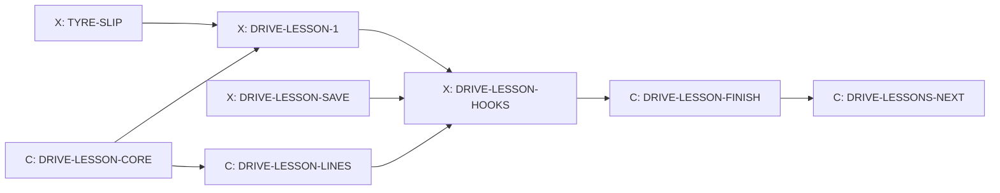

# Driving lessons

Design packet D1 for Cockpit task T-040, written 14 October 2026 by Claude
from Kyle's storyboard ("Helicopter Storyboard Ideas", sections "First
driving lesson: the sharp corner" and "Lessons stay open"). It settles
lesson 1, the sharp corner, enough to build, and the shared lesson pieces
it takes from the helicopter's lessons (H1). Lessons 2 to 4 are outlined in
section 9 and get their own short packet after lesson 1 is played. The
cards are in section 10; the one question for Kyle is in section 11.

## 0. What the game does today (checked on integration 5047d6ff)

- **Helicopter lessons exist** (`docs/HELICOPTER.md` section 7). The
  instructor is the stock voice Brian, recorded clean and played through a
  radio filter (`createRadioChain` in `src/heli/heli-audio.js`; voice and
  lines in `src/heli/heli-radio-lines.js`). `src/heli/heli-lessons.js` is a
  pure module: `createLesson` and `stepLesson`, which returns `running`,
  `passed` or `retry` plus a radio line id; `lessonOpen` opens a lesson when
  the one before it is done; a coach timer stops the instructor nagging.
  The instructor's board (`lessonsMarkup` in `src/heli/heli-ui.js`) lists
  each lesson as open, done ("Retake") or later. Lessons are saved as
  `profile.heli.lessons`. Everything in `src/heli/` may be imported only
  through the helicopter's hooks (an import guard test).
- **Sharp corners exist only on the circuits.** The classic courses have no
  corner tighter than about 200 m radius. Harbour Lights' Lantern Hairpin is
  175 degrees at a 9 m radius, after a 220 m straight ("Hairpin Approach")
  that follows the fast Precinct Bend; its course note already says
  "Rushing it loses more than braking early". Tremblant Woods' Beaver
  Hairpin is 170 degrees at 22 m, after Beaver Kink and an 80 m spur.
  Both courses are bought (1,800 and 1,600 credits); Pacific Canyon, the
  free course, has no hairpin.
- **Time Trial** already runs a race with no rival (`startTimeTrial`,
  `src/game.js` about 258).
- **Upgrades**: seven per car, three levels each, 350, 600 and 950 credits.
  Brakes add 12% braking per level (`src/game.js:159`).
- **Ghosts** replay recorded poses, not inputs (`src/ghost.js`).
- **TYRE-SLIP** (card ready, dev switch `tyre-slip`) makes sliding cost
  grip and speed, adds `s.tyreSlip` (1.0 is the tyre's best grip), and
  makes the tyre squeal follow the real slide. Until it is built, a screech
  in this game costs nothing, so lesson 1 cannot teach the truth without it.

## 1. Kyle's decisions

- The instructor teaches over the radio: Brian, the same voice and the same
  scratchy radio as the helicopter lessons.
- Lessons stay open: go back to the instructor any time to retake one; new
  lessons unlock as you go. The same idea works for driving: braking before
  a corner, the racing line, the manual gearbox, driving on snow.
- Lesson 1, on a sharp hairpin of a course you own: three cones (where to
  brake, the inside of the corner, where to finish on the outside). First
  try: brake late; the tyres screech, the car slides wide, and the
  instructor shows the time you lost. Second try: brake at the first cone,
  turn in, touch the inside cone, accelerate out wide past the third.
  Challenge: beat the instructor's time through the corner three times in a
  row. That unlocks the next lesson and a brake upgrade.
- Sliding costs grip like real tyres (TYRE-SLIP), so a long screech means
  lost time.
- One keyboard; players take turns.

## 2. One instructor, one board, one voice (what is reused from H1)

Driving lessons do not build a second lesson system. Three pieces move out
of `src/heli/` into a small shared folder `src/lessons/`, so both kinds of
lesson use them and the helicopter's import guard stays intact. The
helicopter's behaviour does not change: its tests pass unchanged.

| Shared piece | Moves from | What both use it for |
| --- | --- | --- |
| `src/lessons/lesson-core.js` | the generic parts of `heli-lessons.js` | The lesson contract: `stepLesson` returns `{result: 'running' or 'passed' or 'retry', radio}`; `lessonOpen(order, done, id)`; the coach timer (no coaching line more often than every 6 s); `passed` and `retry` helpers. Each kind of lesson keeps its own goal checks. |
| `src/lessons/radio-voice.js` | `createRadioChain`, the filter numbers and `HELI_RADIO_VOICE` | Brian over the same radio filter, click and hiss. Driving lines are recorded with the same voice and played through the same chain. |
| `src/lessons/lesson-board.js` | `lessonsMarkup` in `heli-ui.js` | The instructor's board: one list with a Flying group and a Driving group, each lesson open, done ("Retake") or "Opens later". |

What stays separate: the helicopter's goal checks, its session and its
save field; driving's goal checks (section 4), its lesson run (section 5)
and its save field (section 7).

**Where you meet the instructor.** On a new **Instructor** button on the
main menu (shown when the `driving-lessons` switch is on), which opens the
board. With the `helicopter` switch also on, the same board on the helipad
shows both groups, and starting a driving lesson from the pad takes you to
the lesson's course like "Race here" does. Driving lessons never need the
helicopter.

## 3. Lesson 1, the sharp corner

### 3.1 Where

The lesson runs on a course you own that has a lesson corner. Two corners
qualify today; the board lists them and you pick:

| Course | Corner | Start gate | Rolling start |
| --- | --- | --- | --- |
| Harbour Lights | Lantern Hairpin | 200 m before turn-in, on Hairpin Approach | 90 mph |
| Tremblant Woods | Beaver Hairpin | 150 m before Beaver Kink, on Beaver Run | 75 mph |

Harbour Lights is first in the list (a long straight into a very tight
corner is the clearest lesson). If you own neither, lesson 1 shows
"Opens later: buy Harbour Lights or Tremblant Woods". A later course with a
hairpin joins by adding one row to the lesson corner table
(`src/lessons/drive-lessons.js`), not by changing the lesson.

### 3.2 The run

A lesson run is a Time Trial on that course with no rival, no traffic, no
police and no combat. It never pays credits, sets records, saves ghosts or
counts toward medals, and a crash costs no repair. Tyre slip rules are
always on in a lesson run (it teaches what TYRE-SLIP makes true). Your own
car, its upgrades and your Casual or Pro setting are used.

Each attempt is short: the car appears at the start gate already rolling
at the table's speed, you drive through the corner, and the attempt ends at
the finish gate, 60 m past the exit cone. The time is from gate to gate, to
a hundredth of a second. Between attempts the result card shows; Enter
starts the next one at the start gate again. Pause (Esc) has a Leave lesson button. A wall
hit, going off the road for more than 1 s, or stopping ends the attempt as
"try again".

### 3.3 The instructor's run, the cones and the late board

Everything is computed when the lesson starts, from one silent run of the
instructor through the same corner, in **your** car with your upgrades and
setting, so the target is always fair and always repeatable:

- The instructor drives the racing line at **92%** of the corner's grip
  limit on Casual and **97%** on Pro, braking in a straight line and never
  sliding (TYRE-SLIP's `steerForYaw`, which never asks for more than the
  tyre's best grip). Its gate-to-gate time is the **instructor's time**.
- **Cone 1, brake here:** where the instructor starts braking, on the
  outside edge of the road.
- **Cone 2, the inside:** at the instructor's apex, on the inside edge.
- **Cone 3, finish wide:** where the instructor's line reaches the outside
  edge after the apex.
- **The red board** (try 1 only): placed so that full braking from it
  reaches turn-in at 1.25 times the instructor's turn-in speed. Braking
  there makes the tyres slide through the corner.

Cones are drawn only; they never touch race physics. A cone "counts" when
the car's centre passes within 2.5 m of it; driving right over it (within
0.8 m) tips it over in the drawing and plays the cone sound.

### 3.4 Try 1: brake late

Instructor: "Let us see what happens when you leave it late. Keep your foot
down and brake at the red board." The red board shows; the cones show.
Whatever you do, the try counts once you reach the finish gate. The result
card shows your time against the instructor's, the time lost, and how long
the tyres screeched (seconds with `s.tyreSlip` above 1.0), for example:
"You 8.42 s. Instructor 7.31 s. Lost 1.11 s. Tyres screeched 1.6 s."
If you braked early anyway, the instructor says so and the try still counts.

### 3.5 Try 2: do it right

Instructor: "Now the right way. Brake hard at the first cone while the car
is straight, turn in, touch the inside cone, and accelerate out wide past
the third." It passes when all four hold:

1. **Braked at cone 1:** the first brake press of 50% or more comes no more
   than 15 m before and 10 m after cone 1.
2. **Touched cone 2.**
3. **Finished wide:** throttle at 80% or more before cone 3, and the car
   passes cone 3 on the outside half of the road.
4. **No long screech:** `s.tyreSlip` above 1.0 for less than 0.3 s in total.

A miss gets one coaching line naming the first rule that failed, then
another go. There is no limit on goes.

### 3.6 The challenge: beat the instructor three times in a row

Instructor: "Good. Now beat my time through the corner. Three in a row."
The instructor's car runs beside you as a ghost (drawn with the existing
ghost drawing from its recorded poses). An attempt that is faster than the
instructor's time, with no wall hit, adds one to the streak; anything else
resets it to 0. The cones stay as a guide but are not checked. Three in a
row passes the lesson.

### 3.7 What passing gives

- Lesson 2 (the racing line) opens.
- **A brake upgrade:** one free brake level on the car you passed in, or
  600 credits if that car's brakes are already at level 3. This is the
  recommendation in the question in section 11; the save keeps only
  "reward given", so Kyle's answer changes one function, not the save.
- The board shows the lesson as done, with your best margin over the
  instructor ("Best: 0.42 s faster"). Retaking it never pays again.

### 3.8 Why this teaches the truth

With TYRE-SLIP, braking late makes you either brake while turning (which
leaves 80% of the cornering grip) or arrive too fast; both push the tyres
past their best grip, they slide, the car runs wide and the slide rubs off
speed. The screech is that slide. In tests the late try must lose at least
0.25 s against the right way (TYRE-SLIP test 8 checks the same on the
Lantern Hairpin); without TYRE-SLIP the lesson would show a screech that
costs nothing, which is why lesson 1 waits for it.

## 4. Lesson rules in code (pure, `src/lessons/drive-lessons.js`)

The driving goal checks follow the shared contract. `createDriveLesson(id,
{corner, instructor})` and `stepDriveLesson(lesson, view, events, dt)`
read a plain view of the car each 120 Hz step (distance along the course,
lateral position, speed, brake, throttle, `tyreSlip`, contact events) and
return `running`, `passed` or `retry` with a radio line id. The module also
holds the lesson corner table (3.1), `placeCones(corner, instructorTrace)`
and the attempt timer. It reads race state and never changes it, like
drift scoring.

## 5. The lesson run in the race (Codex, hooks card)

- `startLesson({courseId, lessonId, car, difficulty})` starts a Time Trial
  with lesson options. The options turn off rival, traffic, police, combat,
  pay, records, ghost saving, medals and damage cost, and latch
  `tyreSlipRules` on.
- The instructor's silent run is a headless run of the same course and car
  from the same rolling start, recorded as poses for the ghost and as a
  trace for the cones. Same seed and car give the same instructor every
  time; it takes well under a second.
- Placing the car at the start gate for each attempt uses the existing safe
  reset, with the rolling speed set; the attempt timer starts at the gate.
- Cones and the red board are drawn by the renderer from the lesson's cone
  list; the result card and the lesson panel (try, rules met, streak 0/3)
  are DOM, like the race HUD. None of it changes race state.

## 6. Sounds and radio lines

- **Radio** (Brian, through `src/lessons/radio-voice.js`): about 16 lines,
  written below and recorded in DRIVE-LESSON-LINES with the same tool and
  voice as the helicopter's lines, within the month's voice credits. Ids are
  `drive.radio.<lesson>.<step>`. Lines never name times or prices; the card
  shows numbers.
- **Cone tipped:** new cue `lesson.cone`, a soft plastic knock, a CC0
  library sound through `tools/audio/catalog.json`.
- **Streak and pass:** the existing interface confirm sound; no new cue.
- **Tyres:** TYRE-SLIP's squeal, unchanged. The lesson adds nothing to it.

| Id | Line |
| --- | --- |
| `drive.radio.corner.intro` | Welcome to the track. Today is the most important corner skill there is: braking. |
| `drive.radio.corner.late.start` | Let us see what happens when you leave it late. Keep your foot down and brake at the red board. |
| `drive.radio.corner.late.result` | Hear that screech? That was your tyres sliding, and sliding is slow. Look at the time you lost. |
| `drive.radio.corner.late.early` | You braked early. Good instinct, but this time I wanted you to feel it. That one still counts. |
| `drive.radio.corner.right.start` | Now the right way. Brake hard at the first cone while the car is straight, turn in, touch the inside cone, and accelerate out wide past the third. |
| `drive.radio.corner.coach.brake` | Brake at the first cone. Not before, not after. |
| `drive.radio.corner.coach.inside` | Get closer to the inside cone. Use the whole road. |
| `drive.radio.corner.coach.exit` | Back on the gas sooner, and let the car run out wide. |
| `drive.radio.corner.coach.screech` | I heard the tyres. Brake a little earlier and keep it smooth. |
| `drive.radio.corner.right.pass` | That is it. Quiet tyres, clean line, and quicker too. |
| `drive.radio.corner.challenge.start` | Good. Now beat my time through the corner. Three in a row. |
| `drive.radio.corner.challenge.one` | That is one. Again. |
| `drive.radio.corner.challenge.two` | Two. One more. |
| `drive.radio.corner.challenge.reset` | Not that time. Back to zero. You know how. |
| `drive.radio.corner.pass` | Three in a row. You have earned better brakes, and the next lesson is open. |
| `drive.radio.retake` | Back for more? Good. Practice is how the fast drivers got fast. |

## 7. The save (`save-shape`)

Optional `profile.drivingLessons` =
`{version: 1, done: {corner}, best: {corner}, rewarded: {corner}}`:
`done` and `rewarded` are true or false, `best` is the best margin over the
instructor in seconds (a number or null). Later lessons add keys (`line`,
`gears`, `snow`) to the same three maps. One line in `normalizeProfile`, a
fixture `tools/fixtures/saves/11-driving-lessons.json`, and the save
checker. An old save without the field reads as no lessons done. Nothing
else in the profile changes, except the reward (one brake level or the
credits) when lesson 1 first passes.

## 8. Switch, files, locks

- **Switch:** `driving-lessons: 'dev'` in `src/feature-flags.js`; the count
  in `tools/test-feature-flags.mjs` rises by one. It never turns on before
  `tyre-slip` is on.
- **New files:** `src/lessons/lesson-core.js`, `radio-voice.js`,
  `lesson-board.js`, `drive-lessons.js`, `drive-radio-lines.js`;
  `tools/test-lesson-core.mjs`, `tools/test-drive-lessons.mjs`;
  runtime voice files in `public/assets/audio/voices/` (mp3, like the helicopter's).
- **Locks:** `busy-game-files` once, in the hooks card (`app.js`,
  `game.js`, `render3d.js`); `save-shape` in the save card; `sound-bank` in
  the lines card (one line maps the driving cue list, as the helicopter's
  does). The shared-pieces card moves helicopter code, so it is Claude's
  (the Flying line is Claude's) and needs no lock.
- **Not touched:** race physics (TYRE-SLIP owns it), replays, world
  signatures, course registry, mastering. Race replays and world signatures
  stay identical.

## 9. Lessons 2 to 4 (outline; a short packet each after lesson 1 is played)

| Lesson | Where | The idea | Passing |
| --- | --- | --- | --- |
| 2 The racing line | Harbour Lights' Old Town Esses, or Tremblant Woods' Fir Esses | Outside, inside, outside; one smooth line through linked corners beats the shortest path | Touch each apex cone, then beat the instructor three times in a row |
| 3 The manual gearbox | Any owned course; a straight and a corner | Shift up near the red line, shift down before the corner; on Pro this is what manual drivers do | No limiter longer than 0.5 s, the right gear at the corner, beat the instructor |
| 4 Driving on snow | Tremblant Snow, Beaver Hairpin | Snow has less grip: brake earlier and turn in slower; winter tyres help | Pass on summer tyres, then see the gain on winter tyres |

Each opens the next. Their rewards are settled in their packets.

## 10. Cards and order

| Card | Who | Holds | What |
| --- | --- | --- | --- |
| DRIVE-LESSON-CORE | Claude | none | Sections 2 and 0: move the three shared pieces out of `src/heli/`, helicopter unchanged |
| DRIVE-LESSON-SAVE | Codex | `save-shape` | Section 7 and the reward function in 3.7 |
| DRIVE-LESSON-1 | Codex | none | Sections 3 and 4: the pure lesson module, corner table, cones, instructor run, tests |
| DRIVE-LESSON-LINES | Claude | `sound-bank` | Section 6: record the lines, the cone sound |
| DRIVE-LESSON-HOOKS | Codex | `busy-game-files` | Section 5 and the board: menu button, lesson run, drawing, panel |
| DRIVE-LESSON-FINISH | Claude | none | Drive the lesson as a player, check it teaches, pictures to Kyle |
| DRIVE-LESSONS-NEXT | Claude | none | Packet for lessons 2 to 4 (section 9) |

DRIVE-LESSON-CORE and DRIVE-LESSON-SAVE start at once. DRIVE-LESSON-1 waits
for TYRE-SLIP.

**Acceptance for D1:**
- With `driving-lessons` and `tyre-slip` on and Harbour Lights owned, a
  player can open the Instructor board from the main menu, take lesson 1,
  do the late try, pass the right way and beat the instructor three times;
  the reward lands once; lesson 2 shows as open; retaking works.
- `tools/test-drive-lessons.mjs`, headless, on both corners, Casual and
  Pro: the instructor run is the same every time; a scripted late try is at
  least 0.25 s slower than the instructor and screeches at least 0.5 s; a
  scripted right try passes all four rules; a scripted driver at 100% of
  the limit beats the instructor on Casual and on Pro; the streak resets on
  a slow attempt; nothing in a lesson run pays, records or damages.
- The helicopter's lesson, session and audio tests pass unchanged after
  DRIVE-LESSON-CORE.
- Race replays, world signatures and combat balance unchanged (lane guards).
- The save checker passes with the new fixture; old saves read as no
  lessons done.
- DRIVE-LESSON-FINISH: Claude plays it on the keyboard on Casual and Pro;
  the release waits for Kyle's word, after or with TYRE-SLIP's.

## 11. The question for Kyle

**What should "a brake upgrade" be?** Recommended: passing lesson 1 gives
one free brake level on the car you passed it in (worth 350 to 950
credits), or 600 credits if those brakes are already maxed. It fits the
upgrade system as it is and changes no race balance. The other choice is a
new fourth brake level that only the lesson opens, then bought with
credits; it needs save and balance work and makes the player brake harder
than the computer racers expect.
