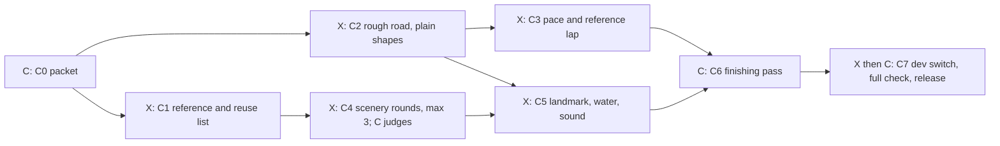
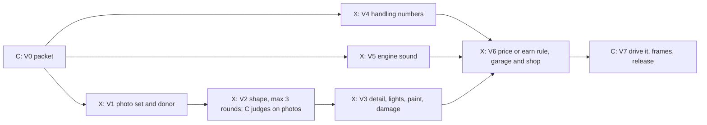
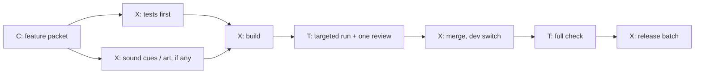
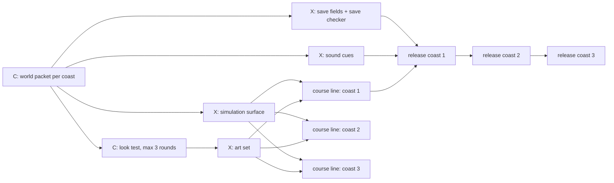
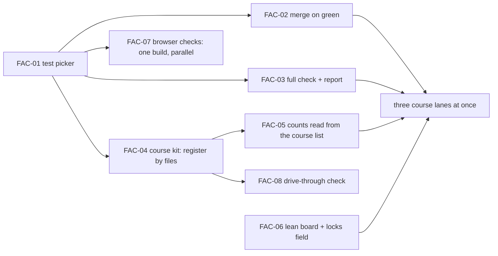

# The Duel factory: production lines as graphs

Kyle, 12 October 2026: the workflow review showed the work runs in a line, one
thing after another. This plan turns it into a factory: three production
lines (feature, course, car, world), each drawn as a graph of steps with arrows
for "must finish first". Steps without an arrow between them run at the same
time. Shared files are named as locks, so collisions are planned instead of
found at merge. The review page is
https://claude.ai/artifact/Y2aWZKfpCRxsqyj8k34RtJ.

This file is the design packet for the FAC cards. It wins over older playbook
and SPEC text about test tiers, merge order and when heavy checks run.

## 1. Decisions (Kyle agreed to every recommendation, 12 October 2026)

1. **Test by what changed.** A lane runs the smoke set plus the suites that
   import or read the changed files. No "run everything" fallback for an
   unmapped game file; the full check covers it. (FAC-01)
2. **Merge as soon as it is green.** One targeted lane run, a build and one
   review. A merge with no conflict does not run again. A conflict fix runs
   the targeted run once more. (FAC-02)
3. **The full check.** One batch once a day, by default while Kyle sleeps:
   full tier, frame check, combat balance on current rules (`--check`), all
   browser scenarios. It checks a copy of one commit, so builders keep
   building and merging while it runs; only its frame step needs the laptop
   to itself. A short report names any merge that broke something; its fix
   goes first and other merges continue. (FAC-03, then FAC-FULL-CHECK)
4. **Release is unchanged.** Full tier on the exact release commit, real
   saves never touched, `dist-previous` kept. Kyle says "go live".
5. **Kyle sets direction.** Art and sound picks are Claude's within the
   three-round cap. Kyle can overrule anything and keeps "go live".
6. **Work in progress limits.** At most six build lanes at once across all
   lines, no more than three of them course lanes, each test run `--jobs 4`
   or fewer. The laptop has 20 threads; the full check's frame step runs alone. A world
   uses as many of the six as its graph allows (The Deep starts six: five
   Codex cards and Claude's water look).

## 2. Locks: the shared files

A card lists the locks it holds in `locks:`. Two cards holding the same lock
never build at the same time; the board shows the second as waiting.

| Lock | Files | Removed by |
|---|---|---|
| `circuit-registry` | `src/circuits/index.js`, circuit lines in `src/feature-flags.js`, `src/course-access.js`, `src/race-field.js`, `start-preview.bat`, stage numbers | FAC-04 (each course registers itself) |
| `reference-laps` | `src/generated/reference-laps.json` (one line) | FAC-04 (one file per course) |
| `replay-fixtures` | `tools/replays/recorded-inputs.json`, `expected-fingerprints.json`, the hash in `salt-flats-controls.json` | FAC-04 (one case file per course) |
| `world-signatures` | baseline map in `tools/test-world-composition.mjs` | FAC-04 (one file per course) |
| `busy-game-files` | `src/game.js`, `src/main.js`, `src/render3d.js`, `src/app.js` | stays; one owner at a time |
| `save-shape` | save schema, migrations, `tools/fixtures/saves/` | stays; save checker required |
| `audio-mix` | `src/audio-output.js` mastering | stays |
| `sound-bank` | `src/sound-bank.js` cue registry | stays; one card adding cues at a time |
| `surfaces` | `src/race-surfaces.js` surface and tyre tables | stays; one card changing surfaces at a time |
| `track-kit-placement` | `src/track-kits.js`, named kit collision transforms in `src/track-script-course.js` | stays; one placement-hook builder at a time, frozen readers do not edit |
| `release` | switch flips, README, VERIFICATION, COURSE_ACCESS | stays; one release at a time, several cards per release |

After FAC-04, a new course holds only `release`, and only at release time.

## 3. The production lines

Arrows mean "must finish first". Steps on the same row run at the same time.
Kyle, 28 October 2026: courses and cars are built on staged lines (below),
not in one large job each, so stages run in parallel, reuse comes first and
every stage has its own check.
Who: **K** Kyle, **C** Claude, **X** Codex, **T** test machine.

### Course line (staged; Kyle, 28 October 2026; up to three courses at once)

Each course moves through numbered stages. A stage is one card on the board,
named `<COURSE>-C1` to `<COURSE>-C7`, made in one go by
`node tools/new-line-cards.mjs course <id> "<Name>"`. A stage starts only when
the stages it needs have passed their gate; stages on the same row run at once.

| Stage | Done when (the gate) | Who judges |
|---|---|---|
| C0 packet | The checklist in section 6 is answered in `docs/courses/<id>.md` | Claude |
| C1 reference and reuse | Photos or descriptions of the real place (landforms, trees, buildings, road edges, light) and a reuse list: which existing kits, models, textures and sounds fit, from `public/assets/`, `C:/Users/kyleb/dev/art-library/` and other courses. New art only where nothing fits | Claude |
| C2 rough road | `src/circuits/<id>.js` drives end to end with existing kits; drive-through check clean; `test-circuits.mjs` passes; a lap feels right on the keyboard (Claude drives it) | Claude |
| C3 pace | Field pace and the reference lap file; computer drivers finish without crashes on every difficulty | Tests |
| C4 scenery | Reused kits placed first; new models as Blender recipes, at most three rounds, one comparison sheet per round under `docs/board/looks/<id>/` | Claude, on pictures |
| C5 landmark, water, sound | The signature landmark, the lake or water body (fire bucket), burnable forest decision, ambient sound cues | Claude |
| C6 finishing pass | Claude drives every sector on Casual and Pro; pictures to Kyle | Claude |
| C7 release | Switch on behind `dev`, full check including frames, then live with the next batch | Release Manager |

- Real places, original roads: a course may take its setting, landforms,
  plants and buildings from a famous racing region; its layout is our own.
- Reverse, dusk and night versions come almost free from a finished course
  (`src/circuit-variants.js`); add them at C7 unless the packet says no.
- Switch-on rehearsal: the course's own test runs with its switch on in the
  lane, so counts and signatures move with the course.

### Car line (staged; Kyle, 28 October 2026; up to two cars at once)

Stage cards `<CAR>-V1` to `<CAR>-V7`, made by
`node tools/new-line-cards.mjs car <id> "<Name>"`.

| Stage | Done when (the gate) | Who judges |
|---|---|---|
| V0 packet | `docs/cars/<id>.md`: what the car is, class, top speed and acceleration targets against the current cars, price or earn rule, sound character | Claude |
| V1 photos and donor | At least six reference photos (front, rear, sides, three-quarter, interior glimpse) noted by source; the closest existing model or recipe to start from | Claude |
| V2 shape | Blender recipe; side, front, top and three-quarter compared against the photos on one sheet; at most three rounds | Claude, against photos |
| V3 detail | Lights, wheels, mirrors, paint options, damage and dirt; triangle and texture budgets met | Claude |
| V4 handling | Car numbers in config; lap times against two current cars on two courses inside the packet targets; replay fingerprints of other cars unchanged | Tests |
| V5 sound | Engine and shift sounds from the sound catalog recipe; loudness matched | Claude, by listening tool numbers |
| V6 earn or buy | Shop or earned-car rule, garage card, upgrades | Tests |
| V7 release | Claude drives it on three courses; frame check with a field of it; live with the next batch | Release Manager |

- Every real car is judged against photos, never a description.
- Reuse first: an existing body, wheel set, interior or sound is the start
  point when it is close.

### Feature line

- The packet answers every open question first: numbers, CPU behaviour, what
  the switch changes, sound cues and loudness, which locks it needs.
- A feature that needs `busy-game-files` or `save-shape` holds that lock.

### World line (The Deep is the first)

- Art, simulation, saves and sound are separate lanes with separate files.
- Each coast is a course-line run inside the world, reusing the course DAG.

## 4. The factory build order (FAC cards)

FAC-01, FAC-06 and FAC-07 can start at once. FAC-04 and FAC-05 need the
`circuit-registry` lock, so no new course work starts until they merge.

## 5. Cards

- **FAC-01 Test picker (Claude, done in this lane).** Selection follows
  imports plus the paths each file names (`new URL(...)`, `join(root,...)`,
  `'../public/...'+name`, runtime `'assets/...'`) and `// test-reads:` lines.
  Only build configs, lockfiles and the runner itself select everything.
  `src/config.js` is game data and follows its importers.
- **FAC-02 Merge on green (Codex, OPS).** Change AGENTS and the playbook to
  drop the re-run on a conflict-free merge and the one-at-a-time queue wait.
  Integrator script merges, runs the janitor and writes the run-log line from
  the test result. Acceptance: two green lanes merge within five minutes.
- **FAC-03 The full check (Codex, TOOL).** `tools/full-check.mjs`: full tier
  `--jobs 4`, frame check (both qualities, busiest view, eight cars),
  combat balance (`--check`, current rules), browser scenarios; writes
  `docs/board/checks/night-<date>.json` and a short report that names
  the first merge after the last green full check for each failure. Kyle
  approves the Windows scheduled task himself. FAC-FULL-CHECK runs the
  stages in a detached sibling copy of one commit while builders keep
  merging. Only frames need the laptop alone; other stages count toward
  the three-heavy-job limit. The command is
  `node tools/full-check.mjs --idle-awake --no-push`. Tonight's direct pause
  remains in force (see `docs/board/next-run.md`).
- **FAC-04 Course kit (Claude design, Codex build, SIM).** Each circuit file
  exports its manifest (id, flag, state, price, grandPrix, releaseOrder,
  driver). `src/circuits/index.js` discovers circuit files and sorts by
  releaseOrder. Flags, prices, Grand Prix list and preview flags derive from
  the manifests. Reference laps, replay cases and world signatures become one
  file per course. Replay fingerprints stay exact.
- **FAC-05 Derived counts (Codex, TOOL).** The about 30 hard-coded course,
  flag and signature counts in 14 suites read their numbers from the course
  list. Per-course price, flag and order checks move into
  `test-circuit-<id>.mjs`. Changed assertions are listed in the change note.
- **FAC-06 Lean board (Codex Director).** Open cards only, one short entry
  each, details in `docs/board/cards/<id>.md`; finished cards leave at merge.
  `tools/board.mjs` reads `locks:` and holds a card whose lock is taken.
  Fix the YAML error at board.yaml line 4567.
- **FAC-07 Browser checks (Codex, TOOL).** Build the QA bundle once per run
  and run scenarios side by side with private ports and profiles.
- **FAC-08 Drive-through check (Codex, TOOL).** An automated lap per
  difficulty that flags leaving the road surface, passing through solid
  barriers, and objects floating above the ground. Runs on course cards.

## 6. The packet checklist

Every course, feature and world starts with a Claude packet that answers
these before any lane starts, so builders never stop to ask:

1. What the player sees and does, in a few sentences.
2. Numbers: speeds, prices, counts, timings, thresholds.
3. The graph: cards, who owns each, arrows, which start at once.
4. Contracts between parallel lanes: data formats, ids, events, cue names.
5. Locks each card holds, and the files each card owns.
6. What stays exact: fingerprints, signatures, saves, other courses.
7. The switch, and what turning it on changes (counts, lists, prices).
8. Sound cues and loudness; art sources and the look target.
9. How it is checked: the targeted tests, the full check, the drive-through
   check, and Kyle's "go live".
10. Water and trees (Kyle, 14 October 2026): where the course's lake or
    other body of water is (every new course has one, for the helicopter's
    fire bucket), and whether its forest can burn (`docs/HELI_FIRE.md`
    section 4.1); a burnable course orders its burnt look with its art.

The first packets written this way: `docs/FACTORY.md` itself (FAC cards)
and `docs/THE_DEEP.md` section 10.

## 7. Who runs which session

- **Claude, design session:** packets, look judging, finishing passes.
  One packet unblocks a whole course or feature graph.
- **Claude, build sessions (Sonnet):** Claude-owned cards in their own lanes.
- **Codex Director:** keeps every line full within the limits in section 1.
- **Codex lanes:** one card each; three course lanes at most.
- **The full check:** once a day, by default while Kyle sleeps, on a copy of
  one commit; only its frame step takes the laptop alone.

## 8. Taking a heavy-job turn (every chat, Claude QA-SHARED-HEAVY-ADMISSION, 15 October 2026)

A heavy job is a lane or full gate, a build, a balance run, a browser check
or a Blender render. At most three run at once across every chat (AGENTS 7).
Every session, Claude or Codex, follows the same four steps; no other tool
or queue exists.

1. **Look.** Read the top of `docs/playtest-inbox.md` for a hold
   (FRAME CHECK, FULL TIER FOR RELEASE, NEXT HEAVY SLOT) and count the jobs
   already running. A job counts once, by its outermost process; its
   children are never counted again:
   `$p = Get-CimInstance Win32_Process -Filter "name='node.exe' or name='blender.exe'" | ? { $_.CommandLine -match 'run-tests|vite build|combat-balance|browser-harness|run-browser|blender' }; $ids = $p.ProcessId; ($p | ? { $ids -notcontains $_.ParentProcessId }).Count`
2. **Start** only when the count is under three and no hold or slot
   reservation for someone else is open. Always `--jobs 4` or fewer.
3. **Check again one minute later.** If the count is now over three, the
   session whose job started last stops its own job and waits for the next
   turn. Never stop another session's job. A release full tier and the 04:00
   full check are never the job that stops.
4. **Reserving the next turn.** A session whose green work is only waiting
   for one short job may write one line at the top of the inbox:
   `NEXT HEAVY SLOT: <job>, <session>, <HH:MM>`. The next freed turn is its
   own; the line expires 20 minutes after its time or when the job starts,
   and the owner deletes it then. One reservation at a time; a later one
   waits until it clears.

Frame timing still needs the laptop alone (AGENTS 8), and a release full
tier still runs alone (AGENTS 1).
