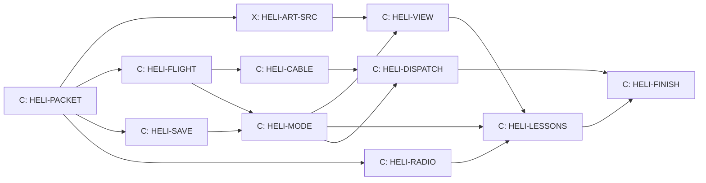

# The helicopter

Design packet for the Flying line, written 14 October 2026 by Claude from
Kyle's storyboard. Kyle's decisions live in his storyboard document
("Helicopter Storyboard Ideas", a Claude Docs page Kyle owns); section 1
copies the ones the game needs. Section 2 onward is the first slice, **H1
First flight**, settled enough to build. Later sprints (H2 to H5, the Lab
and the driving lessons) get their own packets after H1 flies.

Who builds: Claude owns the Flying line, design and build, in Claude's own
lanes (Kyle, 14 October 2026). Codex sources the helicopter art
(HELI-ART-SRC) and otherwise keeps building courses and worlds. The line
touches shared files only through the hooks and locks in section 9.

## 1. Kyle's decisions (14 October 2026)

| Topic | Decision |
| --- | --- |
| Order | Carrying cars first; then whichever is easiest (Claude's pick: forest fire) |
| First build | A small first slice; bigger helicopters and the rest later |
| Helicopter | One, Kestrel One, for every mission; each player has their own |
| Opening | Skippable |
| Autopilot | Off unless switched on; any control input takes over |
| Camera | Switchable views, so you can watch the car swing |
| Fuel | Bought with race credits; fuel has weight |
| Crashes | Cargo can hit things; a damaged car or bucket costs a repair, never the car itself |
| Radio | Whoever fits the moment: the instructor first, rangers, rescue, the lodge; three voices, scratchy like a real radio |
| Lessons | Retake any time; new ones unlock; driving lessons too |
| Missions | Random, after a small random number of refuels (3 to 6); never during a race (H2) |
| Dispatch board | Check in any time for everyday jobs; emergencies come only by radio |
| Burnt course | Closed 10 play days, never lost; buyback 10,000 credits dropping 1,000 a play day; first one picked at random (H2) |
| Skins | Earned after 5 missions of one kind or bought sooner; paint plus one matching piece of gear; first skin is whichever kind reaches 5 first (H3) |
| Animals | Local species only, enough to be interesting (H3; table in the storyboard) |
| Players | One keyboard: nothing needs two players at once |
| Call sign | Kestrel One |
| TV station | Barely News, a bear logo, "Just the bear facts" (H3) |
| The Deep | Joined to the helicopter later by a submarine |
| Tire grip | Sliding costs grip like real tires (card TYRE-SLIP) |

Kept from 12 October: the home helipad is at Tremblant Woods, and every
current course stays on the menu as it is.

## 2. H1 in one paragraph

From the main menu (behind the `helicopter` switch) you go to the helipad
at Tremblant Woods. The instructor talks you through lift-off, hover,
landing and carrying a load, over a crackling radio; the short opening can
be skipped. You buy fuel with race credits. At the dispatch board you take
a job (fly a car to another course for pay) or fly your own car. You hook the
car, take off, fly out of the area, and the cruise leg takes you to the
destination, where you fly the approach and set the car down beside the
start line. Then you race there with that car, or fly home. Crashes cost
repairs. The autopilot is there when you switch it on.

H1 destinations: Tremblant Woods (home pad), Tremblant Snow and Panorama
Ridge. More come with the pilot's map (Cockpit T-008).

## 3. The helicopter and how it flies

All flight rules live in a pure simulation (`src/heli/heli-flight.js`),
fixed step 1/120 s like the race, runnable without graphics, repeatable from
its inputs. Units are metres, kilograms and seconds inside; the instruments
show knots and feet like a real cockpit, with metres in brackets.

**Kestrel One (H1 numbers):**

| Item | Value |
| --- | --- |
| Empty mass | 1,150 kg |
| Pilot | 80 kg |
| Fuel tank | 400 kg (about 500 litres of jet fuel) |
| Hook limit | 1,500 kg |
| Rotor diameter | 10 m |
| Top speed, no load | 60 m/s (about 115 knots) |
| Safe speed with a car on the cable | 30 m/s (about 60 knots) |

**Lift.** Most thrust at sea level = 1.08 × (1,150 + 80 + 400 + 1,500) kg ×
g. Thrust falls with thinner air: × e^(−altitude / 8,500 m). Each
destination has a real base altitude: Tremblant 250 m, Panorama Ridge 860 m.
So a full tank and the heaviest car only just lift at Tremblant and need
ground effect or less fuel at Panorama: the fuel-weight lesson happens on its
own.

**Ground effect.** Below one rotor diameter (10 m) thrust gains up to 15%,
fading linearly to nothing at 10 m.

**Forward speed (translational lift).** Rotor efficiency rises 10% between
8 and 13 m/s airspeed and stays there.

**Attitude.** The cyclic sets a target pitch and roll up to 20 degrees
(Assisted) or 25 degrees (Real), reached at up to 60 degrees a second. Thrust
tilts with the helicopter, which is what moves it. Pedals turn it at up to
60 degrees a second. Drag is quadratic, sized so 60 m/s is the top speed
with no load.

**Two modes, like the gearbox.** Assisted: releasing the cyclic levels the
helicopter; with the collective keys released it holds its height (W and S
ask for up to 5 m/s climb or descent). Real: the collective stays where you
leave it and nothing levels itself. Real pays 25% more on dispatch jobs.

**Fuel.** Burn = 0.25 + 0.55 × collective kg/s, about 0.6 kg/s in a hover,
so a full tank lasts roughly 10 to 15 minutes of flying. Fuel costs 1.5
credits per kg: a full tank is 600 credits. Low fuel warning at 15%. The very
first tank is free.

**Out of fuel (autorotation).** The engine stops and the rotor keeps
turning in the rushing air. The helicopter sinks at about 8 m/s; raising the
collective within 15 m of the ground spends the rotor's stored energy and
slows the touchdown to about 1 m/s for 2 seconds. Land it and you pay a fuel
truck: 300 credits plus the fuel.

**Touchdown.** Vertical speed at most 1.5 m/s and tilt at most 10 degrees
is a good landing. Up to 3 m/s is a hard landing: 150 credits repair. More,
or the rotor touching a tree, cliff or building, is a crash: 800 credits
repair, and you are back on the home pad.

**The autopilot.** Off unless switched on (key P). Switched on, it holds
height and heading, flies to the chosen destination's approach point at
30 m/s, keeps the car's swing small by limiting bank to 10 degrees, and
stops in a hover 20 m above the landing zone. You land or set down yourself
in H1. Any control input beyond 30% hands control back to you.

**Settled while building HELI-FLIGHT (14 October 2026).** These fill gaps
the numbers above left open; `tools/test-heli-flight.mjs` checks each one.

- Drag is sized so Assisted (20 degrees) tops out at 60 m/s with a full
  tank and no load. Above 60 m/s drag climbs steeply (the retreating blade
  stalls), so Real's 25 degrees reaches about 61 m/s, not 68.
- Full collective with no load climbs at about 10 m/s; a hover burns about
  0.52 kg/s, so a full tank hovers about 13 minutes.
- Assisted slows its own descent near the ground: holding S lands at about
  0.6 m/s.
- Touchdown also counts tilt and sliding: tilt 10 to 20 degrees or a slide
  of 3 to 8 m/s turns a good landing hard; more than 20 degrees or 8 m/s is
  a crash.
- Autorotation keeps the rotor's stored energy. Full collective gives lift
  of 1.5 times the weight for about 2.5 seconds; with the lever down the
  rushing air spins the rotor back up. Assisted flares for you while W is
  held below 15 m and lands at under 1 m/s. In Real a flare started about
  8 m up lands well; one started at 14 m runs out of rotor and crashes.
- The autopilot keeps at least 30 m (plus the hanging load) above the
  highest ground or obstacle on the next 10 seconds of its path, and slows
  to 8 m/s when it is more than 10 m short of that height. It limits the
  combined tilt to 10 degrees.
- The rotor and the body strike trees, buildings, rocks and mountains at
  any height; mountains count as cones. Landing on a roof is not part of
  H1: coming down onto one is a crash.

## 4. Controls (one keyboard)

| Key | Action |
| --- | --- |
| W / S | Collective: up / down |
| Arrow keys | Cyclic: tilt forward, back, left, right |
| A / D | Pedals: turn left / right |
| H | Release the hook |
| P | Autopilot on / off |
| C | Next camera view |
| Esc | Pause and menu |

Gamepad: left stick cyclic, right stick up and down collective, right stick
left and right pedals. A new `heli` input context keeps these keys from
reaching the race controls.

## 5. The car on the cable

`src/heli/heli-cable.js`: a 15 m cable with the car as a point mass on a
damped pendulum (no new library; it borrows the tether ideas in
`src/arsenal/harpoon.js`). The car hangs nose-forward and turns with the air.

- **Which cars lift.** Car masses from `src/config.js` where given; the
  others get one in this packet's table. Hook limit 1,500 kg.

  | Car | Mass | Lifts in H1 |
  | --- | --- | --- |
  | Viper Prototype | 940 kg | Yes |
  | Falcone Heritage | 1,150 kg | Yes |
  | Falcone F42 | 1,250 kg | Yes |
  | Dusthawk Rally | 1,280 kg | Yes |
  | Aurora GTR | 1,350 kg | Yes |
  | Koenigsegg Jesko Absolut | 1,390 kg | Yes |
  | Stuttgart 959-S | 1,450 kg | Yes |
  | Banshee Muscle | 1,810 kg | No: needs the Lab's lift upgrade (L1) |
  | Titan Monster | 4,700 kg | Never: too heavy for any helicopter here |

  The missing masses are added only to the helicopter's own table, not to
  the car physics.
- **Setting down.** The car touches the ground inside the 12 m landing
  circle at 1 m/s or less, then you release (H). Released higher than 1 m,
  it drops: 100 credits per metre of drop in repairs.
- **Hitting things.** The car striking terrain, a building or the
  helicopter faster than 4 m/s costs a repair: light 150, heavy 400,
  wreck 900 credits. Trees it hits fall over and stay down until the next
  play day (scenery only; races are untouched).
- **Paying.** A repair takes credits at once. If it costs more than you
  have, it takes what you have and forgives the rest. A save never goes
  below zero.
- **Special cars travel only by air** (Kyle). In H1 the special car is the
  Koenigsegg Jesko Absolut; earned cars from the medal sheets (Cockpit
  T-013) join the list later. With the switch on, a special car races only
  on the course where it was last set down, and it starts at the home pad.
  Existing saves keep the car; it simply starts at Tremblant Woods.

## 6. The dispatch board and flights between courses

- **Board.** At the helipad. Three jobs each play day, chosen with the
  seeded generator from the day number: "Fly the <car> to <course>", paying
  300 (Tremblant Snow), 450 (Panorama Ridge from Tremblant Snow) or 600
  credits (Panorama Ridge from home), plus 25% in Real mode. A play day is a
  calendar day on which the game is opened (stored in the save).
- **Your own car.** Always on the board: "Fly my car", no pay.
- **Cruise leg.** Leaving the flying area (a box around each course,
  ceiling 300 m above its start) with a destination chosen offers Cruise.
  The screen fades, fuel for the leg is taken (table below) and you arrive
  1.5 km out at 150 m, facing the landing zone. Without enough fuel for the
  leg, Cruise is refused and the radio says so.

  | Leg | Fuel |
  | --- | --- |
  | Tremblant Woods to Tremblant Snow | 25 kg |
  | Tremblant Woods to Panorama Ridge | 120 kg |
  | Tremblant Snow to Panorama Ridge | 110 kg |

- **Landing zones.** One per destination, beside the start area, chosen in
  HELI-MODE from each course's start position and checked clear of scenery.
- **Race here.** After setting a car down on an owned course, the menu
  offers "Race here", which starts the normal race at that course with that
  car. Flying never changes how a race runs.

## 7. Lessons and the radio

The instructor (stock voice **Brian**, deep and calm) speaks over the radio.
Every line is recorded clean, then played through a radio filter: band-pass
300 to 3,000 Hz, a soft clip for crackle, a faint hiss under the voice and a
click when the radio keys on and off. The filter lives in
`src/heli/heli-audio.js` on the `voice` bus, not in mastering.

| Lesson | Pass | Opens |
| --- | --- | --- |
| 1 Lift-off | Rise to 3 m and hold 5 s | Lesson 2 |
| 2 Hover | Stay in a 4 m circle at 2 to 5 m for 10 s | Lesson 3 |
| 3 Landing | Land on the pad, under 1 m/s, within 3 m of the H | Fuel and the dispatch board |
| 4 Carry and set down | Carry a 500 kg crate 200 m and set it down in a 10 m circle | Carrying cars |

Skipping the opening marks lessons 1 and 2 done. Any lesson can be retaken
from the instructor's board. About 25 lines in H1: the opening, each lesson's
steps, praise and retries, low fuel, out of fuel, hard landing, crash, job
taken, job done, cruise refused. Lines are written in HELI-RADIO to fit the
month's voice credits.

## 8. What the player sees and hears

- **Camera views (C):** behind the helicopter, cockpit, straight down the
  cable, and side.
- **Instruments:** altimeter (feet and metres, height above ground too),
  airspeed (knots), artificial horizon, climb rate, rotor speed, fuel (kg and
  minutes left), weight (now and most liftable here), compass heading.
  Drawn in the DOM like the speedometer.
- **Sound cues:** rotor loop that deepens with load, engine start and stop,
  wind with airspeed, cable creak, hook release, set-down thud, low fuel
  chime, low rotor horn, radio click and hiss. Library sounds first
  (Freesound CC0), through `tools/audio/freesound.mjs`.
- **From the air.** Courses were built to be seen from the road. HELI-VIEW
  checks each H1 destination from 150 m. Where the edge of the world shows,
  the flying area's ceiling comes down rather than adding scenery in H1.

## 9. Files, switch, locks and hooks

New folder `src/heli/`, imported only through the hooks below (an import
guard test like The Deep's enforces it):

| File | Holds |
| --- | --- |
| `heli-flight.js` | Flight rules, fuel burn, touchdown and crash classes |
| `heli-autopilot.js` | Hold, fly to approach point, swing damping |
| `heli-ground.js` | Ground height and obstacles, from the course samplers |
| `heli-cable.js` | Cable, pendulum, set-down, cargo hits |
| `heli-save.js` | The `heli` save field and its normalizer, fuel purchase, repairs |
| `heli-jobs.js` | Dispatch board jobs from the day number |
| `heli-lessons.js` | Lesson goals and pass checks |
| `heli-session.js` | The mode controller, like `deep-journey.js` |
| `heli-scene.js`, `heli-camera.js` | Drawing only |
| `heli-ui.js`, `heli-ui.css` | Instruments, dispatch board, lessons panel |
| `heli-audio.js` | Rotor and radio sound |

- **Switch:** `helicopter: 'dev'` in `src/feature-flags.js`. The count in
  `tools/test-feature-flags.mjs` rises by one; the change note explains it.
- **Save field** (`save-shape`): optional `profile.heli` =
  `{version: 1, fuelKg, lessons: {liftoff, hover, landing, carry},
  playDay: {last, count}, jobs: {day, taken, done}, carsAt: {carId: courseId},
  refuels, flights}`. One line in `normalizeProfile`, a fixture
  `tools/fixtures/saves/10-heli.json`, and the save checker.
- **`busy-game-files`:** `app.js` (a `visitHeli()` verb, the session in
  `_simulate` and `_applyInput`, `returnToMenu`, dispose, "Race here") and
  `render3d.js` (a private scene hook like the Deep's). Held by HELI-MODE
  and HELI-DISPATCH, one at a time.
- **`sound-bank`:** the cues above, held by HELI-RADIO.
- **Unlocked shared files:** `input-contexts.js` (a `heli` context),
  `screen-router.js` and `screen-menu.js` (a menu entry shown only with the
  switch on).
- **Not touched:** course registry, replays, world signatures, mastering.
  Race replays and world signatures must stay identical.

## 10. Cards and order

HELI-ART-SRC, HELI-FLIGHT, HELI-SAVE and HELI-RADIO start at once. Until
the art passes, HELI-VIEW may draw a plain stand-in in dev builds only.

## 11. Acceptance for H1

- With the switch on, a player can do lessons 1 to 4, buy fuel, take a job or
  fly their own car to Tremblant Snow or Panorama Ridge, set it down in the
  zone and start a race there with that car. Crashes, hard landings, drops
  and out-of-fuel landings charge as in sections 3 and 5.
- The autopilot is off at the start, switches on with P, and any input over
  30% takes over. All four camera views work. The instruments agree with the
  simulation in tests.
- Tests: `test-heli-flight.mjs` (hover holds, ground effect, thin air,
  translational lift, fuel burn, touchdown classes, autorotation,
  same inputs give the same flight), `test-heli-cable.mjs`,
  `test-heli-save.mjs` (with the save checker), `test-heli-jobs.mjs`,
  `test-heli-mode.mjs` (a headless flight from the pad to Panorama Ridge with
  a car, same fingerprint every run) and the import guard.
- Race replays, world signatures and combat balance are unchanged.
- Frame check (rule 8) once HELI-VIEW is reachable: 150 m over Panorama
  Ridge, Performance and High, p95 at most 18.5 ms.
- HELI-FINISH: Claude flies the whole slice, sends Kyle pictures, and the
  release waits for Kyle's word.

## 12. After H1

Cockpit project "The Duel" holds the later sprints: H2 Fire (T-035),
H3 Wildlife and skins (T-036), H4 Rescue (T-037), H5 Heli-skiing (T-038),
the Lab (T-009 to T-012), and the driving lessons (T-039, T-040). Each gets
a packet here when its turn comes; Kyle's storyboard holds the decisions.
