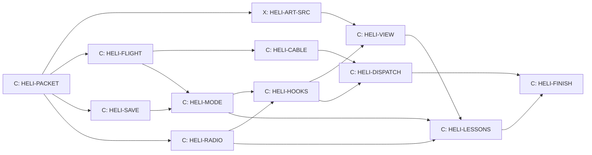

# The helicopter

Design packet for the Flying line, written 14 October 2026 by Claude from
Kyle's storyboard. Kyle's decisions live in his storyboard document
("Helicopter Storyboard Ideas", a Claude Docs page Kyle owns); section 1
copies the ones the game needs. Section 2 onward is the first slice, **H1
First flight**, settled enough to build. Later sprints (H2 to H5, the Lab
and the driving lessons) get their own packets after H1 flies.

Who builds: Claude owns the Flying line, design and build, in Claude's own
lanes (Kyle, 14 October 2026). Codex sources the helicopter art
(HELI-ART-SRC) and otherwise keeps building courses and worlds. The line
touches shared files only through the hooks and locks in section 9.

## 1. Kyle's decisions (14 October 2026)

| Topic | Decision |
| --- | --- |
| Order | Carrying cars first; then whichever is easiest (Claude's pick: forest fire) |
| First build | A small first slice; bigger helicopters and the rest later |
| Helicopter | One, Kestrel One, for every mission; each player has their own |
| Opening | Skippable |
| Autopilot | Off unless switched on; any control input takes over |
| Camera | Switchable views, so you can watch the car swing |
| Fuel | Bought with race credits; fuel has weight |
| Crashes | Cargo can hit things; a damaged car or bucket costs a repair, never the car itself |
| Radio | Whoever fits the moment: the instructor first, rangers, rescue, the lodge; three voices, scratchy like a real radio |
| Lessons | Retake any time; new ones unlock; driving lessons too |
| Missions | Random, after a small random number of refuels (3 to 6); never during a race (H2) |
| Dispatch board | Check in any time for everyday jobs; emergencies come only by radio |
| Burnt course | Closed 10 play days, never lost; buyback 10,000 credits dropping 1,000 a play day; first one picked at random (H2) |
| Skins | Earned after 5 missions of one kind or bought sooner; paint plus one matching piece of gear; first skin is whichever kind reaches 5 first (H3) |
| Animals | Local species only, enough to be interesting (H3; table in the storyboard) |
| Players | One keyboard: nothing needs two players at once |
| Call sign | Kestrel One |
| TV station | Barely News, a bear logo, "Just the bear facts" (H3) |
| The Deep | Joined to the helicopter later by a submarine |
| Tire grip | Sliding costs grip like real tires (card TYRE-SLIP) |

Kept from 12 October: the home helipad is at Tremblant Woods, and every
current course stays on the menu as it is.

## 2. H1 in one paragraph

From the main menu (behind the `helicopter` switch) you go to the helipad
at Tremblant Woods. The instructor talks you through lift-off, hover,
landing and carrying a load, over a crackling radio; the short opening can
be skipped. You buy fuel with race credits. At the dispatch board you take
a job (fly a car to another course for pay) or fly your own car. You hook the
car, take off, fly out of the area, and the cruise leg takes you to the
destination, where you fly the approach and set the car down beside the
start line. Then you race there with that car, or fly home. Crashes cost
repairs. The autopilot is there when you switch it on.

H1 destinations: Tremblant Woods (home pad), Tremblant Snow and Panorama
Ridge. More come with the pilot's map (Cockpit T-008).

## 3. The helicopter and how it flies

All flight rules live in a pure simulation (`src/heli/heli-flight.js`),
fixed step 1/120 s like the race, runnable without graphics, repeatable from
its inputs. Units are metres, kilograms and seconds inside; the instruments
show knots and feet like a real cockpit, with metres in brackets.

**Kestrel One (H1 numbers):**

| Item | Value |
| --- | --- |
| Empty mass | 1,150 kg |
| Pilot | 80 kg |
| Fuel tank | 400 kg (about 500 litres of jet fuel) |
| Hook limit | 1,500 kg |
| Rotor diameter | 10 m |
| Top speed, no load | 60 m/s (about 115 knots) |
| Safe speed with a car on the cable | 30 m/s (about 60 knots) |

**Lift.** Most thrust at sea level = 1.08 × (1,150 + 80 + 400 + 1,500) kg ×
g. Thrust falls with thinner air: × e^(−altitude / 8,500 m). Each
destination has a real base altitude: Tremblant 250 m, Panorama Ridge 860 m.
So a full tank and the heaviest car only just lift at Tremblant and need
ground effect or less fuel at Panorama: the fuel-weight lesson happens on its
own.

**Ground effect.** Below one rotor diameter (10 m) thrust gains up to 15%,
fading linearly to nothing at 10 m.

**Forward speed (translational lift).** Rotor efficiency rises 10% between
8 and 13 m/s airspeed and stays there.

**Attitude.** The cyclic sets a target pitch and roll up to 20 degrees
(Assisted) or 25 degrees (Real), reached at up to 60 degrees a second. Thrust
tilts with the helicopter, which is what moves it. Pedals turn it at up to
60 degrees a second. Drag is quadratic, sized so 60 m/s is the top speed
with no load.

**Two modes, like the gearbox.** Assisted: releasing the cyclic levels the
helicopter; with the collective keys released it holds its height (W and S
ask for up to 5 m/s climb or descent). Real: the collective stays where you
leave it and nothing levels itself. Real pays 25% more on dispatch jobs.

**Fuel.** Burn = 0.25 + 0.55 × collective kg/s, about 0.6 kg/s in a hover,
so a full tank lasts roughly 10 to 15 minutes of flying. Fuel costs 1.5
credits per kg: a full tank is 600 credits. Low fuel warning at 15%. The very
first tank is free.

**Out of fuel (autorotation).** The engine stops and the rotor keeps
turning in the rushing air. The helicopter sinks at about 8 m/s; raising the
collective within 15 m of the ground spends the rotor's stored energy and
slows the touchdown to about 1 m/s for 2 seconds. Land it and you pay a fuel
truck: 300 credits plus the fuel.

**Touchdown.** Vertical speed at most 1.5 m/s and tilt at most 10 degrees
is a good landing. Up to 3 m/s is a hard landing: 150 credits repair. More,
or the rotor touching a tree, cliff or building, is a crash: 800 credits
repair, and you are back on the home pad.

**The autopilot.** Off unless switched on (key P). Switched on, it holds
height and heading, flies to the chosen destination's approach point at
30 m/s, keeps the car's swing small by limiting bank to 10 degrees, and
stops in a hover 20 m above the landing zone. You land or set down yourself
in H1. Any control input beyond 30% hands control back to you.

**Settled while building HELI-FLIGHT (14 October 2026).** These fill gaps
the numbers above left open; `tools/test-heli-flight.mjs` checks each one.

- Drag is sized so Assisted (20 degrees) tops out at 60 m/s with a full
  tank and no load. Above 60 m/s drag climbs steeply (the retreating blade
  stalls), so Real's 25 degrees reaches about 61 m/s, not 68.
- Full collective with no load climbs at about 10 m/s; a hover burns about
  0.52 kg/s, so a full tank hovers about 13 minutes.
- Assisted slows its own descent near the ground: holding S lands at about
  0.6 m/s.
- Touchdown also counts tilt and sliding: tilt 10 to 20 degrees or a slide
  of 3 to 8 m/s turns a good landing hard; more than 20 degrees or 8 m/s is
  a crash.
- Autorotation keeps the rotor's stored energy. Full collective gives lift
  of 1.5 times the weight for about 2.5 seconds; with the lever down the
  rushing air spins the rotor back up. Assisted flares for you while W is
  held below 15 m and lands at under 1 m/s. In Real a flare started about
  8 m up lands well; one started at 14 m runs out of rotor and crashes.
- The autopilot keeps at least 30 m (plus the hanging load) above the
  highest ground or obstacle on the next 10 seconds of its path, and slows
  to 8 m/s when it is more than 10 m short of that height. It limits the
  combined tilt to 10 degrees.
- The rotor and the body strike trees, buildings, rocks and mountains at
  any height; mountains count as cones. Landing on a roof is not part of
  H1: coming down onto one is a crash.

## 4. Controls (one keyboard)

| Key | Action |
| --- | --- |
| W / S | Collective: up / down |
| Arrow keys | Cyclic: tilt forward, back, left, right |
| A / D | Pedals: turn left / right |
| H | Release the hook |
| P | Autopilot on / off |
| C | Next camera view |
| Esc | Pause and menu |

Gamepad: left stick cyclic, right stick up and down collective, right stick
left and right pedals. A new `heli` input context keeps these keys from
reaching the race controls.

## 5. The car on the cable

`src/heli/heli-cable.js`: a 15 m cable with the car as a point mass on a
damped pendulum (no new library; it borrows the tether ideas in
`src/arsenal/harpoon.js`). The car hangs nose-forward and turns with the air.

- **Which cars lift.** Car masses from `src/config.js` where given; the
  others get one in this packet's table. Hook limit 1,500 kg.

  | Car | Mass | Lifts in H1 |
  | --- | --- | --- |
  | Viper Prototype | 940 kg | Yes |
  | Falcone Heritage | 1,150 kg | Yes |
  | Falcone F42 | 1,250 kg | Yes |
  | Dusthawk Rally | 1,280 kg | Yes |
  | Aurora GTR | 1,350 kg | Yes |
  | Ferrari Enzo (earned, 6 medals) | 1,365 kg | Yes |
  | McLaren F1 (earned, 12 medals) | 1,140 kg | Yes |
  | Koenigsegg Jesko Absolut | 1,390 kg | Yes |
  | Stuttgart 959-S | 1,450 kg | Yes |
  | Bugatti Bolide (earned, 24 medals with 6 gold) | 1,450 kg | Yes, 50 kg under the limit |
  | Banshee Muscle | 1,810 kg | No: needs the Lab's lift upgrade (L1) |
  | Titan Monster | 4,700 kg | Never: too heavy for any helicopter here |

  The missing masses are added only to the helicopter's own table, not to
  the car physics.
- **Setting down.** The car touches the ground inside the 12 m landing
  circle at 1 m/s or less, then you release (H). Released higher than 1 m,
  it drops: 100 credits per metre of drop in repairs.
- **Hitting things.** The car striking terrain, a building or the
  helicopter faster than 4 m/s costs a repair: light 150, heavy 400,
  wreck 900 credits. Trees it hits fall over and stay down until the next
  play day (scenery only; races are untouched).
- **Paying.** A repair takes credits at once. If it costs more than you
  have, it takes what you have and forgives the rest. A save never goes
  below zero.
- **Medal cars and the restored Sirena travel only by air.** With the
  helicopter switch on, they race only where last set down. Medal cars start
  at Tremblant Woods; the Sirena starts at Pacific Canyon. Kyle, 25 October
  2026: the Jesko races on every course and in every mode again. Flying it
  is optional, and its old saved helicopter position remains untouched.

**Settled while building HELI-CABLE (14 October 2026).** Checked in
`tools/test-heli-cable.mjs`:

- Hooking: hover with the hook (15 m below the skids) within 4 m of the
  load sideways and 3.5 m up or down, moving under 2.5 m/s relative to it,
  and press H. H again lets go. (Widened from 3 m, 2 m and 1.5 m/s by
  FIX-HELI-HOOK, 24 October 2026: that window needed a near-perfect hover.)
  A press that does not hook says what to fix on the flight panel for two
  seconds: "Take the bucket off at the pad", "Take the rescue line off at the
  pad", "Slow down", "Lower N m" or "Higher N m", "Closer", in that order of
  priority, and only when a load is within 10 m sideways. Within 10 m a ring
  on the ground under the load turns green when H would hook.
- The helicopter is free to move, so it swings back against the car: a
  1,300 kg car swings about once every 5.8 seconds, not the 7.8 of a fixed
  hook. Air drag and a little swing damping settle it.
- The car turns nose first into the way it flies once it moves faster than
  5 m/s. At 30 m/s the air trails it about 7 degrees back.
- The autopilot builds speed gently (0.7 m/s2) and leans the hook toward a
  swinging car; carrying the Jesko at 30 m/s the cable stays within about
  10 degrees of straight down.
- Cargo hits by speed: light from 4 to 8 m/s, heavy from 8 to 14 m/s,
  wreck above 14 m/s. One strike is charged once: a tree is hit once, then
  lies down; a building or rock pushes the car back out, and the same one
  can be charged again only after the car has come away from it.
- Released at 1 m or lower the car simply settles with no charge. A
  hooked car on the ground can be dragged (grip 0.7 of its weight); it
  never anchors the helicopter. A set-down is counted once per hook-up.
- The cable's pull is capped at four times the hook limit's weight, so a
  stretched cable never flings the load.

## 6. The dispatch board and flights between courses

- **Board.** At the helipad. Three jobs each play day, chosen with the
  seeded generator from the day number: "Fly the <car> to <course>", paying
  2,100 credits for a car waiting at the home pad (Tremblant Snow or Panorama Ridge) or
  2,800 credits for one waiting at another pad (Panorama Ridge from Tremblant Snow), plus a quarter for a clean delivery (no
  hard landing, crash, dropped load or cargo knock while the job is in hand),
  plus 25% in Real mode. Every helicopter job pays about 350 credits a minute
  of work, the rate a Medium race win earns; a cruise leg plays as a short fade, so it counts
  one minute whatever its length (HELI-PAY-CONTINUE, 28 October 2026;
  docs/changes/HELI-PAY-CONTINUE.md has the table). A play day is a
  calendar day on which the game is opened (stored in the save).
- **Your own car.** Always on the board: "Fly my car", no pay.
- **Cruise leg.** Leaving the flying area (a box around each course,
  ceiling 300 m above its start) with a destination chosen offers Cruise.
  The screen fades, fuel for the leg is taken (table below) and you arrive
  1.5 km out at 150 m, facing the landing zone. Without enough fuel for the
  leg, Cruise is refused and the radio says so.

  | Leg | Fuel |
  | --- | --- |
  | Tremblant Woods to Tremblant Snow | 25 kg |
  | Tremblant Woods to Panorama Ridge | 120 kg |
  | Tremblant Snow to Panorama Ridge | 110 kg |

- **Landing zones.** One per destination, beside the start area, chosen in
  HELI-MODE from each course's start position and checked clear of scenery.
- **Race here.** After setting a car down on an owned course, the menu
  offers "Race here", which starts the normal race at that course with that
  car. Flying never changes how a race runs.

**Settled while building HELI-MODE (14 October 2026).** Checked in
`tools/test-heli-mode.mjs`:

- Each landing zone is the first clear, level 12 m circle (no more than
  1.5 m of rise, nothing taller than 0.5 m in it or 4 m around it, off
  every road) searched outward from the start line, 30 to 80 m to either
  side. At home the pad is that zone and the car parks 25 m from it.
- The flying area is the course, the zone and every arrival point, plus
  250 m. Without a destination its sides and ceiling hold the helicopter
  in; with one, crossing a side or climbing through the ceiling offers
  Cruise (Enter, or the gamepad's A).
- The cruise leg fades for 1.5 s and arrives 1.5 km out at 150 m, facing
  the zone, flying toward it at 20 m/s, the car still on the cable and the
  autopilot still on if it was. Departures and arrivals face the way of a
  small map (Tremblant Snow is just north of the Woods, Panorama Ridge to
  the north-west).
- The pump is at the home pad only, on the ground. Buying with no amount
  fills the tank, so the free first tank is always a full one.
- A crash charges its repair and returns you to the home pad 3 s later,
  with the fuel you had; a car on the cable goes back to where it was last
  set down. An empty tank on the ground calls the fuel truck (300 plus the
  fuel, taking what you have and forgiving the rest), anywhere except the
  home pad while the pump can still sell a 60 kg reserve (90 credits).
  Nobody is ever stranded.
- A car is delivered when it is let go (H) inside a landing zone; the save
  then remembers it there.
- Every circle in this packet is measured from its centre: the landing
  circle reaches 12 m out, lesson 2's hover circle 4 m and lesson 4's
  crate circle 10 m. Generous on purpose for a keyboard pilot.
- Save rule for later sprints: before H2 adds any key to `heli`,
  `normalizeHeli` must keep unknown keys, so a one-release rollback loses
  nothing; heli save fixtures are written in `createHeli()` order (the
  save review, 14 October).

**Settled while building HELI-DISPATCH (14 October 2026).** Checked in
`tools/test-heli-jobs.mjs` and `tools/test-heli-save.mjs`:

- **The day's jobs.** The board offers one job on each of the three routes
  every play day, in a mixed order, each for a different customer car. The
  customer cars are the cars Kestrel One can lift, leaving out the special
  cars that travel only by air. The same play day always gives the same jobs
  (the seeded generator, seeded from the day number); the ids look like
  `d3-2`. Pay is 2,100, 2,800 and 2,100 credits (was 300, 450 and 600); Real
  pays a quarter more (2,625, 3,500 and 2,625).
- **Taking a job.** At the home pad, on the ground, like the pump. One job at
  a time; "Drop job" hands it back and it can be taken again. A job finished
  today is not offered again that day. A job left in hand from an earlier
  play day is out of date and does not block a new one. "Fly my car" takes
  nothing and sets no destination.
- **The customer's car.** It waits at its pick-up: the parking spot at home,
  the landing zone elsewhere, or a spare spot beside the pad when the
  player's own car already stands there (two cars never sit on top of each
  other, even two of the same model). Nothing about where it is gets saved:
  a new visit finds it at its pick-up again, and a crash sends it back there.
  It is never the player's car, so setting it down never moves the player's
  car in the save.
- **Where to fly.** Taking a job points the destination at the pick-up, or at
  the drop-off when the car is already here. Hooking the customer's car points
  the destination at the drop-off, so the autopilot (P) knows where to go.
- **Delivery and pay.** A clean release of the customer's car inside the
  drop-off course's landing zone finishes the job and pays at once; the radio
  says so. The car stays there for the rest of the visit. A car let go from
  more than 1 m up is charged as a drop and pays nothing; the job stays in
  hand, and hooking the car again and setting it down gently finishes it.
- **Race here.** After the player's own car is set down on a course the
  player owns, the session offers that course and car. Hooking the car again
  or leaving the course withdraws the offer. A customer's car never makes an
  offer.
- **The panel.** `src/heli/heli-board.js` writes the board as plain markup
  and handles its buttons through the session. The jobs part shows only on
  the home pad's ground; the "Race here" button shows wherever the offer is.
  HELI-VIEW mounts and styles it.
- **Save.** `takeJob`, `dropJob` and `finishJob` in `heli-save.js` change only
  the `jobs` field and the credits, and credits stop at the same
  1,000,000,000 as the rest of the save. They need the save review.

## 7. Lessons and the radio

The instructor (stock voice **Brian**, deep and calm) speaks over the radio.
Every line is recorded clean, then played through a radio filter: band-pass
300 to 3,000 Hz, a soft clip for crackle, a faint hiss under the voice and a
click when the radio keys on and off. The filter lives in
`src/heli/heli-audio.js` on the `voice` bus, not in mastering.

| Lesson | Pass | Opens |
| --- | --- | --- |
| 1 Lift-off | Rise to 3 m and hold 5 s | Lesson 2 |
| 2 Hover | Stay in a 4 m circle at 2 to 5 m for 10 s | Lesson 3 |
| 3 Landing | Land on the pad, under 1 m/s, within 3 m of the H | Fuel and the dispatch board |
| 4 Carry and set down | Carry a 500 kg crate 200 m and set it down in a 10 m circle | Carrying cars |

Skipping the opening marks lessons 1 and 2 done. Any lesson can be retaken
from the instructor's board. About 25 lines in H1: the opening, each lesson's
steps, praise and retries, low fuel, out of fuel, hard landing, crash, job
taken, job done, cruise refused. Lines are written in HELI-RADIO to fit the
month's voice credits.

**Settled while building HELI-LESSONS (14 October 2026).** Checked in
`tools/test-heli-lessons.mjs`, which flies all four lessons headless:

- A new pilot (no lesson done) hears the opening (welcome and the
  controls) on the pad; the instructor's board offers lesson 1 and "Skip
  the opening", which marks lessons 1 and 2 done.
- Lesson 1 passes at 2.5 to 4.5 m above the ground held 5 s. Lesson 2:
  within 4 m of the H, 2 to 5 m up, for 10 s. Lesson 3: a good touchdown
  under 1 m/s within 3 m of the H, after lifting off. Lesson 4: the 500 kg
  crate waits 18 m from the pad; its circle (10 m from the centre) is
  about 200 m out, clear and level; a clean release inside it passes. A
  hard landing, a crash or a dropped crate means "try again"; the crate
  goes back beside the pad. Lessons start on the pad and can be retaken.
- What they open: the pump after the free first tank opens with lesson 3
  (a tank below 15% can always be filled, so nobody is stuck); the
  dispatch board opens with lesson 3; carrying cars (the player's or a
  customer's) opens with lesson 4.

## 8. What the player sees and hears

- **Camera views (C):** behind the helicopter, cockpit, straight down the
  cable, and side.
- **Instruments:** altimeter (feet and metres, height above ground too),
  airspeed (knots), artificial horizon, climb rate, rotor speed, fuel (kg and
  minutes left), weight (now and most liftable here), compass heading.
  Drawn in the DOM like the speedometer.
- **Sound cues:** rotor loop that deepens with load, engine start and stop,
  wind with airspeed, cable creak, hook release, set-down thud, low fuel
  chime, low rotor horn, radio click and hiss. Library sounds first
  (Freesound CC0), through `tools/audio/freesound.mjs`.
- **From the air.** Courses were built to be seen from the road. HELI-VIEW
  checks each H1 destination from 150 m. Where the edge of the world shows,
  the flying area's ceiling comes down rather than adding scenery in H1.

## 9. Files, switch, locks and hooks

New folder `src/heli/`, imported only through the hooks below (an import
guard test like The Deep's enforces it):

| File | Holds |
| --- | --- |
| `heli-flight.js` | Flight rules, fuel burn, touchdown and crash classes |
| `heli-autopilot.js` | Hold, fly to approach point, swing damping |
| `heli-ground.js` | Ground height and obstacles, from the course samplers |
| `heli-cable.js` | Cable, pendulum, set-down, cargo hits |
| `heli-save.js` | The `heli` save field and its normalizer, fuel purchase, repairs |
| `heli-jobs.js` | Dispatch board jobs from the day number |
| `heli-lessons.js` | Lesson goals and pass checks |
| `heli-session.js` | The mode controller, like `deep-journey.js` |
| `heli-scene.js`, `heli-camera.js` | Drawing only |
| `heli-ui.js`, `heli-ui.css` | Instruments, dispatch board, lessons panel |
| `heli-audio.js` | Rotor and radio sound |

- **Switch:** `helicopter: 'dev'` in `src/feature-flags.js`. The count in
  `tools/test-feature-flags.mjs` rises by one; the change note explains it.
- **Save field** (`save-shape`): optional `profile.heli` =
  `{version: 1, fuelKg, lessons: {liftoff, hover, landing, carry},
  playDay: {last, count}, jobs: {day, taken, done}, carsAt: {carId: courseId},
  refuels, flights}`. One line in `normalizeProfile`, a fixture
  `tools/fixtures/saves/10-heli.json`, and the save checker.
- **`busy-game-files` and `sound-bank`:** held once, together, by one
  short wiring card, HELI-HOOKS: `app.js` (a `visitHeli()` verb, the
  session in `_simulate` and `_applyInput`, `returnToMenu`, dispose, "Race
  here"), `render3d.js` (a private scene hook like the Deep's) and one line
  in `sound-bank.js` that maps the helicopter's cue list (kept in
  `heli-audio.js`, the way `fight-voices.js` keeps its lines). Every other
  helicopter card builds against those hooks without a lock. (Re-sliced
  14 October 2026 while AUD-15-P1 held both locks: one short turn instead
  of three, which also leaves TYRE-SLIP a single wait.)
- **Unlocked shared files:** `input-contexts.js` (a `heli` context),
  `screen-router.js` and `screen-menu.js` (a menu entry shown only with the
  switch on).
- **Not touched:** course registry, replays, world signatures, mastering.
  Race replays and world signatures must stay identical.

## 10. Cards and order

HELI-ART-SRC, HELI-FLIGHT, HELI-SAVE and HELI-RADIO start at once. Until
the art passes, HELI-VIEW may draw a plain stand-in in dev builds only.

## 11. Acceptance for H1

- With the switch on, a player can do lessons 1 to 4, buy fuel, take a job or
  fly their own car to Tremblant Snow or Panorama Ridge, set it down in the
  zone and start a race there with that car. Crashes, hard landings, drops
  and out-of-fuel landings charge as in sections 3 and 5.
- The autopilot is off at the start, switches on with P, and any input over
  30% takes over. All four camera views work. The instruments agree with the
  simulation in tests.
- Tests: `test-heli-flight.mjs` (hover holds, ground effect, thin air,
  translational lift, fuel burn, touchdown classes, autorotation,
  same inputs give the same flight), `test-heli-cable.mjs`,
  `test-heli-save.mjs` (with the save checker), `test-heli-jobs.mjs`,
  `test-heli-mode.mjs` (a headless flight from the pad to Panorama Ridge with
  a car, same fingerprint every run) and the import guard.
- Race replays, world signatures and combat balance are unchanged.
- Frame check (rule 8) once HELI-VIEW is reachable: 150 m over Panorama
  Ridge, Performance and High, p95 at most 18.5 ms.
- HELI-FINISH: Claude flies the whole slice, sends Kyle pictures, and the
  release waits for Kyle's word.

**Where H1 stands (14 October 2026, HELI-FINISH).** Every acceptance line
above is met in development builds: lessons 1 to 4, fuel, jobs and the
player's own car to Tremblant Snow or Panorama Ridge, set down and raced;
repairs and the fuel truck; the autopilot; four views; instruments tested
against the simulation; replays, signatures and balance untouched (lane
guards); the frame check passed at 16.8 ms p95 on both qualities with the
stand-in model, and again at 16.8 ms with Kestrel One's real model wired
in. The release waits for Kyle's word (and HELI-ART-SRC's hook, helipad and
pump models).

## 12. After H1

Cockpit project "The Duel" holds the later sprints: H2 Fire (T-035),
H3 Wildlife and skins (T-036), H4 Rescue (T-037), H5 Heli-skiing (T-038),
the Lab (T-009 to T-012), and the driving lessons (T-039, T-040). Each gets
a packet here when its turn comes; Kyle's storyboard holds the decisions.
H2 Fire's packet is `docs/HELI_FIRE.md`; H3 Wildlife and skins' is `docs/HELI_WILDLIFE.md`; H4 Rescue's is
`docs/HELI_RESCUE.md`; H5 Heli-skiing's is `docs/HELI_SKIING.md`; the pilot's map is
`docs/PILOT_MAP.md`; the Lab is `docs/LAB.md`.

## 13. Every landing has a reason (Kyle and Claude, 26 October 2026)

Kyle flew to Tremblant Snow with no job and found nothing to do there. The
H1 loop assumed every flight was a job taken at home. Three pieces close the
gap (Kyle: "go with all three").

### 13.1 The arrival panel (HELI-LANDED)

Landed and settled at a place, with nothing under way, the side panel says
where you are, what is here, and offers **Race here** and **Shut down**.
Every later piece below adds its line to this panel, so the panel is the one
place a player looks on arrival.

### 13.2 Return loads (HELI-RETURN-LOADS)

Every landing zone away from home gets a small board by the pad: one crate
job leaving from that place each play day, so no flight ends empty.

- **What:** a crate, never a car (crates need no owner and use the lesson 4
  crate and its hook rules). Weight 300 to 600 kg, seeded from the play day
  and the place.
- **Where to:** home, or one place onward on the map, whichever the seed
  picks. The job names both ends.
- **Pay:** the minutes the crate takes at the race rate, about 350 credits a
  minute, 2,100 on every leg (a crate is 6 minutes: leave, hook, carry out, one
  cruise leg, arrive, set down), never less than premium fuel at either end with a 25% margin.
  Real mode adds 25%, as car jobs do. HELI-PAY-CONTINUE replaced the old 60%
  of the car job.
- **Each place's crate says who sent it**, one line, so places feel lived
  in: the lodge at Tremblant Snow sends empty gas bottles home; the ranger
  post at Panorama Ridge sends sample boxes; the hut on Summit Run sends
  laundry; Ana's field station at Pacific Canyon sends sample crates for the
  lab in town.
- **One a day per place.** When it is done the board says "Nothing more
  today. The board fills again tomorrow."
- **Fuel:** unchanged. The pump stays at home; the fuel truck serves the
  other pads (section 6). A return load always pays more than its leg's fuel.
- Save: one done-flag per place per play day in `heli`, added with
  `normalizeHeli` keeping unknown keys (section 6's save rule).

### 13.3 Each place's own work, switched on as it finishes

The work below is built and waits on its finishing pass (rule 18: Claude
decides go-live). Each one, when switched on, adds its line to the arrival
panel at its place.

| Place | Its own work | Switch | Waits on |
| --- | --- | --- | --- |
| Tremblant Woods (home) | Pump, job board, lessons, the Lab | on | |
| Tremblant Snow | Ski drops and the lodge's group job | `heli-skiing` | SKI-FINISH, frame check |
| Summit Run | Avalanche rescues; lodge supply runs | `rescue` | RESCUE-FINISH, frame check over the avalanche |
| Pacific Canyon, the Table | The pilot's map, secret signs, the Table | `pilot-map` | MAP-FINISH |
| Panorama Ridge | Counting animals from the air | `wildlife` | WILD-ART-SRC, WILD-VIEW, WILD-FINISH |
| Anywhere | Forest fires, by radio | on | |

Order of switching on: rescue and heli-skiing first (their passes are
running), then the map, then wildlife when its art is done. Frame checks run
on an evening with the screens on.

### 13.4 The thread: Kestrel One's logbook

Section 14 is the story draft, for Kyle and Gratian to react to before any
card is cut. Nothing in it is built yet.

## 14. Kestrel One's logbook (story draft for Kyle and Gratian, 26 October 2026)

**Status: decided by Kyle, 26 October 2026 (section 14.1). The draft below is kept for the story; 14.1 wins where they differ.**

### The idea in one breath

Kestrel One is not the first helicopter with that name. The call sign has
been handed from pilot to pilot at the Tremblant Woods pad since 1964, and
every pilot kept a logbook. The old ones sit on a shelf in the pad hut. Each
time you move up a rank, Roger gives you one of the old logbooks, and its
pages point you at something real out in the world. The last one leads to
the edge of the drop-off off Pacific Canyon, and to the submarine.

### The people

- **Brian**, the instructor (and the Lab). Calm. Teaches.
- **Roger**, at the lodge, runs the job board and the radio. Has known
  every Kestrel One pilot since he was a boy.
- **Gus Lindqvist**, the first Kestrel One pilot (1964 to 1981). Only in his
  logbooks. Funny, careful, curious. He flew a little Bell 47 with a bubble
  canopy.
- **Ana Reyes** (from The Deep), whose grandmother Rosa was going to drive
  the Sirena.

### The ranks

| Rank | How you earn it | Roger gives you | Gus's page points at |
| --- | --- | --- | --- |
| Student pilot | Pass lessons 1 to 4 | Your own logbook | (none yet) |
| Line pilot | 5 jobs of any kind | Gus's logbook 1, 1964 | The flat-topped mesa he saw from the coast route: the Table |
| Valley pilot | One job of each kind: a car, a crate, a fire | Gus's logbook 2, 1966 | The night of the storm: he flew spare parts down the coast for the Falcone team, and saw the *Marguerite*'s lights go out of sight near the cove |
| Mountain pilot | A rescue and a ski drop | Gus's logbook 3, 1972 | Big footprints above the tree line at Summit, and a sketch (the yeti) |
| Chief pilot | 50 flights and every place visited | Gus's last logbook, 1981 | Where the *Marguerite* went down, past the drop-off, too deep to drive |

Each rank also changes one small thing you can see: your rank on the
dispatch board, a stripe on your flight suit, and Roger calling you by your
rank on the radio.

### The ending

At Chief pilot, Ana calls. With Gus's last page she knows where the
*Marguerite* lies, deeper than any car can go. The field station has a small
submarine but no way to get it out past the drop-off. Kestrel One can carry
it on the cable, the way you carry a car. You fly it out, lower it into the
water on the mark, and dive the wreck where the Sirena's crate came from.
(That last dive is a later piece of The Deep. The logbook makes it the
reward for becoming Chief pilot.)

### True things it can teach

- A helicopter's logbook is real: every flight is written down, with the
  time in the air. Pilots count their hours.
- The Bell 47 was a real helicopter from the 1940s to the 1970s; it is the
  one in the TV show M\*A\*S\*H.
- Ships' last positions are written in their logbooks too, which is how
  people find wrecks.

### Questions for Kyle and Gratian

1. Do you like Gus? Would you rather the first pilot was someone else (a
   woman pilot, Rosa's brother, Roger's dad)?
2. Five ranks: too many, too few?
3. Should the rank show on the helicopter too (a stripe on the tail), or only
   on the board and the suit?
4. Is the submarine the right ending, or should Chief pilot unlock something
   else (a bigger helicopter, a new place)?
5. Anything Gus should have seen that we have not thought of?

### 14.1 Kyle decided (26 October 2026)

Kyle: "Gus is fine. If 5 ranks is appropriate, then 5 ranks it is. Should
reflect something real. I think the helicopter. It could be a different
skin? Submarine is the right ending."

**The five ranks are real helicopter pilot steps** (Transport Canada's, since
the home pad is in Quebec), and each one repaints Kestrel One:

| Rank | Real thing it stands for | How you earn it in the game | Gus's logbook | Kestrel One's paint |
| --- | --- | --- | --- | --- |
| Student pilot | Student Pilot Permit, Helicopter | Pass lessons 1 to 4 | (your own logbook) | Flight-school white with orange training stripes |
| Private pilot | Private Pilot Licence, Helicopter (45 hours of flying, real) | 10 flights of any kind | 1, 1964: the Table | Your own: gloss midnight blue with a silver cheat line |
| Commercial pilot | Commercial Pilot Licence, Helicopter (100 hours, real; needed to be paid to fly) | One job of each kind: a car, a crate, a fire | 2, 1966: the storm and the *Marguerite* | The lodge's air service: forest green and cream, a kestrel on the door |
| Mountain pilot | Mountain flying training and a long-line (external load) rating, both real | A rescue and a ski drop | 3, 1972: the footprints at Summit | Mountain rescue: high-visibility red and white with reflective bands |
| Chief pilot | The pilot an air service names to run its flying (a real post every Canadian air operator must fill) | 50 flights and every place visited | 4, 1981: where the *Marguerite* lies | Gus's own 1964 colours, restored: cream and signal red, a hand-painted kestrel |

- In real life a pilot needs the commercial licence before being paid. In the
  game Roger's jobs count as supervised training flights until then; Brian
  says so once, at the Private pilot step.
- **The paint is the rank.** A new rank repaints Kestrel One at the pad and
  Roger says so. Every paint earned stays in the helicopter's paint list,
  so a player can fly any rank's colours, like car paints. These join the
  `heli-skins` paint list; the mission skins (five missions of a kind) stay
  as they are.
- **Four Gus logbooks** (not five): the Student pilot gets their own. Each
  opens as a page in the pad hut and marks its place on the pilot's map.
- **Ending: the submarine.** At Chief pilot Ana calls; carrying the field
  station's submarine out past the drop-off is the last job of this story,
  and the dive is a later piece of The Deep.
- Radio lines are on-screen text for now (voice is on hold, 26 October).
