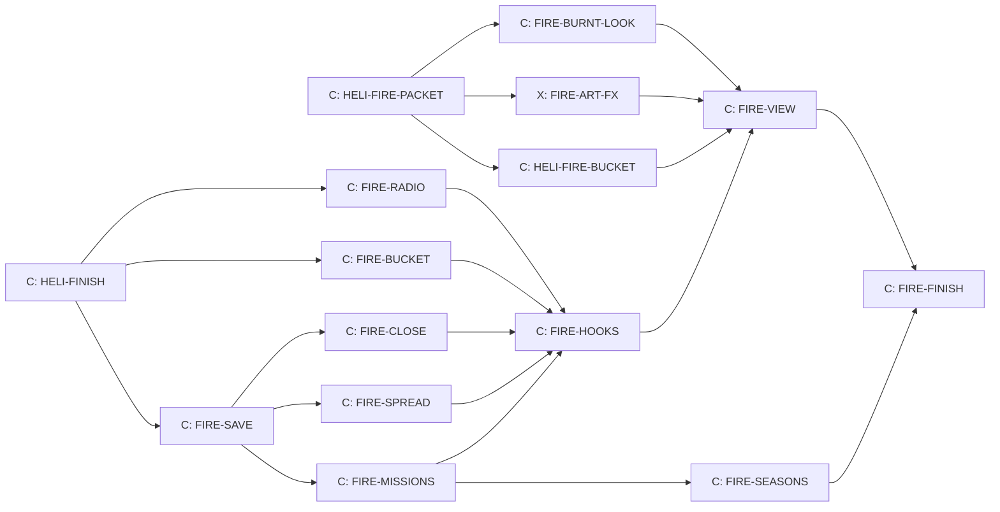

# The helicopter, H2 Fire

Design packet for the second helicopter sprint, written 14 October 2026 by
Claude from Kyle's storyboard ("Helicopter Storyboard Ideas", a Claude Docs
page Kyle owns). It builds on H1 First flight (`docs/HELICOPTER.md`): the
same flying, cable, fuel, crashes, radio filter, save field and hooks. Read
that packet first; this one only adds to it. Design only: no game code.

Who builds: Claude owns the Flying line, design and build (Kyle, 14 October
2026). The art in section 14 can start now: the bucket and the burnt look
are Claude's Blender recipes, the fire and smoke atlas is Codex's.
Every Claude build card waits for HELI-FINISH, so H2 never edits a file the
H1 finishing pass is still changing.

## 1. Kyle's decisions this packet follows

| Topic | Decision (storyboard, 14 October 2026) |
| --- | --- |
| How missions arrive | Over the radio, mid-flight, after a secret random number of refuels, 3 to 6 |
| Never | During a race or in the opening |
| How often (Kyle, 14 October, later the same day) | The same kind may come twice in a row (wildfire season); what matters is that missions do not come so often that a racing session turns into firefighting. No smoke check |
| Answering | Now, or finish what you are doing; a fire grows while you wait |
| Dispatch board | Everyday jobs only; emergencies come only by radio |
| Forest fire | Fit the bucket, scoop from a lake, drop on the fire until it is out |
| Reward | 6,300 credits (was 1,500) and a firefighter badge |
| Where | Forest courses with water nearby; snow courses cannot burn; first one picked at random |
| New courses (Kyle, 14 October) | Every new course gets a lake or other body of water somewhere; a course with enough trees can burn |
| Growth | Over your next few flights; faster uphill and with the wind |
| Days | Play days, not calendar days: a week away burns nothing |
| Neglect | The course burns and closes 10 play days, never lost; buyback 10,000 credits, 1,000 less each play day, free on day 10 |
| Coming back | Black trees and grey ground, then green shoots, then pink fireweed |
| Art cost | Start with one course that can burn |
| Bucket damage | A dented bucket leaks and carries less until repaired |
| Aim | A target-lock helping circle that shrinks as Lab lessons are passed |
| Voices | Rangers (Sarah) and fire calls (Roger), through the same scratchy radio |

## 2. H2 in one paragraph

You are flying a job when the radio crackles: "Calling all pilots." Smoke in
the forest at Tremblant Woods. Press R to answer, or carry on and answer
later while the fire grows. At the home pad you fit the bucket. You hover low
and slow over the lake until it fills, fly heavy to the smoke, and hold H to
pour. A big ring on the ground shows where the water will land. Fire grows
uphill and downwind between drops, so you hit the hot edge first. When the
last cell goes out, Roger thanks you, 6,300 credits land and the firefighter
badge is yours. Leave it long enough and the woods burn: the course closes
for 10 play days, you can buy it back early, and when it reopens it is black,
then green, then pink with fireweed.

## 3. The mission engine

New file `src/heli/heli-missions.js`, pure and repeatable. H2 has one kind,
**fire**. Rescues join the same engine in H4 (`docs/HELI_RESCUE.md` section
3), with dispatch seasons that weight which kind comes.

### 3.1 The secret count

- The engine **arms** when lesson 4 (carry and set down) is done: the bucket
  hangs on the cable, so the cable lesson comes first. Lessons and the
  opening never bring a call.
- On arming it makes a mission seed: a 32-bit hash of the date it armed and
  the player's name. Every draw uses its own generator,
  `makeRng(mix(seed, purpose, n))` from `src/rng.js`, so one draw never
  shifts another and the same save always gives the same missions.
- **need** = `int(3, 6)` from draw n. **count** starts at 0.
- Each successful pump purchase (`buyFuel` returning ok) adds 1 to count,
  but only while no call or mission is open. The fuel truck never counts
  (as in H1). Refuels during a mission do not count.
- When count reaches need, a call becomes **due**. Neither number is ever
  shown; only the tests read them.

### 3.2 The call

- A due call comes on the **next flight**, mid-air: at a seeded time 20 to 60
  seconds after lift-off, once the helicopter is at least 30 m above the
  ground. If you land first, it waits for the next flight.
- Never during a lesson or the opening, never during a cruise fade. Never
  during a race: the engine runs only inside the helicopter session, which
  never runs during a race.
- The call is the dispatch alert tone, then the caller's line, then a panel:
  "R: answer now". Press R within 20 seconds to answer now. Otherwise it is
  "later": the call waits in the save, R answers it at any time in the air or
  on the ground, and the board shows it with an Answer button.

### 3.3 How often: the quiet spell

Kyle: a mission now and then is welcome; firefighting every time you sit
down to race is not. Three rules keep the rate down, with no rule about
which kind came last:

- **Only while flying.** Calls come only in the air, after the secret
  count of 3 to 6 refuels. Opening the game to race never brings one.
- **The quiet spell (the timer).** After an emergency ends, no new call
  comes for the rest of that play day and the whole next play day, and not
  before 20 more minutes of engine time. So a player gets at most one
  emergency every other play day, however much they fly.
- **One at a time.** While a call waits or a mission is open, the count
  stands still.

At those rates a player who flies every day meets a fire about every second
to fourth play day, and a player who mostly races meets almost none.

### 3.4 Which kind

- A kind can be picked when its condition holds. **Fire:** a course that can
  burn (section 4.1), that the player owns, is open, not regrowing and not
  already burning.
- The pick is a seeded random pick among the kinds whose condition holds.
  The same kind may come twice or more in a row (wildfire season). In H2
  fire is the only kind; when nothing can burn (every burnable course
  closed or regrowing), the count stands still until something can.

### 3.5 After a mission

A mission ends when the fire is out or the course is lost. Then count goes
to 0, a new need is drawn and the quiet spell starts.

### 3.6 Seasons: no fires in winter

Kyle, 15 October 2026: seasons decide which emergency comes, and there is
no forest fire in winter. Card FIRE-SEASONS adds this to the engine before
H2 releases.

- **The dispatch season** turns every 12 play days, in order, starting with
  summer on the first play day: summer, autumn, winter, spring. It is worked
  out from `playDay.count`, so nothing new is saved. The board shows it:
  "Summer, play day 4 of 12".
- **Weights.** The engine's pick becomes a seeded weighted pick among the
  kinds whose condition holds, with the season's weights from
  `docs/HELI_RESCUE.md` section 3.2. For fire: summer 4, autumn 2, winter 0,
  spring 1. While fire is the only kind, a weight of 0 means no call: in
  winter the count stands still.
- **The first snow.** When winter begins, a fire still burning goes out by
  itself: no pay, no loss, and the board says "The first snow put out the
  fire at <course>." A course already closed stays closed; its play days
  keep counting.
- Roger's season lines (`heli.radio.season.summer`, `.winter`, recorded with
  RESCUE-RADIO) play at the first lift-off of those seasons.

## 4. The forest fire

New file `src/heli/heli-fire.js`, pure and repeatable, no graphics.

### 4.1 Where fires start

- **Which courses can burn.** A course can burn when all four hold:
  1. it is forest, not snow: at least 150 forest cells (6 hectares, cells
     below);
  2. it is a helicopter destination, so it has a flying area;
  3. a lake or other body of water the bucket can scoop from lies inside
     its flying area (a `basins` lake in its definition, or later a river,
     reservoir or sea marked for scooping);
  4. its burnt look has been made (section 14).
- **Today only Tremblant Woods passes all four.** Panorama Ridge has trees
  but no water; Tremblant Snow is snow; the other courses are not helicopter
  destinations yet. The rule is a check in `heli-fire.js`, not a list of
  names, so a course joins by meeting it.
- **More courses.** Kyle (14 October): every new course gets a lake or other
  body of water somewhere, and its packet says whether its forest can burn
  (FACTORY section 6, item 10). A burnable course orders its burnt look with
  the rest of its art. Older courses join when they become helicopter
  destinations (the pilot's map, Cockpit T-008) and get water and a burnt
  look.
- **The first to burn** is a seeded random pick among the courses that pass
  (Kyle). With one today it is Tremblant Woods; the pick is truly random as
  soon as a second course passes.
- Tremblant Snow shares the road but is a snow course: it never burns and
  stays open.
- **The fire grid.** The course is split into 20 m square cells. A cell is
  forest when it holds at least 3 tree obstacles (the `kind: 'tree'`
  obstacles `heli-ground.js` already reads). Roads, the lake, clearings, the
  paddock and the pad are not forest and never burn, so roads act as
  firebreaks.
- **The start cell** is a seeded pick among forest cells at least 40 m from
  any road edge, at least 150 m from the start line and from the pad, 250 to
  1,000 m from the lake shore, and outside any scar (section 8.5). It starts
  at intensity 0.75 with two forest neighbours at 0.5.

### 4.2 How it grows

Each cell has an intensity from 0 to 1. The fire moves in **spread steps**:

- One step for every 200 seconds the engine runs, on any course (simulated
  time, not the clock). FIRE-FINISH set this from play: a real bucket
  round trip, refuels included, takes about 200 s, so the section 4.5
  targets (tuned at one drop a step) hold in the air; at 90 s a fire
  answered at once took 11 drops and 36 minutes. A cruise leg counts its own flying time: its fuel
  divided by 0.6 kg/s.
- Three steps at the start of each new play day while the fire burns.
- Nothing while the game is closed, and nothing during races (racing days
  count only through the play day steps). A week away therefore burns
  nothing.

In one step, every burning cell at intensity 0.5 or more tries to light each
of its 8 forest neighbours, with chance

`p = 0.12 × slope × wind × damp`

- **slope** (uphill faster): with the rise from cell to neighbour divided by
  their distance, uphill `1 + 3 × rise`, at most 2.5; downhill
  `1 + 1.5 × rise` (rise is negative), at least 0.5. Heights come from
  `heli-ground.js`.
- **wind:** `1 + 0.12 × wind speed (m/s) × cos(angle between the wind and
  the neighbour's direction)`, at least 0.2. A 7 m/s wind makes the downwind
  neighbour 1.84 times likelier and the upwind one 0.2.
- **damp:** 0.2 for 2 steps after water lands on an unburnt forest cell (a
  wet firebreak), otherwise 1.
- Newly lit cells start at 0.25. Every burning cell gains 0.25 a step, up to
  1. Draws come from `makeRng(mix(fireSeed, step))`, so the same drops give
  the same fire.

### 4.3 Wind

Each play day has its own wind, drawn from the mission seed and the play day
count: calm 0 to 1 m/s (40%), breeze 3 to 4 m/s (40%), windy 6 to 8 m/s
(20%), from one of 8 compass points. Roger reports it with the call and at
the first lift-off of each play day while a fire burns. Wind moves the
falling water (section 6) and the fire. It does not push the helicopter in
H2: the H1 flight has no wind, and adding it would change H1's tested
numbers. Wind on the helicopter is a later card.

### 4.4 Out, and lost

- **Out:** no cell above intensity 0. A cell brought to 0 by water turns
  burnt (black) and cannot light again in this fire.
- **Lost:** burning and burnt cells together reach 80 cells (3.2 hectares)
  or 40% of the course's forest cells, whichever is smaller. The course
  burns (section 8), the mission ends with no pay, and the fire leaves the
  save.

### 4.5 Targets the builder tunes to

`tools/test-heli-fire.mjs` runs 50 seeds with a simple drop robot: one full
600 L drop per spread step, 75% of its water on burning cells, hottest
downwind edge first. The base chance 0.12 and the 150 L per intensity point
(section 6) are starting values; tune them until these hold, and record the
final numbers on the card.

| Case | Target (median of 50 seeds) |
| --- | --- |
| Left alone, calm | Lost after 12 to 16 steps |
| Left alone, windy | Lost after 8 to 11 steps |
| Answered at once | Out in 4 to 8 drops |
| Answered one play day late (3 more steps) | Out in 8 to 14 drops |
| Answered two play days late | Out in 14 to 22 drops, needing a refuel |

FIRE-SPREAD's tuning (its card, "Claude answers") changed four rules to fit
Tremblant Woods' strip of forest: cells grow before they spread, embers
carry two cells downwind, the base chance is 0.55 with 180 litres per
point, and a fire is lost at 45 cells.

In plain time: answer at once and it is about 15 to 25 minutes of flying
(5 drops in FIRE-FINISH's headless mission, at one spread step per 200 s);
a fire ignored on a racing-only player's machine is lost on its third to fifth
play day.

## 5. The bucket

New file `src/heli/heli-bucket.js`, pure, plus a water query in
`heli-ground.js`.

- **Fitting.** On the home pad's ground the board offers "Fit the bucket"
  (free) and, when fitted, "Take off the bucket". It cannot be fitted with a
  car on the cable, and a car cannot be hooked while it hangs. A visit that
  ends leaves it at the pad; only its damage is saved.
- **The swing.** The bucket is an H1 cable load (`createLoad`) whose mass is
  50 kg plus its water, so the H1 pendulum, drag, set-down and cargo hits all
  apply unchanged. `heli-cable.js` must read the load's mass each step;
  FIRE-BUCKET checks that and adds it if not.
- **Size.** 600 litres (600 kg of water). Full, it weighs 650 kg: with a full
  tank Kestrel One is 2,280 kg, well inside its lift at Tremblant (250 m) and
  at Panorama Ridge (860 m). A bigger bucket is a Lab upgrade later.
- **Scooping.** Only on water the course lists as a lake (`basins` in its
  definition; Tremblant Woods' lake). The bucket fills while its bottom is at
  least 0.3 m under the surface, at `100 × min(1, depth / 1 m)` litres a
  second, so a full dip fills it in 6 seconds. That means the helicopter
  hovering about 14 to 16 m above the water (15 m cable plus the bucket).
  - Ground speed at most 5 m/s: full rate.
  - 5 to 10 m/s: half rate, and the water drags the bucket back at 2,000 N
    per m/s of its speed (capped at the cable's limit).
  - Over 10 m/s: no filling, the same drag, and the bucket takes a light hit
    (dented, section 5.1) once per dip.
  - The helicopter's body or rotor touching the water is a crash, as for
    ground.

### 5.1 Bucket damage

The bucket hits things like a car (H1 classes by speed) and knocks trees
down the same way. It does not charge at the hit (Kyle: it carries less
until repaired). Damage only gets worse until repaired.

| Hit | State | Holds | Leaks | Repair at the pad |
| --- | --- | --- | --- | --- |
| Light (4 to 8 m/s) | Dented | 450 L | 3 L/s | 100 credits |
| Heavy (8 to 14 m/s) | Torn | 300 L | 8 L/s | 250 credits |
| Wreck (over 14 m/s) | Ruined | nothing | | 600 credits (a new bucket) |

Repair is a board button on the pad's ground. Like every H1 repair, it takes
what the player has and forgives the rest, so nobody is ever stuck without a
bucket.

## 6. Drops

- **Release.** With the bucket fitted, H never unhooks: holding H opens the
  valve and pours at 400 L/s (a full bucket in 1.5 seconds); letting go
  closes it, so split drops work. There is no way to drop the bucket itself
  in H2.
- **How water falls.** Water leaves in parcels of 25 litres, each starting
  at the bucket's position and speed. Each falls with gravity and air drag
  sized to a top falling speed of 9 m/s (water breaks into spray), and drifts
  with the wind. A parcel lands where its path meets the ground or, over
  forest, the tree tops. So water keeps moving forward as it falls: release a
  little short.
- **How wide.** Each parcel wets a disc of radius `2 + 0.12 × fall height`
  metres. Falls up to 30 m keep all the water; from 30 to 90 m the share
  that arrives falls in a straight line from all of it to 40% (spray blown
  away), and stays at 40% above that.
- **What water does.** A cell's intensity drops by the litres landing in it
  divided by 150, so 150 litres puts out a fully burning cell and a freshly
  lit edge cell needs about 40. Water on an unburnt forest cell makes it
  damp for 2 steps (section 4.2).
- **The contract between lanes.** `heli-bucket.js` produces wet patches
  `[{x, z, litres, radius}]` each step; `heli-fire.js` takes them through
  `applyWater(fire, patches)`. Neither imports the other.

### 6.1 The target-lock helping circle

- While the bucket holds water, a ring on the ground shows where the centre
  of the water would land if the whole bucket went now: the same parcel
  model run forward from the present speed, height and wind.
- **Lock:** when the ring's centre is over a burning cell, the ring turns
  from white to orange and the lock tick plays once.
- **Size.** `DROP_AIM_RINGS = [12, 8, 5, 0]` metres. H2 always uses the
  first, a big 12 m ring that reads easily. The Lab's projectile lessons
  (later) move the player down the table, until at 0 there is no ring and the
  player aims by understanding. The Lab card adds the saved tier; H2 saves
  nothing for it.
- **Kept for the fire service skin (H3).** Kyle's table gives the fire
  service skin "a water gauge and drop sight". So H2 shows the water as
  words ("Bucket: full", "half", "low", "empty"), and the skin later adds the
  litre gauge and a sight dot at the exact centre of the ring.

## 7. Rewards

- **Fire out:** 6,300 credits (was 1,500), the same in Assisted and Real (a mission is
  not a dispatch job, and a Real bonus would put it above the best race
  wins). Paid at once, capped like every other credit change.
- **The firefighter badge** with the first fire put out, shown on the
  dispatch board's header and the pilot panel with the count: "Firefighter.
  Fires out: 3". The count is what H3's fire service skin (5 fires) reads.
- **Lost fire:** nothing, and no charge.

## 8. The burnt course

### 8.1 Closing and buying back

- When a fire is lost the course burns on that play day: burn day 0.
- Closed while `days since burn < 10`, counted in play days. It reopens by
  itself on day 10, free.
- **Buyback price:** `10,000 − 1,000 × days since burn` credits: 10,000 on
  the day it burns, 1,000 on day 9. The player must have the whole price
  (it is a purchase, not a repair). Buying back reopens it at once.
- Never lost: the course stays owned, its records, ghosts, podiums and
  leaderboard times stay, and every course stays on the menu as it is.
- **Play days.** H1 counts a play day only when the helicopter is visited.
  Closure must count days the player only races, so FIRE-HOOKS also notes
  the play day when a player's profile becomes active on a date. Each
  player's save keeps its own fires and closures: one player's burnt course
  is open for the other.
- With the `forestFire` switch off nothing is closed, whatever the save
  says, and the save keeps its data.

### 8.2 On the course menu

The course's card stays where it is, its picture darkened with a soot tint
(drawn in the page, no new art), with:

- "Closed: burnt in a forest fire."
- "Reopens in 7 play days." (singular "1 play day")
- A button "Buy back: 3,000 credits", or, when short, the same button
  disabled with "You need 450 more credits."

On reopening day the card shows "Reopened after the fire." for that play day.

### 8.3 Races, Grand Prix and career while closed

- A single race, the course's Grand Prix event and qualifying there are
  refused with "Tremblant Woods is closed after a forest fire." The start
  path checks one function, `courseClosed(profile, courseId, today)`.
- A race already under way (an unfinished race in the save) finishes and
  pays as normal; a course only burns inside the helicopter session or at the
  start of a play day, never mid-race.
- The career is never set back: podiums and unlocks stay. Anything that
  needs a race at the closed course waits; nothing in the career runs on a
  clock, so nothing expires.
- Helicopter side: the course's pad and landing zone stay open (the home pad
  is there). "Race here" is not offered on a closed course. Dispatch jobs to
  and from it continue: you fly over the burn.

### 8.4 Regrowth

The look follows the play days since the burn, also after a buyback:

| Days since burn | Stage | Look |
| --- | --- | --- |
| 0 to 9 | Closed | Black trunks, grey ash ground; thin smoke wisps on days 0 to 2 |
| 10 to 19 | Black | Black trunks, grey ash ground |
| 20 to 34 | Shoots | Black trunks, green shoots through the ash |
| 35 to 59 | Fireweed | Black trunks, green ground, pink fireweed patches |
| 60 and on | Healed | The normal course; fires may start here again |

Sarah says so on the radio at the first helicopter visit of each stage
(reopened, shoots, fireweed). The look shows in races and from the air. It
is drawing only: race state, replays and world signatures never see it.
Fires never start on a course that is closed or regrowing, so while
Tremblant Woods is the only burnable course, a lost fire means no fires
until day 60. Every course that joins makes that gap rarer.

### 8.5 Scars

A fire put out leaves its burnt cells as a scar with the same art, cell by
cell: black on days 0 to 9, shoots 10 to 24, fireweed 25 to 39, gone at 40.
At most 4 scars are kept; the oldest goes first. Fires never start in a
scar.

### 8.6 Art cost

Tremblant Woods' burnt look is one set (FIRE-BURNT-LOOK): charred versions of
the tree models it uses, three ground looks (ash, shoots, green) and one
fireweed clump. The same set draws scars. Each further burnable course
costs one more set, ordered in its own course packet.

## 9. Board, radio and controls

- **The dispatch board never lists fires.** It gains a
  "Radio" box: a waiting call with its Answer button, or the mission in hand
  ("Fire at Tremblant Woods: 40% out, wind north-west 7 m/s"). Bucket
  buttons (fit, take off, repair) sit with the pump, on the home pad's
  ground. Closure notices show there as text; buyback lives on the course
  menu only.
- **New keys in the `heli` input context:** R answers the radio. H pours
  while the bucket is fitted. Nothing else changes. Gamepad: Y answers.
- **Instruments:** a fire line under the compass: bearing and distance to the
  nearest burning cell, share out, and wind ("FIRE 045° 0.8 km · 40% out ·
  wind NW 7"). The bucket in words (section 6.1).
- **The autopilot on the fire course.** With an empty bucket it flies to the
  lake's scoop point and stops in a hover 25 m above the water; with water
  aboard, to the upwind side of the hottest edge, stopping 40 m above the
  trees. Scooping and pouring are always the pilot's. It keeps H1's
  obstacle height, bank limit and hand-back rule.

## 10. Voices and lines

All lines go through H1's radio filter in `heli-audio.js`. The line table
gains a voice per line: Brian (instructor), **Sarah** (stock voice, warm and
clear, voice id `EXAVITQu4vr4xnSDxMaL`) for the park rangers and **Roger**
(stock voice, quick and confident, voice id `CwhRBWXzGAHq8TQ4Fs17`) for fire
dispatch. Neither is used by the crew. Same settings as Brian. Lines name no
prices and no course, so new burnable courses need no new lines; the panel
names the course.

| Id | Voice | Line |
| --- | --- | --- |
| `heli.radio.fire.call` | Roger | Calling all pilots, calling all pilots. Smoke and flames reported in the forest. Kestrel One, can you take it? |
| `heli.radio.fire.answer` | Roger | Thank you, Kestrel One. Fit the bucket at the pad. The lake is your water. |
| `heli.radio.fire.later` | Roger | Understood. Call us back when you can. It will not wait forever. |
| `heli.radio.fire.reminder` | Roger | Kestrel One, that fire is still burning, and it is growing. |
| `heli.radio.wind.calm` | Roger | Wind is light today. |
| `heli.radio.wind.breeze` | Roger | There is a breeze. Watch where the water drifts. |
| `heli.radio.wind.strong` | Roger | It is windy out there. The fire runs with the wind, so hit the downwind side first. |
| `heli.radio.fire.half` | Roger | Good work, Kestrel One. It is half out. |
| `heli.radio.fire.out` | Roger | That is the last of it. Fire is out. Great flying, Kestrel One. |
| `heli.radio.fire.lost` | Roger | We have lost those woods. The course is closed. Nobody was hurt. |
| `heli.radio.fire.thanks` | Sarah | From all of us at the park, thank you. The animals thank you too. |
| `heli.radio.burn.reopen` | Sarah | The burnt woods are open again. All black for now, but it will come back. |
| `heli.radio.burn.shoots` | Sarah | Green shoots are coming up in the burn. |
| `heli.radio.burn.fireweed` | Sarah | Fireweed is blooming in the burn. It is always the first flower back after a fire. |
| `heli.radio.bucket.first` | Brian | That is the bucket. Hover low and slow over the lake and let it sink and fill. |
| `heli.radio.bucket.full` | Brian | Bucket is full. She is heavier now, so give her more collective. |
| `heli.radio.bucket.fast` | Brian | Too fast over the water. Slow down or you will tear the bucket. |
| `heli.radio.drop.tip` | Brian | Hold H to let the water go. Drop low, and a little short. The water keeps moving as it falls. |
| `heli.radio.bucket.dented` | Brian | You dented the bucket. It will leak until the shop fixes it. |

19 lines, made once each through `tools/audio/elevenlabs.mjs` and fitted to
the month's voice credits; if credits run short, the three regrowth lines
wait (the menu text carries the news). Brian's first two bucket lines play
only on the first fitting and first fill.

## 11. Sound cues

Added to the cue tables in `heli-audio.js`. HELI-HOOKS already maps
`HELI_CUES` into `src/sound-bank.js` with one line, so H2 needs no
`sound-bank` lock and never touches mastering. Library sounds first
(Freesound CC0, through `tools/audio/freesound.mjs`), tones where noted.

| Cue | Bus | When |
| --- | --- | --- |
| `heli.fire.alert` | interface | Dispatch alert before a call: two alternating tones (made from tones) |
| `heli.fire.crackle` | ambience | Loop; louder with burning cells and nearer, heard within 400 m |
| `heli.bucket.scoop` | vehicle | Loop while filling; rate follows the fill rate |
| `heli.bucket.pour` | vehicle | While H pours |
| `heli.fire.hiss` | ambience | Steam hiss where water lands on fire, scaled by litres |
| `heli.bucket.dent` | vehicle | A bucket hit: a dull metal clank |
| `heli.aim.lock` | interface | Short tick when the ring locks |
| `heli.badge` | interface | Short rising chime with the badge (tones) |

Loudness: the crackle sits under the rotor (volume 0.5 before distance), the
alert at the H1 radio click's level. Round one listening goes with
FIRE-RADIO's change note, three rounds at most.

## 12. Save fields

Added to `profile.heli`, all optional, version stays 1. Before any of these
land, `normalizeHeli` must keep keys it does not know, so a one-release
rollback loses nothing (the H1 save review rule). It does not yet. FIRE-SAVE's
first commit adds it, and the `forestFire` switch turns on only in a release
after one that already carries that change (H1's own release, if the H1
finishing pass picks it up first).

```
missions: {seed, draws, need, count, last: 'fire' | null,
  call: null | {kind, id, courseId, day, answered},
  quiet: {untilDay, engineSeconds}, firesOut, badges: ['firefighter']}
fire: null | {id, courseId, seed, startDay, steps, engineSeconds,
  burning: [[cell, percent]], burnt: [cell], damp: [[cell, steps]]}
burnt: {courseId: {day, boughtBack, heard?: 'reopen' | 'shoots' | 'fireweed'}}
  (heard: Sarah's last regrowth news, only forward; a new burn has none)
scars: [{courseId, day, cells: [cell]}]
bucket: {damage: 0 | 1 | 2 | 3}
```

- A cell is one whole number: `(i + 512) × 1024 + (j + 512)` for grid column
  i and row j. A fire holds at most 80 burning and burnt cells, so the field
  stays small.
- Numbers are counts with H1's limits; unknown courses, kinds and badges are
  dropped; at most 4 scars; damp steps at most 2.
- Burnt entries at 60 days or more are removed when a new play day is noted.
- Every new helper takes `{enabled}` and refuses with the switch off, like
  H1's. Credits never go below zero (repairs) and buyback needs the full
  price.
- A new fixture `tools/fixtures/saves/11-heli-fire.json` (written in
  `createHeli()` order) with a waiting call, a fire burning, a course burnt
  on day 4, one scar and a dented bucket. The save checker runs; the three
  suites that count the roster rise from ten to eleven.

## 13. Files, switch, locks and hooks

- **Switch:** `forestFire: 'dev'` in `src/feature-flags.js`, effective only
  with `helicopter` on. The count in `tools/test-feature-flags.mjs` rises by
  one.

| File | Holds | Card |
| --- | --- | --- |
| `src/course-closures.js` | Closure, buyback price, regrowth stage; pure, outside `src/heli/` so the course menu can read it | FIRE-SAVE |
| `src/heli/heli-save.js` | The new fields, normalizer, mission and fire records, bucket repair, buyback | FIRE-SAVE |
| `src/heli/heli-missions.js` | Count, need, call timing, the quiet spell, kinds | FIRE-MISSIONS |
| `src/heli/heli-fire.js` | Grid, start, spread, wind, water, out, lost, scars | FIRE-SPREAD |
| `src/heli/heli-bucket.js`, water query in `heli-ground.js` | Fitting, scoop, pour, parcels, aim ring, damage | FIRE-BUCKET |
| `src/heli/heli-radio-lines.js`, `heli-audio.js` | Lines with voices, cues | FIRE-RADIO |
| `src/heli/heli-session.js`, `heli-board.js`, `src/app.js`, `src/render3d.js` | Wiring | FIRE-HOOKS |
| `src/heli/heli-fire-view.js`, `heli-scene.js`, `heli-ui.js`, `heli-ui.css`, `src/burnt-look.js` | Drawing only | FIRE-VIEW |
| `src/screen-courses.js`, `src/course-access-ui.js` | The closed card and buyback | FIRE-CLOSE |

- **Locks.** FIRE-SAVE holds `save-shape`. FIRE-HOOKS holds
  `busy-game-files`, once, briefly: in `app.js` the play day on profile
  activation, the race start check, the session's new events; in
  `render3d.js` one call into `burnt-look.js` for races. No card needs
  `sound-bank`, `audio-mix`, `surfaces`, `circuit-registry` or
  `world-signatures`. `src/course-access.js` is not edited.
- **Import guard.** `src/heli/` is still imported only through the hooks.
  `course-closures.js` and `burnt-look.js` live outside it and import
  nothing from it.
- **Unlocked shared files:** `input-contexts.js` (R and Y in the `heli`
  context), `screen-courses.js`, `course-access-ui.js`.
- **What stays exact:** race replays, world signatures (measured with no
  burn), combat balance, other courses, and every H1 test.

## 14. Art cards (can start now)

Two are Claude's, built as Blender recipes by the main design session (14
October 2026); the fire and smoke atlas is Codex's. All three follow SPEC
0.11: CC0 first, then CC-BY with credit, at most three rounds, one comparison
sheet per round (JPG, 500 KB at most) under `docs/board/looks/heli-fire/`,
judged by Claude. Gritty and real, never toy-like. Blender files are rebuilt
from scripts in `tools/blender/` and never committed.

**HELI-FIRE-BUCKET (Claude): the water bucket.** Recipe
`tools/blender/fire-bucket.py`, output `public/assets/heli/fire-bucket.glb`.
A collapsible firefighting bucket like a real helicopter bucket: orange and
black fabric body with a steel rim, a release valve at the bottom, four
rigging lines up to a top ring. Metres, +Y up, origin at the top ring where
the cable hook meets it (like `cargo-hook.glb`). About 1.1 m across, body
1.3 m tall, rigging 2.5 m; the H1 cable stays 15 m and is drawn in code.
Nodes, named exactly: `bucket`, `rigging`, `valve`, `water` (a disc at the
water surface; the full state shows it at the rim, the empty state hides it,
and the game moves it by fill in between), and `bucket_dented` (the same body
crumpled, hidden by default, shown for the dented, torn and ruined states).
At most 3,000 triangles, 1K textures, PBR. Original from simple shapes, like
the H1 accessories; no donor needed.

**FIRE-ART-FX (Codex): fire, smoke and water.** One atlas
`public/assets/heli/fire-fx.png` (1024 square, alpha) and its frame table
`fire-fx.json`, built by a recipe from the Kenney particle pack (CC0,
already in `C:/Users/kyleb/dev/art-library/kenney-particle-pack`: `fire_*`,
`flame_*`, `smoke_*`, `scorch_*`, `circle_*`, `dirt_*`). Frames: flames 6,
smoke 6 (grey-brown, thick at the base), steam 2 (white), water spray 2,
ember 1, ground scorch 3. The comparison sheet shows the atlas over a still
of Tremblant Woods from 150 m, with a smoke column, a burning edge and a
water drop.

**FIRE-BURNT-LOOK (Claude): Tremblant Woods after the fire.** Recipes in
`tools/blender/`, output under `public/assets/burnt/tremblant-woods/`:

- A charred version of each tree model Tremblant Woods places (its scenery
  and track kits): black trunks and limbs, no needles or leaves. Same origin,
  scale and node names as the original, so the game swaps one for the other.
- A ground look for the forest floor per stage in section 8.4: black with
  grey ash (closed and black), ash with green shoots (shoots), green with ash
  patches (fireweed). Textures at most 1K, tiling; a tint on the course's own
  ground is fine if it reads right from the road and from the air.
- One fireweed clump (pink flower spikes on green stems), at most 300
  triangles, for instancing.
- Look target: real Laurentian forest after a fire: black poles over grey
  ash, then green, then fireweed pink. The Quaternius Ultimate Nature pack
  (CC0) has dead trees if charring the course's own trees falls short.
- The sheet shows the four stages (closed, black, shoots, fireweed) from the
  Lakeshore straight and from 150 m. Scars (section 8.5) reuse the same set.

## 15. Cards and order



The three art cards start now (two Claude, one Codex). When HELI-FINISH merges, FIRE-SAVE,
FIRE-BUCKET and FIRE-RADIO start at once; FIRE-MISSIONS, FIRE-SPREAD and
FIRE-CLOSE follow FIRE-SAVE together (different files). Until the art
passes, FIRE-VIEW may draw plain stand-ins in dev builds only.

## 16. Tests and acceptance

- `tools/test-heli-missions.mjs`: need is always 3 to 6; the same save gives
  the same needs and call times; only pump purchases count, and not during a
  mission; never a call in a lesson, the opening or a cruise fade; the quiet
  spell (no call that play day or the next, nor within 20 minutes of engine
  time); the same kind may repeat; no call when nothing can burn; answer
  now and answer later.
- `tools/test-heli-fire.mjs`: the four rules for a course that can burn
  (Tremblant Woods passes, Panorama Ridge and Tremblant Snow do not); start
  cell rules; spread faster uphill and
  downwind; roads and the lake never burn; damp cells; out and lost; the
  section 4.5 targets across 50 seeds; same drops give the same fire.
- `tools/test-heli-bucket.mjs`: fill rates by depth and speed; mass follows
  water; pour rate; parcels land forward of the release and downwind; wider
  and thinner from higher; the aim ring's centre agrees with the parcels to
  within 2 m; damage states, leaks and repairs.
- `tools/test-course-closures.mjs`: closed days, buyback price each day, free
  on day 10, stages by day, scars, switch off opens everything, per player.
- `tools/test-heli-save.mjs` (extended) with the save checker and fixture 11;
  unknown keys survive.
- `tools/test-heli-fire-session.mjs`: a headless mission flown by script:
  the call on a flight, answer, fit the bucket, scoop at Tremblant's lake,
  drops until out, 6,300 credits and the badge; and the neglect path to a
  closed course and its buyback. Same fingerprint every run.
- Race replays, world signatures and combat balance unchanged; every H1
  test unchanged.
- Frame check (rule 8) once FIRE-VIEW is reachable: 150 m over a 60-cell
  fire at Tremblant Woods, and a race on the burnt course, Performance and
  High, p95 at most 18.5 ms. Fire sprites capped at 400 (High) and 200
  (Performance).
- FIRE-FINISH: Claude flies a fire to the end and lets one burn, sends Kyle
  pictures of the fire, the drop and each regrowth stage, and the release
  waits for Kyle's word.

## 17. Kyle's answers (14 October 2026)

- No smoke check. The same kind may come twice in a row; the quiet spell
  (section 3.3) keeps missions from taking over racing time.
- Any forest course with water nearby can burn, picked at random; every new
  course gets a body of water. Tremblant Woods is simply the only one that
  qualifies today (section 4.1).
- Search and rescue is H4 Rescue (Cockpit T-037). It joins this mission
  engine as a second emergency when its packet is written.
