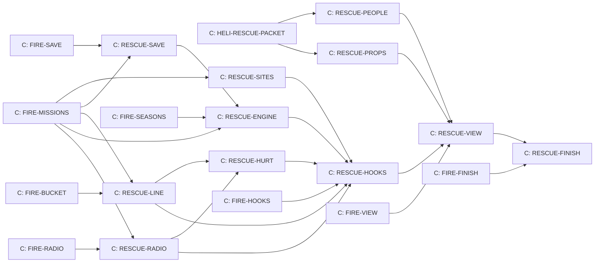

# The helicopter, H4 Rescue

Design packet for the helicopter's rescue sprint, written 14 October 2026 by
Claude from Kyle's storyboard ("Helicopter Storyboard Ideas", a Claude Docs
page Kyle owns) and Kyle's answers that day. It builds on H1 First flight
(`docs/HELICOPTER.md`) and H2 Fire (`docs/HELI_FIRE.md`): the same flying,
cable, fuel, crashes, radio, save field and mission engine. Read those
first; this packet only adds to them. Design only: no game code.

Who builds: Claude owns the Flying line, design and build, and the main
design session makes the people and props as original Blender recipes
(section 13); those start now. Every Claude build card waits for H2's
FIRE-MISSIONS (the engine it joins) and for the H2 card that last touches
the same files.

## 1. Kyle's decisions this packet follows

| Topic | Decision |
| --- | --- |
| Missions (storyboard) | Hoist rescue (3,850 credits), avalanche beacon search (3,850), lost hiker before dark (3,500), supply run (4,850); the storyboard's 1,200 and 1,000 were raised by HELI-PAY-CONTINUE |
| Emergencies (14 October) | Search and rescue is another emergency beside fires, through the same radio engine |
| How often (14 October) | The same kind may come twice in a row; what matters is that missions do not take over racing time |
| Missed calls (storyboard) | Rescues left too long go to another pilot, and you miss the pay |
| Voices (storyboard) | Mountain rescue, fire calls and the lodge: Roger; park rangers: Sarah; the instructor: Brian |
| Skins (storyboard, H3) | Medevac after 5 hoist rescues (a stretcher and a winch); search and rescue after 5 searches (a searchlight and a heat camera) |
| Supply run (storyboard) | The road to the avalanche course is cut off: Summit Run, whose avalanche (P4-AVALANCHE) cuts the road at the Gallery |
| One helicopter (Kyle) | Kestrel One does every rescue; no second helicopter yet |
| Lessons (storyboard) | Hoist rescue teaches a steady hover and the swing; the beacon teaches that signals weaken with distance; the hiker teaches search patterns; the supply run teaches weight and thin air |

## 2. H4 in one paragraph

The radio crackles. A skier is buried under an avalanche on the ski hill at
Tremblant Snow, or a driver has gone off the road below the ridge at
Panorama Ridge, or a hiker is lost in the woods and it will soon be dark, or
the avalanche on Summit Run has cut the road to the summit hut. You answer, fit the rescue line at the pad
with the rescuer clipped on, and fly. Over the avalanche you follow the
beacon's beeps, faster and faster, and lower the rescuer onto the spot to
dig. Below the ridge you hold a steady hover beside a steep slope while the
rescuer clips the driver on, then carry them both, gently, to the paramedics.
Over the forest you fly a search pattern until an orange flare goes up. A
clock on the panel counts down, and the people you carry can get hurt: a
bump, a hard set-down or a long wait makes them worse and the pay smaller.
Run out of time or crash and the ground team brings them out badly hurt,
you pay for the call-out, and your progress toward that skin drops.

## 3. Joining the mission engine

H2's engine (`src/heli/heli-missions.js`, `docs/HELI_FIRE.md` section 3)
stays as it is: the secret 3 to 6 refuels, the call mid-flight, answer now
with R or later, the quiet spell after each emergency, one at a time. H4
adds four kinds and two rules.

### 3.1 The kinds and where they happen

H4 uses H1's three destinations and adds a fourth, **Summit Run** (section
5.5), so the supply run can go where the storyboard puts it. Cloudbreak
Skyway, the storyboard's hoist rescue road, joins when the pilot's map
(Cockpit T-008) makes it a destination; the hoist table then gains a row.

| Kind | Caller | Where in H4 | Condition |
| --- | --- | --- | --- |
| `fire` (H2) | Roger | A course that can burn | As in H2 |
| `hiker` | Sarah | Tremblant Woods, Panorama Ridge | Always (forest destinations) |
| `avalanche` | Roger | Tremblant Snow's ski hill; Summit Run's snowfields | Always |
| `hoist` | Roger | Panorama Ridge, below The Ridge and Mountain Climb | Always |
| `supply` | Roger (the lodge) | Summit Run, from its start area up to the summit hut; Tremblant Snow's lodge while Summit Run is not a destination | Always |

Rescues do not need the player to own the course: anyone can fly anywhere.

### 3.2 Seasons: which kind comes

Kyle's "wildfire season", made concrete. The engine's pick is a seeded
weighted pick among the kinds whose condition holds, with weights by
**dispatch season**. A season lasts 12 play days and they turn in order,
starting with summer at the first play day: summer, autumn, winter, spring.
Seasons change only which emergencies come; the courses look as they always
do.

| Kind | Summer | Autumn | Winter | Spring |
| --- | --- | --- | --- | --- |
| fire | 4 | 2 | 0 | 1 |
| hiker | 2 | 2 | 1 | 2 |
| avalanche | 0 | 1 | 3 | 2 |
| hoist | 1 | 1 | 1 | 1 |
| supply | 0 | 1 | 3 | 1 |

So summer is mostly fires, winter mostly avalanches and supply runs, and the
same kind can come several times running. Roger says when summer and winter
begin. The quiet spell holds for every kind, so the overall rate stays H2's:
at most one emergency every other play day. Question 1 in section 15.

### 3.3 Calls left waiting

A fire waits and grows (H2). A rescue call that is not answered goes to
another crew at the end of the next play day, or after 2 more flights,
whichever comes first: no pay, no charge, and the quiet spell starts as if
it had ended. Roger says so the next time the radio is on.

### 3.4 The mission clock

Once answered, each rescue has a clock, shown on the panel. It counts
simulated time while the helicopter session runs, in the air or on the
ground, including cruise legs (their flying time, as in H2).

| Kind | Clock | The story |
| --- | --- | --- |
| hiker | 15 minutes | Until dark; the light dims over the last 3 minutes |
| avalanche | 12 minutes | A buried skier needs help fast |
| hoist | 12 minutes | The driver is cold and hurt |
| supply | 25 minutes | The lodge can last that long |

- **Getting cold.** When two thirds of the clock has gone, a casualty who
  is still unhurt becomes hurt (cold and waiting; section 4.1). Roger:
  "They are getting cold. Hurry."
- **Out of time is a failure** (section 4.2): the ground team brings the
  person out badly hurt.
- **Leaving the helicopter** (back to the menu, a race) with a rescue in
  hand is the same failure. A rescue cannot be paused by walking away from
  it.
- **A crash** with people aboard or on the line is the same failure, on top
  of H1's crash repair.

### 3.5 After a rescue

As in H2: count goes to 0, a new need is drawn, the quiet spell starts.

### 3.6 No fires in winter

Kyle, 15 October: seasons decide, and there is no forest fire in winter.
The season clock itself goes into the engine with H2 (FIRE-SEASONS,
`docs/HELI_FIRE.md` section 3.6); RESCUE-ENGINE adds the rescue rows of
section 3.2's table to it.

## 4. The rescue line

New file `src/heli/heli-rescue.js`, pure and repeatable.

- **Short-haul, not a winch.** Real mountain rescue teams often fly a
  rescuer on a fixed line under the helicopter. H4 does exactly that with
  H1's 15 m cable, so nothing in the cable changes. The winch that reels a
  line in and out belongs to the medevac skin (H3's skin table: "a stretcher
  and a winch"), so H4 leaves it for that skin.
- **Fitting.** On the home pad's ground the board offers "Fit the rescue
  line" (free) and "Take off the rescue line", like the bucket. One fitting
  at a time: car, bucket or line. The rescuer clips on at the pad and rides
  the line to the site.
- **Weights.** Rescuer with gear 90 kg; a casualty 80 kg; both together
  170 kg on the line. These are H1 cable loads, so the pendulum, drag and
  set-down rules all apply.
- **People on the line.** Airspeed at most 20 m/s (about 40 knots) with
  anyone on the line. Over 25 m/s Roger warns. Anyone on the line striking
  terrain, a tree or a building faster than 4 m/s is a **bump**, and bumps
  hurt people (section 4.1).
- **H does nothing** while people are on the line: nobody can be dropped.
- **Setting the rescuer down at the site.** The rescuer must rest on the
  ground (the cable's load at rest, as in H1) within 3 m of the casualty or
  the beacon, with the helicopter moving under 1.5 m/s. Then hold. If the
  rescuer is dragged faster than 1.5 m/s or lifted off before the hold
  ends, the hold starts again ("Hold her steady").
- **The hold.** Hoist rescue: 8 seconds while the driver is strapped in.
  Avalanche: 12 seconds of digging, shown as a bar. Then the casualty is
  clipped on and the load becomes 170 kg.
- **Handover.** Set the pair down inside a destination's landing circle (12
  m, H1) at 1 m/s or less: two paramedics walk over, the rescue is done and
  paid. The home pad's circle works for every kind; the site course's own
  landing zone works too.

### 4.1 People can get hurt

Kyle, 15 October 2026: people can get hurt, and failure has a cost.

- **Condition.** Every casualty (the hiker, the buried skier, the stranded
  driver) starts **unhurt** and can become **hurt**, then **badly hurt**.
  People are hurt, never killed.
- **What makes it worse** (one step each unless noted):
  - a bump on the line faster than 4 m/s; faster than 8 m/s, two steps;
  - setting the pair down anywhere harder than 1 m/s, once lifted: one step
    (a touchdown the cable counts as a bump, above 4 m/s, is counted once, as
    the bump);
  - the hiker in the cabin: an H1 hard landing; a crash makes them badly
    hurt;
  - the clock passing two thirds while they are still unhurt (section 3.4).
  - The rescuer is a professional and is never hurt.
- **Pay by condition** at the handover: unhurt 100%, hurt 60%, badly hurt
  25% (section 6). This replaces the flat 300 credits a bump that RESCUE-LINE
  built; card RESCUE-HURT changes it.
- **New and changed lines** (Roger, through the radio filter): the new
  words for `rescue.bump` and `rescue.late`, and the new `rescue.hurt`,
  `rescue.badly`, `rescue.cold` and `supply.late`. RESCUE-HURT recorded them;
  they are in section 8's table.
- **What it looks like.** Unhurt: they walk to the paramedics. Hurt: they
  limp, a paramedic beside them. Badly hurt: the paramedics carry them on a
  stretcher. Roger says which, at the handover.

### 4.2 Failure and its cost

A rescue fails when the clock runs out, when the helicopter crashes with
people aboard or on the line, or when the player leaves the helicopter with
the rescue in hand. Then:

- the ground team brings the person out **badly hurt**, and Roger says so;
- **no pay**, and a **400-credit charge** for the ground team's call-out,
  taken by H1's repair rule (what the player has, the rest forgiven, never
  below zero);
- the tally toward that kind's skin **drops by one** (never below zero);
- after a crash, H1's crash repair as well.

A supply run that runs out of time pays for the crates delivered and costs
200 credits (the lodge sends a snowcat); its tally drops by one too.

A call that is never answered is not a failure: it goes to another crew and
costs nothing but the missed pay, so nobody is forced off a race to fly
(Kyle, 14 October).

## 5. The four rescues

New file `src/heli/heli-search.js`, pure and repeatable: it picks the sites,
spots the hiker and works the beacon. All picks use the mission seed
(`makeRng(mix(seed, purpose, n))`), so the same save gives the same
rescues.

### 5.1 Lost hiker (Sarah)

- **Search area.** A circle of 300 m radius around a "last seen" point,
  shown on the instruments and as a faint ring on the ground. The hiker is
  at a seeded spot in forest, within 250 m of that point, with a clear,
  level 12 m circle (H1's landing zone test) within 120 m of them.
- **Spotting.** The hiker hears you and lights an orange flare when the
  helicopter passes within 70 m of them sideways, no more than 120 m above
  the ground. The smoke rises for 60 seconds and stays marked on the
  instruments after that. Flying parallel lines about 120 m apart, low and
  slow, covers the circle in a few minutes: that is the search pattern
  lesson.
- **Pickup.** Once spotted, the hiker walks to the clearing at 1.2 m/s.
  Land inside it (a good H1 touchdown); the hiker climbs in when they
  arrive and rides in the second seat (75 kg). No rescue line needed.
- **Handover** at the home pad's circle or the site course's landing zone.
- **Dusk.** The light dims over the clock's last 3 minutes (drawing only).
  The search and rescue skin's searchlight and heat camera (H3) will later
  let the search run on into the night; H4 ends it at dark.

### 5.2 Avalanche beacon search (Roger)

- **The slide.** A debris area of 80 by 200 m on Tremblant Snow's ski hill:
  a seeded stretch of slope between 20 and 40 degrees, at least 30 m from
  the chairlift and the lodge. It is drawn as rough snow blocks. The skier's
  beacon is buried at a seeded point inside it.
- **The receiver.** The helicopter hears the beacon within 60 m, measured
  straight from the helicopter to the beacon, height included. It beeps once
  every `0.15 + 1.6 × distance / 60` seconds (1.75 s at the edge of range,
  0.15 s right on top) and the beep's pitch rises from 900 to 1,400 Hz as
  you close in. The panel shows a signal bar, full at 0 m and fading with
  the square of the distance. No arrow and no distance number: the lesson is
  that signals weaken with distance, so you find the beacon by flying toward
  faster beeps.
- **Out of range:** "No signal" on the panel. Flying the slide at 30 m or
  lower hears about 50 m to each side.
- **Digging.** Set the rescuer down within 3 m of the beacon and hold 12
  seconds (section 4). Then the skier is clipped on.
- **Handover** at Tremblant Snow's landing zone (the ski patrol's
  paramedics) or the home pad.

### 5.3 Hoist rescue (Roger)

- **The scene.** A driver went off the road and is stuck on a slope too
  steep to land on. The spot is a seeded pick on Panorama Ridge, along The
  Ridge and Mountain Climb: ground sloping 25 to 40 degrees, 10 m or more
  below the road, 20 to 120 m from its edge, no tree within 12 m (rotor
  room). Their car lies beside them. If a later course offers no such spot,
  that course simply gets no hoist rescues.
- **The rescue.** Hover so the rescuer rests within 3 m of the driver, hold
  8 seconds, lift both, carry them to the paramedics. The slope climbs
  beside you and the trees are close: a steady hover and a small swing are
  the lesson.
- **The car afterwards.** The next play day, the dispatch board offers
  "Recover the <car> from Panorama Ridge" for 500 credits: hook the car on
  the slope and set it down in the landing zone, an H1 car carry in a hard
  place. The car is a seeded pick from the customer cars Kestrel One can
  lift. The job stays on the board for 3 play days. It is an everyday job,
  so it sits on the board, not the radio.

### 5.4 Supply run (Roger, for the lodge)

- **The story.** The avalanche on Summit Run (P4-AVALANCHE) has cut the road
  above the Gallery, and the summit hut is running low. Three crates wait
  in Summit Run's start area, where the road is still open.
- **The job.** Carry each on the H1 cable up the mountain to the hut yard, a
  clear 10 m circle the game finds near the summit hut (H1's clear circle
  test), and set it down gently. Any order.
- **Thin air is the lesson.** Kestrel One lifts less the higher it goes
  (H1: thrust times e to the minus altitude over 8,500 m). Summit Run starts
  at 2,860 m and the hut is far above that, so a full tank and the heaviest
  crate do not climb out of the start area together; half a tank does. The
  crates are food 300 kg, medicine 200 kg and fuel drums 450 kg as starting
  values: RESCUE-SITES reads the hut's real height from the course and tunes
  the drums so that this holds, and records the numbers on its card.
- **Fuel.** The pump stays at the home pad (H1), and the cruise leg to
  Summit Run is long (section 5.5), so the player plans: arrive with enough
  fuel for three climbs, but light enough to lift.
- **Settled by RESCUE-SITES (14 October).** From the start area the job
  cannot be done: a crate leg there is 7.6 km and needs most of a tank. The
  crates wait instead at a pickup on the open road 100 m below where the
  race's avalanche crosses it (about 3,430 m, 2.3 km and 150 m below the hut
  yard), with the lodge's fuel truck beside them selling fuel at the pump's
  price; the drums are 640 kg. "The start area" in sections 3.1, 5.4 and
  12 means that pickup. Numbers and reasons: the RESCUE-SITES card.
- **Without Summit Run** (its switch off), the same run goes from the home
  pad to the yard by Tremblant Snow's lodge, with crates of 400, 500 and 900
  kg: snow has shut the road there instead.
- **Pay.** 1,450 credits a crate, and 500 more when all three are down before
  the clock ends (4,850 in all; was 300, 100 and 1,000). A crate released from higher than 1 m
  counts but pays 750 less (H1's drop rule, applied to the pay instead of a
  repair).

### 5.5 Summit Run, a new destination

- Added to the destinations table in `heli-jobs.js` while the `summit-run`
  switch is on (the course is in dev today): base altitude 2,860 m (the
  real start of the Pikes Peak road), placed on the small map north-west of
  Panorama Ridge. Cruise fuel: 160 kg from Tremblant Woods, 150 kg from
  Tremblant Snow, 90 kg from Panorama Ridge.
- Its landing zone is found by H1's search beside the start line, as for
  every destination. HELI-VIEW's rule holds: where the edge of the world
  shows from the air, the flying area's ceiling comes down.
- The dispatch board's everyday jobs stay on H1's three routes, so H1's job
  tests and fingerprints do not move. Summit Run is for flying your own car
  (special cars too) and for missions.
- Avalanche searches there use its Snowfields and Avalanche Gallery slopes,
  never the race road.

## 6. Rewards and badges

| Rescue | Pay (credits) | Counts toward |
| --- | --- | --- |
| Lost hiker | 1,000 (unhurt), 600 (hurt), 250 (badly hurt) | Searches |
| Avalanche | 1,200, 720, 300 | Searches |
| Hoist rescue | 1,200, 720, 300 | Hoist rescues |
| Supply run | 300 a crate, 1,000 for all three | Supply runs |
| Car recovery job | 500 | (a dispatch job) |

- The same in Assisted and Real, as for fires. A failed rescue pays
  nothing, costs 400 credits and drops that skin's tally by one (section
  4.2).
- **The rescue badge** with the first hiker, avalanche or hoist rescue,
  shown beside the firefighter badge with its count: "Rescue. 4 people
  saved."
- The counts are what H3's skins read: medevac after 5 hoist rescues,
  search and rescue after 5 searches, supply after 5 supply runs.

### 6.1 Gear, and what H3's skins add

Kyle: one helicopter, Kestrel One, for everything. Every rescue can be done
with the kit Kestrel One has in H4. The gear below makes a rescue easier or
opens more of it, and comes with H3's skins (Kyle's skin table), so H3 ties
each skin to it without changing these rescues.

| Gear | Comes with | What it does | In H4 without it |
| --- | --- | --- | --- |
| Rescue line and harness | H4, for everyone | A rescuer rides H1's 15 m cable | (the base kit) |
| Winch | Medevac skin | Reels the line from 5 to 40 m at 1.5 m/s, so you can hover higher above trees and cliffs | The fixed 15 m line: hover closer |
| Stretcher | Medevac skin | The casualty lies on a stretcher: a bump hurts only above 8 m/s, and two steps only above 14 m/s; hoist rescues pay 650 more (was 200) | A harness |
| Searchlight | Search and rescue skin | The hiker search runs 8 minutes on into the night | The search ends at dark |
| Heat camera | Search and rescue skin | The panel shows warm people within 150 m: the hiker under trees, a buried skier within 30 m | The flare and the beacon only |
| Avalanche receiver | H4, for everyone | Hears the beacon (section 5.2) | (the base kit) |

## 7. What the player sees and does

- **Board.** The radio box (H2) shows a waiting rescue with its Answer
  button, or the one in hand: "Avalanche at Tremblant Snow · 9:40 left".
  "Fit the rescue line" and "Take off the rescue line" join the bucket
  buttons. The car recovery job appears with the other jobs.
- **Instruments.** The mission line under the compass: bearing and distance
  to the search area or site, and the clock ("RESCUE 120° 0.6 km · 9:40").
  For the avalanche, the beacon's signal bar. For the supply run, crates
  delivered ("CRATES 1/3"). The clock turns orange in its last minute.
- **Autopilot.** Flies to the search area's centre, the debris area or the
  cliff spot, stopping in a hover 40 m above the obstacles, and to the
  handover circle. Searching, setting the rescuer down and landing are
  always the pilot's. H1's obstacle height, bank limit and hand-back rule
  hold; with people on the line it also holds 20 m/s.
- **No new keys.** R answers (H2). H does nothing with people on the line.

## 8. Voices and lines

Through H1's radio filter, a voice per line as H2 set up. Lines name no
prices and no courses; the panel names the place.

| Id | Voice | Line |
| --- | --- | --- |
| `heli.radio.avalanche.call` | Roger | Calling all pilots. Avalanche on the ski hill. A skier is buried. Kestrel One, can you take it? |
| `heli.radio.hoist.call` | Roger | Calling all pilots. A car has gone off the road, and the driver is stuck on the slope below. Kestrel One, can you take it? |
| `heli.radio.supply.call` | Roger | Kestrel One, this is the lodge. Snow has shut the road and we are running low. Can you fly supplies up? |
| `heli.radio.hiker.call` | Sarah | Kestrel One, park rangers here. A hiker is lost in the forest and it will be dark soon. Can you search for them? |
| `heli.radio.rescue.answer` | Roger | Thank you, Kestrel One. Fit the rescue line at the pad. Your rescuer is waiting. |
| `heli.radio.supply.answer` | Roger | Thanks, Kestrel One. Three crates are waiting by the pad. Bring them to the yard by the lodge. |
| `heli.radio.hiker.answer` | Sarah | Thank you. They were last seen inside the circle on your map. Fly low and slow, and watch for an orange flare. |
| `heli.radio.rescue.later` | Roger | Understood. If you cannot get there, another crew will. |
| `heli.radio.rescue.taken` | Roger | Another crew has taken that call, Kestrel One. |
| `heli.radio.beacon.signal` | Roger | You have a signal. Follow the beeps. Faster means closer. |
| `heli.radio.rescue.steady` | Roger | Hold her steady. The rescuer needs you still. |
| `heli.radio.rescue.clipped` | Roger | They are clipped on. Lift gently. |
| `heli.radio.rescue.fast` | Roger | Slow down! People on the line. |
| `heli.radio.rescue.bump` | Roger | Easy! You are hurting them. |
| `heli.radio.rescue.done` | Roger | Safe and sound. Great work, Kestrel One. |
| `heli.radio.rescue.late` | Roger | The ground team got there first. They are badly hurt and on their way to hospital. |
| `heli.radio.rescue.hurt` | Roger | They are hurt, but they will be all right. The paramedics have them. |
| `heli.radio.rescue.badly` | Roger | They are badly hurt. The paramedics are taking them to hospital. |
| `heli.radio.rescue.cold` | Roger | They are getting cold, Kestrel One. Hurry. |
| `heli.radio.supply.crate` | Roger | Crate is down. Thank you. |
| `heli.radio.supply.done` | Roger | That is everything. The whole lodge thanks you, Kestrel One. |
| `heli.radio.supply.late` | Roger | The lodge sent a snowcat in the end. They are still short of supplies. |
| `heli.radio.season.summer` | Roger | Wildfire season is here. Keep an eye out for smoke. |
| `heli.radio.season.winter` | Roger | Winter is here. Watch the ski hill for avalanches. |
| `heli.radio.hiker.spotted` | Sarah | That is them! There is a clearing close by. Land there and they will walk over. |
| `heli.radio.hiker.dusk` | Sarah | It is getting dark, Kestrel One. |
| `heli.radio.line.first` | Brian | That is the rescue line. Fly smooth, and keep her under forty knots with people on it. |
| `heli.radio.line.setdown` | Brian | Lower the rescuer gently, right beside them, and hold her there. |

28 lines, made once each through `tools/audio/elevenlabs.mjs` and fitted to
the month's voice credits (24 by RESCUE-RADIO; RESCUE-HURT re-recorded two
and added four).
Brian's two lines play only on the first fitting and first set-down.

## 9. Sound cues

Added to `heli-audio.js`; they reach `src/sound-bank.js` through HELI-HOOKS'
existing line, so no `sound-bank` lock. H2's dispatch alert tone opens every
call. Library sounds first (Freesound CC0), tones where noted.

| Cue | Bus | When |
| --- | --- | --- |
| `heli.beacon.beep` | interface | Each beacon beep; rate and pitch from section 5.2 (tone) |
| `heli.flare` | ambience | The hiker's flare: a pop and a hiss |
| `heli.snow.dig` | vehicle | Shovel in snow, looping during the dig |
| `heli.rescue.clip` | vehicle | A carabiner click when someone clips on |
| `heli.clock.tick` | interface | A soft tick each second in the clock's last minute (tone) |

The beeps sit above the rotor (they are the instrument you fly by), the
ticks under it. Round one of listening goes with RESCUE-RADIO's change note,
three rounds at most.

## 10. Save fields

Added to `profile.heli.missions` (H2's field), all optional, version stays
1, unknown keys kept (H2's rule):

```
last: 'fire' | 'hiker' | 'avalanche' | 'hoist' | 'supply' | null
call: null | {kind, id, courseId, day, answered, flights}
rescue: null | {kind, id, courseId, seed, clockSeconds, stage,
  crates: [0 | 1 | 2], condition: 0 | 1 | 2}
hoists, searches, supplies, rescued
badges: ['firefighter', 'rescue']
wreck: null | {courseId, carId, x, z, day}
```

- `condition` is 0 unhurt, 1 hurt, 2 badly hurt.
- `stage` is one of `fly`, `found`, `hold`, `carry`; `crates` holds 0 (at
  the pad), 1 (on the line) or 2 (delivered) for each of the three crates.
- The season is worked out from `playDay.count`; nothing saved.
- `call.flights` counts flights since a rescue call came, for section 3.3.
- Counts follow H1's limits; unknown kinds, stages and badges are dropped;
  a `wreck` older than 3 play days is removed when a new play day is noted.
- A new fixture `tools/fixtures/saves/12-heli-rescue.json` (written in
  `createHeli()` order) with a rescue in hand, a waiting call, a wreck job
  and both badges. The save checker runs; the roster suites rise by one.

## 11. Files, switch, locks and hooks

- **Switch:** `rescue: 'dev'` in `src/feature-flags.js`, effective only with
  `helicopter` on. The mission engine runs when `forestFire` or `rescue` is
  on, and offers only the kinds whose switch is on. The count in
  `tools/test-feature-flags.mjs` rises by one.

| File | Holds | Card |
| --- | --- | --- |
| `src/heli/heli-save.js` | The new mission fields and helpers | RESCUE-SAVE |
| `src/heli/heli-search.js` | Site picks, the hiker's flare, the beacon | RESCUE-SITES |
| `src/heli/heli-rescue.js` | The rescue line, set-down and hold, bumps, handover, crates | RESCUE-LINE; the casualty's condition and pay by condition, RESCUE-HURT |
| `src/heli/heli-missions.js`, `src/heli/heli-jobs.js` | New kinds, seasons, waiting calls, clocks; Summit Run as a destination; the car recovery job | RESCUE-ENGINE |
| `src/heli/heli-radio-lines.js`, `heli-audio.js` | Lines and cues | RESCUE-RADIO |
| `src/heli/heli-session.js`, `heli-board.js` | Wiring | RESCUE-HOOKS |
| `src/heli/heli-rescue-view.js`, `heli-scene.js`, `heli-ui.js`, `heli-ui.css` | Drawing only | RESCUE-VIEW |

- **Locks.** RESCUE-SAVE holds `save-shape`. Nothing else: H2's FIRE-HOOKS
  already wires the mission engine, the session's events and play days into
  `app.js`, so H4 needs no `busy-game-files`. No `sound-bank`, `audio-mix`,
  `circuit-registry` or `world-signatures`.
- **Same files as H2.** Each H4 card waits for the H2 card that last edits
  its files (section 14), so two builders never share a file.
- **What stays exact:** race replays, world signatures, combat balance,
  every H1 and H2 test.

## 12. Tests and acceptance

- `tools/test-heli-search.mjs`: site picks meet their rules (hiker in forest
  with a clearing in reach; the slide on 20 to 40 degree slope away from the
  lift; the hoist spot steep, below the road, clear of trees); Panorama
  Ridge offers at least 5 hoist spots and Tremblant Snow at least 3 slides;
  spotting distance and height; beep interval, pitch and signal bar; same
  seed, same sites.
- `tools/test-heli-rescue.mjs`: condition steps (bumps at 4 and 8 m/s, hard
  set-downs, the cabin, the cold at two thirds) and pay by condition;
  failure: badly hurt, no pay, 400 credits taken by the repair rule, the
  tally down one; weights on the line; speed warnings; bumps
  over 4 m/s and their pay; the hold resets when dragged or lifted; dig and
  strap times; handover only inside a circle at 1 m/s or less; H does
  nothing with people on the line; crates and their pay.
- `tools/test-heli-missions.mjs` (extended): season weights by play day;
  the same kind may repeat; rescues go to another crew after the next play
  day or 2 flights; clocks run in the air, on the ground and through
  cruise legs; leaving the helicopter hands the rescue on; the quiet spell
  after every kind; switches filter kinds.
- `tools/test-heli-jobs.mjs` (extended): the car recovery job appears the
  next play day, pays 500, leaves after 3 play days; Summit Run is a
  destination only with its switch on, and the day's jobs are unchanged.
- `tools/test-heli-mode.mjs` (extended): a landing zone at Summit Run, and
  the thin-air supply run: the heaviest crate and a full tank do not leave
  the start area, half a tank does.
- `tools/test-heli-save.mjs` (extended) with the save checker and fixture 12.
- `tools/test-heli-rescue-session.mjs`: one of each rescue flown headless by
  script, from the call to the pay, plus a clock running out. Same
  fingerprint every run.
- Race replays, world signatures and combat balance unchanged.
- Frame check (rule 8) once RESCUE-VIEW is reachable: hovering over the
  avalanche at Tremblant Snow with the rescuer and the snow blocks drawn,
  Performance and High, p95 at most 18.5 ms.
- RESCUE-FINISH: Claude flies each rescue, sends Kyle pictures (the flare,
  the beacon search, the hover beside the slope, the handover), and the
  release waits for Kyle's word, after H2's.

## 13. Art cards (can start now)

The main design session makes these as original Blender recipes in
`tools/blender/`, judged in at most three rounds (SPEC 0.11), one comparison
sheet per round (JPG, 500 KB at most) under `docs/board/looks/heli-rescue/`.
Gritty and real, never toy-like. Nothing here needs a download; animals stay
with Codex in H3.

**RESCUE-PEOPLE: six people.** A rescuer (red and black suit, helmet,
harness), a hiker (orange jacket, backpack), a skier (ski suit, helmet), a
stranded driver (everyday clothes) and two paramedics (green uniforms).
`public/assets/heli/people/`, one file each, metres, +Y up, origin at the
feet, with a `harness` empty at the clip point. Poses, as separate files or
named animations: hanging in a harness (the rescuer alone, and rescuer with
casualty clipped together), standing and waving, sitting on a slope, lying
on a stretcher, walking (a loop for the hiker and the paramedics). At most
6,000 triangles a person and 1K textures. Real proportions and plain
colours; no cartoon faces. The Quaternius people in the art library (CC0)
may serve as a base.

**RESCUE-PROPS: the gear and the scene.** Under `public/assets/heli/rescue/`:

- The winch (a side-mounted hoist with its arm, origin where it bolts to the
  fuselage, a `line_out` empty where the line leaves it), the stretcher (a
  rescue litter with four lift straps meeting at a `harness` empty), and the
  searchlight (a belly light with a `beam` empty pointing down and forward).
  These three are the H3 skins' gear (section 6.1); made now so H3 can
  simply fit them.
- An avalanche beacon (a small transceiver, for the skier and the dig) and
  avalanche debris (rough snow blocks for instancing, at most 3,000
  triangles together).
- Three supply crates (food, medicine, a pallet of fuel drums), each with the
  H1 crate's origin at its top centre, at most 1,500 triangles each; the
  game scales nothing, the masses live in code.
- The hiker's orange flare smoke reuses H2's fire and smoke atlas, tinted.

## 14. Cards and order



The people and props start now. Every build card needs FIRE-MISSIONS, the
engine it joins, and the H2 card that last touches its files, so H4 builds
alongside H2 without two builders in one file. H4 releases after H2.

## 15. Kyle's answers (15 October 2026)

1. **Seasons: yes.** Seasons decide which emergency comes, and there is no
   forest fire in winter (section 3.6; FIRE-SEASONS puts the clock in before
   H2 releases).
2. **People can get hurt, and failure has a cost** (sections 4.1 and 4.2):
   bumps, hard set-downs and waiting make a casualty worse and the pay
   smaller; a failed rescue brings them out badly hurt, pays nothing, costs
   400 credits and drops that skin's tally by one. People are hurt, never
   killed; an unanswered call costs nothing.
