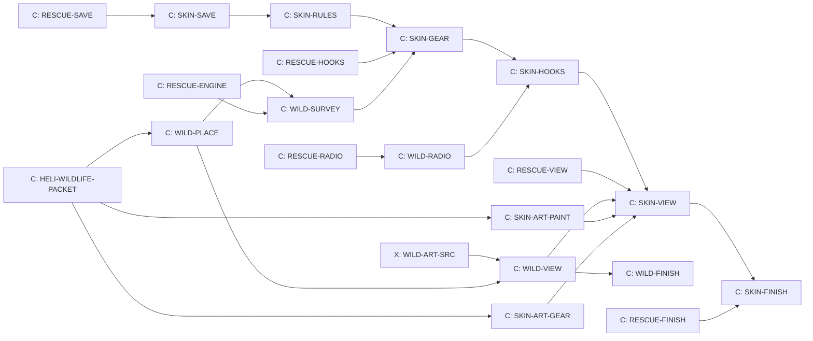

# The helicopter, H3 Wildlife and skins

Design packet for the helicopter's wildlife and skins sprint (Cockpit
T-036), written 14 October 2026 by Claude from Kyle's storyboard
("Helicopter Storyboard Ideas", a Claude Docs page Kyle owns). It builds on
H1 (`docs/HELICOPTER.md`), H2 Fire (`docs/HELI_FIRE.md`) and H4 Rescue
(`docs/HELI_RESCUE.md`): the skins here fit the gear those packets left for
them. Read those first. Design only: no game code.

Two parts that can ship apart:

- **Wildlife:** local animals beside the road on every course, in races and
  from the air, and the wildlife count, an everyday job on the dispatch
  board. Animals in races need no helicopter.
- **Skins and dirt:** a mission skin earned after five missions of one kind
  or bought sooner, each a fresh coat of paint plus one piece of matching
  gear; dirt that builds as you fly, and a 100-credit wash.

Who builds: Claude owns the design and build. Codex sources the animals
(WILD-ART-SRC, already on the board). The main design session makes the
skin palettes, grime and gear as Blender recipes (section 12).

## 1. Kyle's decisions this packet follows

| Topic | Decision (storyboard, 14 October 2026) |
| --- | --- |
| Animals | Only animals that really live in that kind of place: three or four common ones and one rare one per course (the table in WILD-ART-SRC) |
| How many | At racing speed about one sighting every 30 to 60 seconds; a herd counts as one; the rare animal about one race in five |
| Races | Animals stay off the racing line and never change a race |
| From the air | You see more from the helicopter, which is what the wildlife count is for |
| Wildlife count | Count bears, wolves, cougars, deer and moose for the park rangers; about 600 credits; the lesson is sampling and estimating |
| Facts | Bears and wolves at Tremblant, cougars at Summit and the western mountains, deer nearly everywhere; no cougars at Tremblant |
| Skins | Earned after 5 missions of one kind, or bought sooner; a fresh coat of paint plus one piece of matching gear; the first skin is whichever kind reaches 5 first |
| Dirt | Starts new, gets dirty with use: dust on dry courses, mud, soot after a fire, salt by the sea; a wash costs 100 credits |
| One helicopter | Kestrel One for everything (Kyle) |
| TV station | Barely News, a bear's head in headphones, "Just the bear facts"; the logo is `public/assets/heli/barely-news.svg` |

## 2. H3 in one paragraph

On the Lakeshore at Tremblant Woods a moose stands in the shallows and lifts
its head as you pass; a minute later two deer bound off into the trees. One
race in five, a wolf. Over at the helipad, the dispatch board has a wildlife
count: Sarah wants to know how many moose live in a square of forest. You
fly straight lines across it, high enough not to scare them, count what you
pass and work out the whole from the part you covered. Every mission adds to
a tally; at five fires the paint shop has a red and yellow fire service coat
waiting, with a water gauge and a drop sight. Fly through enough smoke and
mud and Kestrel One turns grimy, until you pay for a wash.

## 3. Animals beside the road

New file `src/wildlife.js`, pure, outside `src/heli/` so races and the
helicopter share it. Drawing lives in `src/wildlife-view.js`.

### 3.1 Which animals where

The species table in `docs/board/cards/WILD-ART-SRC.md` (from the
storyboard) is the source. `wildlife.js` keeps it per course: common species
with weights, herd sizes and one rare species.

| Course | Common (herd size) | Rare |
| --- | --- | --- |
| Tremblant Woods | White-tailed deer (1 to 3), moose (1 to 2), black bear (1, sometimes with 1 to 2 cubs), beaver (1, at the lake) | Eastern wolf (2 to 4) |
| Tremblant Snow | White-tailed deer (1 to 3), moose (1), wolf tracks in the snow (a decal) | Eastern wolf (2 to 3) |
| Panorama Ridge | Eastern grey kangaroo (2 to 6), sulphur-crested cockatoo (a flock of 4 to 8), kookaburra (1 to 2) | Echidna crossing near the track (1) |
| Summit Run | Yellow-bellied marmot (1 to 3), bighorn sheep (2 to 5), mule deer (1 to 3), raven (1 to 2) | Cougar (1) |
| High Country, Ridge Rally, Timberline, Cloudbreak | Mule deer, elk, black bear, coyote | Cougar |
| Ardennes, Eifel, Alpine Serpent, Azure Riviera | As the storyboard table for each | As the table |
| Red Mesa, Pacific Canyon | As the table | As the table |
| Harbour Lights, city courses | Birds; a raccoon or a cat at night | Black-faced spoonbill; an owl on a lamp post |
| Titan arenas | None | None |

A course's animals appear only when their models have passed WILD-ART-SRC's
rounds; until then that course simply has none. North woods come first.

### 3.2 How many and where

- **Sighting spots per lap** = the course's reference lap time (in
  `src/generated/reference-laps/`) divided by 45 seconds, rounded, at least
  1 and at most 8. Tremblant Woods (77 s) gets 2. The spots sit at seeded
  points around the lap, at least 25 seconds of reference lap apart, so a
  driver at racing pace meets one every 30 to 60 seconds.
- **Each spot** holds one herd: a common species picked by weight, its herd
  size from the table.
- **The rare animal:** each race has a 1 in 5 chance that one spot holds the
  rare species instead.
- **Off the racing line:** 15 to 70 m from the road edge, standing on the
  drawn ground, never on the road, a run-off area, an escape road, the pit
  lane or the paddock, never inside a wall, a building or the lake (except
  the beaver and the moose in the shallows, at most 3 m out). Birds perch on
  trees or posts and fly.
- **The seed** is made from the course id, the play day and the number of
  the race that day, and never draws from the race's own generator. So
  animals differ from race to race while the race itself, its replays and
  its fingerprints stay exactly the same.

### 3.3 What they do

All drawing, read-only from the race:

- Idle (graze, look up) until a car comes within 35 m, then turn away from
  the road and trot or bound 10 to 20 m into cover, then idle again.
  Birds take off and fly off, and do not come back that race.
- Faded out beyond 250 m and capped at 12 animals drawn at once.
- Animals never touch race state: no collisions, no effect on cars, timing,
  computer racers, replays or pay. The world composition signatures are
  measured without them (they live in their own group, like the cars); if
  that cannot hold, WILD-VIEW takes the `world-signatures` lock and a
  reviewed regeneration instead.

### 3.4 From the air

The helicopter session draws the same animals on the course it is flying
over (the race's spots, from the day's seed), plus the wildlife count's
animals (section 4). From the air you see more than from the road: the
helicopter's view range is 400 m.

## 4. The wildlife count

New file `src/heli/heli-survey.js`, pure. An everyday job, so it lives on
the dispatch board, never the radio.

- **The job.** One a play day, on its own line on the board below the car
  jobs (so H1's day jobs do not change): "Count the <species> at <course>"
  for Sarah, at a seeded forest destination. In H3: moose, black bear or
  deer at Tremblant Woods; kangaroos at Panorama Ridge; deer or moose at
  Tremblant Snow; bighorn sheep or (rarely) cougar at Summit Run when it is a
  destination. Never a cougar at Tremblant.
- **The square.** An 800 m square of forest and open ground, shown on the
  instruments and faintly on the ground. It holds the true number of the
  species, seeded: 6 to 14 animals in 2 to 6 herds, plus other species that
  do not count.
- **Counting.** An animal of the species counts when it passes within 60 m
  sideways of the helicopter, while the helicopter is no more than 150 m
  above the ground. The panel ticks up and the camera shutter clicks. Each
  animal counts once.
- **Scaring.** Below 60 m above the ground and within 100 m, animals run
  into the trees and cannot be counted for 2 minutes. Fly high and level.
- **The estimate.** The game tracks how much of the square lay within 60 m
  of your path (on a 20 m grid). Report to Sarah (the board's Report button,
  or R when no call is waiting) once at least a quarter is covered: the estimate is the count
  divided by the share covered, rounded. Flying parallel lines 120 m apart
  covers it all; covering half and doubling is the sampling lesson.
- **Pay.** Within 20% of the true number: 600 credits. Within 40%: 400.
  Further off: 200. Spotting the rare animal of that course during the
  count: 100 more. The same in Assisted and Real.
- Leaving the course or taking another job drops the count; it can be
  started again the same play day. Each finished count adds 1 toward the
  wildlife skin.

## 5. Skins

New file `src/heli/heli-skins.js`, pure.

### 5.1 Earning and buying

| Skin | Look (body, lower and tail, stripe) | Gear | Earned after |
| --- | --- | --- | --- |
| Stock | White, navy, red (Kestrel One today) | (none) | Owned |
| Fire service | Red, yellow, white | Water gauge and drop sight | 5 fires put out |
| Medevac | White, white, red | Winch and stretcher | 5 hoist rescues |
| Search and rescue | Rescue yellow, red, black | Searchlight and heat camera | 5 hiker or avalanche searches |
| Wildlife | Olive, brown and dark green camouflage | Quieter rotor tips and a zoom camera | 5 wildlife counts |
| Supply | Orange, white, black | Cargo net and stronger hook | 5 supply runs |
| TV camera | Black, black, gold, with the Barely News logo on both doors | A steady nose camera | Bought only, until camera flights exist (deferred by Kyle, section 15) |

- **Earned** at the fifth mission of a kind, counted from the H2 and H4
  tallies (fires out, hoist rescues, searches, supply runs) and H3's
  wildlife counts. Missions done before H3 count. The first one earned gets
  Brian's line and a note on the board; whichever kind reaches five first is
  simply the first skin.
- **Bought sooner** at the pad: 2,500 credits, less 400 for each mission of
  that kind already done, never below 900. The TV skin is 2,500.
- **Owned for good.** Never taken away, never lost to a crash.

### 5.2 Wearing a skin and its gear

- At the home pad's paint shop (a board panel): wear any owned skin or the
  stock paint. Changing is free and takes the H1 1.5 second fade.
- A skin's gear comes with it and works while that skin is worn (Kyle: a
  coat of paint plus one piece of matching gear). The fit buttons help: with
  the fire service skin owned, "Fit the bucket" offers "and wear fire
  service" in the same click; the rescue line does the same for medevac or
  search and rescue. Kyle agreed (section 15).
- The first time a newly earned or bought skin is worn, it is a fresh coat:
  the dirt goes back to zero.

### 5.3 What the gear does

These are the numbers the H2 and H4 packets left for H3, gathered in one
place.

| Gear | Skin | Effect |
| --- | --- | --- |
| Water gauge | Fire service | The bucket shows litres on the panel instead of words (H2 6.1) |
| Drop sight | Fire service | A dot marks the exact centre of the aim ring (H2 6.1) |
| Winch | Medevac | The rescue line reels from 5 to 40 m at 1.5 m/s (keys: W and S with the hook key H held), so you can hover higher above trees and cliffs (H4 6.1) |
| Stretcher | Medevac | A bump hurts only above 8 m/s, two steps only above 14 m/s; hoist rescues pay 200 more (H4 6.1) |
| Searchlight | Search and rescue | The hiker search runs 8 minutes on into the night (H4 6.1) |
| Heat camera | Search and rescue | The panel shows warm people within 150 m: the hiker under trees, a buried skier within 30 m (H4 6.1); in a wildlife count, warm animals too |
| Quieter rotor tips | Wildlife | Animals scare at 50 m instead of 100 m (section 4) |
| Zoom camera | Wildlife | Counting reaches 100 m sideways instead of 60 m |
| Cargo net | Supply | Two crates ride the cable at once on a supply run (their weights add) |
| Stronger hook | Supply | Hooking reaches 5 m sideways instead of 3 m; the hook limit stays 1,500 kg (heavier lifting is the Lab's) |
| Steady nose camera | TV camera | A fifth camera view (C): a steadied camera on the nose, level with the horizon |

## 6. Dirt and the wash

- **Four kinds,** each a level from 0 to 100 in the save: dust, mud, soot,
  salt. The drawn grime is their sum (at most 100), coloured by their
  shares.
- **How it builds** (from H1, H2 and H4 events):

  | Kind | Builds by |
  | --- | --- |
  | Dust | 1 per 10 minutes of engine time anywhere; 1 per 2 minutes below 30 m over Panorama Ridge or Summit Run; 2 per landing off a pad there |
  | Mud | 3 per landing off a pad at Tremblant Woods or Tremblant Snow; 1 per bucket dip |
  | Soot | 2 per water drop within 30 m of a burning cell; 1 per minute within 100 m of a fire |
  | Salt | 1 per 2 minutes below 50 m over the sea (courses by the sea, when they become destinations) |

  A dirty helicopter flies exactly like a clean one; dirt is looks only.
- **The wash:** 100 credits at the home pad, on the ground. Everything goes
  back to 0. When the grime first passes 80, Brian suggests a wash.

## 7. Board, panel and controls

- **Board.** A wildlife count line under the car jobs; a paint shop panel
  (wear, buy, the tallies toward each skin: "Fire service 3/5"); the wash
  button beside the pump.
- **Instruments.** During a count: the square's bearing and distance, the
  count, the share covered ("MOOSE 7 · 46% covered"). The heat camera, when
  worn, adds its view as a small inset.
- **Keys.** No new keys except the winch (H held with W or S) on the
  medevac skin, and the fifth camera view on the TV skin.

## 8. Voices and lines

Through H1's radio filter, a voice per line (H2). Lines name no prices and
no courses.

| Id | Voice | Line |
| --- | --- | --- |
| `heli.radio.survey.taken` | Sarah | Thanks, Kestrel One. Fly straight lines across the square, and stay high enough not to scare them. |
| `heli.radio.survey.scared` | Sarah | Too low! You are scaring them off. |
| `heli.radio.survey.good` | Sarah | Spot on. That matches our ground count. Thank you. |
| `heli.radio.survey.close` | Sarah | Close enough to be useful. Thanks. |
| `heli.radio.survey.off` | Sarah | That is a long way from our numbers. Try more lines next time. |
| `heli.radio.survey.rare` | Sarah | Did you see that? That one is rare. Lucky you. |
| `heli.radio.skin.earned` | Brian | Five missions of the same kind. There is a new coat of paint waiting for you at the pad. |
| `heli.radio.wash.hint` | Brian | She is filthy, Kestrel One. A wash at the pad will fix that. |
| `heli.radio.wash.done` | Brian | Shiny as new. |

9 lines through `tools/audio/elevenlabs.mjs`, fitted to the month's credits.

## 9. Sound cues

Added to `heli-audio.js`; they reach `src/sound-bank.js` through HELI-HOOKS'
existing line, so no `sound-bank` lock. Library sounds first (Freesound
CC0).

| Cue | Bus | When |
| --- | --- | --- |
| `heli.survey.click` | interface | A camera shutter as an animal is counted |
| `heli.wash` | vehicle | A pressure washer, about 3 seconds |
| `heli.animal.<species>` | ambience | A call when the helicopter hovers within 80 m of a herd: moose, wolf howl, bear huff, kookaburra laugh, cockatoo screech, sheep, marmot whistle, raven |
| `heli.winch` | vehicle | The winch motor while reeling (medevac) |

Animal calls in races would need the `sound-bank` lock and a race mixing
pass; they are a later card (WILD-RACE-SOUND), not H3.

## 10. Save fields

Added to `profile.heli`, all optional, version stays 1, unknown keys kept
(H2's rule):

```
skins: {owned: ['fire' | 'medevac' | 'rescue' | 'wildlife' | 'supply' | 'tv'],
  worn: 'stock' | <owned kind>, fresh: [<owned kind not yet worn>]}
dirt: {dust, mud, soot, salt}
missions: {... H2 and H4 fields ..., wildlifeCounts,
  cameraFlights: 0}
survey: {day, done}
```

- Dirt levels are whole numbers 0 to 100; unknown skins are dropped; a worn
  skin that is not owned reads as stock.
- Wildlife in races saves nothing.
- A new fixture `tools/fixtures/saves/13-heli-skins.json` (in `createHeli()`
  order) with two skins owned, one worn, one fresh, dirt of every kind and a
  finished count today. The save checker runs; the roster suites rise by
  one.

## 11. Files, switches, locks and hooks

- **Switches:** `wildlife: 'dev'` (animals in races, and the wildlife count
  when the helicopter is on) and `'heli-skins': 'dev'` (skins, gear, dirt, the
  wash), effective only with `helicopter` on. The count in
  `tools/test-feature-flags.mjs` rises by two.

| File | Holds | Card |
| --- | --- | --- |
| `src/wildlife.js` | Species tables, spots, herds, the rare chance, the seed | WILD-PLACE |
| `src/wildlife-view.js`, one call in `src/render3d.js` | Drawing animals in races and from the air | WILD-VIEW |
| `src/heli/heli-survey.js`, a board line in `src/heli/heli-jobs.js` | The wildlife count | WILD-SURVEY |
| `src/heli/heli-save.js` | Skins, dirt, survey fields | SKIN-SAVE |
| `src/heli/heli-skins.js` | Earning, buying, wearing, the gear table, dirt, the wash | SKIN-RULES |
| `heli-bucket.js`, `heli-rescue.js`, `heli-search.js`, `heli-survey.js`, `heli-cable.js`, `heli-camera.js` | The gear effects in section 5.3 | SKIN-GEAR |
| `src/heli/heli-radio-lines.js`, `heli-audio.js` | Lines and cues | WILD-RADIO |
| `src/heli/heli-session.js`, `heli-board.js` | Paint shop, wash, count report, wiring | SKIN-HOOKS |
| `src/heli/heli-skin-view.js`, `heli-scene.js`, `heli-ui.js`, `heli-ui.css` | Palettes, gear models, grime, the heat camera inset, the nose camera | SKIN-VIEW |

- **Locks.** SKIN-SAVE holds `save-shape`. WILD-VIEW holds
  `busy-game-files` once, briefly, for the one call in `render3d.js` (and
  `world-signatures` only if section 3.3's exclusion cannot hold). Nothing
  else.
- **Same files as H2 and H4.** Each card waits for the H4 card that last
  edits its files (section 13), so builders never share a file. H3's
  helicopter half releases after H4, since its skins fit H4's gear. The
  animals in races can release on their own switch as soon as WILD-VIEW and
  the North woods art pass.
- **What stays exact:** race replays and fingerprints, world signatures,
  combat balance, H1's day jobs, every H1, H2 and H4 test.

## 12. Art

- **WILD-ART-SRC (Codex, on the board):** the animals, with idle and walk
  or run (birds a flight loop), at most 5,000 triangles (birds 2,000), in
  `public/assets/wildlife/`. Unchanged by this packet.
- **SKIN-ART-PAINT (Claude, the main design session's recipes):** the six
  palettes as material sets for Kestrel One's `paint_white`, `paint_navy`
  and `paint_red` (section 5.1; TV gold on the stripe), a camouflage pattern
  texture (olive, brown, dark green, 1K) for the wildlife skin, the Barely
  News logo placed as a decal on both doors, and four grime masks (dust,
  mud, soot, salt; 1K, tiling) that blend over the paint by level. One
  comparison sheet: Kestrel One in all seven paints, clean and at grime 80.
- **SKIN-ART-GEAR (Claude, the main design session's recipes):** the drop
  sight, the heat camera turret, the zoom camera pod, the quieter rotor
  tips (a `main_rotor_quiet` variant with swept tips), the cargo net with
  the stronger hook, and the steady nose camera. The winch, stretcher and
  searchlight already come from RESCUE-PROPS. Each file's origin is its
  mount point; the recipe `tools/blender/kestrel-one.py` gains mount empties
  (`mount_nose`, `mount_belly`, `mount_side_right`) so every piece fits
  without hand placement. At most 3,000 triangles a piece, 1K textures.
- All three rounds-capped (SPEC 0.11), sheets under
  `docs/board/looks/heli-skins/` and `docs/board/looks/wildlife/`. Gritty
  and real, never toy-like.

## 13. Cards and order



WILD-PLACE (a new file of its own), SKIN-ART-PAINT and SKIN-ART-GEAR start
now, beside WILD-ART-SRC. WILD-FINISH releases the animals in races on
their own; SKIN-FINISH releases the helicopter half after H4.

## 14. Tests and acceptance

- `tools/test-wildlife.mjs`: spots per lap from the reference lap; spacing
  in time; herds by species; the rare share near 1 in 5 over 500 races;
  every animal 15 to 70 m off the road edge and off every road, run-off,
  pit and wall; no cougar at Tremblant; the same seed gives the same
  animals; the race's own generator is never called.
- Race replays, fingerprints and world signatures unchanged with
  `wildlife` on and off.
- `tools/test-heli-survey.mjs`: the day's count is the same for the same
  day; counting distance and height; scaring; coverage on the 20 m grid;
  the estimate; pay bands; the rare bonus; H1's day jobs unchanged.
- `tools/test-heli-skins.mjs`: earning at five from each tally (including
  missions done before H3); buying price by missions done; wearing and the
  fresh coat; every gear effect in section 5.3 on and off with its skin;
  dirt building by event; the wash.
- `tools/test-heli-save.mjs` (extended) with the save checker and fixture 13.
- Frame check (rule 8) once reachable: a race at Tremblant Woods with eight
  cars and animals at a spot, and a hover over a wildlife count square,
  Performance and High, p95 at most 18.5 ms.
- WILD-FINISH and SKIN-FINISH: Claude drives and flies them, sends Kyle
  pictures (a moose by the lake, a kangaroo mob at Panorama, all seven
  paints, a grimy helicopter before and after a wash), and each release
  waits for Kyle's word.

## 15. Kyle's answers (14 October 2026)

1. **Gear with its skin: yes.** A skin's gear works while that skin is
   worn, and fitting the bucket or rescue line offers the matching skin in
   the same click.
2. **The TV camera skin: deferred.** Camera flights (fly beside a computer
   race and keep the leader in the picture) wait for a later card, parked in
   `docs/board/parked.md`. Until then the Barely News skin can be bought.
