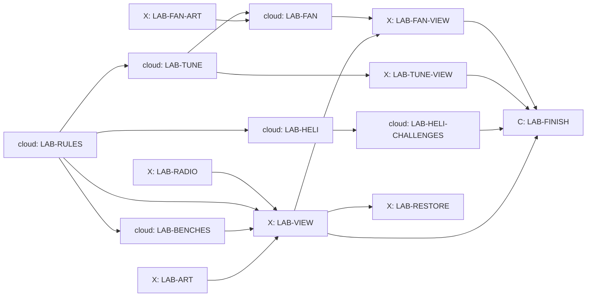

# The Lab

Design packet for the Lab, written 24 October 2026 by Claude from Kyle's
storyboard ("Helicopter Storyboard Ideas", section "The Lab", 14 October)
and his notes of 14 October: lessons are hands-on experiments that unlock
upgrades bought with credits; a wind tunnel with grip, downforce, braking,
suspension and fuel lessons (fuel for petrol cars only); tuning settings and
bonus credits for tuned laps; and a super secret McMurtry Spéirling fan car
(the real one is electric). Kyle handed the Lab's design to Claude on 24
October. Sections 4 to 6 are for players and builders; 9 to 11 for builders.

## 1. What the game does today (checked on integration d0699b4d)

- **Kestrel One** (`docs/HELICOPTER.md` 3): empty 1,150 kg, pilot 80 kg,
  tank 400 kg, hook limit 1,500 kg. Most thrust = 1.08 x (1,150 + 80 + 400 +
  1,500) kg x g x e^(-altitude / 8,500 m). Cable 15 m (`src/heli/heli-cable.js`,
  already takes another `lineLength`). Bucket 600 litres
  (`docs/HELI_FIRE.md` 6). The drop ring sizes are `DROP_AIM_RINGS = [12, 8,
  5, 0]` m and H2 always uses 12: "the Lab card adds the saved tier".
- **Cars** have seven upgrades of three levels (`src/game.js` 56 to 163):
  engine, nitro, handling, tyres, brakes, suspension, nitro tank. They change
  `grip`, `braking`, `accel`, `offRoadGrip` and `roughnessScale`. Grip has no
  part that grows with speed, and no car carries fuel.
- **Heavy cars:** the Banshee Muscle is 1,810 kg and the Titan 4,700 kg, over
  Kestrel One's hook. Wasteland armour kits weigh 90, 180 and 270 kg
  (`src/armor-kits.js`).
- **Pit stops** exist on Summit Run and Tremblant Snow (tyres and boost).
- **Lessons:** the shared lesson board, answer and radio pieces live in
  `src/lessons/`; Brian is the instructor's voice.

## 2. The Lab in one paragraph

The Lab is a workshop in the hangar beside the home helipad at Tremblant
Woods: benches, a fire pit, a pendulum frame, a test rig and a small wind
tunnel. You reach it from a **Lab** tab in the garage and from the helipad
(no new main-menu button). Each lesson has three parts. **The bench:** a
hands-on experiment, two or three controls and a Run button; Brian, in
person (his clean voice, no radio), explains what you see in two or three
lines. **The challenge:** one short task in the game that uses what the
bench showed. **The reward:** passing opens an upgrade or a setting, which
you buy with credits (some are free). Lessons can be retaken any time.

**The rule for truth.** Every bench runs the game's own rules (the same
functions the helicopter and cars use), so what you learn is what the game
does. Where the game is simpler than the real world, Brian says so in one
sentence. Every explanation in section 4 is true as written.

## 3. Which lessons are open

| Group | Lessons | Opens when |
| --- | --- | --- |
| Flying | Lift and weight, Projectile motion, Fire triangle, Pendulums, Air and altitude | The helicopter's first lessons are done |
| Workshop | Strength against weight, Rust, G-force, Headings and maps | From the start (G-force after driving lesson 1) |
| Wind tunnel | Grip, Downforce, Braking, Suspension, Fuel | Driving lesson 1 is passed |
| Snow (with H5) | Launch angles, Ski wax | Heli-skiing is on (`docs/HELI_SKIING.md`) |

Without the helicopter switch, the Flying group shows "Opens with the
helicopter". Each group lists its lessons in the order above; any open
lesson can be taken in any order.

## 4. The lessons

### 4.1 Flying (the helicopter)

| Lesson | The bench | What Brian explains (true) | Challenge | Opens (credits) |
| --- | --- | --- | --- | --- |
| **Lift and weight** | Kestrel One on a weighing pad. Add fuel and cargo, raise the collective, see if it leaves the ground. A bar shows weight against the most lift | To hover, the rotor must push the air down as hard as gravity pulls the helicopter down. More weight needs more push, and every rotor has a most it can give | Lift the Dusthawk (1,280 kg) with a full tank and hover 10 s at 2 to 5 m over the home pad | **Engine 1** (2,500): thrust x 1.05. **Engine 2** (4,000, after Engine 1): x 1.10. **Light frame** (3,000): empty mass -80 kg |
| **Projectile motion** | A drop tower over a sand pit. Set height (10 to 60 m) and forward speed (0 to 30 m/s), drop a water parcel (the bucket's own parcel model), watch the arc. The ring shows where it will land | A dropped thing keeps the forward speed it had, so it lands ahead of where you let go. It falls about 5 m in the first second, 20 m in two and 45 m in three. Air slows a spray of water more than a stone, so water falls shorter | Three floating buoys on the home lake: hit each with a bucket drop (within 5 m) using the ring you have. Pass with the 12 m ring, then again with 8, 5 and no ring | Each pass moves you down one ring (12, 8, 5, none); you can pick any ring you have earned. **Bigger bucket** (2,500, after the first pass): 800 litres (it weighs 200 kg more) |
| **Fire triangle** | A steel fire pit with three switches: the gas (heat), the wood (fuel), a lid (air). Water, sand and a cleared strip each put it out a different way | Fire needs heat, fuel and oxygen; take away any one and it dies. Water takes heat away, a lid takes the air, a cleared strip takes the fuel. Fire retardant coats plants with salts that make them char instead of burn, so planes drop it in front of a fire, not on it | A practice fire beside the home pad: stop it reaching the road within 3 minutes | **Retardant tank** (3,000): a 600-litre load filled only at the home pad. Forest it lands on can no longer catch fire for the rest of that fire; it does not put flames out |
| **Pendulums** | Three weights on 5, 15 and 25 m strings, then a heavier weight on the same string. A stopwatch times each swing | A swing's time depends on the string's length, not the weight: about 4.5 s on 5 m, 7.8 s on 15 m and 10 s on 25 m. A slower swing is gentler and easier to calm, but a longer cable needs more height | Carry a car across Tremblant Woods and set it down with the swing under 1 m when you let go | **Long cable** (1,500): choose 15 m or 25 m before each flight |
| **Air and altitude** | A rotor on a test stand at sea level, Panorama Ridge (860 m) and Summit Run (2,860 m). Measure its lift at each | Higher up the air is thinner. At 2,860 m each lungful holds about three quarters of the air it would at the sea, so the rotor has less to push on and the engine makes less power. (The game rounds this down a little, to 71%) | Fly a 300 kg crate to Summit Run and land with at least 30% fuel left | **Altitude tune** (3,500): the engine keeps more power high up (thrust falls with e^(-altitude / 10,000 m) instead of 8,500), so Kestrel One has more lift to spare high up (at the Summit pad a full heli-ski group on a full tank has about 5% to spare without it, H5) |

### 4.2 Workshop

| Lesson | The bench | What Brian explains (true) | Challenge | Opens (credits) |
| --- | --- | --- | --- | --- |
| **Strength against weight** | A test rig bends three bars of the same weight: aluminium, steel and carbon fibre. Load them until they bend or snap | Aluminium weighs about a third as much as steel. Carbon fibre is lighter still and very stiff, but it snaps instead of bending. Engineers choose by what the part must do | On the bench: build a hook arm that holds 2,000 kg for the least weight (pick a material and a thickness) | **Heavy hook** (2,000): hook limit 2,000 kg, enough for the Banshee with Engine 2. **Carbon plates** (1,500): every Wasteland armour kit weighs 40% less, same protection |
| **Rust** | Four steel nails in jars for a week (fast-forwarded): dry air, fresh water, salt water, and one with a zinc coat in salt water | Iron rusts when water and oxygen reach it, and salt water makes it rust much faster. Paint keeps them out. A zinc coat rusts first and saves the steel under it. Museums soak wreck metal in fresh water for months to draw the salt out, and use a small electric current to loosen the rust | Pick the right protection for three parts (underbody, exhaust, armour plate) | **Restore the Sirena** (2,500, once it is raised: `docs/THE_DEEP.md` 6.2). **Galvanised finish** (600): armour plates in bright zinc grey |
| **G-force** | A car on a turning arm. Set speed and radius; a weight on a string leans and a meter reads g | In a corner the car pushes you sideways. 1 g is a push as strong as your own weight. Twice the speed makes four times the push; half the radius makes twice the push. Road cars on road tyres reach about 1 g; the cars in this game are allowed between 2.5 and 3.5 g, closer to racing cars with wings | Drive a lap of any owned course and reach 2 g in three different corners without leaving the road | **G-meter and racing seat** (800): a g readout on the dash and a race seat in the cockpit view. Brian is honest: a seat does not make a car faster, it lets the driver feel what the car does |
| **Headings and maps** | A map table: compass, ruler and the pilot's map. Find the bearing and distance between two pads | A heading is the compass direction you point: 0 is north, 90 east, 180 south, 270 west. A map's scale says how many real metres one map unit stands for | Fly from the home pad to a smoke marker in the woods using only a heading and a distance (no arrow, autopilot off) | **Moving map** (1,200): the cockpit map with bearings, and grid lines on the pilot's map, which the secret-course clues use (`docs/PILOT_MAP.md`) |

### 4.3 Snow (with heli-skiing)

| Lesson | The bench | What Brian explains (true) | Challenge | Opens (credits) |
| --- | --- | --- | --- | --- |
| **Launch angles** | A small launcher: angle 15 to 75 degrees, speed, a tape measure | On flat ground with no air, 45 degrees goes furthest. Air drag, and landing lower than you took off, both make the best angle lower than 45 | Hit a target distance with one launch | **Aerials** (free): the aerials kicker run in heli-skiing |
| **Ski wax** | Skis on three snow samples (-15 C dry powder, -5 C, 0 C wet) with three waxes; time each glide | Cold snow has hard, sharp crystals, so it needs a hard wax. Warm wet snow sticks by suction, so it needs a softer wax and fine grooves in the base to let the water out | On a slalom run, beat the target time with the right wax for the day's snow | **Wax kit** (400): choose a wax before each run; the right one glides 3% faster |

### 4.4 The wind tunnel (cars and tuning)

A small wind tunnel with a car on a rolling road, smoke streams over the
body, a fan dial and a scale under each wheel. Each wind-tunnel lesson opens
one **tuning setting** (section 5), free. Its challenge is the first tuned
lap: set the new setting and beat your own stock lap (section 5.3) by 0.5%
on the course the lesson names.

| Lesson | The bench | What Brian explains (true) | Opens (course for the challenge) |
| --- | --- | --- | --- |
| **Grip** | A tyre on the rolling road, slid a little more each run; a graph of grip against slide | A tyre can slide a few degrees and keep all its grip: in the game that is up to 4.3 degrees. Past that the rubber skates and grip falls. A short squeal says you are at the limit; a long screech is lost time | Tyre pressure (Tremblant Woods) |
| **Downforce** | A wing in the smoke; the fan dial from 50 to 150 mph; the scale reads the push | A racing wing is an aeroplane wing upside down: it pushes the car onto the road. Twice the speed gives four times the push. More push means more grip in fast corners, but the wing also drags, so top speed falls | Wing angle (Panorama Ridge) |
| **Braking** | The car brakes from 50 and from 100 mph on the rolling road; a slider moves braking between front and back | Stopping distance grows with the square of speed: from 100 mph a car needs four times the road it needs from 50. Braking tips the car's weight forward onto the front tyres, so the front brakes do most of the work. Too much rear brake and the back slides | Brake balance (Harbour Lights) |
| **Suspension** | A shaker rig under each wheel, a bumpy road and a smooth one; soft and stiff springs; a light glows while the tyre touches | Soft springs let the body ride over a bump, so it is shaken less, but it leans more in a corner. Stiff springs pass every bump up into the car, shaking it harder, but keep it flat and quick to turn on smooth roads | Springs (Tremblant Snow) |
| **Fuel** (petrol cars) | A jerry can on a scale, then the car timed from 0 to 60 mph full and half full | Petrol weighs about three quarters of a kilo a litre, so a 70-litre tank holds about 52 kg. A lighter car speeds up, brakes and turns a little better. Electric cars carry batteries instead, which weigh the same full or empty | Fuel load (Summit Run, a Grand Prix) |

## 5. Tuning

### 5.1 The settings

A **Tune** page for each car in the garage, opened setting by setting by the
wind-tunnel lessons. Every setting has five steps from -2 to +2; **0 is the
car exactly as it is today**, and "Reset" sets all to 0. Tuning changes only
the player's own car; computer cars are never tuned. Lesson runs always use
0. A race's tuning is part of its setup, like upgrades, so replays repeat.

| Setting | Toward -2 | Toward +2 | Each step |
| --- | --- | --- | --- |
| Tyre pressure | Lower: more grip, more drag | Higher: sharper, less grip | grip -/+1% (lower adds), top speed +/-0.5% |
| Wing angle | Less wing: faster on straights | More wing: more grip in fast corners | grip at 100 mph +3%, scaled by (speed / 100 mph) squared; top speed -1% |
| Brake balance | Toward the front: steady | Toward the rear: shorter stops, the car turns in while braking but slides sooner | braking +1% rearward; cornering grip left while braking 80% -2% rearward (front gives the reverse) |
| Springs | Softer: better on bumps and dirt | Stiffer: more grip on smooth roads | grip +1% stiffer; `offRoadGrip` +2% and bumps 8% smaller per softer step |
| Fuel load | (none) | Half tank, Grand Prix with a pit lane only | accel and braking +1.5%; the tank lasts 55% of the race; empty means 40% power until a pit stop adds fuel (+5 s) |

The fuel setting shows only for petrol cars (every car but the Spéirling)
and only in Grand Prix races on a course with a pit lane.

### 5.2 No free lunch

No setting may be better everywhere. The tuning card proves, with the test
driver in Node, that for each wind-tunnel course some setting beats 0 by at
least 0.5%, and that every non-zero setting is slower than 0 on at least one
other owned course. If a step is too strong or too weak, its number moves;
the shape of each trade stays.

### 5.3 Stock laps and the tuned-lap bonus

- **Stock lap:** your best Time Trial lap on a course in a car with every
  setting at 0. Laps from before tuning existed count as stock.
- **Tuned-lap bonus:** a Time Trial lap with any non-zero setting that beats
  your stock lap on that course, in that car, by at least 1% pays **400
  credits, once per course** (per player; any car). The results card says
  "Tuned lap: 1.4% faster than your stock lap. Bonus 400."
- With twenty courses that is at most 8,000 credits, earned by learning.

## 6. The secret: the McMurtry Spéirling

Nobody mentions it. When all five wind-tunnel lessons are passed, a switch
marked REVERSE appears on the tunnel's fan dial. Flip it and the fan winds
down, stops, and roars back the other way, sucking air out from under the
car on the rolling road: the scales jump. Brian: "Huh. A fan that sucks the
car onto the road, even standing still. Someone really built that."

A blueprint pins itself to the wall, **Project Fan**, with the true story:

- In 1970 the Chaparral 2J raced with two fans sucking it to the ground.
- In 1978 the Brabham BT46B fan car won the Swedish Grand Prix at its first
  race and was withdrawn straight after.
- In 2022 the electric McMurtry Spéirling, under 1,000 kg with fans that
  pull about 2,000 kg of downforce even standing still, set the record for
  the Goodwood hill climb, 39.08 s.

**Building it** costs 15,000 credits on the fan bench: you set the fans and
watch the scales read more than the car's own weight before it has moved.
Then it is yours, at the home pad (with the helicopter on, it is a special
car and travels by air; at about 1,000 kg Kestrel One lifts it).

**How it drives:** the quickest car off the line in the game and the most
grip at low speed, because the fans' push does not depend on speed (an
extra grip that is the same at every speed, about double a normal car's at
a crawl). Top speed is lower than the hypercars'. Electric: no fuel setting,
no gears to shift (a single gear), a motor whine and the fans' roar. Tuning:
tyre pressure, brake balance and springs; no wing (the fans are its wing).

## 7. Restoring the Sirena

From `docs/THE_DEEP.md` 6.2. When the raised Sirena is waiting and the Rust
lesson is passed, the Rust bench offers **Restore the Sirena** (2,500): a
short sequence on the bench (soak, the electric current with fizzing bubbles,
strip, rebuild, paint) of about a minute, skippable after the first time.
The Sirena becomes yours, and the Lab's crew trucks it to Pacific Canyon for
the Coast Cup.

## 8. Sounds, voice and art

- **Brian in the Lab:** about 55 lines (an intro, the explanation and a pass
  line for each lesson, plus the secret and the restore), clean, no radio,
  recorded like the driving lessons, ids `lab.brian.<lesson>.<step>`.
- **New cues:** `lab.fan` (tunnel fan hum, pitch with speed), `lab.reverse`
  (the fan winding down and roaring back), `lab.burner` (gas whoosh),
  `lab.snap` and `lab.creak` (bars breaking and bending), `lab.splash`
  (a parcel hitting sand), `lab.tick` (pendulum stopwatch), `lab.clunk`
  (weights on the pad), `lab.fizz` (rust current), `heli.buoy-hit` (water
  on a buoy, a soft bell), `car.speirling` (electric whine and fan roar).
  Passing and buying use the existing confirm and purchase sounds.
- **Art:** the hangar room and bench props from one Blender recipe
  (`tools/blender/lab.py`), reusing Kestrel One, the car models, tyres, the
  fire and smoke effects and the Deep's crust for the rust jars; the
  Spéirling from `tools/blender/speirling.py`. At most three rounds each;
  Claude judges; no frame checks for the Lab (rule 9), only for the
  Spéirling in races.

## 9. The save (`save-shape`)

Optional `profile.lab`:
`{version: 1, done: {<lesson>: true}, owned: {<upgrade>: true}, ring: 0..3,
ringBest: 0..3, cable: 15 | 25, tune: {<carId>: {pressure, wing, brakes, springs, fuel}},
stockLaps: {"<car>|<course>": seconds}, tunedBonus: [<courseId>],
secret: {reverse: true}}`. `ringBest` is the best drop ring earned (0 is the 12 m ring; each pass of
Projectile motion made with the best ring held earns the next); `ring` is the
one in use and is never above `ringBest`. Every key optional; an old save
reads as no lessons done, no upgrades and every setting 0. Lesson ids: `lift`,
`projectile`, `fire`, `pendulum`, `altitude`, `strength`, `rust`, `gforce`,
`headings`, `launch`, `wax`, `grip`, `downforce`, `braking`, `suspension`,
`fuel`. Upgrade ids: `engine-1`, `engine-2`, `light-frame`, `big-bucket`,
`retardant`, `long-cable`, `altitude-tune`, `heavy-hook`, `carbon-plates`,
`gmeter`, `moving-map`, `aerials`, `wax-kit`, `galvanised`, `speirling`
(the Sirena's restore is recorded by the car joining `unlockedCars`).
Credits stop at the save's 1,000,000,000 cap. Fixture
`tools/fixtures/saves/17-lab.json`; the save checker.

## 10. Switches, files and cards

- **Switches:** `lab` (dev) for the Lab, its lessons and upgrades;
  `lab-tuning` (dev) for the Tune page and its physics, so the race feel
  can be judged on its own. The Spéirling sits behind `lab`.
- **Files:** `src/lab/` (rules, benches, shop, save, view), `tools/test-lab-*.mjs`.
  The helicopter reads its upgrades through one function,
  `heliUpgrades(lab)`, so `src/heli/` imports only that.

| Card | Owner | Starts | What |
| --- | --- | --- | --- |
| LAB-RULES | claude-cloud | now | Lesson table, opening order, shop and prices, the save (lock `save-shape`), switches |
| LAB-BENCHES | claude-cloud | after RULES | Each bench's experiment as a pure model on the game's own rules, with tests that the numbers match |
| LAB-HELI | claude-cloud | after RULES | Upgrades in the helicopter: thrust, frame, hook, cable, bucket, ring, retardant, altitude |
| LAB-HELI-CHALLENGES | claude-cloud | after HELI | The five flying challenges and the headings flight in the helicopter session |
| LAB-TUNE | claude-cloud | after RULES | Tuning rules and the two driving hooks (wing, brake balance), fuel in the pit, stock laps, the bonus, the no-free-lunch proof (lock `busy-game-files`) |
| LAB-ART | codex | now | The hangar and benches, three rounds |
| LAB-RADIO | codex | now | Brian's Lab lines and the new cues (lock `sound-bank`) |
| LAB-VIEW | codex | after RULES, BENCHES, ART, RADIO | The Lab screen: tabs, board, benches, shop, the G-force lap and workshop challenges (lock `busy-game-files`) |
| LAB-TUNE-VIEW | codex | after TUNE | The Tune page and the tuned-lap result line |
| LAB-FAN-ART | codex | now | The Spéirling model, three rounds |
| LAB-FAN | claude-cloud | after TUNE, FAN-ART | The car, its fan grip, the secret's rules, the build |
| LAB-FAN-VIEW | codex | after VIEW, FAN | The REVERSE switch, the blueprint, the build bench |
| LAB-RESTORE | codex | after VIEW, SIRENA-CAR | The Sirena's restore sequence and purchase |
| LAB-FINISH | Claude | after all | Play every lesson as a player; check each explanation reads true |

Heli-skiing's two lessons (Launch angles, Ski wax) are built with H5's cards
(`docs/HELI_SKIING.md`).

## 11. Picked for Kyle (24 October 2026)

- The Lab is a tab in the garage and a door at the helipad, not a main-menu
  button, so the menu stays as it is.
- Brian teaches in the Lab too, in person (no radio), so there is one
  teacher and no new voice to pay for.
- Prices sit between 400 and 4,000 credits (one to four good wins), and the
  Spéirling costs 15,000 as the long secret goal.
- Armour in the game does not wear out today, so the rust lesson's armour
  reward is a finish you can see, not a number; making armour wear would be
  a new mechanic.
- The tuned-lap bonus pays once per course, not per car, so it rewards
  learning to tune rather than repeating laps.
