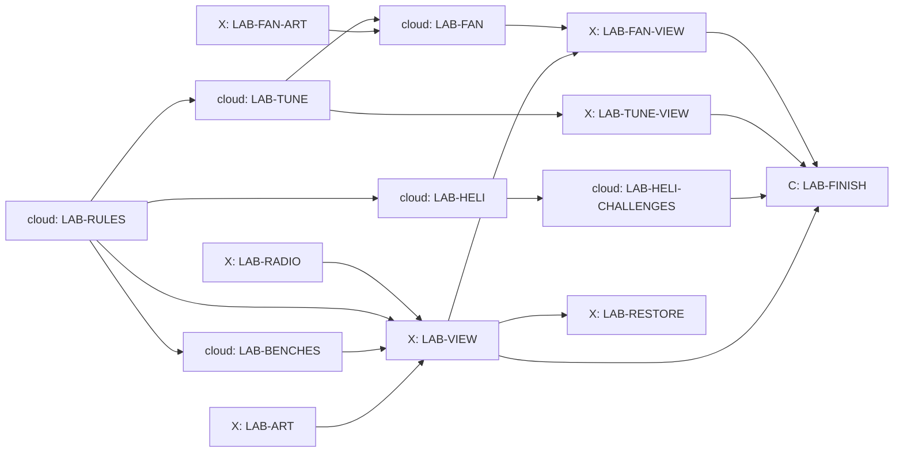

# The Lab

Design packet for the Lab, written 24 October 2026 by Claude from Kyle's
storyboard ("Helicopter Storyboard Ideas", section "The Lab", 14 October)
and his notes of 14 October: lessons are hands-on experiments that unlock
upgrades bought with credits; a wind tunnel with grip, downforce, braking,
suspension and fuel lessons (fuel for petrol cars only); tuning settings and
bonus credits for tuned laps; and a super secret McMurtry Spéirling fan car
(the real one is electric). Kyle handed the Lab's design to Claude on 24
October. Sections 4 to 6 are for players and builders; 9 to 11 for builders.

## 1. What the game does today (checked on integration d0699b4d)

- **Kestrel One** (`docs/HELICOPTER.md` 3): empty 1,150 kg, pilot 80 kg,
  tank 400 kg, hook limit 1,500 kg. Most thrust = 1.08 x (1,150 + 80 + 400 +
  1,500) kg x g x e^(-altitude / 8,500 m). Cable 15 m (`src/heli/heli-cable.js`,
  already takes another `lineLength`). Bucket 600 litres
  (`docs/HELI_FIRE.md` 6). The drop ring sizes are `DROP_AIM_RINGS = [12, 8,
  5, 0]` m and H2 always uses 12: "the Lab card adds the saved tier".
- **Cars** have seven upgrades of three levels (`src/game.js` 56 to 163):
  engine, nitro, handling, tyres, brakes, suspension, nitro tank. They change
  `grip`, `braking`, `accel`, `offRoadGrip` and `roughnessScale`. Grip has no
  part that grows with speed, and no car carries fuel.
- **Heavy cars:** the Banshee Muscle is 1,810 kg and the Titan 4,700 kg, over
  Kestrel One's hook. Wasteland armour kits weigh 90, 180 and 270 kg
  (`src/armor-kits.js`).
- **Pit stops** exist on Summit Run and Tremblant Snow (tyres and boost).
- **Lessons:** the shared lesson board, answer and radio pieces live in
  `src/lessons/`; Brian is the instructor's voice.

## 2. The Lab in one paragraph

The Lab is a workshop in the hangar beside the home helipad at Tremblant
Woods: benches, a fire pit, a pendulum frame, a test rig and a small wind
tunnel. You reach it from a **Lab** tab in the garage and from the helipad
(no new main-menu button). Each lesson has three parts. **The bench:** a
hands-on experiment, two or three controls and a Run button; Brian, in
person (his clean voice, no radio), explains what you see in two or three
lines. **The challenge:** one short task in the game that uses what the
bench showed. **The reward:** passing opens an upgrade or a setting, which
you buy with credits (some are free). Lessons can be retaken any time.

**The rule for truth.** Every bench runs the game's own rules (the same
functions the helicopter and cars use), so what you learn is what the game
does. Where the game is simpler than the real world, Brian says so in one
sentence. Every explanation in section 4 is true as written.

## 3. Which lessons are open

| Group | Lessons | Opens when |
| --- | --- | --- |
| Flying | Lift and weight, Projectile motion, Fire triangle, Pendulums, Air and altitude | The helicopter's first lessons are done |
| Workshop | Strength against weight, Rust, G-force, Headings and maps | From the start (G-force after driving lesson 1) |
| Wind tunnel | Grip, Downforce, Braking, Suspension, Fuel | Driving lesson 1 is passed |
| Snow (with H5) | Launch angles, Ski wax | Heli-skiing is on (`docs/HELI_SKIING.md`) |

Without the helicopter switch, the Flying group shows "Opens with the
helicopter". Each group lists its lessons in the order above; any open
lesson can be taken in any order.

## 4. The lessons

### 4.1 Flying (the helicopter)

| Lesson | The bench | What Brian explains (true) | Challenge | Opens (credits) |
| --- | --- | --- | --- | --- |
| **Lift and weight** | Kestrel One on a weighing pad. Add fuel and cargo, raise the collective, see if it leaves the ground. A bar shows weight against the most lift | To hover, the rotor must push the air down as hard as gravity pulls the helicopter down. More weight needs more push, and every rotor has a most it can give | Lift the Dusthawk (1,280 kg) with a full tank and hover 10 s at 2 to 5 m over the home pad | **Engine 1** (2,500): thrust x 1.05. **Engine 2** (4,000, after Engine 1): x 1.10. **Light frame** (3,000): empty mass -80 kg |
| **Projectile motion** | A drop tower over a sand pit. Set height (10 to 60 m) and forward speed (0 to 30 m/s), drop a water parcel (the bucket's own parcel model), watch the arc. The ring shows where it will land | A dropped thing keeps the forward speed it had, so it lands ahead of where you let go. It falls about 5 m in the first second, 20 m in two and 45 m in three. Air slows a spray of water more than a stone, so water falls shorter | Three floating buoys on the home lake: hit each with a bucket drop (within 5 m) using the ring you have. Pass with the 12 m ring, then again with 8, 5 and no ring | Each pass moves you down one ring (12, 8, 5, none); you can pick any ring you have earned. **Bigger bucket** (2,500, after the first pass): 800 litres (it weighs 200 kg more) |
| **Fire triangle** | A steel fire pit with three switches: the gas (heat), the wood (fuel), a lid (air). Water, sand and a cleared strip each put it out a different way | Fire needs heat, fuel and oxygen; take away any one and it dies. Water takes heat away, a lid takes the air, a cleared strip takes the fuel. Fire retardant coats plants with salts that make them char instead of burn, so planes drop it in front of a fire, not on it | A practice fire beside the home pad: stop it reaching the road within 3 minutes | **Retardant tank** (3,000): a 600-litre load filled only at the home pad. Forest it lands on can no longer catch fire for the rest of that fire; it does not put flames out |
| **Pendulums** | Three weights on 5, 15 and 25 m strings, then a heavier weight on the same string. A stopwatch times each swing | A swing's time depends on the string's length, not the weight: about 4.5 s on 5 m, 7.8 s on 15 m and 10 s on 25 m. A slower swing is gentler and easier to calm, but a longer cable needs more height | Carry a car across Tremblant Woods and set it down with the swing under 1 m when you let go | **Long cable** (1,500): choose 15 m or 25 m before each flight |
| **Air and altitude** | A rotor on a test stand at sea level, Panorama Ridge (860 m) and Summit Run (2,860 m). Measure its lift at each | Higher up the air is thinner. At 2,860 m each lungful holds about three quarters of the air it would at the sea, so the rotor has less to push on and the engine makes less power. (The game rounds this down a little, to 71%) | Fly a 300 kg crate to Summit Run and land with at least 30% fuel left | **Altitude tune** (3,500): the engine keeps more power high up (thrust falls with e^(-altitude / 10,000 m) instead of 8,500), so Kestrel One has more lift to spare high up (at the Summit pad a full heli-ski group on a full tank has about 5% to spare without it, H5) |

### 4.2 Workshop

| Lesson | The bench | What Brian explains (true) | Challenge | Opens (credits) |
| --- | --- | --- | --- | --- |
| **Strength against weight** | A test rig bends three bars of the same weight: aluminium, steel and carbon fibre. Load them until they bend or snap | Aluminium weighs about a third as much as steel. Carbon fibre is lighter still and very stiff, but it snaps instead of bending. Engineers choose by what the part must do | On the bench: build a hook arm that holds 2,000 kg for the least weight (pick a material and a thickness) | **Heavy hook** (2,000): hook limit 2,000 kg, enough for the Banshee with Engine 2. **Carbon plates** (1,500): every Wasteland armour kit weighs 40% less, same protection |
| **Rust** | Four steel nails in jars for a week (fast-forwarded): dry air, fresh water, salt water, and one with a zinc coat in salt water | Iron rusts when water and oxygen reach it, and salt water makes it rust much faster. Paint keeps them out. A zinc coat rusts first and saves the steel under it. Museums soak wreck metal in fresh water for months to draw the salt out, and use a small electric current to loosen the rust | Pick the right protection for three parts (underbody, exhaust, armour plate) | **Restore the Sirena** (2,500, once it is raised: `docs/THE_DEEP.md` 6.2). **Galvanised finish** (600): armour plates in bright zinc grey |
| **G-force** | A car on a turning arm. Set speed and radius; a weight on a string leans and a meter reads g | In a corner the car pushes you sideways. 1 g is a push as strong as your own weight. Twice the speed makes four times the push; half the radius makes twice the push. Road cars on road tyres reach about 1 g; the cars in this game are allowed between 2.5 and 3.5 g, closer to racing cars with wings | Drive a lap of any owned course and reach 2 g in three different corners without leaving the road | **G-meter and racing seat** (800): a g readout on the dash and a race seat in the cockpit view. Brian is honest: a seat does not make a car faster, it lets the driver feel what the car does |
| **Headings and maps** | A map table: compass, ruler and the pilot's map. Find the bearing and distance between two pads | A heading is the compass direction you point: 0 is north, 90 east, 180 south, 270 west. A map's scale says how many real metres one map unit stands for | Fly from the home pad to a smoke marker in the woods using only a heading and a distance (no arrow, autopilot off) | **Moving map** (1,200): the cockpit map with bearings, and grid lines on the pilot's map, which the secret-course clues use (`docs/PILOT_MAP.md`) |

### 4.3 Snow (with heli-skiing)

| Lesson | The bench | What Brian explains (true) | Challenge | Opens (credits) |
| --- | --- | --- | --- | --- |
| **Launch angles** | A small launcher: angle 15 to 75 degrees, speed, a tape measure | On flat ground with no air, 45 degrees goes furthest. Air drag, and landing lower than you took off, both make the best angle lower than 45 | Hit a target distance with one launch | **Aerials** (free): the aerials kicker run in heli-skiing |
| **Ski wax** | Skis on three snow samples (-15 C dry powder, -5 C, 0 C wet) with three waxes; time each glide | Very cold, dry snow has hard, sharp crystals, so it needs a hard wax. Medium snow wants a medium wax. Warm wet snow sticks by suction, so it needs a softer wax and fine grooves in the base to let the water out | On a slalom run, beat the target time with the right wax for the day's snow | **Wax kit** (400): choose a wax before each run; the right one glides about 3% faster than the wrong one on a slalom run, and about 1% faster than no wax |

### 4.4 The wind tunnel (cars and tuning)

A small wind tunnel with a car on a rolling road, smoke streams over the
body, a fan dial and a scale under each wheel. Each wind-tunnel lesson opens
one **tuning setting** (section 5), free. Its challenge is the first tuned
lap: set the new setting and beat your own stock lap (section 5.3) by 0.5%
on the course the lesson names.

| Lesson | The bench | What Brian explains (true) | Opens (course for the challenge) |
| --- | --- | --- | --- |
| **Grip** | A tyre on the rolling road, slid a little more each run; a graph of grip against slide | A tyre can slide a few degrees and keep all its grip: in the game that is up to 4.3 degrees. Past that the rubber skates and grip falls. A short squeal says you are at the limit; a long screech is lost time | Tyre pressure (Tremblant Woods) |
| **Downforce** | A wing in the smoke; the fan dial from 50 to 150 mph; the scale reads the push | A racing wing is an aeroplane wing upside down: it pushes the car onto the road. Twice the speed gives four times the push. More push means more grip in fast corners, but the wing also drags, so top speed falls | Wing angle (Panorama Ridge) |
| **Braking** | The car brakes from 50 and from 100 mph on the rolling road; a slider moves braking between front and back | Stopping distance grows with the square of speed: from 100 mph a car needs four times the road it needs from 50. Braking tips the car's weight forward onto the front tyres, so the front brakes do most of the work. (The bench shows that weight shift at a gentle 1 g stop; the stopping distances use the car's full braking.) Too much rear brake and the back slides | Brake balance (Harbour Lights) |
| **Suspension** | A shaker rig under each wheel, a bumpy road and a smooth one; soft and stiff springs; a light glows while the tyre touches | Soft springs let the body ride over a bump, so it is shaken less, but it leans more in a corner. Stiff springs pass every bump up into the car, shaking it harder, but keep it flat and quick to turn on smooth roads | Springs (Tremblant Snow) |
| **Fuel** (petrol cars) | A jerry can on a scale, then the car timed from 0 to 60 mph full and half full | Petrol weighs about three quarters of a kilo a litre, so a 70-litre tank holds about 52 kg. A lighter car speeds up, brakes and turns a little better. Electric cars carry batteries instead, which weigh the same full or empty | Fuel load (Summit Run, a Grand Prix) |

## 5. Tuning

### 5.1 The settings

A **Tune** page for each car in the garage, opened setting by setting by the
wind-tunnel lessons. Every setting has five steps from -2 to +2; **0 is the
car exactly as it is today**, and "Reset" sets all to 0. Tuning changes only
the player's own car; computer cars are never tuned. Lesson runs always use
0. A race's tuning is part of its setup, like upgrades, so replays repeat.

| Setting | Toward -2 | Toward +2 | Each step |
| --- | --- | --- | --- |
| Tyre pressure | Lower: more grip, more drag | Higher: sharper, less grip | grip -/+1% (lower adds), top speed +/-0.5% |
| Wing angle | Less wing: faster on straights | More wing: more grip in fast corners | grip at 100 mph +3%, scaled by (speed / 100 mph) squared; top speed -1% |
| Brake balance | Toward the front: steady | Toward the rear: shorter stops, the car turns in while braking but slides sooner | braking +1% rearward; cornering grip left while braking 80% -2% rearward (front gives the reverse) |
| Springs | Softer: better on bumps and dirt | Stiffer: more grip on smooth roads | grip +1% stiffer; `offRoadGrip` +2% and bumps 8% smaller per softer step |
| Fuel load | (none) | Half tank, Grand Prix with a pit lane only | accel and braking +1.5%; the tank lasts 55% of the race; empty means 40% power until a pit stop adds fuel (+5 s) |

The fuel setting shows only for petrol cars (every car but the Spéirling)
and only in Grand Prix races on a course with a pit lane.

### 5.2 No free lunch

No setting may be better everywhere. The tuning card proves, with the test
driver in Node, that for each wind-tunnel course some setting beats 0 by at
least 0.5%, and that every non-zero setting is slower than 0 on at least one
other owned course. If a step is too strong or too weak, its number moves;
the shape of each trade stays.

### 5.3 Stock laps and the tuned-lap bonus

- **Stock lap:** your best Time Trial lap on a course in a car with every
  setting at 0. Laps from before tuning existed count as stock.
- **Tuned-lap bonus:** a Time Trial lap with any non-zero setting that beats
  your stock lap on that course, in that car, by at least 1% pays **400
  credits, once per course** (per player; any car). The results card says
  "Tuned lap: 1.4% faster than your stock lap. Bonus 400."
- With twenty courses that is at most 8,000 credits, earned by learning.

**Settled by LAB-TUNE (25 October 2026).**

- **Where it acts.** `src/lab/lab-tune.js` turns a tune into the car's numbers after upgrades (`tunedCar`): pressure, springs
  and fuel are plain multipliers; the wing's grip depends on speed and the brake balance's cornering cost on the brake, so
  the driving code asks `tunedGrip(car, speed, brake)` for the grip the steering sees. A stock tune (all settings 0, or
  fuel at or below 0) is the very same car object and the same grip value, so a race replays exactly as without the switch.
  The tune is part of the race setup (`state.tune`, present only when something is set, `lab-tuning` is on and it is not a
  lesson run) like upgrades; computer cars are never tuned.
- **Fuel.** Steps -2 to 0 are the full tank (a full tank lasts 110% of the race and never runs dry). +1 is a three-quarter
  tank and +2 a half tank; each step above 0 gives +1.5% acceleration and braking. The tank is a distance that runs down with
  the metres driven in a Grand Prix on a course with a pit lane; empty means 40% of the acceleration until the pit stop, which
  takes 5 s longer (4 s becomes 9 s) and refills the tank. Petrol cars only (a car marked `electric` has no tank).
- **Brake balance's cornering cost** is applied in the tuning's own hook whatever the tyre-slip switch says: while the brake is
  held the cornering grip is multiplied by `1 + (-0.02 x step / 0.8) x brake` (a step rearward leaves 78% of the 80%, a step
  forward 82%). At step 0 nothing is multiplied.
- **Stock laps** are kept by rule set: `car|course` for a plain race, `car|course|rules` for one latched with tyre-slip or
  engine-curve (names joined by `+`, alphabetical). A tuned lap is judged only against the stock lap of the same rules, and a
  record from another rule set never seeds or judges it. They are seeded once, from the player's own Time Trial records in the
  leaderboard, the first time a Time Trial settles with tuning on and no stock laps saved; existing records are never
  replaced. The bonus (1% faster, once per course, 400) settles before the run is written to the records.
- **No free lunch** is shown by the test driver in Node with first laps on six courses and by number: the wing trades
  top speed for grip in fast corners (faster on the authored circuits, slower on the older courses with long straights),
  pressure the other way; brake balance and springs trade two numbers against each other by construction, and the springs'
  other half is proved on rough ground, because a lap on the road never leaves the road. Braking strength alone hardly
  moves a lap (a step is about 0.01%), so no lap claim is made for the brakes. See `docs/changes/LAB-TUNE.md` for the table.

## 6. The secret: the McMurtry Spéirling

Nobody mentions it. When all five wind-tunnel lessons are passed, a switch
marked REVERSE appears on the tunnel's fan dial. Flip it and the fan winds
down, stops, and roars back the other way, sucking air out from under the
car on the rolling road: the scales jump. Brian: "Huh. A fan that sucks the
car onto the road, even standing still. Someone really built that."

A blueprint pins itself to the wall, **Project Fan**, with the true story:

- In 1970 the Chaparral 2J raced with two fans sucking it to the ground.
- In 1978 the Brabham BT46B fan car won the Swedish Grand Prix at its first
  race and was withdrawn straight after.
- In 2022 the electric McMurtry Spéirling, under 1,000 kg with fans that
  pull about 2,000 kg of downforce even standing still, set the record for
  the Goodwood hill climb, 39.08 s.

**Building it** costs 15,000 credits on the fan bench: you set the fans and
watch the scales read more than the car's own weight before it has moved.
Then it is yours, at the home pad (with the helicopter on, it is a special
car and travels by air; at about 1,000 kg Kestrel One lifts it).

**How it drives:** the quickest car off the line in the game and the most
grip at low speed, because the fans' push does not depend on speed (an
extra grip that is the same at every speed, about double a normal car's at
a crawl). Top speed is lower than the hypercars'. Electric: no fuel setting,
no gears to shift (a single gear), a motor whine and the fans' roar. Tuning:
tyre pressure, brake balance and springs; no wing (the fans are its wing).

## 7. Restoring the Sirena

From `docs/THE_DEEP.md` 6.2. When the raised Sirena is waiting and the Rust
lesson is passed, the Rust bench offers **Restore the Sirena** (2,500): a
short sequence on the bench (soak, the electric current with fizzing bubbles,
strip, rebuild, paint) of about a minute, skippable after the first time.
The Sirena becomes yours, and the Lab's crew trucks it to Pacific Canyon for
the Coast Cup.

**Changed (Kyle, 25 October 2026; THE_DEEP 6.9):** the restore is now two
steps. **Get her running** (1,000, the Rust bench: soak, current, strip of
the mechanicals) adds the Sirena to the garage in her **Sea wreck** finish,
crust and all; her body is **not** restored. The **Restored 1966** finish
(1,500) is then bought in the garage and plays the rebuild and paint part of
the show; the Sea wreck finish stays selectable for good. LAB-RESTORE's single
2,500 restore is replaced by these two (card LAB-RESTORE-2).

## 8. Sounds, voice and art

- **Brian in the Lab:** about 55 lines (an intro, the explanation and a pass
  line for each lesson, plus the secret and the restore), clean, no radio,
  recorded like the driving lessons, ids `lab.brian.<lesson>.<step>`.
- **New cues:** `lab.fan` (tunnel fan hum, pitch with speed), `lab.reverse`
  (the fan winding down and roaring back), `lab.burner` (gas whoosh),
  `lab.snap` and `lab.creak` (bars breaking and bending), `lab.splash`
  (a parcel hitting sand), `lab.tick` (pendulum stopwatch), `lab.clunk`
  (weights on the pad), `lab.fizz` (rust current), `heli.buoy-hit` (water
  on a buoy, a soft bell), `car.speirling` (electric whine and fan roar).
  Passing and buying use the existing confirm and purchase sounds.
- **Art:** the hangar room and bench props from one Blender recipe
  (`tools/blender/lab.py`), reusing Kestrel One, the car models, tyres, the
  fire and smoke effects and the Deep's crust for the rust jars; the
  Spéirling from `tools/blender/speirling.py`. At most three rounds each;
  Claude judges; no frame checks for the Lab (rule 9), only for the
  Spéirling in races.

### 8.1 Brian's Lab lines

Written 24 October 2026 for LAB-RADIO. Ids `lab.brian.<lesson>.<intro|explain|pass>`
(the lesson ids of `src/lab/lab-lessons.js`), `lab.brian.secret.*` and
`lab.brian.restore.*`. Each explanation says only what its bench shows (the
numbers are on the bench's meters or in `facts()`); where the game is simpler
than the world it says so. Lines never name credits or prices.

| Id | Line |
| --- | --- |
| `lab.brian.lift.intro` | Kestrel One is on the weighing pad. Add fuel and cargo, raise the collective, and see if she leaves the ground. |
| `lab.brian.lift.explain` | To hover, the rotor has to push the air down as hard as gravity pulls the helicopter down. More weight needs more push, and every rotor has a most it can give. |
| `lab.brian.lift.pass` | Good. Now you know why a heavy load is a hard lift. |
| `lab.brian.projectile.intro` | Pick a height and a forward speed, drop the parcel, and watch where it lands. |
| `lab.brian.projectile.explain` | A dropped thing keeps the forward speed it had, so it lands ahead of where you let go. And it falls faster every second. Air slows a spray of water more than a stone, so water falls shorter. |
| `lab.brian.projectile.pass` | That's your aim. Let go early, not right over the target. |
| `lab.brian.fire.intro` | Three switches: gas for heat, wood for fuel, and a lid for air. Let's put the fire out three different ways. |
| `lab.brian.fire.explain` | Fire needs heat, fuel and air. Take away any one and it dies. Water takes the heat, a lid takes the air, a cleared strip takes the fuel. Retardant coats plants so they char instead of burn, so planes drop it in front of a fire, not on it. |
| `lab.brian.fire.pass` | Heat, fuel, air. Break any one and the fire is done. |
| `lab.brian.pendulum.intro` | Three weights on three strings, then a heavier weight on the same string. The stopwatch times every swing. |
| `lab.brian.pendulum.explain` | A swing takes longer on a longer string, and the weight makes no difference. Slow swings are gentler and easier to calm, but a longer cable needs more height. |
| `lab.brian.pendulum.pass` | A long cable swings slow, and a slow swing is easy to settle. |
| `lab.brian.altitude.intro` | A rotor on a test stand at sea level, at Panorama Ridge and at Summit Run. Measure its lift at each. |
| `lab.brian.altitude.explain` | Higher up the air is thinner. At Summit Run each lungful holds about three quarters of the air it would at sea level, so the rotor has less to push on and the engine makes less power. The game rounds this down a little, to seventy one percent. |
| `lab.brian.altitude.pass` | Thin air, less lift. Plan your load for the high country. |
| `lab.brian.strength.intro` | Three bars of the same weight: aluminium, steel and carbon fibre. Load them until they bend or snap. |
| `lab.brian.strength.explain` | Aluminium is about a third the weight of steel, size for size. Carbon fibre is lighter still and very stiff, but it snaps instead of bending. Engineers choose by what the part has to do. |
| `lab.brian.strength.pass` | That arm holds the load for the least weight. Well chosen. |
| `lab.brian.rust.intro` | Four steel nails in jars for a week. Dry air, fresh water, salt water, and one with a zinc coat in salt water. |
| `lab.brian.rust.explain` | Iron rusts when water and oxygen reach it, and salt water makes it rust much faster. A zinc coat rusts first and saves the steel under it. |
| `lab.brian.rust.pass` | Right protection for the right part. That's how you keep metal alive. |
| `lab.brian.gforce.intro` | A car on a turning arm. Set the speed and the radius, and watch the weight on the string lean. |
| `lab.brian.gforce.explain` | In a corner the car pushes you sideways. One g is a push as strong as your own weight. Twice the speed makes four times the push, and half the radius makes twice the push. The cars in this game are allowed between two and a half and three and a half g. |
| `lab.brian.gforce.pass` | That's a proper corner. You can feel that in the seat. |
| `lab.brian.headings.intro` | A map table with a compass and a ruler. Find the heading and the distance between two pads. |
| `lab.brian.headings.explain` | A heading is the compass direction you point. Zero is north, ninety is east, one eighty is south and two seventy is west. A map's scale says how many real metres one map unit stands for. |
| `lab.brian.headings.pass` | A heading and a distance. With those two you can find anything. |
| `lab.brian.grip.intro` | A tyre on the rolling road. Each run, we slide it a little more and graph the grip. |
| `lab.brian.grip.explain` | In the game a tyre keeps all its grip up to four point three degrees of slide. Past that the rubber skates and grip falls. A short squeal says you are at the limit. A long screech says you are past it. |
| `lab.brian.grip.pass` | Right at the limit and no further. That's grip. |
| `lab.brian.downforce.intro` | A wing in the smoke. Turn the fan from fifty to a hundred and fifty miles an hour, and watch the scale. |
| `lab.brian.downforce.explain` | A racing wing is an aeroplane wing upside down, so it pushes the car onto the road. Twice the speed gives four times the push. More push means more grip in fast corners, but the wing also drags, so top speed falls. |
| `lab.brian.downforce.pass` | More wing, more grip, less top speed. Choose for the track. |
| `lab.brian.braking.intro` | The car brakes from fifty and from a hundred miles an hour. You can slide the braking between front and back. |
| `lab.brian.braking.explain` | From a hundred miles an hour a car needs four times the road it needs from fifty. Braking tips the weight forward onto the front tyres, so the front brakes do most of the work. Too much rear brake and the back slides. The bench shows the weight shift at a gentle stop; the distances use the car's full braking. |
| `lab.brian.braking.pass` | Double the speed, four times the road. Brake early and brake straight. |
| `lab.brian.suspension.intro` | A shaker rig under each wheel, a bumpy road and a smooth one. Try soft springs and stiff springs. |
| `lab.brian.suspension.explain` | Soft springs let the body ride over a bump, so it is shaken less, but it leans more in a corner. Stiff springs pass every bump up into the body and shake it harder, but keep it flatter. |
| `lab.brian.suspension.pass` | Soft for bumps, stiff for smooth. Now you can set up for the road. |
| `lab.brian.fuel.intro` | A jerry can on the scale, then the car timed from nought to sixty, full and half full. |
| `lab.brian.fuel.explain` | Petrol weighs about three quarters of a kilo a litre, so a seventy litre tank holds about fifty two kilos. A lighter car speeds up quicker. Electric cars carry batteries instead, which weigh the same full or empty. |
| `lab.brian.fuel.pass` | Less fuel, less weight, a quicker car. But you still have to finish the race. |
| `lab.brian.launch.intro` | A small launcher. Set the angle and the speed, and measure how far it goes. |
| `lab.brian.launch.explain` | On flat ground with no air, forty five degrees goes furthest. Air drag, and landing lower than you took off, both make the best angle lower than forty five. |
| `lab.brian.launch.pass` | Right on target. That's how you plan a jump. |
| `lab.brian.wax.intro` | Skis on three kinds of snow, with three waxes. We'll time every glide. |
| `lab.brian.wax.explain` | Very cold, dry snow has hard, sharp crystals, so it needs a hard wax. Medium snow wants a medium wax. Warm wet snow sticks by suction, so it needs a softer wax and fine grooves in the base to let the water out. |
| `lab.brian.wax.pass` | Right wax for the snow. That's free speed. |
| `lab.brian.secret.reverse` | Huh. A fan that sucks the car onto the road, even standing still. Someone really built that. |
| `lab.brian.secret.1970` | In 1970 the Chaparral 2J raced with two fans sucking it to the ground. |
| `lab.brian.secret.1978` | In 1978 the Brabham BT46B fan car won its first race, the Swedish Grand Prix, and was withdrawn straight after. |
| `lab.brian.secret.2022` | In 2022 the electric McMurtry Spéirling set the Goodwood hill climb record, 39.08 seconds. Its fans pull about two thousand kilos of downforce, even standing still. |
| `lab.brian.restore.start` | Salt has been working on her metal for sixty years. First a long soak in fresh water to draw it out, then a small electric current to loosen the rust. |
| `lab.brian.restore.done` | Strip, rebuild, paint. There she is. Sixty years under the sea, and she's ready to race. |

## 9. The save (`save-shape`)

Optional `profile.lab`:
`{version: 1, done: {<lesson>: true}, owned: {<upgrade>: true}, ring: 0..3,
ringBest: 0..3, cable: 15 | 25, tune: {<carId>: {pressure, wing, brakes, springs, fuel}},
stockLaps: {"<car>|<course>": seconds}, tunedBonus: [<courseId>],
secret: {reverse: true}}`. `ringBest` is the best drop ring earned (0 is the 12 m ring; each pass of
Projectile motion made with the best ring held earns the next); `ring` is the
one in use and is never above `ringBest`. Every key optional; an old save
reads as no lessons done, no upgrades and every setting 0. Lesson ids: `lift`,
`projectile`, `fire`, `pendulum`, `altitude`, `strength`, `rust`, `gforce`,
`headings`, `launch`, `wax`, `grip`, `downforce`, `braking`, `suspension`,
`fuel`. Upgrade ids: `engine-1`, `engine-2`, `light-frame`, `big-bucket`,
`retardant`, `long-cable`, `altitude-tune`, `heavy-hook`, `carbon-plates`,
`gmeter`, `moving-map`, `aerials`, `wax-kit`, `galvanised`, `speirling`
(the Sirena's restore is recorded by the car joining `unlockedCars`).
Credits stop at the save's 1,000,000,000 cap. Fixture
`tools/fixtures/saves/17-lab.json`; the save checker.

## 10. Switches, files and cards

- **Switches:** `lab` (dev) for the Lab, its lessons and upgrades;
  `lab-tuning` (dev) for the Tune page and its physics, so the race feel
  can be judged on its own. The Spéirling sits behind `lab`.
- **Files:** `src/lab/` (rules, benches, shop, save, view), `tools/test-lab-*.mjs`.
  The helicopter reads its upgrades through one function,
  `heliUpgrades(lab)`, so `src/heli/` imports only that.

| Card | Owner | Starts | What |
| --- | --- | --- | --- |
| LAB-RULES | claude-cloud | now | Lesson table, opening order, shop and prices, the save (lock `save-shape`), switches |
| LAB-BENCHES | claude-cloud | after RULES | Each bench's experiment as a pure model on the game's own rules, with tests that the numbers match |
| LAB-HELI | claude-cloud | after RULES | Upgrades in the helicopter: thrust, frame, hook, cable, bucket, ring, retardant, altitude |
| LAB-HELI-CHALLENGES | claude-cloud | after HELI | The five flying challenges and the headings flight in the helicopter session |
| LAB-TUNE | claude-cloud | after RULES | Tuning rules and the two driving hooks (wing, brake balance), fuel in the pit, stock laps, the bonus, the no-free-lunch proof (lock `busy-game-files`) |
| LAB-ART | codex | now | The hangar and benches, three rounds |
| LAB-RADIO | codex | now | Brian's Lab lines and the new cues (lock `sound-bank`) |
| LAB-VIEW | codex | after RULES, BENCHES, ART, RADIO | The Lab screen: tabs, board, benches, shop, the G-force lap and workshop challenges (lock `busy-game-files`) |
| LAB-TUNE-VIEW | codex | after TUNE | The Tune page and the tuned-lap result line |
| LAB-FAN-ART | codex | now | The Spéirling model, three rounds |
| LAB-FAN | claude-cloud | after TUNE, FAN-ART | The car, its fan grip, the secret's rules, the build |
| LAB-FAN-VIEW | codex | after VIEW, FAN | The REVERSE switch, the blueprint, the build bench |
| LAB-RESTORE | codex | after VIEW, SIRENA-CAR | The Sirena's restore sequence and purchase |
| LAB-FINISH | Claude | after all | Play every lesson as a player; check each explanation reads true |

Heli-skiing's two lessons (Launch angles, Ski wax) are built with H5's cards
(`docs/HELI_SKIING.md`).

## 11. Picked for Kyle (24 October 2026)

- The Lab is a tab in the garage and a door at the helipad, not a main-menu
  button, so the menu stays as it is.
- Brian teaches in the Lab too, in person (no radio), so there is one
  teacher and no new voice to pay for.
- Prices sit between 400 and 4,000 credits (one to four good wins), and the
  Spéirling costs 15,000 as the long secret goal.
- Armour in the game does not wear out today, so the rust lesson's armour
  reward is a finish you can see, not a number; making armour wear would be
  a new mechanic.
- The tuned-lap bonus pays once per course, not per car, so it rewards
  learning to tune rather than repeating laps.

## 12. Lab 2: a place that teaches (Kyle, 26 October 2026)

Kyle tried the first lesson: "it had me adjust some sliders and didn't
define what 'collective' was. I didn't understand it at all. This lab must
become significantly more interactive and explanatory. Little sliders are
not teaching materials." He asked for a Lab you can walk around in, machines
you visit, more explanation on hand, and animations that show each idea,
built on real teaching practice: scaffolding, relevant visuals and
animation.

Lab 2 keeps everything in sections 3 to 7 (the lessons, their true
explanations, challenges, rewards, tuning, the Spéirling and the Sirena) and
changes how a lesson is taught. It is built behind a new switch, `lab-2`
(dev). When it goes live, the old bench panels and sliders are removed in
the same change (replace means remove).

### 12.1 Walk the Lab

- **First person, eye height 1.6 m, in the hangar that is already built**
  (`lab-scene.js`). Up and down arrows (or W and S) walk, left and right turn,
  A and D step sideways; hold the mouse button and drag to look around. The
  walls and machines block you. Esc leaves the Lab.
- **Four corners, named on hanging signs:** Flying (the weighing pad, drop
  tower, fire pit, pendulum frame, rotor stand), Workshop (bending rig, nail
  jars, turning arm, map table), Wind tunnel, Snow (launcher, snow trays).
- **Visit a machine** by walking up to it. Its name lights on the floor in
  front of it with "E: use the Lift bench". A machine whose lesson is not
  open yet shows a small card: "Opens when you pass helicopter lesson 3."
  A passed machine shows a green tick.
- **Brian is in the room**, standing by the machine you used last. Walk up
  and press E to ask him: "What should I try next?" or "Tell me about this
  machine."
- **The door board** by the entrance lists every lesson, open or not, done or
  not, with what it opens, so a player can plan.

### 12.2 Every lesson has the same five steps

This is the scaffold. Each step leans on the one before, and help is
removed step by step until the player does it alone in the game.

1. **Wonder.** A short moment in 3D that raises the question, before any
   words. Lift: Kestrel One on the pad strains, skids lifting and settling,
   with the Dusthawk on the hook. Brian: "She can't get it off the ground.
   Why not? Let's find out."
2. **New words, with pictures.** Every word the lesson needs, shown on the
   machine before it is used, one at a time, each with its own short
   animation and a one-sentence meaning a child can say back. The words go
   into the player's **Lab notebook** (saved), and every later mention of the
   word, in the Lab, the helicopter or a lesson, is underlined: point at it
   to see the meaning and its animation again. No lesson uses a word it has
   not shown.
3. **Watch it work.** Brian runs the machine once while the player watches:
   an animation in slow motion, with the forces drawn as arrows whose length
   is to scale, air or water drawn as moving particles, and big gauges with
   units and a comparison a child knows ("about the weight of a car").
   Pause, step and replay buttons. Brian says one thing per step.
4. **Predict, then try.** The player changes one thing at a time, using the
   machine itself (pull the lever, put a crate on the pad, turn the dial),
   never a bare slider. Before each run the player picks what will happen
   from two or three pictures. Then the run, then the result beside the
   prediction, and Brian explains any gap in one or two sentences. The first
   try is guided with arrows and prompts. The second has prompts only. The
   third is alone.
5. **Check, then the challenge.** Two or three quick questions answered with
   pictures, not words ("Which one hovers?"). A wrong answer shows the right
   one with its animation, no penalty. Then the challenge in the game, as in
   sections 4 and 5, with the lesson's key idea on a small card in the
   corner of the screen during the challenge.

**Help when stuck (never "Not quite").** Every failed try says what happened
and what to change ("She lifted, but sank back: the load is 300 kg more than
the rotor can lift. Take some fuel out or leave a crate behind"). After two
failed tries the hint gets plainer; after three, "Show me" plays the
worked answer, and the player then does it themselves.

**Reading level.** Short sentences, everyday words, at most two sentences on
screen at once. Every line shows as text; Brian's recorded voice plays where
a line already exists. New voice lines wait for Kyle (voice credits).

### 12.3 The pictures that teach

- **Arrows for forces,** one colour each through the whole Lab and the game:
  lift or push up green, weight down red, drag orange, grip blue. Length to
  scale, with the number on the arrow.
- **Particles for air and water,** speed shown by streak length.
- **Slow motion and a ghost of the last try,** so two runs can be compared
  side by side.
- **Graphs that draw themselves** as a run happens, axes labelled in words.
- **The real thing next to the model:** each machine has a small panel of
  where this happens in the world (a real helicopter's collective lever, a
  real wind tunnel), drawn as game art.

### 12.4 The first lesson rebuilt: Lift and weight

Built first, end to end, as the pattern for the other fifteen. Kyle and
Gratian try it before the rest are built (rule 18: a preview Kyle asked
for).

- **Wonder:** as above, Kestrel One straining with the Dusthawk.
- **New words:**
  - *Rotor:* the big wings on top that spin. Each blade is a long thin wing.
  - *Lift:* the push up that the spinning rotor makes by throwing air down.
  - *Weight:* how hard gravity pulls the helicopter and everything in it
    down.
  - *Collective:* the lever by the pilot's left hand. Pull it up and every
    blade tilts more steeply at the same time ("collectively"), so each one
    throws more air down and the lift grows. (Animation: the lever moves,
    the blades twist, the air particles below speed up and the green arrow
    grows.)
  - *Hover:* staying still in the air. It happens when lift is exactly as
    big as weight.
- **Watch it work:** Brian raises the collective slowly on the empty
  helicopter. The green lift arrow grows until it matches the red weight
  arrow, the skids lift and she hovers. Then he adds the Dusthawk: the red
  arrow jumps, and at full collective the green arrow is still shorter.
- **Predict, then try:** the player loads the pad with real things (fuel
  cans, crates, the Dusthawk), each showing its weight, and pulls the
  collective lever on the helicopter model. Predictions: "Will she lift off,
  hover, or stay on the ground?" The numbers come from the game's own
  helicopter: empty 1,150 kg, pilot 80 kg, a full tank 400 kg, and the most
  the rotor can push is about 3,380 kg at sea level, with up to 15% extra
  close to the ground.
- **Check:** three pictures of loaded helicopters, "Which one can hover?"
- **Challenge:** unchanged (section 4.1), with the card "Lift must match
  weight. Lighten the load if she won't climb."

### 12.5 Order of work

1. LAB-WALK: walking, the four corners, machine visits, Brian in the room,
   the door board (`lab-2`, dev).
2. LAB-LESSON-FRAME: the five steps, the notebook (save), arrows, particles,
   prediction cards, hint ladder, "Show me".
3. LAB-LIFT-2: Lift and weight on the new frame, with its animations.
4. Kyle and Gratian try it. Their verdict changes the frame before anything
   more is built.
5. The other fifteen lessons, in batches by corner (Flying, Workshop, Wind
   tunnel, Snow), Claude writing each lesson's words, pictures and
   predictions on its card before Codex builds it.
6. `lab-2` goes live and the old panels are removed.

### 12.6 The other fifteen lessons (Kyle and Gratian, 26 October 2026: "it works, build the other fifteen")

Each lesson below follows Lift and weight's pattern (12.2 to 12.4): the same
five steps, kilograms and metres a child knows, the picture in the centre of
the screen, at most two sentences at once, and a hint that says what
happened and what to change. Every number comes from the game's own rules
(the function the challenge uses), never copied by hand; where the game is
simpler than the world, Brian says so once. Challenges and rewards stay as
in section 4. "Try" is what the player handles on the machine itself.

#### Flying corner

**Projectile motion** (drop tower)
- Wonder: a water parcel dropped from a moving helicopter misses the buoy
  and splashes far past it. "Why did it land over there?"
- Words: *Gravity* (the pull that makes things fall faster every second),
  *Forward speed* (how fast the parcel was already moving sideways when let
  go), *Arc* (the curved path it falls along).
- Watch: two parcels let go at the same moment, one dropped straight, one
  thrown forward. They hit the sand at the same time (slow motion, a clock
  on each); the thrown one lands ahead. Distance marks at 1, 2 and 3 seconds
  show 5, 20 and 45 m of fall.
- Try: raise the drop arm on the tower (height) and set the trolley speed
  with its crank; predict the landing spot by placing a flag on the sand,
  then drop. A ghost of the last arc stays.
- Check: three pictures of a helicopter flying toward a buoy, "Where should
  she let go?" (before it, over it, after it).
- Hint: "It landed 14 m past the buoy. Let go earlier, or fly slower."
- Card: "Let go before the target. It keeps your forward speed."

**Fire triangle** (fire pit)
- Wonder: a fire roars; Brian slams the lid and it dies at once. "Why did
  that work with no water?"
- Words: *Heat*, *Fuel* (anything that can burn), *Oxygen* (the part of air
  a fire needs), *Fire triangle* (all three or no fire), *Retardant* (a coat
  that makes plants char instead of burn).
- Watch: the triangle drawn over the pit; Brian takes away one side at a
  time (gas off, wood out, lid on) and the flames die each way.
- Try: put the fire out three ways with real tools (bucket of water, sand,
  rake a cleared strip); predict which side of the triangle each tool takes
  away, then use it. Then the retardant: spray it ahead of a creeping line
  of flame and watch the flame stop at it.
- Check: pictures of a bucket drop, a lid and a firebreak, "Which side of the
  triangle does each take away?"
- Hint: "The water landed behind the flames. Put retardant in front of the
  fire, where it is going."
- Card: "Take away heat, fuel or air. Retardant goes in front."

**Pendulums** (pendulum frame)
- Wonder: a car on the cable swings wider and wider as the helicopter stops.
  "Why does it keep swinging?"
- Words: *Pendulum* (a weight swinging on a string), *Swing time* (one full
  swing out and back), *Length* (from the hook to the weight).
- Watch: three weights on 5, 15 and 25 m strings let go together; stopwatches
  run; the short one swings fastest (about 4.5 s, 7.8 s, 10 s). Then a
  heavier weight on the 15 m string: same time.
- Try: hang a light or heavy weight on any of the three strings and pull it
  back; predict "faster, slower or the same" before letting go.
- Check: "Which swings slowest?" (three pictures: short, long, heavy-short).
- Hint: "The car was still swinging 3 m when you let go. Hover still and
  count one full swing before you set it down."
- Card: "Length sets the swing time. Hover still and let it settle."

**Air and altitude** (rotor stand)
- Wonder: Kestrel One hovers easily at the home pad, then at Summit Run
  struggles to lift the same load. "Same helicopter. What changed?"
- Words: *Altitude* (how high above the sea), *Thin air* (less air in each
  breath higher up), *Air density* (how much air is packed in one space).
- Watch: the rotor stand at sea level, Panorama Ridge (860 m) and Summit Run
  (2,860 m); a jar of air beside it shows fewer dots higher up; the green
  lift arrow shrinks with them.
- Try: move the stand between the three heights and load it; predict
  "lifts, hovers, stays down" at each. Brian notes once that the game
  rounds the real figure down a little (71% at the summit).
- Check: "Where can she lift this load?" (three pictures of the same load
  at three heights).
- Hint: "At Summit she can lift 2,400 kg, not 3,380. Carry less fuel up
  high."
- Card: "Thin air, less lift. Go light up high."

#### Workshop corner

**Strength against weight** (bending rig)
- Wonder: a steel hook arm holds a car, but it is so heavy the helicopter
  can barely lift it with a car on. "Can it be lighter and still strong?"
- Words: *Strength* (how much load before it bends or breaks), *Stiff*
  (bends very little), *Brittle* (snaps instead of bending), *Aluminium*,
  *Steel*, *Carbon fibre*.
- Watch: three bars of the same weight loaded until they give: steel bends,
  aluminium bends sooner, carbon fibre stays straight, then snaps. Weights
  shown on a scale beside each.
- Try: pick a material and thickness for a hook arm, hang the Banshee on it;
  predict "holds, bends, snaps".
- Check: "Which is lightest and still holds 2,000 kg?"
- Hint: "It held, but it weighs 60 kg. Try a lighter material, a bit
  thicker."
- Card: "Pick by what the part must do: strong, light or tough."

**Rust** (nail jars)
- Wonder: the Sirena comes up from the sea crusted orange. "What did the sea
  do to her?"
- Words: *Rust* (iron turning to flaky orange when water and air reach it),
  *Salt water*, *Paint* (a skin that keeps water and air out), *Zinc coat*
  (a metal that rusts first to save the steel).
- Watch: a week in the jars in ten seconds: dry air stays shiny, fresh water
  spots, salt water rusts fast, the zinc-coated nail in salt water stays
  clean while its zinc wears away.
- Try: pick a protection for a part and drop it in a jar; predict how rusty
  it will be after a week.
- Check: three parts (underbody, exhaust, armour plate), "Which protection
  for each?"
- Hint: "Paint flakes off a hot exhaust. A zinc coat or a heat-proof finish
  lasts."
- Card: "Keep water and air out, or let zinc rust first."

**G-force** (turning arm)
- Wonder: in a fast corner the driver leans hard against the door. "What is
  pushing him?"
- Words: *G-force* (the push you feel in a turn), *1 g* (a push as strong as
  your own weight), *Radius* (how tight the turn is).
- Watch: the car on the turning arm speeds up; the weight on a string leans
  further; the g meter climbs. Doubling the speed makes four times the push
  (the arrow grows four times).
- Try: turn the speed crank and slide the car in or out on the arm; predict
  "more push, less push or the same".
- Check: "Which corner pushes hardest?" (fast and tight, slow and tight,
  fast and wide).
- Hint: "You reached 1.6 g. Carry more speed through a tighter corner."
- Card: "Twice the speed, four times the push."

**Headings and maps** (map table)
- Wonder: smoke rises from the woods, but the helicopter's arrow is gone.
  "How do you find it?"
- Words: *Heading* (the compass direction you point), *North, East, South,
  West* as 0, 90, 180, 270, *Scale* (how far one map square is on the
  ground).
- Watch: a compass rose on the map table; a toy helicopter turns to 90 and
  points east; a ruler measures four squares and the scale turns it into
  metres.
- Try: lay the ruler between two pads, read the heading on the compass and
  count the distance; predict where the toy will land, then fly it on the
  table.
- Check: "Which heading points to the lake?" (three arrows).
- Hint: "You flew 270, which is west. The smoke is east: turn to 90."
- Card: "Point the heading, count the distance."

#### Wind tunnel

**Grip** (tyre on the rolling road)
- Wonder: one car takes a corner clean; another slides wide with a long
  screech. "Same corner. Why did one slide?"
- Words: *Grip* (how hard the tyre can push on the road), *Slip* (a tyre
  sliding a little sideways), *Limit* (the most grip before it slides).
- Watch: the tyre slides a little more each run; a graph draws grip against
  slide: it climbs to a peak (4.3 degrees in the game) and then falls. A
  short squeal plays at the peak, a long screech past it.
- Try: turn the slide dial; predict "more grip, the most grip, less grip";
  then set tyre pressure and see the peak move.
- Check: "Which tyre has the most grip?" (three pictures of the graph point).
- Hint: "You slid 9 degrees and lost grip. Ease off until the squeal."
- Card: "A short squeal is the limit. A screech is lost time."

**Downforce** (wing in the smoke)
- Wonder: at full speed a racing car's back end stays planted. "What is
  holding it down?"
- Words: *Wing*, *Downforce* (air pushing the car down), *Drag* (air pushing
  back, slowing the car).
- Watch: smoke streams flow over the wing; the scale under it reads the
  push; the fan goes from 50 to 100 mph and the push becomes four times as
  big; an orange drag arrow grows too.
- Try: tilt the wing and turn the fan dial; predict "more push, more drag,
  both".
- Check: "Which wing for a fast, twisty course? Which for a long straight?"
- Hint: "Your top speed dropped 6 mph. Flatten the wing for the straight
  courses."
- Card: "More wing, more grip in fast corners, less top speed."

**Braking** (rolling road)
- Wonder: a car stops easily from 50 mph but slides past the line from 100.
  "Why so much further?"
- Words: *Stopping distance*, *Weight shift* (braking tips the car's weight
  onto the front tyres), *Brake balance* (how much the front and back brakes
  do).
- Watch: two stops side by side, 50 and 100 mph; the 100 mph car needs four
  times the road. Arrows on each tyre show the weight moving forward as it
  brakes.
- Try: move the brake balance lever and choose a speed; predict where the car
  stops and whether the back slides.
- Check: "Which car stops shortest without sliding?"
- Hint: "Too much rear brake: the back slid. Move the balance forward."
- Card: "Twice the speed, four times the stopping distance."

**Suspension** (shaker rig)
- Wonder: on a bumpy road one car bounces off the ground; another rides it
  smoothly. "What is different?"
- Words: *Spring*, *Soft*, *Stiff*, *Body roll* (the car leaning in a turn).
- Watch: soft springs over bumps: the body moves gently and the tyre light
  stays on; stiff springs: the body shakes and the light flickers off. Then
  a corner: soft leans more, stiff stays flat.
- Try: pick soft or stiff and a road; predict "smooth, shaky", "leans, flat".
- Check: "Which springs for Tremblant Snow's bumpy road?"
- Hint: "The tyres left the road on the bumps. Try softer springs."
- Card: "Soft for bumps, stiff for smooth fast roads."

**Fuel** (jerry can on a scale)
- Wonder: the same car is quicker off the line with a half tank. "Why?"
- Words: *Fuel load*, *Litre*, *Kilogram* (petrol weighs about three
  quarters of a kilo a litre).
- Watch: the jerry can fills on the scale: 70 litres reads about 52 kg;
  the car runs 0 to 60 mph full and half full, the lighter one ahead. An
  electric car's battery weighs the same full or empty.
- Try: fill the tank with the can, choose the laps; predict "enough fuel,
  run out, carry too much".
- Check: "How much fuel for three laps?"
- Hint: "You finished with 20 litres spare: that is 15 kg you carried for
  nothing. Fill a little less."
- Card: "Carry the fuel you need, no more."

#### Snow corner

**Launch angles** (launcher ramp)
- Wonder: a skier flies off a kicker and lands short of the table. "What
  angle goes furthest?"
- Words: *Launch angle*, *Speed*, *Distance*.
- Watch: the launcher fires at 15, 30, 45, 60 and 75 degrees at the same
  speed; arcs stay drawn; 45 goes furthest on flat ground with no air. Then
  with air and a lower landing, the best angle drops below 45.
- Try: set the angle on the ramp and the speed; predict where it lands by
  placing a flag.
- Check: "Which launch reaches the flag?"
- Hint: "Too steep: it went high and short. Lower the angle."
- Card: "About 45 goes furthest. Lower if you land below."

**Ski wax** (snow trays)
- Wonder: two skiers on the same slope; one glides past the other. "Same
  skis. Why?"
- Words: *Wax*, *Glide*, *Snow crystals* (cold snow has hard, sharp
  crystals; warm snow is wet).
- Watch: close-up of cold, sharp crystals scratching a soft wax; warm wet
  snow sucking at a hard base; the right wax for each glides further.
- Try: pick a wax for each of three snow trays and slide the ski; predict
  "fastest, middle, slowest".
- Check: "Which wax for minus 15 C powder?"
- Hint: "Soft wax on cold snow drags. Pick a hard wax for the cold."
- Card: "Hard wax for cold, soft wax for warm."
