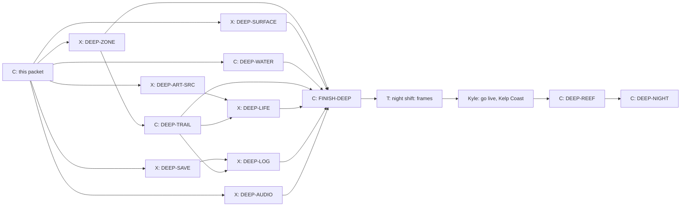

# The Deep: the hidden underwater world

Design for a hidden underwater world, written 11 October 2026 at Kyle's
request: "a potential underwater world in the way that we created an easter
egg for finding mad max ... kelp forests, fish, turtles and other fun sea
life ... no missions yet ... after we drive underwater, we can find new
places to explore ... another route can also be a speed boat or sailing
race." Then: "how about planning out the underwater world too. maybe we can
start on that in parallel."

Status: approved by Kyle on 11 October 2026 ("this all looks good"),
with Kyle's answers in section 11. Section 10 is the build graph (12
October 2026): its six first cards start in free lanes alongside Phase 4.

## 1. The feeling

Wonder, not danger. You drive off a sunny coast road, down an old boat ramp,
and keep going. The sound goes muffled, the light turns green and blue, sun
shafts come down through the water, and a turtle glides past the windscreen.
Nothing is timed and nothing can hurt you. There is always something moving
at the edge of the light: a school of fish turning together, kelp swaying,
a ray lifting off the sand. Further in, the places get stranger: a sunken
freighter you drive through, a cave lit by jellyfish, the edge of the
drop-off where something very big swims by in the blue.

Look: a real reef and kelp forest, photographed. Muted, natural colours
that lose their reds with depth, soft fog, sunlight dappling the sand. Never
cartoon fish or toy colours (Kyle's standing rule: gritty, never toy-like).
References: the Monterey kelp forest, the Great Barrier Reef shallows, and
wreck dives in clear tropical water.

## 2. How you find it

The Wasteland goes up a canyon off Pacific Canyon. The Deep goes the other
way: down to the sea. Kyle chose several coasts (11 October 2026), so there
are three boat ramps on three circuits, and each leads to its own
underwater place (section 4).

- **Where:** at a small cove beside each coast road, an old concrete boat
  ramp leaves the road, crosses the sand and runs down into the water. It is
  easy to see and easy to dismiss: it just looks like scenery.
  1. **Pacific Canyon Circuit, Pacific Coast:** the first and easiest to
     find, leading to the **Kelp Coast**.
  2. **High Country Grand Tour, Coastal Descent:** leading to **Wreck Reef**.
  3. **Harbor & Highlands, Coast Road (at night):** leading to the **Night
     Harbour**.
- **The dive kit:** a car needs a dive kit to go under (a snorkel up the
  windscreen pillar, sealed seams, a roof light bar). Without it, the
  existing "WATER AHEAD" reset turns the car back at the shoreline, as now.
  The kit is a cheap garage item for every car, shown only after the hint
  (below). One kit fits all cars, so Kyle and Gratian can each dive in their
  favourite.
- **Hints, never on the main menu:**
  1. After five finishes on Pacific Canyon, a garage tip: "Fishermen at the
     cove say the old boat ramp goes further than the beach." Once the Kelp
     Coast is found, the other two ramps get their own tips after a few
     finishes on their circuits.
  2. The dive kit then appears in the garage.
  3. After ten finishes without diving, a second tip, and a few bubbles
     rise off the water at the ramp's end during races.
- **Going in:** works in an ordinary Duel race or Time Trial on that
  circuit (not Mad Max races; the Wasteland owns those). Past the water's
  edge, like the Hidden Road's 150 m point, the race pauses ("RACE
  PAUSED"); drive back up the ramp and it resumes. Keep going down and the
  race display fades, the view sinks under the surface (the waterline
  slides up the screen, bubbles, a muffled thump of sound), and a short
  choice appears: "Dive" or "Turn back". Dive abandons the race with no
  penalty and no record, as at the Wasteland gate.
- **Coming back:** the menu, or drive back up the ramp. Return visits: drive
  down a ramp again in any race or Time Trial on its circuit with the kit
  fitted. The main menu stays exactly as it is (Kyle's standing rule); no
  new button.
- **Remembered:** the save records that the Deep was found, the creatures
  logged and the pearls collected (section 6). A save without these fields
  loads exactly as before.

## 3. Driving underwater

The car stays on the sea floor: it drives sand, rock and reef trails like
any off-road track. That fits how the game already moves cars along a
course, so no swimming or flying model is needed.

| Feel | Rule |
| --- | --- |
| Heavy water | Top speed about 70% of the car's normal, gentler acceleration, more drag in turns |
| Floaty jumps | Off a rise or a reef ledge the car hangs and drifts down slowly (about a third of normal gravity), landing softly in a cloud of sand |
| Sand | Wheels lift slow-settling sand clouds that drift with the current, instead of dust |
| Bubbles | A stream of bubbles from the exhaust and the snorkel, more on the throttle |
| Light | Headlights matter: they cut through the gloom in the cave, the wreck and at depth |
| Sound | Engine muffled and low, bubbles, creaks, distant whale song at the drop-off |
| Safety | No damage, no drowning, no timer. Steep reef walls are walls; the edge of the drop-off has a natural rock lip |

Every car gets the same rules, scaled from its own handling, so a monster
truck still feels heavier than the rally car.

## 4. The places

Each ramp leads to its own loop of about 3 to 4 km from the bottom of the
ramp and back. Each place inside is found the first time you drive into it
(a short title card, like a circuit's corner names). The Kelp Coast is built
first; the other two follow once Kyle has played it.

**1. Kelp Coast (Pacific Canyon): sunny, green and gold, cold clear water.**

| Place | What is there |
| --- | --- |
| **Ramp Shallows** | Bright, sandy, 5 to 10 m deep. Seagrass, rippled sand, sunlight in shafts, the surface shimmering overhead. Turtles graze, crabs scuttle, a ray lifts off the sand as you pass |
| **The Kelp Forest** | Tall golden-brown kelp rising to the surface, swaying, the light green and dappled. Schools of silver fish part around the car. Sea lions twist past; a sea otter floats at the top |
| **The Drop-off** | The kelp ends at a cliff into deep blue. The trail runs along the lip. Once a visit, a whale passes slowly below and sings |

**2. Wreck Reef (High Country): warm blue water, colour and a big wreck.**

| Place | What is there |
| --- | --- |
| **Coral Garden** | A reef plateau: coral heads, sea fans, anemones, bright reef fish, a moray in a crack, two reef sharks cruising (harmless, they just swim) |
| **The Wreck** | A rusty freighter on its side. The trail goes in through a hull breach, through the hold (headlights, swaying cables, fish in the gloom, a big grouper) and out of the other side |
| **Manta Point** | A sandy channel where manta rays glide in wide loops over the car |

**3. Night Harbour (Harbor & Highlands, at night): dark, glowing, mysterious.**

| Place | What is there |
| --- | --- |
| **The Old Harbour Wall** | A sunken stone quay, old anchors and sunken fishing boats, the harbour lights wobbling on the surface above |
| **Jellyfish Cave** | A rock tunnel lit by drifting, softly glowing jellyfish; the exit opens into dark water |
| **Glow Bay** | Plankton that glows blue when disturbed: the car leaves a glowing trail and the wheels throw sparks of light. An octopus changes colour on the rocks |

Later places, if Kyle wants more: a kelp maze, a volcanic vent field with
shimmering water and odd tube worms, and a deep trench where it is dark
except for your headlights and glowing creatures.

## 5. Sea life

All sea life is scenery: it never changes the car or the race, so it costs
nothing in fairness and can be as lively as the frame budget allows. It does
react to the car (fish scatter and re-form, turtles turn away, a ray lifts
off the sand), using the car's position only.

| Creature | Where | Behaviour |
| --- | --- | --- |
| Schools of small silver fish (several hundred) | Kelp Coast | Swim together, turn as one, part around the car and close behind it |
| Reef fish (mixed colours, small groups) | Wreck Reef | Hover near the coral, dart into cover |
| Green turtles (4 to 6) | Ramp Shallows, Coral Garden | Glide slowly with flipper strokes, surface for air |
| Stingrays and manta rays | Ramp Shallows, Manta Point | Rays rest on the sand and lift off; mantas glide in wide loops |
| Sea lions, one otter | The Kelp Forest | Fast twisting passes; the otter floats at the surface on its back |
| Crabs | Sand, the harbour wall | Scuttle sideways out of the way |
| Moray, grouper | Coral Garden, the Wreck | Moray in a crack, grouper hanging in the hold |
| Reef sharks (2) | Coral Garden | Cruise slowly; never chase |
| Jellyfish (dozens) | Jellyfish Cave | Pulse and drift, glowing softly |
| Whale | The Drop-off | One slow pass below per visit, with song |
| Octopus, glowing plankton | Glow Bay | The octopus shifts colour on the rocks; the plankton lights up around the car |

## 6. Things to do (no missions yet)

Kyle asked for no missions yet. Two light, optional things give a reason to
look around, both reusing what the Titan's playground already does:

- **Sea-life log:** drive close and slow near a creature to log it (a small
  picture card slides in). Fourteen creatures across the three places. The log is a
  page in the garage, with blank silhouettes for ones not yet found, so
  Gratian has a list to complete.
- **Pearls:** nine pearls in giant clams, three in each place (for example
  at the far end of the kelp, on a ledge at the drop-off, in the wreck's
  hold, under a coral arch, deep in the jellyfish cave). All nine earn the
  dive kit a pearl-white paint finish for any car.

Missions come later, if Kyle wants them (a treasure hunt, a timed reef run,
a photo safari).

## 7. Boats: the second route (separate stage, after the Deep)

A completely different kind of driving, so it is its own stage with its own
plan before any build. The idea, to be settled with Kyle:

- **The marina:** a boathouse at the Pacific Canyon cove (the found Deep makes it
  appear), where boats are bought and raced.
- **Speedboat races:** buoy courses along the coast, 4 to 6 boats. Boats
  plane (bow up, faster as they lift), slide wide in turns, hop off wakes and
  waves, and have no brakes: you lift off and turn. Spray, wakes and chop.
- **Sailing races:** a regatta round marks with a wind arrow. Speed depends
  on the angle to the wind: you can't sail straight into it, fastest is
  across it, so the race is about tacking and picking a line. Slower and
  more thoughtful; a good contrast.
- **Learning:** three short lessons at the boathouse (throttle and turns,
  waves and wakes, sailing to the wind), each a minute or two.
- **Fit:** courses are a line of buoys the same way a track is a line of
  road, so the existing race, ghost and Grand Prix field code can be reused
  with a new water handling model.

## 8. Rules for the build (for Codex and the Claude agents)

- **Switches:** `the-deep` (Deep, off until released), later `boats`.
  Everything new stays behind them.
- **Install like the Hidden Road and Muddy Hollow:** the ramp and the sea
  floor trail are an authored zone installed into its circuit after the
  course is built, without touching its racing line, scenery positions or
  random stream. One generic zone format serves all three coasts, and each
  coast is data. The three circuits' replays and fingerprints stay exact
  when the ramps are not used, and with the switch off everything is byte-for-byte as
  now.
- **Underwater surface rule:** one new surface profile in the driving code
  (drag, speed cap, low gravity for jumps, sand), selected by the zone,
  generic and named for what it does, not for a place. Tests in Node without
  graphics: speed cap, slow fall, landing, ramp return, no damage.
- **Sea life is scenery only:** creatures live in the renderer, use the
  car's position read-only, and never feed back into race state or random
  streams.
- **Frame cost:** the water's fog limits how far you can see (about 90 to
  140 m), so only nearby things need drawing. Use instancing and swimming
  motion in the shader (no per-fish objects), the kit loader's chunks and
  distance levels, and a hard cap per creature type. Target: delivered p95
  at most 18.5 ms on Performance and High at the busiest view (the kelp
  forest with a full school), construction under 1 s.
- **Saves:** new optional fields `deep.found` (which of the three places), `deep.logged` (creature
  ids), `deep.pearls` (pearl ids), `deep.kit` (owned). Old saves load
  unchanged; save checks in memory only.
- **Art:** CC0 first (Quaternius, Kenney, Poly Pizza), CC-BY with credit in
  `public/assets/models/CREDITS.md` and `tools/art/catalog.json`. Recipes in
  `tools/blender/`. Kelp, seagrass, coral and sand ripples should be
  procedural or instanced from a few small meshes. At most three art rounds
  per card; Claude judges the sheets (AGENTS rule 15) and Kyle sees the
  result.
- **Sound:** every new event names its cue: dive splash, muffled engine,
  bubbles, sand landing, creature logged, pearl found, whale song, cave
  ambience.
- **Size:** aim for about 20 MB of new runtime assets for the Deep, watched
  against `tools/size-targets.json`.

## 9. The underwater look (Claude's notes for the look test)

- **Colour with depth:** warm and bright in the shallows, then reds and
  yellows fade first, greens next, until the deep is blue. A depth-based
  grade, not one flat blue filter.
- **Fog:** soft exponential fog that matches the water colour at that depth;
  no hard far edge.
- **Sunlight:** god rays slanting down from the surface, moving slowly;
  caustic light ripples on the sand and the car, strongest in the shallows
  and gone in the deep.
- **The surface from below:** a bright, rippled ceiling with the sun as a
  blurred disc, and Snell's window (you see the sky only straight up; at an
  angle the surface is a silver mirror).
- **Particles:** fine floating specks (marine snow) that drift past the
  camera, so you feel the water moving.
- **Kelp:** tall stems with leaf blades, gently swaying in a slow current,
  light coming through the blades, slightly translucent.
- **Never:** cartoon fish, neon colours, a flat blue tint over everything,
  or a hard fog wall.

## 10. The build as a graph (Claude packet, 12 October 2026)

The Deep is the first job on the world line in `docs/FACTORY.md`. The first
plan put almost every card behind one large ramp card. This packet splits the
work by the files each part owns and settles every shared name and number
below, so six lanes start at once and nobody stops to ask. The contracts in
10.1 are the agreement between lanes: build against them, never around them.



| Card | Owner | Starts | Owns (and locks) | Done when |
| --- | --- | --- | --- | --- |
| DEEP-ZONE | Codex SIM | now | `src/deep/deep-zone.js`, `src/deep/deep-journey.js`, `src/deep/deep-ui.js`, `src/deep/deep-ui.css`, `tools/test-deep-zone.mjs`; hooks in `src/app.js`, `src/game.js` and the one scene call in `src/render3d.js` (lock `busy-game-files`) | The zone format of 10.1 loads; the Pacific Canyon ramp is installed in the Pacific Coast cove; past the water's edge the race pauses, the Dive / Turn back choice works, driving back up the ramp resumes; a test zone (in the test only) drives end to end; Pacific Canyon fingerprints exact with the ramp unused and with the switch off |
| DEEP-SURFACE | Codex SIM | now | `sea-floor` entry in `src/race-surfaces.js`, its reader in the driving code, `tools/test-deep-surface.mjs` | The numbers in 10.1 hold in Node: speed cap, slow fall, soft landing, no damage, every car scaled from its own handling; every other surface and fingerprint exact |
| DEEP-SAVE | Codex SAVE | now | `src/deep/deep-discovery.js`, `src/deep/deep-hints.js`, the dive kit in `src/screen-garage.js`, save fixture `tools/fixtures/saves/09-deep.json` (lock `save-shape`, save checker) | Save fields of 10.1 round-trip; old saves load byte for byte; hints appear at the counts in 10.1; the kit appears after the first hint and costs 150 credits |
| DEEP-ART-SRC | Codex ART | now | `public/assets/models/deep/`, `tools/art/catalog.json` rows, credits, `docs/board/looks/deep-art/` | The 14 creatures of 10.1 and the set pieces (wreck hull, clam, anchor, sunken boat) sourced CC0 first, round sheets judged by Claude, at most three rounds |
| DEEP-AUDIO | Codex AUDIO | now | `public/assets/audio/deep/`, catalog rows, `src/deep/deep-audio.js`; hooks `src/sound-bank.js` and the engine filter in `src/audio.js` (lock `sound-bank`) | The eight cue ids of 10.1 exist, built from recipes, louder than nothing and quieter than the race mix (about -20 LUFS ambience, -1 dBTP peaks); no change to the master mix |
| DEEP-WATER | Claude | now | `src/deep/underwater-scene.js` and the existing look modules (sea floor, kelp, light, surface, colour, snow), `tools/deep-look.*` | The approved look test works for any zone of the 10.1 format, at any depth, on Performance and High |
| DEEP-TRAIL | Claude | after DEEP-ZONE | `src/deep/zones/kelp-coast.js` | The Kelp Coast loop (section 4) as zone data: Ramp Shallows, Kelp Forest, the Drop-off lip, pearl and creature spots |
| DEEP-LIFE | Codex VIS | after ART-SRC, TRAIL | extends the existing `src/deep/fish-school.js` and `fish-rules.js`, `tools/test-deep-life.mjs` | Section 5 creatures for the Kelp Coast, instanced, reacting to the car's position read-only, capped per type |
| DEEP-LOG | Codex UI | after SAVE, TRAIL | `src/deep/deep-log.js`, the log page in the garage, the pearl-white finish in `src/paint-presets.js`, `tools/test-deep-log.mjs` | Logging by driving close and slow (within 6 m under 15 km/h for 1 s), pearls, the pearl-white finish after nine |
| FINISH-DEEP | Claude | after all of the above | finishing fixes in owned files | Postcard sheet; drive-through check passes; night-shift frame check passes |

Wreck Reef (DEEP-REEF) and Night Harbour (DEEP-NIGHT) are later course-line
runs that reuse every part above with new zone data, after Kyle has played
the Kelp Coast. Boats (B0) stay a separate plan after FINISH-DEEP.

### 10.1 Contracts between lanes

**Zone format** (`src/deep/deep-zone.js` exports `defineZone` and
`ZONE_FORMAT_VERSION = 1`). A zone is plain data:

```js
{ id: 'kelp-coast', circuit: 'pacific-canyon', switch: 'the-deep',
  ramp: { atDistance: <metres along the course>, side: 'left' | 'right',
          length: 120, endDepth: 8 },
  trail: [ { x, z, depth, width, surface: 'sea-floor' } ],   // closed loop, metres
  places: [ { id, name, fromIndex, toIndex } ],              // title cards
  pearls: [ { id, trailIndex, offset } ],
  spots:  [ { creature, trailIndex, count } ] }
```

The ramp sits in the Pacific Coast cove, off the racing line, with no change
to the course's racing line, scenery positions or random stream.

**Surface** `sea-floor` in `SURFACES` (hard-ground tyre column `asphalt`):
grip .75 so the `SEA FLOOR` hint shows, top speed 70% of the car's own,
acceleration 60%, turning drag 1.4 times, gravity a third of normal, landing
never damages, cue `deep.sand-land` on landing. It is a zone surface, never
on a circuit road, so it stays out of `SURFACE_KINDS` and the circuit
surface tests stay exact.

**Save fields** under `deep` (all optional): `found` (zone ids), `places`
(place ids already titled, so a title card shows the first time ever),
`logged` (creature ids), `pearls` (pearl ids), `kit` (true when bought),
`hintsShown` (hint ids) and `pacificFinishes` (whole number, stops at 10,
counting Duel and Time Trial finishes on Pacific Canyon; the existing
`wasteland.pacificFinishes` counts Mad Max races only and stays as it is).
First hint at five, second at ten while `found` is empty.

**Creature ids (14):** `silver-school`, `reef-fish`, `turtle`, `ray`,
`manta`, `sea-lion`, `otter`, `crab`, `moray`, `grouper`, `reef-shark`,
`jellyfish`, `whale`, `octopus`.

**Pearl ids:** `kelp-1` to `kelp-3`, `reef-1` to `reef-3`, `night-1` to
`night-3`.

**Sound cue ids:** `deep.splash`, `deep.engine-muffle`, `deep.bubbles`,
`deep.sand-land`, `deep.logged`, `deep.pearl`, `deep.whale`, `deep.cave`.

**Events** use the existing `duel.emit({name: payload})` style, read by the
renderer and sound and never written by them: `deepEntered {zoneId}`,
`deepExited {zoneId}`, `deepLanded {speed}`, `deepLogged {creature}`,
`deepPearl {pearl}`, `deepPlace {place}`.

**Coordinates:** trail and spot `x`, `z` are world metres in the circuit's
own frame, `depth` is metres below the surface.

**Scene hook:** `src/deep/underwater-scene.js` (DEEP-WATER) exports
`createUnderwaterScene({zone, quality})` returning `{group, update(car, dt),
dispose()}`. DEEP-ZONE adds the one call in the renderer; DEEP-WATER owns
everything behind it, including the waterline and bubbles on the way down.

**Logging** measures the car against the fixed `spots` in the zone data,
never against the moving creatures, so the log does not depend on the
renderer.

Release: Kyle says "go live" for the Kelp Coast after FINISH-DEEP and a
passing night shift, then each later place on its own.

## 11. Settled with Kyle (11 October 2026)

1. **Where to find it:** several coasts. Pacific Canyon leads to the Kelp
   Coast (built first), High Country to Wreck Reef, and Harbor & Highlands
   at night to the Night Harbour.
2. **Which cars:** every car, with the dive kit ("whatever's easiest").
3. **Sharks:** two harmless reef sharks stay; they never chase.
