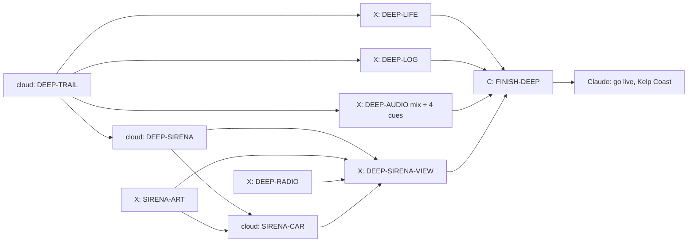

# The Deep: the hidden underwater world

Design for a hidden underwater world, written 11 October 2026 at Kyle's
request: "a potential underwater world in the way that we created an easter
egg for finding mad max ... kelp forests, fish, turtles and other fun sea
life ... no missions yet ... after we drive underwater, we can find new
places to explore ... another route can also be a speed boat or sailing
race." Then: "how about planning out the underwater world too. maybe we can
start on that in parallel."

Status: approved by Kyle on 11 October 2026 ("this all looks good"),
with Kyle's answers in section 11. The story and goals (section 6) were
written by Claude on 24 October 2026, when Kyle handed the Deep's story to
Claude. Section 10 is the build graph for what is left.

## 1. The feeling

Wonder, not danger. You drive off a sunny coast road, down an old boat ramp,
and keep going. The sound goes muffled, the light turns green and blue, sun
shafts come down through the water, and a turtle glides past the windscreen.
Nothing is timed and nothing can hurt you. There is always something moving
at the edge of the light: a school of fish turning together, kelp swaying,
a ray lifting off the sand. Further in, the places get stranger: a sunken
freighter you drive through, a cave lit by jellyfish, the edge of the
drop-off where something very big swims by in the blue.

Look: a real reef and kelp forest, photographed. Muted, natural colours
that lose their reds with depth, soft fog, sunlight dappling the sand. Never
cartoon fish or toy colours (Kyle's standing rule: gritty, never toy-like).
References: the Monterey kelp forest, the Great Barrier Reef shallows, and
wreck dives in clear tropical water.

## 2. How you find it

The Wasteland goes up a canyon off Pacific Canyon. The Deep goes the other
way: down to the sea. Kyle chose several coasts (11 October 2026), so there
are three boat ramps on three circuits, and each leads to its own
underwater place (section 4).

- **Where:** at a small cove beside each coast road, an old concrete boat
  ramp leaves the road, crosses the sand and runs down into the water. It is
  easy to see and easy to dismiss: it just looks like scenery.
  1. **Pacific Canyon Circuit, Pacific Coast:** the first and easiest to
     find, leading to the **Kelp Coast**.
  2. **High Country Grand Tour, Coastal Descent:** leading to **Wreck Reef**.
  3. **Harbor & Highlands, Coast Road (at night):** leading to the **Night
     Harbour**.
- **The dive kit:** a car needs a dive kit to go under (a snorkel up the
  windscreen pillar, sealed seams, a roof light bar). Without it, the
  existing "WATER AHEAD" reset turns the car back at the shoreline, as now.
  The kit is a cheap garage item for every car, shown only after the hint
  (below). One kit fits all cars, so Kyle and Gratian can each dive in their
  favourite.
- **Hints, never on the main menu:**
  1. After five finishes on Pacific Canyon, a garage tip: "Fishermen at the
     cove say the old boat ramp goes further than the beach." Once the Kelp
     Coast is found, the other two ramps get their own tips after a few
     finishes on their circuits.
  2. The dive kit then appears in the garage.
  3. After ten finishes without diving, a second tip, and a few bubbles
     rise off the water at the ramp's end during races.
- **Going in:** works in an ordinary Duel race or Time Trial on that
  circuit (not Mad Max races; the Wasteland owns those). Past the water's
  edge, like the Hidden Road's 150 m point, the race pauses ("RACE
  PAUSED"); drive back up the ramp and it resumes. Keep going down and the
  race display fades, the view sinks under the surface (the waterline
  slides up the screen, bubbles, a muffled thump of sound), and a short
  choice appears: "Dive" or "Turn back". Dive abandons the race with no
  penalty and no record, as at the Wasteland gate.
- **Coming back:** the menu, or drive back up the ramp. Return visits: drive
  down a ramp again in any race or Time Trial on its circuit with the kit
  fitted. The main menu stays exactly as it is (Kyle's standing rule); no
  new button.
- **Remembered:** the save records that the Deep was found, the creatures
  logged, the pearls collected and the Sirena's parts raised (section 6). A save without these fields
  loads exactly as before.

## 3. Driving underwater

The car stays on the sea floor: it drives sand, rock and reef trails like
any off-road track. That fits how the game already moves cars along a
course, so no swimming or flying model is needed.

| Feel | Rule |
| --- | --- |
| Heavy water | Top speed about 70% of the car's normal, gentler acceleration, more drag in turns |
| Floaty jumps | Off a rise or a reef ledge the car hangs and drifts down slowly (about a third of normal gravity), landing softly in a cloud of sand |
| Sand | Wheels lift slow-settling sand clouds that drift with the current, instead of dust |
| Bubbles | A stream of bubbles from the exhaust and the snorkel, more on the throttle |
| Light | Headlights matter: they cut through the gloom in the cave, the wreck and at depth |
| Sound | Engine muffled and low, bubbles, creaks, distant whale song at the drop-off |
| Safety | No damage, no drowning, no timer. Steep reef walls are walls; the edge of the drop-off has a natural rock lip |

Every car gets the same rules, scaled from its own handling, so a monster
truck still feels heavier than the rally car.

## 4. The places

Each ramp leads to its own loop of about 3 to 4 km from the bottom of the
ramp and back. Each place inside is found the first time you drive into it
(a short title card, like a circuit's corner names). The Kelp Coast is built
first; the other two follow once Kyle has played it.

**1. Kelp Coast (Pacific Canyon): sunny, green and gold, cold clear water.**

| Place | What is there |
| --- | --- |
| **Ramp Shallows** | Bright, sandy, 5 to 10 m deep. Seagrass, rippled sand, sunlight in shafts, the surface shimmering overhead. Turtles graze, crabs scuttle, a ray lifts off the sand as you pass |
| **The Kelp Forest** | Tall golden-brown kelp rising to the surface, swaying, the light green and dappled. Schools of silver fish part around the car. Sea lions twist past; a sea otter floats at the top |
| **The Drop-off** | The kelp ends at a cliff into deep blue. The trail runs along the lip. Once a visit, a whale passes slowly below and sings |

**2. Wreck Reef (High Country): warm blue water, colour and a big wreck.**

| Place | What is there |
| --- | --- |
| **Coral Garden** | A reef plateau: coral heads, sea fans, anemones, bright reef fish, a moray in a crack, two reef sharks cruising (harmless, they just swim) |
| **The Wreck** | A rusty freighter on its side. The trail goes in through a hull breach, through the hold (headlights, swaying cables, fish in the gloom, a big grouper) and out of the other side |
| **Manta Point** | A sandy channel where manta rays glide in wide loops over the car |

**3. Night Harbour (Harbor & Highlands, at night): dark, glowing, mysterious.**

| Place | What is there |
| --- | --- |
| **The Old Harbour Wall** | A sunken stone quay, old anchors and sunken fishing boats, the harbour lights wobbling on the surface above |
| **Jellyfish Cave** | A rock tunnel lit by drifting, softly glowing jellyfish; the exit opens into dark water |
| **Glow Bay** | Plankton that glows blue when disturbed: the car leaves a glowing trail and the wheels throw sparks of light. An octopus changes colour on the rocks |

Later places, if Kyle wants more: a kelp maze, a volcanic vent field with
shimmering water and odd tube worms, and a deep trench where it is dark
except for your headlights and glowing creatures.

## 5. Sea life

All sea life is scenery: it never changes the car or the race, so it costs
nothing in fairness and can be as lively as the frame budget allows. It does
react to the car (fish scatter and re-form, turtles turn away, a ray lifts
off the sand), using the car's position only. Each creature's card in the
log (section 6.4) carries the one true fact in the last column.

| Creature (id) | Where | Behaviour | Fact on its log card |
| --- | --- | --- | --- |
| Sardines (`silver-school`, several hundred) | Kelp Coast | Swim together, turn as one, part around the car and close behind it | Sardines swim in schools of thousands. Turning together makes it hard for a hunter to pick out one fish. |
| Reef fish (`reef-fish`, small groups) | Wreck Reef | Hover near the coral, dart into cover | Bright colours help reef fish find their own kind among hundreds of others. |
| Green turtle (`turtle`, 4 to 6) | Ramp Shallows, Coral Garden | Glide slowly with flipper strokes, surface for air | Green turtles are named for the green fat under their shell, which comes from the seagrass they eat. They do live off Southern California. |
| Bat ray (`ray`) | Ramp Shallows | Rests on the sand and lifts off | Bat rays dig clams out of the sand by flapping their wings over it. |
| Manta (`manta`) | Manta Point | Glides in wide loops | The biggest mantas are 7 m across, wider than a car is long, yet they eat only tiny plankton. |
| California sea lion (`sea-lion`) | The Kelp Forest | Fast twisting passes | Sea lions can turn their back flippers forward and walk on land. Seals cannot. |
| Sea otter (`otter`) | The Kelp Forest, at the surface | Floats on its back, wrapped in kelp | Otters eat sea urchins. Without otters, urchins eat the kelp and the forest disappears. |
| Kelp crab (`crab`) | Sand, rocks, the harbour wall | Scuttles sideways out of the way | A crab's legs bend outward, so sideways is its fastest way to move. |
| Moray (`moray`) | Coral Garden | Watches from a crack | A moray has a second set of jaws in its throat that pulls food down. |
| Grouper (`grouper`) | The Wreck | Hangs in the hold | A big grouper opens its mouth so fast that water rushes in and carries a fish with it. |
| Reef shark (`reef-shark`, 2) | Coral Garden | Cruises slowly, never chases | Sharks have no bones: their skeleton is cartilage, like the end of your nose. |
| Jellyfish (`jellyfish`, dozens) | Jellyfish Cave | Pulses and drifts, glowing softly | Jellyfish have no brain, no heart and no bones, and are about 95% water. |
| Gray whale (`whale`) | The Drop-off | One slow pass below per visit, with song | Gray whales swim 16,000 to 20,000 km a year, from Alaska to Mexico and back. |
| Octopus (`octopus`) | Glow Bay | Shifts colour on the rocks | An octopus has three hearts and can change colour in under a second. |

## 6. The story and goals (Claude, 24 October 2026)

The Deep stays a place to play around in: nothing is timed, nothing can hurt
you, and you can ignore every goal and just drive with the turtles. The goals
give a reason to dive, a reason to come back, and an ending you drive
yourself.

### 6.1 Why you dive: the Falcone Sirena

In 1966 Falcone, the maker of the F42 in your garage, built one car to race
the Coast Cup on the Pacific Canyon coast road: the **Sirena**, a low red
sports-racing car with the number 7 on its doors. Rosa Reyes was going to
drive it. The car went up the coast lashed to the deck of a small freighter,
the *Marguerite*. A storm came up in the night off the cove, the lashings
broke, and the Sirena went over the side near the edge of the drop-off. The
crew got home safe. The car never raced, and fishermen at the cove still
snag the odd piece of it in their nets.

Today Rosa's granddaughter **Ana Reyes** is a marine biologist at the Kelp
Coast field station, counting sea life for a survey. The first time you
drive under, she calls you on the through-water phone. (True: ordinary radio
waves fade out within a few metres of sea water, so divers talk with sound.)

This could really happen. In 1956 a one-off Chrysler show car, the
Norseman, sank with the liner *Andrea Doria* off Nantucket. It is still down
there, about 70 m deep. Ana tells that story once, on the drive back up after
your first part is raised.

### 6.2 One Kelp Coast story, from first dive to the finish line

1. **First dive.** Ana calls: she asks for help with the survey (the log) and
   tells the Sirena story in two lines.
2. **The badge.** A few metres from the bottom of the ramp, something glints
   in the sand: Falcone's enamel badge. Drive up and stop beside it. Ana
   recognises it and fits the **sonar** to your dive kit (section 6.3).
3. **Four parts with the sonar.** The steering wheel and a front wheel in the
   Kelp Forest (the wheel is tangled in a kelp holdfast), the bonnet at the
   forest's edge, and a door with the number 7 on the Drop-off lip. Each one
   goes up on a lift bag.
4. **The car.** With five pieces up, Ana works it out: the heavy part sank
   straight down. The sonar now finds the Sirena itself, on a ledge just
   below the Drop-off lip. Four lift bags, and it rises slowly through the
   kelp into the sunlight. If the whale has not passed this visit, it passes
   now.
5. **The Lab.** The Sirena waits in your garage under a sheet until the Lab
   restores it (`docs/LAB.md`, the rust lesson). Restoring it costs 2,500
   credits and makes it your car.
6. **The Coast Cup.** Finish any race on Pacific Canyon in the Sirena. A title
   card reads "Coast Cup, 1966 to 2026: finished", Ana passes on her
   grandmother's thanks, and a plaque goes on the Sirena's garage page.

Every step can be done on any dive, in any order the sonar allows, and both
players keep their own progress (each named player has a save).

### 6.3 The sonar and the lift bags

- **Sonar (R).** Press R to ping. Sound runs through sea water at about
  1,500 m a second, more than four times faster than through air; the sonar
  times the echo and shows the distance. A ring spreads on the screen; the
  nearest part not yet raised within 150 m shows as a blip with its
  direction and its distance in metres. Nothing in range: "No echo". One
  ping every 1.5 s. Ana says the 1,500 m figure on the first ping.
- **Lift bag (F).** Stop within 4 m of a part (under 3 km/h) and press F. A
  yellow bag fills with air from the car's tank in 3 s and floats the part
  to the surface, where Ana's boat picks it up. Each litre of air lifts
  about one kilogram in sea water, so one 200-litre bag lifts a door or a
  wheel. The Sirena weighs about 700 kg in water and takes four bags. True
  to life: salvage divers raise wrecks this way.
- R and F are free under water today (the builder checks the key map); the
  controls help lists both while diving.

### 6.4 The sea-life log

Drive close and slow to log a creature (within 6 m of its zone spot under
15 km/h for 1 s). A picture card slides in with its name and the true fact
from section 5. The log is a page in the garage, one row per place, with
grey shapes for creatures not yet found. The Kelp Coast has seven: sardines,
green turtle, bat ray, sea lion, sea otter, kelp crab and gray whale.

### 6.5 Pearls

Three pearls per place, nine in all. Drive within 3 m of one under
15 km/h for 1 s to collect it. On the Kelp Coast they come from red
abalone on the reef rocks (true: abalone very rarely make pearls, in blues
and greens); Wreck Reef's come from giant clams and the Night Harbour's
from oysters. All nine give the pearl-white paint finish for any car (as
settled with Kyle on 11 October).

### 6.6 Rewards (once per player)

| Goal | Pays |
| --- | --- |
| Each creature logged for the first time | 50 credits |
| A place's log page complete | 250 credits |
| Each pearl | 150 credits |
| Each Sirena part raised (five) | 100 credits |
| The Sirena raised | 500 credits |
| The Coast Cup finished in the Sirena | 1,000 credits and the plaque |

The whole Kelp Coast pays about 3,000 credits, a little more than two Hard
wins, and the Sirena costs 2,500 to restore: the reward is the car and the
story, not money.

### 6.7 Ana on the phone

A fourth stock voice from the voice service the game already uses, a warm
woman's voice not yet used by any crew member or radio (Matilda if it is
offered), recorded clean and played through the radio chain plus a slow
warble, because the phone works by sound through water. Lines never name
prices; cards show numbers. Ids are `deep.ana.<step>`. Recorded with Bella:
Matilda is already Odessa on the crew.

| Id | Line |
| --- | --- |
| `deep.ana.hello` | Hello? You found the old ramp! I'm Ana, at the field station. If you're staying down, could you help me count what lives here? Drive up slow and close, and the log does the rest. |
| `deep.ana.legend` | And keep your eyes open. In 1966 my grandmother's race car went over the side out here in a storm. Nobody has ever found it. |
| `deep.ana.badge` | Is that a Falcone badge? It is! Hold on, I'm sending you a sonar. |
| `deep.ana.sonar` | Press R to ping. Sound runs through water at fifteen hundred metres a second, and the sonar times the echo. The blip shows where something solid is. |
| `deep.ana.bag` | Stop right beside it and press F. One litre of air lifts about one kilo down there, so one bag will carry that. |
| `deep.ana.part` | Got it. My boat's got it. That's a real piece of the Sirena. |
| `deep.ana.norseman` | You know, this isn't the only car on the sea floor. A Chrysler show car went down with a big liner in 1956, and it's still there today. |
| `deep.ana.deep` | Five pieces, all light ones. The heavy part must have gone straight down. Try the edge of the drop-off. |
| `deep.ana.car` | That's her. That's the Sirena. She's heavy, so it'll take four bags. |
| `deep.ana.raised` | She's coming up! Look at that. Sixty years in the dark. |
| `deep.ana.lab` | She'll need a lot of work. Salt gets into the metal. Take her to the Lab. |
| `deep.ana.cup` | Grandma Rosa watched you race. She says thank you. The Sirena finally ran the Coast Cup. |
| `deep.ana.log` | That's one for the survey. Thank you. |
| `deep.ana.page` | That's every animal on the Kelp Coast. That page is done. |
| `deep.ana.pearl` | A pearl! Abalone hardly ever make them. Keep it safe. |
| `deep.ana.otter` | See the otters? They eat the sea urchins. No otters, no kelp forest. |

The otter line plays once, the first time an otter is logged; `deep.ana.log`
plays for the others. `deep.ana.norseman` plays once on the way back up the
ramp after the first part is raised.

### 6.8 Toys along the loop

Nothing here is a goal; it is there to drive through. Two sand gullies with
a low lip on each side, where the slow fall (section 3) turns a jump into a
long float; kelp that bends around the car and closes behind it; a school
of sardines that splits and re-forms; the whale. The trail data marks the
gullies (DEEP-TRAIL).

### 6.9 Later chapters (after Kyle plays the Kelp Coast)

- **Wreck Reef: the *Marguerite*.** The freighter sank off the High Country
  coast later the same night. In its hold is the Falcone team's crate: the
  Sirena's 1966 paint (red with a white nose stripe and the 7) and its spare
  engine, which becomes an engine upgrade for the Sirena.
- **Night Harbour: the Cup.** The Coast Cup trophy went down with a harbour
  launch in the same storm. It lies at the end of the Jellyfish Cave. Raised,
  it goes on the Sirena's garage page beside the plaque.
- **The helicopter.** Once a coast is a helicopter destination (the pilot's
  map), the cove can be seen from the air: from straight above, clear water
  shows the shapes on the bottom, and a car-shaped shadow by the Drop-off
  marks the Sirena on the sonar before your first dive there. Kyle's
  submarine idea (the helicopter lowers a small submarine) stays for later.

## 7. Boats: the second route (separate stage, after the Deep)

Kept as Kyle's 11 October idea, with no change: a marina at the Pacific
Canyon cove, speedboat races round buoys and a sailing regatta that teaches
sailing across the wind, each with a short lesson. It gets its own plan after
FINISH-DEEP, switch `boats`.

## 8. Rules for the build (for Codex and the Claude agents)

- **Switches:** `the-deep` (Deep, off until released), later `boats`.
  Everything new stays behind them.
- **Install like the Hidden Road and Muddy Hollow:** the ramp and the sea
  floor trail are an authored zone installed into its circuit after the
  course is built, without touching its racing line, scenery positions or
  random stream. One generic zone format serves all three coasts, and each
  coast is data. The three circuits' replays and fingerprints stay exact
  when the ramps are not used, and with the switch off everything is byte-for-byte as
  now.
- **Underwater surface rule:** one new surface profile in the driving code
  (drag, speed cap, low gravity for jumps, sand), selected by the zone,
  generic and named for what it does, not for a place. Tests in Node without
  graphics: speed cap, slow fall, landing, ramp return, no damage.
- **Sea life is scenery only:** creatures live in the renderer, use the
  car's position read-only, and never feed back into race state or random
  streams.
- **Frame cost:** the water's fog limits how far you can see (about 90 to
  140 m), so only nearby things need drawing. Use instancing and swimming
  motion in the shader (no per-fish objects), the kit loader's chunks and
  distance levels, and a hard cap per creature type. Target: delivered p95
  at most 18.5 ms on Performance and High at the busiest view (the kelp
  forest with a full school), construction under 1 s.
- **Saves:** new optional fields `deep.found` (which of the three places), `deep.logged` (creature
  ids), `deep.pearls` (pearl ids), `deep.kit` (owned). Old saves load
  unchanged; save checks in memory only.
- **Art:** CC0 first (Quaternius, Kenney, Poly Pizza), CC-BY with credit in
  `public/assets/models/CREDITS.md` and `tools/art/catalog.json`. Recipes in
  `tools/blender/`. Kelp, seagrass, coral and sand ripples should be
  procedural or instanced from a few small meshes. At most three art rounds
  per card; Claude judges the sheets (AGENTS rule 15) and Kyle sees the
  result.
- **Sound:** every new event names its cue: dive splash, muffled engine,
  bubbles, sand landing, creature logged, pearl found, whale song, cave
  ambience.
- **Size:** aim for about 20 MB of new runtime assets for the Deep, watched
  against `tools/size-targets.json`.

## 9. The underwater look (Claude's notes for the look test)

- **Colour with depth:** warm and bright in the shallows, then reds and
  yellows fade first, greens next, until the deep is blue. A depth-based
  grade, not one flat blue filter.
- **Fog:** soft exponential fog that matches the water colour at that depth;
  no hard far edge.
- **Sunlight:** god rays slanting down from the surface, moving slowly;
  caustic light ripples on the sand and the car, strongest in the shallows
  and gone in the deep.
- **The surface from below:** a bright, rippled ceiling with the sun as a
  blurred disc, and Snell's window (you see the sky only straight up; at an
  angle the surface is a silver mirror).
- **Particles:** fine floating specks (marine snow) that drift past the
  camera, so you feel the water moving.
- **Kelp:** tall stems with leaf blades, gently swaying in a slow current,
  light coming through the blades, slightly translucent.
- **Never:** cartoon fish, neon colours, a flat blue tint over everything,
  or a hard fog wall.

## 10. The build as a graph (updated 24 October 2026 for the story)

Built and merged: DEEP-ZONE (format, Pacific ramp, dive and return),
DEEP-SURFACE, DEEP-SAVE (fields, hints, the 150-credit kit), DEEP-WATER (the
look), DEEP-ART-SRC (creatures and sets) and DEEP-AUDIO's eight cues. The
game has no playable zone yet: `main.js` passes no Deep provider, so a dive
has nowhere to go until DEEP-TRAIL. What is left:



| Card | Owner | Starts | Owns (and locks) | Done when |
| --- | --- | --- | --- | --- |
| DEEP-TRAIL | claude-cloud | now | `src/deep/zones/kelp-coast.js`, the provider line in `src/main.js`, the optional `finds` field in `src/deep/deep-zone.js`, `tools/test-deep-kelp-coast.mjs` | The Kelp Coast loop of sections 4, 6 and 10.1 is zone data the game dives into |
| DEEP-SIRENA | claude-cloud | after TRAIL | `src/deep/deep-sirena.js`, `tools/test-deep-sirena.mjs`, three fields in `normalizeDeep`, fixture `tools/fixtures/saves/16-deep-sirena.json` (lock `save-shape`) | Sonar, lift bags, the order of finds, rewards and save, all in Node |
| DEEP-RADIO | codex | now | `src/deep/deep-phone.js`, `src/deep/deep-phone-lines.js`, takes in `audio-src/voices/`, catalogue rows, runtime files (lock `sound-bank`) | Ana's 16 lines recorded and played through the phone chain |
| SIRENA-ART | codex | now | `tools/blender/sirena.py` or a builder in `src/classic-vehicles.js`, `public/assets/models/sirena/`, credits, `docs/board/looks/sirena/` | The car, its wreck, five loose parts and the lift bag, at most three rounds |
| SIRENA-CAR | claude-cloud | after SIRENA, ART | the `falcone_sirena` entry in `src/config.js`, `src/deep/sirena-car.js`, `tools/test-sirena-car.mjs` | The car exists once restored, starts at Pacific Canyon, and the Coast Cup pays once |
| DEEP-LOG | codex | after TRAIL | as before, plus the facts and the pay | Section 6.4 to 6.6 |
| DEEP-LIFE | codex | after TRAIL | as before | Section 5 creatures on the Kelp Coast |
| DEEP-AUDIO | codex | after TRAIL | as before, plus four cues | The real Kelp Coast mix and the cues of 10.1 |
| DEEP-SIRENA-VIEW | codex | after SIRENA, ART, RADIO, CAR | keys, drawing, sonar ring, phone captions, garage sheet and plaque (lock `busy-game-files`) | A player can do section 6.2 from first dive to the Coast Cup |
| DEEP-ART-FINAL | Claude | any time | creature art picks | Finished creatures, within three rounds |
| FINISH-DEEP | Claude | after all | finishing fixes | Postcard sheet, drive-through, frame check, then go live |

The Lab's restore button (`docs/LAB.md`, LAB-RESTORE) needs SIRENA-CAR.
Without the Lab the raised Sirena waits under its sheet, which is a finished
state, not a placeholder: the story says the car needs the Lab.

Wreck Reef (DEEP-REEF) and Night Harbour (DEEP-NIGHT) reuse every part with
new zone data and the later chapters of 6.9, after Kyle has played the Kelp
Coast. Boats (B0) stay a separate plan.

### 10.1 Contracts between lanes

**Zone format** (`src/deep/deep-zone.js` exports `defineZone` and
`ZONE_FORMAT_VERSION = 1`). A zone is plain data:

```js
{ id: 'kelp-coast', circuit: 'pacific-canyon', switch: 'the-deep',
  ramp: { atDistance: <metres along the course>, side: 'left' | 'right',
          length: 120, endDepth: 8 },
  trail: [ { x, z, depth, width, surface: 'sea-floor',      // closed loop, metres
              kelp, grass, rock } ],                     // optional look, 0 to 1
  places: [ { id, name, fromIndex, toIndex } ],              // title cards
  pearls: [ { id, trailIndex, offset } ],
  spots:  [ { creature, trailIndex, count } ] }
```

The ramp sits in the Pacific Coast cove, off the racing line, with no change
to the course's racing line, scenery positions or random stream.

**Surface** `sea-floor` in `SURFACES` (hard-ground tyre column `asphalt`):
grip .75 so the `SEA FLOOR` hint shows, top speed 70% of the car's own,
acceleration 60%, turning drag 1.4 times, gravity a third of normal, landing
never damages, cue `deep.sand-land` on landing. It is a zone surface, never
on a circuit road, so it stays out of `SURFACE_KINDS` and the circuit
surface tests stay exact.

**Save fields** under `deep` (all optional): `found` (zone ids), `places`
(place ids already titled, so a title card shows the first time ever),
`logged` (creature ids), `pearls` (pearl ids), `kit` (true when bought),
`hintsShown` (hint ids) and `pacificFinishes` (whole number, stops at 10,
counting Duel and Time Trial finishes on Pacific Canyon; the existing
`wasteland.pacificFinishes` counts Mad Max races only and stays as it is).
First hint at five, second at ten while `found` is empty.

**Creature ids (14):** `silver-school`, `reef-fish`, `turtle`, `ray`,
`manta`, `sea-lion`, `otter`, `crab`, `moray`, `grouper`, `reef-shark`,
`jellyfish`, `whale`, `octopus`.

**Pearl ids:** `kelp-1` to `kelp-3`, `reef-1` to `reef-3`, `night-1` to
`night-3`.

**Sound cue ids:** `deep.splash`, `deep.engine-muffle`, `deep.bubbles`,
`deep.sand-land`, `deep.logged`, `deep.pearl`, `deep.whale`, `deep.cave`.

**Events** use the existing `duel.emit({name: payload})` style, read by the
renderer and sound and never written by them: `deepEntered {zoneId}`,
`deepExited {zoneId}`, `deepLanded {speed}`, `deepLogged {creature}`,
`deepPearl {pearl}`, `deepPlace {place}`.

**Coordinates:** trail and spot `x`, `z` are world metres in the circuit's
own frame, `depth` is metres below the surface. A sideways offset (pearl
`offset`, `lateral`) is positive to the left, as in the game: heading +z,
left is +x.

**Trail look fields:** `kelp`, `grass` and `rock` on a trail point are
optional numbers from 0 to 1 (default 0) saying how much kelp forest,
seagrass and bare rock surround that stretch. DEEP-ZONE keeps them when it
checks a zone; only the look reads them.

**Scene hook:** `src/deep/underwater-scene.js` (DEEP-WATER) exports
`createUnderwaterScene({zone, quality, renderer, scene})` returning
`{group, update({car, camera, seconds}), attachCar(object), dispose()}`.
`car` is read-only `{x, y, z, heading, speed}`. The scene adds its own lights,
fog and water to `scene` and on dispose removes them and restores the
scene's background and environment. `attachCar` dresses the player's car in
copies of its materials (caustics, shadow, headlights below 16 m); dispose
gives the originals back. During the descent, before the dive, DEEP-ZONE
draws `createWaterline()` from `src/deep/waterline.js` over the circuit's
own scene: `update(camera, seconds)`, then render `overlay.scene` with
`overlay.camera` while `overlay.active`. DEEP-ZONE makes the one call in the
renderer when the player dives and disposes it on the way back up; DEEP-WATER
owns everything behind it, including the waterline and bubbles on the way
down.

**Logging** measures the car against the fixed `spots` in the zone data,
never against the moving creatures, so the log does not depend on the
renderer.

**Story additions (24 October 2026).**

- **Finds** (optional zone field, read by DEEP-SIRENA): `finds: [{id,
  trailIndex, offset, below}]`. `offset` is sideways as for pearls; `below`
  (metres, default 0) puts a find under the trail's floor, as the Sirena on
  its ledge under the Drop-off lip. A zone without `finds` loads exactly as
  before. Kelp Coast ids, in story order: `sirena-badge` (Ramp Shallows),
  `sirena-steering-wheel`, `sirena-wheel`, `sirena-bonnet` (Kelp Forest),
  `sirena-door` (Drop-off lip), `sirena-car` (the ledge, `below` 3).
- **Gullies** are made from the trail's own `depth` numbers (a short
  stretch 3 m deeper with a lip either side); no new field.
- **Save fields** under `deep` (all optional): `sonar` (true once given),
  `raised` (find ids), `coastCup` (true once finished). Old saves load
  unchanged.
- **Rules** (`src/deep/deep-sirena.js`, pure): the sonar is given when
  `sirena-badge` is raised; the badge needs no sonar. The sonar shows the
  nearest find not yet raised within 150 m, except that `sirena-car` shows
  only when the other five are raised. A lift starts when the car is within
  4 m of a find (horizontal distance; `below` ignored) under 3 km/h and F is
  pressed; it takes 3 s (12 s for `sirena-car`, four bags) and the car may
  not drive off during it (driving off cancels it). Ping cooldown 1.5 s,
  range 150 m.
- **Rewards** (section 6.6) are paid once, at the moment the save first
  records the thing; credits stop at the save's 1,000,000,000 cap.
- **Events:** `deepSonar {blip}` where `blip` is `{find, distance,
  bearing}` or `null`; `deepLift {find, seconds}`; `deepRaised {find}`;
  `deepCoastCup {}`.
- **Sound cues** (four more): `deep.sonar` (the ping), `deep.echo` (the
  return tick, played after the real echo time, 2 × distance / 1,500 s),
  `deep.liftbag` (air rushing into the bag and its rise), `deep.raised` (a
  low swell as the Sirena breaks free of the sand).
- **The Sirena:** car id `falcone_sirena`; it lives at Pacific Canyon when
  restored (section 6.2 and SIRENA-CAR).

Release: Claude decides go live for the Kelp Coast after FINISH-DEEP and a
passing full check (AGENTS rule 18), then each later place on its own.

## 11. Settled with Kyle (11 October 2026)

1. **Where to find it:** several coasts. Pacific Canyon leads to the Kelp
   Coast (built first), High Country to Wreck Reef, and Harbor & Highlands
   at night to the Night Harbour.
2. **Which cars:** every car, with the dive kit ("whatever's easiest").
3. **Sharks:** two harmless reef sharks stay; they never chase.

## 12. Picked for Kyle (24 October 2026)

- The lost car is a Falcone, the game's own make, so the story belongs to
  the game and needs no real maker's badge.
- Rewards stay small (about 3,000 credits for the whole Kelp Coast) so
  diving never beats racing for money.
- Ana is a new voice (a fourth stock voice), so Gratian does not hear a park
  ranger playing the scientist.
- The restored Sirena starts at Pacific Canyon, so the Coast Cup can be
  raced before the coast is on the pilot's map; with the helicopter on it
  then travels like any special car, only by air.
