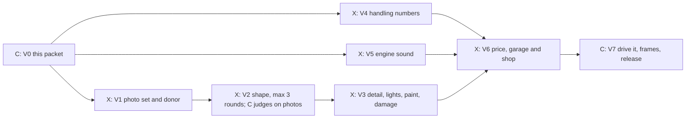

# Nissan Skyline GT-R (R34): a new shop car (car packet V0)

Claude, 28 October 2026, for Kyle's staged car line (`docs/FACTORY.md` section
3, car line, and section 6). This packet answers the section 6 checklist so the
seven stage cards can start without asking. Design only: no game code.

The Skyline GT-R is the 1999 to 2002 R34 generation: a boxy two-door coupe with
a 2.6 litre twin-turbo straight six, six-speed manual gearbox and all-wheel
drive, about 1,560 kg. Like the Jesko, the Enzo and the F1, it carries the real
car's name and an original model built from public pictures used as a viewing
reference only. No maker model, badge, logo or texture is used.

## 1. What the player sees and does

A new car in the garage, bought with credits, not earned. It is blue by
default (Bayside Blue, the colour the car is known for) with silver wheels, a
boxy long-hooded body, four round tail lamps and a wing on the boot. On the
road it is quick and sticks to the road: very high grip for its price, a strong
launch and good brakes, a little less top speed than the Aurora. On gravel and
snow it holds on better than any other road car, because it is all-wheel drive.
It turns in with a throaty straight-six note, a turbo whistle as you press on
and a short hiss and flutter when you lift off the throttle.

Everything else about it works like any bought car: seven upgrades at 350, 600
and 950 credits, paint finishes, a medal sheet, ghosts, Grand Prix, Mad Max
armour. Nothing new for the player to learn.

## 2. Numbers

### 2.1 Where it sits

Current cars from `src/config.js` (base figures), with the speed they reach at
full tuning (base top speed times 1.105, the figure `docs/EARNED_CARS.md` uses)
and the game's own pace figure, the racing-line index from `performanceIndex`
in `src/race-field.js`, on two circuits (higher is faster round a lap).

| Car | Top speed (mph) | Accel | Grip | Braking | Price | Mass (kg) | Fully tuned top (mph) | Index, Tremblant Woods | Index, Ardennes Forest |
| --- | ---: | ---: | ---: | ---: | ---: | ---: | ---: | ---: | ---: |
| Falcone F42 | 201 | 7.6 | .82 | .90 | free | | 222 | 128.5 | 116.6 |
| Stuttgart 959-S | 197 | 6.9 | .95 | 1.00 | free | | 218 | 131.5 | 120.0 |
| Falcone Heritage | 201 | 7.6 | .82 | .90 | 1,800 | | 222 | 128.5 | 116.6 |
| Aurora GTR | 214 | 8.1 | 1.01 | 1.06 | 2,200 | | 236 | 138.4 | 126.1 |
| Dusthawk Rally | 184 | 8.5 | 1.05 | 1.10 | 3,500 | 1,280 | 203 | 136.8 | 125.3 |
| Banshee Muscle | 209 | 9.3 | .86 | .98 | 5,000 | 1,810 | 231 | 134.7 | 122.2 |
| **Nissan Skyline GT-R R34** | **205** | **8.4** | **1.08** | **1.12** | **6,000** | **1,560** | **226** | **140.7** | **128.6** |
| Viper Prototype | 232 | 8.8 | 1.13 | 1.24 | 7,500 | 940 | 256 | 146.4 | 133.3 |
| Titan Monster | 116 | 8.6 | .91 | 1.08 | 12,000 | 4,700 | | | |
| Koenigsegg Jesko | 298 | 9.9 | 1.12 | 1.50 | earned | 1,390 | 329 | 153.4 | 138.3 |

(The Skyline's index figures are the same calculation, run on the settled
numbers of 2.2. The Heritage is the F42's body with the same numbers, so its
figures match.)

So the Skyline sits where the brief asks: above both starters and the Falcone
Heritage, a little below the Aurora in top speed but quicker through corners and
off the line, a step above the Banshee on pace and a step below the Viper. On
four circuits it is 1.6 to 2.3% quicker than the Aurora and 3.2 to 3.9% slower
than the Viper (calculated: Tremblant Woods +1.6% and -3.9%, Panorama Ridge
+1.7% and -3.6%, Ardennes Forest +2.0% and -3.5%, Harbour Lights +2.3% and
-3.2%). The V4 gate keeps it inside 1 to 3% above the Aurora and 3 to 5% below
the Viper on those four.

### 2.2 The settled numbers for `src/config.js`

| Setting | Value | Why |
| --- | --- | --- |
| key | `nissan_skyline_gtr_r34` | the naming the Enzo, F1 and Bolide use |
| name | `Nissan Skyline GT-R R34` | |
| homage | `R34-inspired twin-turbo all-wheel-drive coupe` | the wording of the other real-name cars |
| gearbox | manual, 6 speeds | the real car has six |
| `topSpeed` | 205 | between the starters (201, 197) and the Aurora (214); tuned about 226 |
| `accel` | 8.4 | quick: above the Aurora (8.1), below the Dusthawk (8.5) |
| `grip` | 1.08 | very grippy: above the Aurora (1.01) and the Dusthawk (1.05), below the Viper (1.13) |
| `braking` | 1.12 | between the Dusthawk (1.10) and the Viper (1.24) |
| `gears` | 55, 95, 133, 167, 190, 205 | the same spacing as the Aurora's six |
| `color` and `accent` | Bayside Blue `0x1b3d8c`, silver `0xc7ccd1` | a deep metallic blue; the accent is the wheels and trim |
| `price` | 6,000 | see 2.3 |
| `offRoadGrip`, `offRoadSpeed`, `offRoadScrub` | .90, 105, .26 | between the Dusthawk (.96, 125, .20) and the Banshee (.72, 76, .38): better than any road car, short of a rally car |
| `mass` | 1,560 | the real weight; over Kestrel One's 1,500 kg hook limit (2.4) |
| `collision` | halfWidth 1.0, halfLength 2.30 | real size 1.785 by 4.60 m, with the same small margin the F1 and Enzo carry |
| `height` | 1.37 | real height 1.36 m |
| new setting `awd: true` | see 2.5 | gravel and snow grip |
| new setting `excludeFromCompletion: true` | see 2.3 | keeps the Jesko's list at eight cars |

The numbers are game settings, not measurements. The real car tops out near
250 km/h unrestricted, which a literal copy would put below both starters; the
game scales cars by class and feel (the Dusthawk's top speed is also far from a
real hatchback's), and the Skyline is placed by how it drives.

Upgrades follow the shared rules (seven systems, three levels each, 350, 600
and 950 credits). Engine character: a `tools/fit-engine-curve.mjs` fit gives
the car its own row in `ENGINE_FIT` (V4); the test that every car has a row
fails until it does.

### 2.3 Price and earn rule

**A shop car at 6,000 credits.** Prices today run 1,800 (Heritage), 2,200
(Aurora), 3,500 (Dusthawk), 5,000 (Banshee), 7,500 (Viper), 12,000 (Titan). The
Skyline is faster than the Banshee and slower than the Viper, so it sits between
them: 6,000 is 20% over the Banshee and 20% under the Viper. A Medium win pays
1,000 credits and a Hard win 1,500, so it is about four to six wins, about half
what the Titan asks.

It is not earned and has no medal rule. The garage shows "6,000 CR" in the car
list and the usual unlock card ("UNLOCK CAR").

**The Jesko's list stays at eight cars.** The Jesko asks the player to fully
upgrade every other car without an unlock rule (the two starters and the six
priced cars). A seventh priced car would make it nine and raise the cost of the
Jesko by about 13,300 credits of upgrades plus the 6,000 purchase. In keeping
with `docs/EARNED_CARS.md` ("a new car never makes the Jesko harder"), the new
setting `excludeFromCompletion: true` takes the Skyline out of that list. The
change is two lines in `completionCarProgress` (`src/progression.js`); the
garage text "Fully upgrade all 8 other cars" and every existing save are
unchanged. Existing Jesko owners keep it either way.

### 2.4 Weight and the helicopter

At 1,560 kg the Skyline is over Kestrel One's 1,500 kg hook limit, so the
helicopter's lift check (`liftCheck` in `src/heli/heli-cable.js`) fails it with
"Needs the Lab's lift upgrade", exactly as it does the Banshee (1,810 kg). So
it is never a customer car (`JOB_CARS` is built from the cars that pass), the
seeded dispatch jobs stay exactly as they are, and the Skyline is not on the
air-only list (it races anywhere, like every bought car). V4's lift test
proves this. If the Lab's lift upgrade later raises the limit above 1,560 kg,
the helicopter packet's rule for customer cars decides then.

### 2.5 All-wheel drive on gravel and snow

The numbers above give the Skyline strong ordinary grip. The all-wheel-drive
feel on gravel and snow comes from one small change to the surface rules, held
as a separate setting so no other car moves:

- Graded gravel: the Skyline's grip is .93 (the rally car and Titan have 1.00,
  every other car .85).
- Packed snow and deep snow: its grip is multiplied by 1.06 on top of the tyre
  value (winter tyres on packed snow give .70 today and .74 for the Skyline;
  summer tyres give .525 and .557).
- Ice, asphalt and warm tarmac: unchanged.

Only a car with `awd: true` gets this. The 959-S is also all-wheel drive in its
description but is not given it: its numbers and fingerprints stay exactly as
they are (`src/race-surfaces.js` is held by the `surfaces` lock; V4 holds it).
If the lock is busy, V4 can ship without it and add it later; the car is still
right on its numbers.

### 2.6 Size budgets

At most 60,000 triangles and 56 draws (the 959-S's size; the F1 is 54,655 and 54,
the Jesko's limit is 73,600 and 66). With the model that light it can be
drawn eight times in a test field. It is not added to the pool of cars the
computer racers pick from (`ROAD_CARS`), so every existing Grand Prix field
stays as it is.

## 3. The graph

Cards `NISSAN-SKYLINE-GTR-R34-V1` to `NISSAN-SKYLINE-GTR-R34-V7`, made with
`node tools/new-line-cards.mjs car nissan-skyline-gtr-r34 "Nissan Skyline GT-R R34"`.
Owners: C is Claude, X is Codex, T is the test machine.

V1, V4 and V5 start at once. V6 needs all three branches.

## 4. Contracts between the parallel cards

- **Names:** car key `nissan_skyline_gtr_r34`; model file `src/skyline-vehicle.js`
  exporting `createSkylineVehicle` (the pattern of `src/mclaren-f1-vehicle.js`);
  switch `nissan-skyline`; test file `tools/test-skyline-vehicle.mjs`; sheets
  `docs/board/looks/skyline/round-1.jpg` to `round-3.jpg` and
  `docs/board/looks/skyline/review.md`.
- **Config entry:** the numbers of 2.2, appended after the cars already in
  `CARS` (never inserted), plus the two new settings `awd` and
  `excludeFromCompletion`.
- **Voice entry:** one `CAR_VOICES` row (section 8.1) and one
  `ENGINE_FIT` row, both under the key.
- **Sound cue names:** `vehicle.turbo-whistle` (loop) and `vehicle.blowoff`
  (one shot).
- **Paint ids:** `bayside_blue` is the factory finish (no entry needed);
  `skyline_white`, `skyline_silver` and `skyline_black` are the three extra
  finishes, restricted to this car and priced 250 credits each (appearance
  only), the price of the cheaper existing finish.
- **Registration rows:** `src/vehicle-assets.js` (the model), `src/vehicle-sockets.js`
  (roof and front sockets), the armour kit `nissan_skyline_gtr_r34.glb` in
  `public/assets/models/wasteland/kits/` from the existing recipe
  `tools/blender/armor-kits.py`.
- **Race field:** one line adding the car to `ROAD_CLASS` in `src/race-field.js`
  (the list of cars whose Grand Prix gets a mixed field instead of eight copies of
  the player's own car). `ROAD_CARS`, the pool racers pick from, is not touched.

## 5. Locks and owned files

| Card | Holds these locks | Owns |
| --- | --- | --- |
| V1 | none | `docs/board/cards/NISSAN-SKYLINE-GTR-R34-V1.md` (photo list, donor note) |
| V2 | none | `src/skyline-vehicle.js`, `tools/test-skyline-vehicle.mjs`, the round sheets and review note |
| V3 | none beyond V2's files | the same files, the armour kit, rows in `src/vehicle-assets.js` and `src/vehicle-sockets.js` (neither is locked, one builder at a time) |
| V4 | `surfaces` (the `awd` rule in `src/race-surfaces.js`) | the config entry, the `ENGINE_FIT` row, the surface rule and its test, `tools/test-skyline-handling.mjs` |
| V5 | `sound-bank` | the voice row, the two cues, the sound recipe in `tools/audio/catalog.json`, the audio change in `src/audio.js` (no lock) |
| V6 | `circuit-registry` for the one `ROAD_CLASS` line only; no `save-shape` | garage and shop rows, paint finishes in `src/paint-presets.js`, `excludeFromCompletion` in `src/progression.js`, the switch in `src/feature-flags.js`, tests that pin the car list |
| V7 | `release` | the switch flip and the release note |

## 6. What stays exact

- Every other car's numbers, price, voice and replay fingerprints. Adding a car
  to the end of `CARS` changes no other car's simulation.
- Every existing Grand Prix field (the pool `ROAD_CARS` is untouched).
- The helicopter's customer-car list and seeded dispatch jobs (2.4).
- The Jesko's rule and the number eight (2.3) and every existing save, including
  Jesko owners. The save has no new field: owning the car is one more id in the
  existing list of unlocked cars, the same as any bought car. The fixtures under
  `tools/fixtures/saves/` still load unchanged.
- Surface grip for every car without `awd` (2.5).
- All the existing paint finishes and prices.
- World composition signatures: a car is not part of any course scene.

## 7. The switch

Switch name `nissan-skyline`, state `dev` while building, `on` at V7. With it off
the car does not appear in the garage list, the car picker, the shop, the
paint panel, a Grand Prix field or the helicopter; the roster is exactly the
roster of today. With it on: one more car in the list (priced 6,000), the car's
voice and cues, three more paint finishes for this car, and the Jesko's list
stays at eight. Counts that read from the car list move by one; every changed
assertion in the tests that pin the car list (`test-progression.mjs`,
`test-course-eligibility.mjs`, `test-combat-armor.mjs`, the garage and shop
suites) is named in the V6 change note, never loosened.

## 8. Sound and art

### 8.1 Sound: a straight-six with a turbo

The existing engine samples are shared by every car; each car tunes them with a
voice row. The Skyline's row, in the shape `CAR_VOICES` uses, is
`pitch .96, brightness 1.03, gain .98, accent 1.0, exhaust .16, intake .13`.
No other car uses pitch .96, which matters because the audio test insists each
car's steady rate differ. It is a smooth mid-pitch engine, higher than the
Banshee's muscle rumble and lower than the F1's V12 shriek, with a metallic rasp
in the exhaust.

Two new cues give the turbo its character; neither exists today:

- `vehicle.turbo-whistle` (loop): a thin rising whistle, audible above about 35%
  throttle load, its pitch following revs, topping out in the 4 to 7 kHz band,
  at most 20 dB under the engine bed so it colours the sound and never leads it.
- `vehicle.blowoff` (one shot, about 0.35 s): the short hiss and flutter when
  the throttle is lifted from at least 70% throttle with revs above 55%, played at
  most once every 1.2 s and not twice inside one gear change. Peak at most 3 dB
  under the existing lift accent.

Source: the library recipes in `tools/audio/catalog.json` (CC0 first, then CC-BY
with credit; ElevenLabs only by the audio owner within budget). If no library
sample passes, both can be built by synthesis (filtered noise and a sine
sweep), the way the procedural engine fallback is made. Loudness: the car's
engine matches the rest of the roster within 1 dB, and the worst six-second
adjacent-band mix across all cars stays within the existing 7 dB limit
(`docs/AUDIO_EXPANSION.md`). `src/audio.js` learns a per-car `turbo` setting;
only this car has it. No listening review is claimed; Claude judges by the
measurement tool's numbers (FACTORY V5).

### 8.2 Paints

Bayside Blue is the factory finish and the car's signature. The three others
are 250-credit finishes restricted to this car, appearance only:

| Id | Name | Colour | Finish |
| --- | --- | --- | --- |
| factory | Bayside Blue | `0x1b3d8c` | deep metallic blue, metalness .46, roughness .27 (the 959-S's) |
| `skyline_white` | Skyline White | `0xe8e8e2` | pearl white, metalness .35 |
| `skyline_silver` | Sonic Silver | `0xb4bac0` | light metallic, metalness .55 |
| `skyline_black` | Midnight Black | `0x16181b` | deep gloss, metalness .30 |

(Colour names are ours, not the maker's.) The existing generic finishes (Copper
Metallic, Glacier Satin) work on it as on any car.

### 8.3 Look target

A road-car coupe, not a hypercar: boxy and tough, never toy-like. Long bonnet
and short rear deck, flat roof with an upright greenhouse and almost upright rear
glass, squared shoulders over wide flared arches, rectangular headlamps with
a wide lower intake and a small bonnet vent, four round tail lamps (two each
side), a boot-lid wing, twin round exhaust tips, five double-spoke wheels with
red brake calipers. Judged against photographs, never a description (FACTORY car
line). At most three rounds; one comparison sheet per round (JPG, 500 KB at most);
evidence is deleted after the verdict.

## 9. How it is checked

- V1: Claude accepts the photo set and donor note.
- V2: the car's own test (`tools/test-skyline-vehicle.mjs`) checks the standard
  vehicle contract (driver, steering, four wheels, brake lights, boost flames,
  paint, directional damage, crush, exact reset), size budget, helmet clearance and
  light visibility from the camera views; Claude judges the sheets against the
  photos.
- V3: the paint and grounding suites that cover every car (`test-vehicle-paint`,
  `test-vehicle-grounding`, `test-vehicle-sockets` and the armour kit fit) pass
  with the car; paint finishes check.
- V4: `tools/test-skyline-handling.mjs` runs the racing-line index on Tremblant
  Woods, Panorama Ridge, Ardennes Forest and Harbour Lights against the Aurora
  and the Viper (bands of 2.1: 1 to 3% above the Aurora, 3 to 5% below the Viper);
  the surface test proves only `awd` cars move on gravel and snow; the existing
  replay fingerprints of every other car are unchanged; the lift test proves 2.4.
- V5: the audio suites pass including distinct steady rates and the mix limit;
  the two new cues have measured loudness numbers in the change note.
- V6: the garage and shop show it only with the switch on; buying it deducts 6,000
  credits and unlocks it; the Jesko's progress still reads "of 8"; all save
  fixtures load; the lane tier and a build; one code review (saves are not
  touched, so no save checker; the garage and progression change is covered by
  the review).
- V7: Claude drives it on three courses (Tremblant Snow for snow, Summit Run
  for its graded gravel, Pacific Canyon for plain asphalt) and signs off the feel;
  the frame check with a field of eight Skylines at the busiest start grid on both
  qualities (p95 at most 18.5 ms, world build under 1 s, rule 8, laptop alone);
  then live with the next batch (rule 18). Claude decides go-live and Kyle hears
  afterwards. No frame check on the art rounds (rule 9).

## 10. Water and trees

Not applicable: a car has no lake or forest and needs no burnt look.

## 11. Stage cards: what each must deliver

**NISSAN-SKYLINE-GTR-R34-V1, photos and donor (Codex, ART; Claude judges).** A
note in the card's file with six reference views noted by source (public maker
pictures and freely licensed photographs, links or descriptions; nothing is
copied into the game or the repository), the closest existing body named
(below), its helpers listed and the size budget of 2.6 confirmed. The six views:

1. Front three-quarter from the left, at bonnet height: bonnet shape, headlamps,
   the wide lower intake, arch flare.
2. Rear three-quarter from the right: boot-lid wing, four round tail lamps, rear
   bumper and twin tips.
3. Side profile, level with the car: roofline, door and glasshouse proportion,
   wheel size against the arches, the ride height.
4. Straight front: headlamp and intake layout, bonnet vent, width.
5. Straight rear: tail lamp circles, wing height, tip positions.
6. An interior glimpse through the driver's window or windscreen: seats,
   steering wheel, the gauge cluster (for the driver and cockpit shape).

**The donor (settled here).** Tools and files checked: `tools/blender/` holds no
car recipe (only `car-review.py`, which renders review pictures of a car, and
`armor-kits.py` for the Mad Max kits), and the GLB files in
`public/assets/models/classics` and `unlocks` are exports of the code builders
(`tools/export-classic-vehicles.mjs`, `tools/export-unlock-vehicles.mjs`), not
art sources. So cars are built in code. The closest existing model is the
**Stuttgart 959-S** (`stuttgart()` in `src/classic-vehicles.js`): a two-door coupe
with a closed cabin, six gears, all-wheel drive in its own description, and
an open cockpit tub for the driver, built from the shared helpers
(`originalVehicleParts` in `src/unlock-vehicles.js`: `materials`, `batch`, `body`,
`panel`, `cylinder`, `cockpit`, `wheels`, `exhaust`, `rearPlate`,
`fitSurfacePatch`). The V2 builder starts from its body sections and cockpit
and reshapes them boxier. The contract wiring (steering, wheels, lights, damage,
paint, sockets, reset) is copied from the newest accepted car, `src/mclaren-f1-vehicle.js`
with its test `tools/test-mclaren-f1-vehicle.mjs`, which is the template for
the Skyline's own test. For review pictures, `tools/art/car-review-export.mjs` and
`tools/blender/car-review.py` make the four standard views.

**NISSAN-SKYLINE-GTR-R34-V2, shape (Codex, ART; Claude judges against photos).**
`src/skyline-vehicle.js` and its test, nominal size 1.96 by 4.60 by 1.38 m (the
F1 carries about 0.18 m over its real width, and the Skyline's real width is 1.785
m), wheel radius about 0.34 m, driver in the left seat as the other cars,
+Z forward, ground at y = 0. A single comparison sheet per round: side, front,
top and three-quarter views of the model beside the V1 photos. At most three
rounds. Stop rule: if three rounds do not meet the look target, stop, write why in
the change note and ask Kyle; never ship a stand-in car.

**NISSAN-SKYLINE-GTR-R34-V3, detail (Codex, ART).** Headlamps and tail lamps that
read from the driving cameras, brake and reverse lights, wheels with spokes and
red calipers, mirrors, the wing, the exhaust tips, a blank plate, the three paint
finishes of 8.2 as appearance values, dents, scratches, glass cracks and dirt on
the existing contract, the armour kit for Mad Max Duel, the roof and front
sockets, and the budget of 2.6 met. Done when the model test, paint, grounding,
sockets and armour suites pass with the car.

**NISSAN-SKYLINE-GTR-R34-V4, handling (Codex, SIM; tests judge).** The config
entry of 2.2 appended to `CARS`, the `ENGINE_FIT` row from `tools/fit-engine-curve.mjs`
with the car at its race engine level, the `awd` rule of 2.5 in
`src/race-surfaces.js` with a test that no other car's grip changes by even a
decimal, and `tools/test-skyline-handling.mjs` with the index bands of 2.1. The
lift test of 2.4. Replay fingerprints of every other car unchanged. Done when the
tests pass.

**NISSAN-SKYLINE-GTR-R34-V5, sound (Codex, AUDIO; Claude judges the numbers).**
The voice row of 8.1, the two new cues in the sound registry with their recipes,
the per-car turbo setting in `src/audio.js`, loudness within 1 dB of the roster
and the mix limit kept. The change note gives the measured numbers. Done when
the audio suites pass.

**NISSAN-SKYLINE-GTR-R34-V6, buy rule, garage and shop (Codex, SIM; tests
judge).** Price 6,000 in the config entry, the garage card and list text, the
`ROAD_CLASS` line, the Jesko exclusion, the three paint finishes at 250 credits
(restricted to this car in `src/paint-presets.js`), the switch in
`src/feature-flags.js` (the car appears nowhere while it is off), and every
car-count assertion that now reads nine bought cars named and explained. Done
when the lane tier and a build pass and a fresh and an old save both load and
buy the car.

**NISSAN-SKYLINE-GTR-R34-V7, release (Claude, then the Release Manager).** The
checks of section 9, the switch flip, a release note with pictures for Kyle.

## Removed

Nothing is removed by this packet's work: adding the car replaces nothing. The
V2 working renders and every round sheet and photo note are evidence used once
and deleted after the verdict (AGENTS "Evidence is used once"); only the verdict
note and the final comparison sheet stay.

## Open for Claude

1. **The Jesko exclusion (2.3).** I recommend excluding the Skyline from the
   Jesko's completion list so the Jesko stays at eight cars. If you would
   rather keep "every bought car", the Jesko then asks for nine, which is about
   13,300 credits of upgrades plus the 6,000 price more than today. This
   changes what an existing reward asks of a new player, so I want your yes
   before V6.
2. **The all-wheel-drive rule (2.5).** Whether to spend the `surfaces` lock on
   an `awd` setting for one car, or let the grip, off-road numbers and the
   car's description carry the feel. I recommend the setting, small as it is.
   If the 959-S should also get it, that moves its numbers and is a separate
   decision.
3. **Price (2.3).** 6,000 credits is my reading of the ladder. A price of 5,500
   or 6,500 changes nothing else; say if you want a different number.
4. **Top speed (2.2).** 205 mph is far above the real car and is placed by
   class. If you would rather keep it nearer the real car (a top near 190 with
   more acceleration and grip, index about the same), I can re-run the numbers
   the same way.
5. **Paint finishes (8.2).** Are three 250-credit finishes right, or should they
   be free, or generic finishes any car can wear? I made them car-restricted at
   250 so no other car moves.
6. **Not in the computer racers' pool.** A Grand Prix in the Skyline fills the
   field from the existing road cars. If you want computer racers to drive
   Skylines too, the pool `ROAD_CARS` changes and every existing Grand Prix field
   changes with it, so I left it out.
7. **Real-name use.** The Skyline and the maker's name follow the same rule as
   the Ferrari Enzo, McLaren F1 and Koenigsegg: the name in the garage, an
   original model, no badge, logo or texture. Please confirm the name is fine
   for a shop car too.

## Claude answers (28 October 2026)

- Leave the Skyline out of the Jesko's list (excludeFromCompletion): yes. The Jesko must not get harder because a new car was added.
- Top speed 205 mph: yes, game scale; its pace placement between the Aurora and the Viper is what matters.
- Price 6,000 credits, shop car: yes.
- The all-wheel-drive rule for this car only, holding the surfaces lock at V4: yes.
- Donor: the Stuttgart 959-S code builder; judge the shape against the six photos at V2, never a description.
- Over Kestrel One's hook limit, so never a customer car: fine.

## V1 photos and donor

Prepared 28 October 2026 for NISSAN-SKYLINE-GTR-R34-V1.
No locks. Owned files: this packet (Kyle's explicit extension), the V1 card and
its change note. Checks: six-view and contact-sheet audit; read the donor and
shared helper contracts; board and repository hygiene, lane tier with jobs 2,
production build. No browser, frame or live-save check applies to references.

### Generated reference pictures

Folder: `C:/Users/kyleb/dev/art-library/nissan-skyline-gtr-r34/reference/`.
All six requested views were made with the built-in imagegen tool in metallic
Bayside Blue. `prompts.json` contains the exact prompts, original output paths
and crop provenance. `ref-nissan-skyline-gtr-r34.jpg` is the labelled contact
sheet, at most 500 KB. These synthetic pictures are modelling guides, not
factory photographs or dimension drawings. They are never copied into the game.

| File | Source and use |
| --- | --- |
| `front.png` | Built-in imagegen: straight front. Headlamp rectangles, width, grille, intake and squared shoulders. |
| `rear.png` | Built-in imagegen: straight rear. Four round lamps, upright glass, boot and separate wing. |
| `left-side.png` | Built-in imagegen: left profile. Long bonnet, two-door cabin, beltline, rear arch and wheel placement. |
| `right-side.png` | Built-in imagegen: right profile. Opposite side, fuel door and door/glass proportions. |
| `three-quarter.png` | Built-in imagegen: front-left at bonnet height. Front volume, fender flare, cabin and wing in depth. |
| `interior.png` | Built-in imagegen interior request returned a four-panel study; use its bottom-right interior panel, cropped without altering it. Right-hand-drive cockpit, dark seats, three-spoke wheel, analog cluster and centre display. |
| `rear-three-quarter.png` | Extra view from the same study's top-right panel, cropped without altering it. Covers the packet's rear-right wing and bumper reference in addition to Kyle's six required views. |

Real-car cross-check: [Nissan Heritage, BNR34 V-spec II](https://www.nissan-global.com/EN/HERITAGE_COLLECTION/280_skyline_gt-r_v-spec_ii.html)
supplies a manufacturer picture and dimensions (4,600 by 1,780 by 1,360 mm,
wheelbase 2,665 mm). This source's particular variant differs from the game's
approved 1.96 by 4.60 by 1.38 m envelope; the packet controls game dimensions.
[Nissan Heritage, R34 GT-R](https://www.nissan-global.com/EN/HERITAGE_COLLECTION/skyline_gt-r_2000.html)
is a second maker reference. No maker image was downloaded or shipped.

Visual inspection: both sides, front, rear, three-quarter and cockpit are
readable and blue throughout. The generated views are not geometrically
identical: wheel details vary; the reference shows gold calipers and one large
exhaust outlet; the bonnet vent is absent in the front study. The packet asks
for red calipers, five double-spoke wheels, twin tips and a small bonnet vent.
V2/V3 must follow those written art decisions and compare the actual model,
rather than copy these synthetic detail errors. Badges visible in the
references are not a request to model logos. The reference cockpit is RHD;
the packet deliberately keeps the game driver in the left seat.
Claude's shape verdict remains pending. No model resemblance score is claimed.

### Donor confirmed from the implementation

Read `src/classic-vehicles.js`, especially `createClassicVehicle()`,
`shell()`, `stuttgart()`, `ribbonWindow()` and `fittedDetails()`, plus
`originalVehicleParts` in `src/unlock-vehicles.js`.
The settled donor is **Stuttgart 959-S**, selected by
`createClassicVehicle({key: 'stuttgart_959s'})`.

The actual builder opens the painted shell under the cockpit, adds a closed
coupe roof and glazing, calls `cockpit(vehicle,b,m,[.372,.090,-.24],.92)`,
uses five broad spokes, and provides paint, wheel pivots, brake lights,
boost flames and damage metadata. Paint already uses metalness .46 and
roughness .27, matching Bayside Blue's approved finish values.
The donor envelope is 2.30 by 4.80 by 1.48 m with .41 m wheel radius,
so it must be resized to the packet's Skyline envelope and roughly .34 m
wheels, not retained at donor scale.

Keep the shared helpers `materials`, `batch`, `body`, `panel`,
`cylinder`, `cockpit`, `wheels`, `exhaust`, `rearPlate` and
`fitSurfacePatch` from `src/unlock-vehicles.js`. Keep the open cockpit tub,
material/paint handling, batched geometry and fitted surface details.
Replace the 959's rounded shell stations, hemisphere roof, curved glazing,
integrated low rear hoop, light strip and opposed exhaust placement with the
Skyline's squared shoulders, flatter roof, upright cabin, rectangular lamps,
four round rear lamps and separate boot wing.

Use `src/mclaren-f1-vehicle.js` and
`tools/test-mclaren-f1-vehicle.mjs` as the newer contract template for
steering, lights, damage, exact reset and driver clearance, as the packet
requires. `public/assets/models/classics/stuttgart_959s.glb` is an export,
not the editable source; `tools/export-classic-vehicles.mjs` produces it.
`tools/art/car-review-export.mjs` and `tools/blender/car-review.py`
provide review pictures, not a body-building recipe.

Budget confirmed for the future model: at most 60,000 triangles and 56 draws.
This reference stage adds no mesh and makes no measured model-budget claim.
The 959-S remains unchanged; V2 creates the separate Skyline builder.
