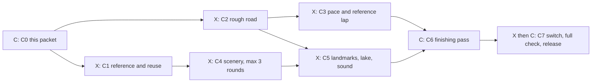

# Eifel Crown: the full treatment (course packet C0)

Claude, 28 October 2026, for Kyle's staged course line (`docs/FACTORY.md`
section 3). This packet answers the section 6 checklist so the seven stage
cards can start without asking. Design only: no game code.

Eifel Crown is the one existing course that gets the full treatment: its own
road drawn from a track script, its own scenery kits, a castle, a village and a
reservoir, like Ardennes Forest and Summit Run. Today it is a smooth looping
shape from the generic expansion builder (`src/expansion-courses.js`). It keeps
its id (`eifel-crown`), its length (5.6 km), its price (1,400 credits), its
place in the menu and its character: forest esses, a high ridge and a valley
sweep. The layout stays our own, never a copy of the Nordschleife.

## 1. What the player sees and does

A damp, overcast day in the Eifel hills of western Germany, the country around
the Nurburgring. Dense dark spruce and grey-green beech crowd the road on steep
wooded slopes. Armco rails and low drystone walls line the verges, hedges
mark the fields, and the kerbs are green and white. The timber lodge still
stands beside the start straight, where it always did.

The lap in one breath: out of the lodge straight, five quick esses through the
forest (Spruce Bend, then four more that swing left and right), a small dip with
a crest after it, then the long climb to the crown of the ridge. From the ridge
a castle on a crag is in view across the valley. The road drops hard through
Crag Corner and Castle Bend into a valley with a half-timbered village, climbs
again over a second hill, and runs down the Valley Sweep past a reservoir to
the last corner and home.

The player does what they do on any circuit: Rival Duel, Time Trial or a Grand
Prix with a field of 8. The road now has real braking corners where today it has
only gentle bends, so a clean lap rewards braking and a good line. Everything
else about owning and racing the course stays as it is.

## 2. Numbers

### 2.1 Today against the new road

| | Today (from `src/expansion-courses.js` and the reference lap) | New (fitted by Claude, checked with `tools/track-script-fit.mjs`) |
| --- | --- | --- |
| Length | 5,600 m | 5,600 m (script 5,596 m; the builder stretches straights by at most 1.2% to close the loop) |
| Laps | 2 (Grand Prix: the shared default of 3) | unchanged |
| Road width | 14 m | 14 m all round |
| Corners | 12, slowest 163 km/h | 17, slowest 146 km/h (Castle Bend) |
| Tightest radius | about 94 m | 70 m (Last Turn) |
| Steepest grade | 24.8% | about 21% (near Esses Exit) |
| Lowest and highest | 14 m and 111.5 m | 14 m (lake end) and 111.7 m (ridge top) |
| Test driver lap (Stuttgart 959-S, Medium, the reference lap policy in `docs/CIRCUITS.md` 7b.1) | 1:19.0 (78,975 ms) | target 1:40 to 1:46 |
| Sections and shares | Forest Esses .42, Crown Ridge .35, Valley Sweep .23 | same names and shares |

Why the lap gets slower: today's road has no corner below 163 km/h and runs
at 260 to 298 km/h for most of the lap, which is faster than the feel targets
in `docs/CIRCUITS.md` section 4 (1:30 to 2:15 for a mid car). The new road keeps
the same hills, the same order of left and right bends and the same length, but
gives each bend a real radius. The estimate comes from the game's own racing-line
speed calculation on the draft below: 1:32.4 at the limit, and the reference
lap has run 9 to 12% slower than that calculation on Eifel today and Ardennes.
A three-lap Grand Prix comes to about 5:10, inside the 5 to 7 minute target.

Speeds the calculation gives the Stuttgart on the racing line: slowest corners
Castle Bend 146 km/h, Last Turn 161, Spruce Bend 165, Crag Corner 171,
Pine Right 171; fastest Hatch Sweep and Valley Brow 232, Reservoir Right 225;
top speed on the straights about 290 km/h. The esses go through at 155 to
185 km/h, quick and not flat out.

### 2.2 The road (the first draft for C2)

Fitted so that the loop closes, the turns follow the order of the old road
(left and right as today), and the hills and the ridge fall where today's do.
Turns: L is left, R is right. Distances are along the script; the start line
sits 60 m into the Lodge Straight (`scriptStart: 60`). The pieces add up to
361 degrees of turn; the builder trims one degree, which is inside its
2 degree limit. The closest two separate stretches of road are 468 m apart, so
no ground ever lies under two roads. C2 may change lengths and angles by up to
10% to fit the scenery, and must keep that separation.

| # | Piece | Name | Starts at (m) | Climb (m) | Notes |
| --- | --- | --- | ---: | ---: | --- |
| 1 | straight 255 | Lodge Straight | -60 | +1.5 | width 14; grid, paddock, timber lodge |
| 2 | L 30, r 300 | Start Kink | 192 | +14 | |
| 3 | straight 53 | | 396 | +5.3 | |
| 4 | R 45.5, r 180 | Spruce Bend | 449 | +19.7 | first ess |
| 5 | straight 140 | | 635 | +11.7 | |
| 6 | L 81.5, r 130 | First Ess | 774 | +4.7 | |
| 7 | straight 53 | | 1014 | -2 | |
| 8 | R 47, r 120 | Second Ess | 1067 | -8.9 | |
| 9 | straight 96 | | 1195 | -9.3 | |
| 10 | L 62, r 110 | Third Ess | 1291 | -16.5 | |
| 11 | straight 113 | | 1445 | -10.6 | |
| 12 | R 48.5, r 130 | Fourth Ess | 1559 | -5.2 | |
| 13 | straight 96 | Forest Dip | 1702 | +9.7 | crest 2.5 m, the old signature crest; a stream under the dip |
| 14 | L 85.5, r 140 | Esses Exit | 1798 | +46.1 | steepest piece |
| 15 | straight 149 | Crown Climb | 2067 | +24.8 | |
| 16 | R 41.5, r 170 | Crown Kink | 2217 | +12.6 | ridge top is just after this |
| 17 | straight 191 | Ridge Top | 2377 | -10.2 | the castle comes into view |
| 18 | L 120, r 80 | Crag Corner | 2569 | -36.9 | heavy braking, overtaking |
| 19 | straight 98 | | 2787 | -18.9 | |
| 20 | R 56.5, r 85 | Castle Bend | 2885 | -17.8 | slowest corner |
| 21 | straight 106 | | 2994 | -11 | |
| 22 | L 87, r 105 | Wall Left | 3101 | -2 | village on the right below |
| 23 | straight 170 | Village Street | 3308 | +11.6 | |
| 24 | R 48.5, r 130 | Beech Right | 3478 | +16.5 | |
| 25 | straight 142 | | 3621 | +17 | |
| 26 | L 77.5, r 150 | Hatch Sweep | 3764 | +15.9 | fast, the brave corner |
| 27 | straight 261 | Ridge Straight | 4027 | -15.3 | overtaking into Pine Right |
| 28 | R 41.5, r 140 | Pine Right | 4286 | -15.6 | |
| 29 | straight 198 | | 4418 | -16.4 | |
| 30 | L 70.5, r 150 | Valley Brow | 4617 | +5.2 | start of the Valley Sweep |
| 31 | straight 177 | | 4856 | -7.6 | |
| 32 | R 38, r 220 | Reservoir Right | 5032 | -11.9 | lake on the inside |
| 33 | straight 134 | | 5222 | -0.4 | |
| 34 | L 114, r 70 | Last Turn | 5356 | 0 | onto the Lodge Straight |

The climbs come from today's height curve, taken piece by piece, so the four
hills sit where they sit now: first rise to about 72 m near 1.0 km, the valley
at 18 m before the crest, the ridge at 111.7 m, the second hill at 76 m near
4.0 km and the long run down to 14 m. The pieces add up to a 0.2 m leftover that
the builder spreads over the straights.

Sections (names and shares kept): Forest Esses from the start to the end of
Crown Kink (pieces 1 to 16); Crown Ridge from Ridge Top to Pine Right
(17 to 28); Valley Sweep from there home. All three sections use the alpine
look. (Today the generic builder gives the Valley Sweep a coast look and puts a
lighthouse in it, which never belonged in the Eifel; see Removed.)

### 2.3 Other numbers

- Price: unchanged at 1,400 credits (`COURSE_PRICES`). Owners paid it and
  nothing about their purchase changes.
- Field and mode: Rival Duel, Time Trial and Grand Prix with 8 cars, the same
  as today. Traffic and Mad Max Duel stay available as they are today (the
  course does not set `noTraffic` or `noCombat`, unlike Ardennes). A Grand Prix
  already runs without traffic, police and radar.
- Speed limit setting, airborne flag and terrain width stay as today (65 mph
  limit text, 64 m terrain on each side).
- Animals: Europe group, as `src/wildlife.js` has it today: roe deer, red deer,
  wild boar, red fox, black stork as the rare one. Sighting spots per lap:
  reference lap 103 s divided by 45 s, rounded: 2.
- Kit and tree budgets: near trees at most 1,000 plus the far forest band
  (Ardennes: 800 plus the band, with a frame check that passed). Today's
  generic builder uses 1,600 tree attempts, which is why the course is called
  denser; C4 gets the density by rows and groves, then the frame check decides.
- New model budgets (High / LOD triangles): castle 7,000 / 2,000; dam wall
  2,500 / 800; drystone wall piece 600 / 200; hedge row piece 500 / 200. The
  village houses are built in code like Ardennes' (at most 120 houses).
- Frames: p95 at most 18.5 ms on Performance and on High with eight cars at
  the busiest view (the grid on the Lodge Straight looking along it, and a
  second look from Wall Left over the village), world build under 1 s.

## 3. The graph

Cards `EIFEL-CROWN-C1` to `EIFEL-CROWN-C7`, made with
`node tools/new-line-cards.mjs course eifel-crown "Eifel Crown"`. Owners: C is
Claude, X is Codex. Arrows mean "must finish first"; stages on the same row run
at once.

C1 and C2 start at once. C3 can start the moment C2's road drives. C4 needs C1's
reuse list. C5 needs the road and the first scenery round.

## 4. Contracts between the parallel cards

- **One id everywhere:** `eifel-crown`. Generation identity `stage: 9` and
  `layoutSeed: 1989` stay. `layoutVersion` goes from 2 to 3.
- **One file:** `src/circuits/eifel-crown.js` holds the road script, the
  sections, the landmark rows, the kit rows, the lake, the light and the
  course's registration (id `eifel-crown`, switch `eifel-crown`, state `dev`
  until C7, price 1,400, Grand Prix yes, release order 12, driver
  `stuttgart_959s` at skill .95). The corner names in section 2.2 are the
  names every card uses; landmark rows and notes refer to pieces by name, never
  by number.
- **The place in the list (settled here, built in C2):** the course keeps its
  position in the course list, so saved careers, the Grand Tour cup and any
  race in progress still find it. A circuit registration may carry
  `slot: 9`, meaning "stand in for the entry at that position instead of being
  added at the end". With the switch off, the old entry stays; with it on, the
  new definition fills slot 9 and the old one is not used. C2 makes this
  change in `src/circuits/index.js`, `src/circuit-manifests.js` and
  `src/config.js` (one small change, under the registry lock). The tests that
  count courses (`COURSE.length` against released circuits) learn that a slotted
  course is not an extra entry.
- **Kit names (new):** `eifel-castle`, `half-timber-house` (built in code as a
  `houseStyle: 'half-timber'` for the village, not a model), `dam-wall`,
  `drystone-wall`, `hedge-row`. Each with a `-lod` partner like the others in
  `public/assets/models/circuits/kits/`.
- **Landmark rows (names for C5):** `eifel-castle` (on the crag hill),
  `eifel-village` (houses and lamps, from the village row), `eifel-reservoir`
  (the lake basin and its shore), `eifel-lodge` (the timber lodge at the start).
- **Sound cue names:** none new. The course uses `ambience.forest` as it is.
  One optional local cue, `landmark.village-bell`, is decided in C5 (see Open).
- **Generated data:** `src/generated/reference-laps/eifel-crown.json`
  (rebuilt in C3), `tools/fixtures/world-signatures/eifel-crown.json`
  (regenerated at C7 after a reviewed look), `tools/replays/courses/eifel-crown.json`
  (new recorded inputs, C3), the pilot map outline in
  `src/generated/pilot-map.json` (rebuilt with its own tool at C2), and the
  Team Room notes in the course file (written by Claude in C6).

## 5. Locks and owned files

| Card | Holds these locks | Owns |
| --- | --- | --- |
| C1 | none | `docs/board/cards/EIFEL-CROWN-C1.md` (reference notes and the reuse list) |
| C2 | `circuit-registry` (the slot change, then released) | `src/circuits/eifel-crown.js` (road, sections, registration), `tools/test-circuit-eifel.mjs` |
| C3 | `circuit-registry` (the Grand Prix pace row in `src/race-field.js`), `reference-laps`, `replay-fixtures` | the pace row for `eifel-crown`, `src/generated/reference-laps/eifel-crown.json`, `tools/replays/courses/eifel-crown.json` |
| C4 | `track-kit-placement` if it edits `src/track-kits.js` for the new kit names | kit recipes `tools/blender/eifel-landmarks.py` and its settings file, the new kit files, kit rows in the course file, `docs/board/looks/eifel-crown/round-1.jpg` to `round-3.jpg` |
| C5 | none beyond the course file (one small change to `src/circuit-landmarks.js` for the half-timber house style; no lock covers it, so one builder at a time) | landmark, lake and sound rows in the course file |
| C6 | owns the course file while the card is open (Codex does not edit it) | finishing changes, the `intel` block, the postcard sheet |
| C7 | `release`, `circuit-registry`, `world-signatures` | the switch flip, the removal of the old entry, the reverse variant file `src/circuits/eifel-crown-reverse.js`, the world signature files |

## 6. What stays exact

- Every other course's road, signature, reference lap, replay fingerprint and
  pace row. The Eifel changes are all inside Eifel's own files plus the slot
  rule, which does nothing for a course without `slot`.
- The save: ownership of Eifel Crown, credits, wins, medals and the Grand Tour
  cup progress stay as they are. Old Eifel personal bests and ghosts are
  moved into the archive by the `layoutVersion` bump from 2 to 3
  (`docs/GHOSTS.md`, `docs/PROGRESSION_V2.md`): they stay in the save, they
  cannot be raced against on the new road, and nothing is deleted. No new save
  field.
- The course id, its price, its place in the menu, its Grand Prix membership
  (it ends the Grand Tour cup, `docs/CIRCUITS.md` section 7) and its animals.
- The old recorded replay of `eifel-crown-duel` (an input log for the old
  road) is retired and replaced by a new recording on the new road. That is
  the one fingerprint that moves, listed in the C3 and C7 change notes.

## 7. The switch

Switch name `eifel-crown`, state `dev` while the lane builds, `on` at C7.
Because the course already exists, the switch chooses between two roads:

- **Off:** today's road, exactly as released.
- **On (Preview and after C7):** the new road in slot 9. The reverse version
  `eifel-crown-reverse` also appears.

What turning it on changes: one course in the list is the new road (same
position), one more entry is added at the end (the reverse), the Grand Prix
list is unchanged (Eifel is already in it, the reverse joins), prices are
unchanged (the reverse costs 0), the pilot map outline for Eifel is the new
one, and the Team Room shows the new corner notes. Counts that derive from the
course list move by the reverse only; the change note lists each changed
assertion.

At C7 the old expansion entry for Eifel is removed from
`src/expansion-courses.js` (the other five expansion courses keep their
places) in the same change that turns the switch on.

## 8. Sound and art

### 8.1 Sound

- Engine and road sounds: as now.
- Ambience: the existing forest bed, `ambience.forest` (gain .15), which the
  Tremblant and Ardennes forests also use. No new recording.
- One optional extra: a soft village bell as a car passes within 150 m of the
  village, `landmark.village-bell`, at least 12 dB below the engine bed. C5
  builds it only if a local cue already works the way it would need (see
  Open); if not, it is dropped, not faked.
- Loudness: every new cue within 1 dB of `ambience.forest` as measured by
  `tools/audio/measurements.mjs`.

### 8.2 Look target

Overcast and damp (`defaultMood: 'overcast'`, the mood Alpine Serpent uses),
dark wet tarmac and a little valley mist like Ardennes' (`dampRoad` and
`valleyMist`, both existing). Dense spruce close behind the verge, beech groves
set back like Ardennes' beeches, grey stone, white plaster and dark timber in the
village, a pale castle of local stone on its crag. Gritty and believable,
never toy-like. At most three look rounds, one comparison sheet per round under
`docs/board/looks/eifel-crown/`, judged by Claude on the pictures.

### 8.3 Reuse list (starting points for C1, nothing new until these fail)

| Need | Reuse | Change |
| --- | --- | --- |
| Spruce forest | the Ardennes forest bands (`scenery.forest`, `farForest`) | density and colour only |
| Beech groves | `ardennes-beech` kit and its grove placement | leaf colour a duller green via `kitLook` |
| Armco rails | `armco` kit, as Ardennes' `safety()` rows | none |
| Braking boards | `braking-board-150/100/50`, as Ardennes' `brakingBoards()` | rows before Crag Corner, Castle Bend and Last Turn |
| Start and paddock | `start-gantry`, `pit-garage`, `grandstand` | a short paddock only |
| Lodge | today's timber lodge model (`src/generated/course-landmarks.json`), or the `ski-lodge` kit at .7 scale | move it to the start |
| Stream under Forest Dip | `stone-stream-bridge` and the Ardennes `basins` and `stream` effect | one small channel |
| Lake shore | `wooden-dock` kit and the Tremblant lake basin (`basins`) | shape and colour |
| Mist and damp road | Ardennes' `valleyMist` and `dampRoad` rows | positions |
| Village layout | Ardennes' `valleyTown()` street layout pattern | half-timber house style |
| Burnt look | `public/assets/burnt/tremblant-woods/burnt-props.glb` (charred pine snags, logs, stumps, shoots) | referenced, not copied |
| Marshals and tyre wall | `marshal-post`, `tyre-wall` kits | Last Turn outside |
| Kerbs | the script's own kerbs (red and white today) | green and white if a generic kerb colour option is cheap; see Open |

New art only where nothing fits: the castle on its crag, the half-timber house
style, the dam wall, the drystone wall and the hedge row. All as Blender
recipes in `tools/blender/eifel-landmarks.py` (the Ardennes recipe
`tools/blender/ardennes-landmarks.py` is the model for structure and checks).
The house style is code in `src/circuit-landmarks.js`, widening the one
`ardennes-stone` check to also allow `half-timber`.

## 9. How it is checked

- C2: `tools/drive-through.mjs` clean for Casual and Pro (no leaving the
  road, no passing through solid barriers, nothing floating);
  `node tools/test-circuits.mjs` passes; a new `tools/test-circuit-eifel.mjs`
  checks closure, width, the 468 m separation, boards, kerbs and the slot
  rule; Claude drives a lap on the keyboard.
- C3: 30 seeded races per difficulty with the test driver: every computer
  racer finishes in at least 95% of them, first-lap pile-ups (three or more
  cars crashing in the first 30 s) in at most 1 race in 20, at least 3
  passes between computer racers per Medium race, and the test driver wins
  60 to 80% on Easy, 30 to 50% on Medium, 10 to 25% on Hard
  (`docs/CIRCUITS.md` 3.2). The reference lap is rebuilt with
  `tools/build-reference-laps.mjs`; a test fails if it is stale.
- C4, C5: the course's own test checks every kit row (nothing on the road,
  nothing floating, nothing inside a wall), the lake basin, the animal spots
  and the village rows; the browser views recipe is modelled on
  `tools/scenarios/ardennes-views.mjs`. Art is judged on pictures only; no
  frame timing on art rounds (AGENTS rule 9).
- C6: Claude drives every sector on Casual and Pro and judges the section 4
  feel targets of `docs/CIRCUITS.md`.
- C7: the course's own test runs with the switch on; the lane tier and a build;
  one code review (rule 17); then the full check including frames at both
  qualities (rule 8, eight cars, the two busiest views in 2.3); then live with
  the next batch (rule 18). Claude decides go-live; Kyle hears afterwards.
- The signature capture is regenerated only after Claude has looked at the
  new scene and accepted the visual difference.

## 10. Water and trees

- **Water:** a reservoir lake on the inside of Reservoir Right, below the Valley
  Sweep (pieces 31 to 34): about 320 m along the road, 100 m across, its edge
  roughly 90 m to the right of the road centre (the right is the negative side),
  its surface about 5 m below the road at the nearest point, made as a `basins`
  bowl exactly as Tremblant's lake. A short concrete dam wall closes the far
  end, seen across the water from Hatch Sweep. The helicopter's fire bucket
  scoops from it. Exact numbers are settled in C5 against the ground.
- **Burnable forest: yes.** The forest is spruce and beech, well over the 150
  cells (6 hectares) the rule asks for, the reservoir gives the bucket its
  water, and the burnt look already exists: the charred snags, logs and stumps
  of Tremblant suit spruce and beech, so the course points at that one model
  and orders no new burnt art. Eifel Crown is already a place on the pilot's
  map (`src/heli/pilot-map-data.js`, altitude 600 m). C5 checks that a clear flat
  landing circle exists in its flying area (Ardennes failed that check and is
  left off the map), and the course joins the fire list only if that passes.
- **Trees:** dense dark spruce, beech groves behind the verge as at Ardennes.

## 11. Stage cards: what each must deliver

**EIFEL-CROWN-C1, reference and reuse (Codex, ART; Claude judges).** A note in
the card's file with: at least eight reference sources written as descriptions
or links, noted by source (viewing reference only, nothing downloaded into the
game): Eifel spruce and beech forest and its wet road edge, German Armco and
green-and-white kerbs, half-timbered Eifel village streets, a castle on a crag
(Nurburg and Eltz are good looks), drystone field walls and hedges, an Eifel
reservoir with a dam. The reuse list of 8.3 checked against the real files in
`public/assets/models/circuits/kits/`, with each row marked "fits", "fits after
change" or "new", and the budgets of 2.3 confirmed. Done when Claude accepts
the list.

**EIFEL-CROWN-C2, rough road (Codex, SIM; Claude judges).** `src/circuits/eifel-crown.js`
with the road from 2.2, the sections, width 14, `stage: 9`, `layoutVersion: 3`,
scenery limited to existing forest bands, and the registration with the slot
rule working with the switch on and off. Kerbs and boards from the script.
Drive-through clean, `test-circuits.mjs` and the new course test pass, the pilot
map outline rebuilt, and a screenshot of the top-down map from
`tools/track-script.mjs eifel-crown` kept in the change note until read. A lap
feels right on the keyboard (Claude drives it). Done when Claude says the road
is right.

**EIFEL-CROWN-C3, pace (Codex, TOOL).** The Grand Prix pace row for
`eifel-crown` retuned (fieldPace Easy, Medium and Hard; aggression stays 1.4
unless the racing says otherwise), the reference lap rebuilt and inside
1:40 to 1:46, the new replay recording, and the targets of section 9. No computer
racer crashes on any difficulty. Done when the tests pass.

**EIFEL-CROWN-C4, scenery (Codex, ART; Claude judges, at most 3 rounds).** The
reused kits placed first (Armco, boards, paddock, beech groves, spruce bands,
mist, damp road, marshals, tyre wall), then the new kit recipes (drystone wall,
hedge row) and kit rows through the village and field stretches. Round sheets at
`docs/board/looks/eifel-crown/round-N.jpg`, 500 KB at most, six views each:
grid, First Ess, ridge top, Crag Corner, village street and Valley Sweep. Done
when Claude accepts a round.

**EIFEL-CROWN-C5, landmarks, water and sound (Codex, ART).** The castle on its
crag (a `hills` crag under it, 40 to 50 m above the valley floor, 120 to 180 m
out from Wall Left on the outside, in view from Ridge Top and the descent), the
half-timbered village along Village Street and Wall Left (two short streets, at
most 120 houses, lit windows only in the damp dusk if the mood needs it), the
lodge moved to the start, the reservoir, the dam, the stream under Forest Dip,
the burnable-forest decision carried through (landing circle check and
reference to the burnt model), and the sound decision (the optional village
bell). Done when the course's own test passes and Claude's look judgement is
yes.

**EIFEL-CROWN-C6, finishing pass (Claude).** Claude drives every sector on
Casual and Pro, tunes the course data directly (radii, widths, crest height,
kerb and board rows, scenery density, light), writes the Team Room `intel`
block (sector boundaries, flags and engineer notes for every corner by name;
the old notes in `src/circuit-intel/eifel-crown.js` refer to lap-number corners
that no longer exist and are deleted in C7), and sends a postcard sheet of six
views to Kyle.

**EIFEL-CROWN-C7, release (Codex then Claude).** The switch `eifel-crown` goes to
`on` after the lane gate, the reverse variant `eifel-crown-reverse` (made with
`reverseVariant`, free, found from the air like the other reverse courses, release
order 14), the world signatures captured for both, the old expansion entry,
the old circuit-intel file, the old pilot outline and the old replay case
removed, the full check including frames, then live with the next batch.

## 12. Removed (when the switch turns fully on)

- The `eifel-crown` entry in `src/expansion-courses.js` and its landmark mesh
  hook for the lodge, if the lodge is rebuilt as a kit.
- The generic builder's coast look and lighthouse in the Valley Sweep for this
  course (the code that adds a lighthouse to coast sections of expansion
  courses stays for the other expansion courses).
- `src/circuit-intel/eifel-crown.js` and its line in `src/circuit-intel/index.js`.
- The old `eifel-crown-duel` replay case and the old Eifel world signature,
  replaced by the new ones.
- The Eifel row of the old pilot outline, replaced by the new outline.

## Open for Claude

1. **The slot rule.** I recommend `slot: 9` on the registration so Eifel keeps
   its menu position. The other way is to let it move to the end of the list,
   which shifts the five other expansion courses by one place and breaks saved
   race positions that count from the start. Please confirm the slot rule
   before C2 starts.
2. **Lodge.** Whether the old timber lodge model can be placed on a scripted
   road without new code, or the `ski-lodge` kit at .7 scale stands in. C2 or C5
   finds out; the choice is Claude's if the lodge looks worse.
3. **Green and white kerbs.** The script's kerbs have no colour setting today.
   A generic colour option is small and also helps later courses, but it is a
   shared-code change. Claude decides at C4 whether it is worth it; red and
   white is acceptable if not.
4. **Village bell.** Whether a sound that plays only near one place already
   exists in `src/audio.js`. If not, drop the bell rather than build a new
   sound system.
5. **Landing circle for the helicopter.** If C5 finds no clear flat circle in
   Eifel's flying area, the course stays off the fire list and only the lake
   and the burnt look reference are kept. Claude decides whether to flatten a
   small pad in the scenery.
6. **Reverse grid.** The reverse variant runs the road backwards and flips every
   row to the other side. C7 checks that the lodge, paddock and grid still sit
   together; if they do not, Claude chooses whether to move the lodge row.
7. **Release order numbers.** I used 12 for Eifel Crown, 13 for Kogane Pass and
   14 onward for their variants, the next free numbers today (the highest used
   is 11). If another lane registers a course first, take the next free number
   at merge; the order only decides the list position of added courses.
