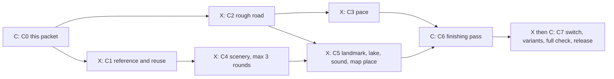

# Kogane Pass: a new mountain pass (course packet C0)

Claude, 28 October 2026, for Kyle's staged course line (`docs/FACTORY.md`
section 3). This packet answers the section 6 checklist so the seven stage
cards can start without asking. Design only: no game code.

Kogane Pass is a new course in the style of the mountain passes around Mount
Haruna and Mount Akagi in Japan, the roads the Japanese call touge. The setting
is real in spirit (a forested volcano, a crater lake, cedar and maple, stone
walls and white guardrails); the road is our own and no real sign, logo or
brand appears. The name means "golden pass": the maples turn it gold at dusk.

## 1. What the player sees and does

You start on a lakeside straight at the top of a volcano, in the last of the
daylight. Beside the road a big vermilion torii gate stands in the shallows of
the crater lake, and a small car park by the start has a tea house with paper
lanterns and a row of glowing vending machines. Then the road tips over the rim
and falls away down the forested slope: a narrow two-lane road, concrete
crash barriers and white guardrails right at its edge, stone retaining walls on
the hill side, tall cedar and red-gold maple crowding in.

Four tight hairpins are stacked one under another down the mountain, each
reached by a short straight that is fast enough to scare you. Late braking is
the whole game here: brake at the board, turn in late, get the power down
early. Below the hairpins the light has gone to night, sodium street lamps
light the lower road through the village, and the run ends on a straight beside
a roadside station car park. Looking back up from the stack you can see the
lights of the summit car park above the trees.

The player races Rival Duel, Time Trial or a Grand Prix with a field of 6. It
is a pure race: no traffic, no police, no Mad Max Duel (`noTraffic` and
`noCombat`, like every Grand Circuit, `docs/CIRCUITS.md` section 2).

## 2. Numbers

### 2.1 The shape in figures

| | Value | Where it comes from |
| --- | --- | --- |
| Kind | point to point, one run, downhill | settled here; see 2.4 |
| Length | 4,684 m | the draft below, built with `src/track-script.js` |
| Drop | 294 m (the road starts at 320 m on the course's own height scale and finishes at 26 m) | the draft's climbs |
| Steepest grade | about 10% (after Cedar Hairpin) | `tools/track-script.mjs` |
| Road width | 10 m, 12 m through the four hairpins | settled here (Summit Run's Gallery is the narrowest road raced so far at 10 m) |
| Tightest corner | radius 14 m (Maple Hairpin); the other hairpins 15 m and 16 m | Harbour Lights' hairpin (9 m) stays the only one under 14 m |
| Hairpins | 4 (168, 166, 164 and 164 degrees) | |
| Other corners | 10, radius 28 m to 90 m | |
| Field | 6 cars, a narrow mountain road like Summit Run; Grand Prix of 1 run | `fieldSize: 6`, `grandPrixLaps: 1`, default mode Grand Prix |
| Test driver run (Stuttgart 959-S, Medium) | target 1:38 to 1:46 | the racing-line calculation gives 1:30.4 at the limit; the reference lap has run 9 to 12% slower than that on Eifel Crown and Ardennes |
| Speeds on the racing line (calculated, Stuttgart) | hairpins about 79 km/h; Bridge Corner 119, Stone Wall corners 129 and 139, Car Park Corner 143; straights peak at 237 to 277 km/h | racing-line calculation on the draft |
| Price | 2,200 credits | settled here; see 2.2 |
| Release order | 13 (Eifel Crown takes 12) | see Open |
| Wildlife spots per run | 2 | open roads guess their pace at 160 km/h: 4,684 m takes about 105 s, divided by 45 s, rounded |
| Light | dusk at the start, night from about 2.6 km | settled here |

The braking is the point: from 250 to 277 km/h on the longer straights down to
about 80 km/h in the hairpins, with boards at 150, 100 and 50 m, and 180 to 300 m
of straight road before every hairpin (the rule is at least 120 m).

### 2.2 Price and order

Kogane Pass costs **2,200 credits**. The current prices run from Tremblant
Woods and Panorama Ridge at 1,600 up to Summit Run at 2,600 (`COURSE_PRICES`).
Kogane sits above Ardennes Forest (2,000, today's longest lap) because it
arrives with a night run and a reverse run, and below Summit Run (2,600, the
showpiece), level with Cloudbreak Skyway (2,200). A Medium win pays 1,000
credits and a Hard win 1,500, so it is a bit over two Medium wins.

Release order after the current courses: Eifel Crown's upgrade (release order
12, no price change), then Kogane Pass (13), then the free variants: Eifel Crown
Reverse (14), Kogane Pass Night (15) and Kogane Pass Reverse (16).

### 2.3 The road (the first draft for C2)

Found with the same fit tool the other courses used (`tools/track-script-fit.mjs`
and a short search over the angles). The legs fan out down the mountain like a
spiral instead of zig-zagging straight under each other, so the closest two
stretches of road that are more than 750 m apart along the road are 196 m apart
(the same 165 m ground rule Summit Run kept). C2 may change lengths and angles
by up to 10% to fit the scenery and must keep that separation (a test).
The start line sits 45 m into the Lakeside Start (`gridStartS: 45`, as Summit
Run).

| # | Piece | Name | Starts at (m) | Climb (m) | Width |
| --- | --- | --- | ---: | ---: | ---: |
| 1 | straight 300 | Lakeside Start | 0 | -4 | 10 |
| 2 | L 54, r 90 | Torii Bend | 300 | -5 | |
| 3 | straight 320 | Shrine Straight | 410 | -16 | |
| 4 | R 66, r 45 | Car Park Corner | 730 | -6 | |
| 5 | straight 180 | | 807 | -12 | |
| 6 | L 168, r 15 | Cedar Hairpin | 987 | -4 | 12 |
| 7 | straight 150 | | 1056 | -14 | 10 |
| 8 | R 43, r 60 | | 1206 | -5 | |
| 9 | straight 300 | Cedar Descent | 1276 | -25 | |
| 10 | R 166, r 14 | Maple Hairpin | 1576 | -4 | 12 |
| 11 | straight 140 | | 1642 | -13 | 10 |
| 12 | L 44, r 55 | | 1782 | -5 | |
| 13 | straight 280 | | 1849 | -23 | |
| 14 | L 164, r 16 | Tea House Hairpin | 2129 | -4 | 12 |
| 15 | straight 160 | | 2200 | -14 | 10 |
| 16 | R 74, r 70 | | 2360 | -5 | |
| 17 | straight 420 | Maple Terraces | 2477 | -34 | |
| 18 | R 74, r 35 | Stone Wall Right | 2897 | -4 | |
| 19 | L 54, r 40 | Stone Wall Left | 2967 | -4 | |
| 20 | straight 240 | | 3030 | -16 | |
| 21 | R 164, r 15 | Sodium Hairpin | 3270 | -4 | 12 |
| 22 | straight 180 | | 3338 | -16 | 10 |
| 23 | L 53, r 60 | | 3518 | -5 | |
| 24 | straight 380 | Village Run | 3599 | -22 | |
| 25 | L 70, r 28 | Bridge Corner | 3979 | -3 | |
| 26 | straight 260 | | 4038 | -15 | |
| 27 | R 44, r 80 | | 4298 | -3 | |
| 28 | straight 300 | Finish Straight | 4384 | -9 | |

The road is an open road (`closed: false`) with `baseHeight: 320`. Walls
(`walls: 'both'`): solid, 1 m outside the road edge, from the first piece to
the last; the look of those walls (concrete barrier on the outside of the
corners, stone retaining wall on the hill side, white guardrail along the lake)
is C4's work on top of the same collision.

Sections (for the menu and the scenery): Summit Lake 0 to 730 m (share .156),
Cedar Switchbacks 730 to 2,360 m (.348), Maple Terraces 2,360 to 3,230 m (.186),
Village Run 3,230 m to the end (.310). All four use the alpine look; C4 adds
the volcanic and Japanese touches in the scenery rows.

### 2.4 Point to point, not a loop (checked)

The brief asked for a loop only if Grand Prix needed one. It does not. Summit
Run is already a one-way Grand Prix course (`grandPrixLaps: 1`, field of 6, a
member of the Grand Tour cup) and `src/circuit-manifests.js` accepts any
circuit with a manifest. What an open road does not get today (`src/track-analysis.js`
and `src/reference-laps.js` need a closed course): a reference lap file, the Team
Room dossier and the wildlife pace taken from a reference lap. Summit Run lives
with the same. The pilot's map accepts open roads (Summit's outline is one).
A downhill run is the character the course asks for, and a loop would need a
second road back up the mountain, doubling the length.

### 2.5 Other numbers

- Reverse and night: `kogane-pass-night` (full night from the start, the car
  park and lanterns lit) and `kogane-pass-reverse` (the climb: start at the
  foot, finish at the lake). Both free, unlocked by finding them from the
  helicopter, like the other variants (`src/circuit-variants.js`). Release
  orders 15 (night) and 16 (reverse); Eifel Crown's reverse takes 14.
- Kit budgets (High / LOD triangles): torii 1,800 / 600; tea house 4,500 / 1,400;
  vending machine row 1,500 / 500; stone lantern 700 / 250; stone retaining
  wall piece 600 / 200; curve mirror 400 / 150; chevron board 200 / 100. A
  white guardrail is the existing armco mesh with a white finish, so it costs
  no triangles. Cedar trees reuse the existing fir; a new `cedar` recipe
  (1,500 / 500) is made only if the fir looks wrong at the C4 round.
- Frames: p95 at most 18.5 ms on Performance and on High with six cars at the
  busiest views (the grid on Lakeside Start at dusk with the car park and torii
  lit, and Tea House Hairpin looking down the stack at night), world build under
  1 s.
- Ground: darker volcanic soil, loose rocks, fallen red and gold maple leaves
  at the road edges (existing `groundLeaves` colour options).

## 3. The graph

Cards `KOGANE-PASS-C1` to `KOGANE-PASS-C7`, made with
`node tools/new-line-cards.mjs course kogane-pass "Kogane Pass"`. Owners: C is
Claude, X is Codex. Arrows mean "must finish first"; stages on one row run at once.

Also three small side cards that the stages depend on, made by the Director
when the course starts:

- `WILD-ART-SRC` gets one new row (the Japan group, section 8.3). Codex ART.
- A pilot map card (place, altitude, a region blob) inside C5.
- A short audio card for the evening bed (inside C5).

## 4. Contracts between the parallel cards

- **One id:** `kogane-pass`; variants `kogane-pass-night` and `kogane-pass-reverse`.
  Generation identity `stage: 22` (the next free after Ardennes Forest's 21),
  `layoutVersion: 1`, `layoutSeed: 1989`.
- **One file:** `src/circuits/kogane-pass.js` holds the road, sections, light
  path, lamps, kit rows, lake, animals row note, and the registration (id and
  switch `kogane-pass`, state `dev` until C7, price 2,200, Grand Prix yes,
  release order 13, driver `stuttgart_959s` at skill .95). Variants live in
  `src/circuits/kogane-pass-night.js` and `src/circuits/kogane-pass-reverse.js`,
  made with the existing `lightVariant` and `reverseVariant` helpers.
- **Corner names** are the names in 2.3. Rows refer to pieces by name; unnamed
  pieces are not referred to.
- **New kit ids** (each with a `-lod` partner, in `public/assets/models/circuits/kits/`):
  `torii`, `torii-small`, `tea-house`, `vending-row`, `stone-lantern`,
  `stone-retaining-wall`, `curve-mirror`, `chevron-board`, `armco-white`
  (the armco mesh with a white finish; no new mesh), `cedar` only if needed.
- **Landmark rows:** `kogane-torii` (in the shallows, right of Lakeside Start),
  `kogane-car-park` (tea house, vending row, lanterns, lamps), `kogane-shrine-path`
  (small torii and steps at Torii Bend), `kogane-valley-town` (lights far below
  the lower road, as Summit's valley lights).
- **Sound cue names:** `ambience.kogane` (new loop, file `ambience-kogane.flac`);
  optional `landmark.shrine-bell`. Both in the sound registry, one card adding
  cues at a time.
- **Animals:** `kogane-pass` table in `src/wildlife.js` (8.3); model ids
  `sika-deer`, `japanese-macaque`, `tanuki`, `japanese-serow`; `black-kite`
  already exists.
- **Pilot map:** place id `kogane-pass`, courses `['kogane-pass',
  'kogane-pass-night', 'kogane-pass-reverse']`, altitude 1,300 m (a crater lake
  on a volcano, below Alpine Serpent at 1,700 and far below Summit Run's 2,860).
- **Generated and fixture files:** `tools/fixtures/world-signatures/kogane-pass.json`
  (and the two variants), `tools/replays/courses/kogane-pass.json` (and the
  variants), the pilot outline in `src/generated/pilot-map.json`. No reference
  lap file: an open road has none (2.4).

## 5. Locks and owned files

| Card | Holds these locks | Owns |
| --- | --- | --- |
| C1 | none | `docs/board/cards/KOGANE-PASS-C1.md` (reference notes, reuse list) |
| C2 | `circuit-registry` at registration time only (feature switch entry, stage number, price), then released | `src/circuits/kogane-pass.js` (road), `tools/test-circuit-kogane.mjs` |
| C3 | `circuit-registry` (a Grand Prix pace row for the course in `src/race-field.js`), `replay-fixtures` | the pace row, `tools/replays/courses/kogane-pass.json` |
| C4 | `track-kit-placement` if it edits `src/track-kits.js` for the new kit names | `tools/blender/kogane-landmarks.py` and its settings file, the kit files, kit rows in the course file, `docs/board/looks/kogane-pass/round-1.jpg` to `round-3.jpg` |
| C5 | `sound-bank` (new cues); the course file; the pilot map data (no lock) | landmark, lake and sound rows, `ambience-kogane.flac` recipe in `tools/audio/catalog.json`, the pilot place and altitude |
| C6 | owns the course file while open | finishing changes, the postcard sheet |
| C7 | `release`, `circuit-registry`, `world-signatures` | the switch flip, the variant files, the signature files |

## 6. What stays exact

- Every other course: roads, signatures, reference laps, replay fingerprints,
  pace rows. Kogane is appended at the end of the course list, never inserted,
  so every saved id and position stays (`docs/CIRCUITS.md` principle 5).
- The save: no new field. A new course is owned or not by its id like the others.
- The Grand Tour, Mountain, Night and Winter cups keep their event lists. Kogane
  joins no cup at release; a later "touge cup" is Kyle's call, not built here.
- No change to the car, tyre or surface tables: there is no snow and no ice on
  this course, so nothing in `src/race-surfaces.js` changes.

## 7. The switch

Switch name `kogane-pass`, state `dev` while building, `on` at C7. With it off the
course appears nowhere (the registry hides it). The variants follow the parent
course's unlock: they are free and are found from the helicopter, so they need
the course to be a place on the pilot's map with a clear landing circle (C5).

What turning it on changes: the course list grows by 3 (the course and its two
variants, at the end), the prices list gets one non-zero entry (2,200), the
Grand Prix list gets three ids, the pilot map gets one place, the animal tables
get one entry, three signature files and three replay files are added, and the
counts that read from the course list move by exactly those. Each changed
assertion is named in the change note.

## 8. Sound and art

### 8.1 Sound

- `ambience.kogane`: a new loop. Evening cicadas (the long rattling call of
  higurashi) in the first half of the run, fading into night crickets, with a
  mountain stream under everything and a hint of frogs by the lake. Source: the
  sound library by recipe in `tools/audio/catalog.json` (CC0 first, then CC-BY
  with credit; ElevenLabs only by the audio owner within budget). Gain .14,
  within 1 dB of `ambience.forest` (.15), checked with
  `tools/audio/measurements.mjs`.
- How the course picks its bed: today the bed follows the section's look
  (`biome`), so every alpine course gets `ambience.forest`. C5 adds the smallest
  way for a course to name its own bed, in `src/audio.js` (no lock) and the cue
  in `src/sound-bank.js` (the `sound-bank` lock).
- Engine and road sounds are untouched.
- Optional: `landmark.shrine-bell`, one soft bell when a car passes the torii at
  the start, only if a local cue works without new sound machinery (Open).

### 8.2 Look target

Dusk to night on a wet mountain road. Cool blue-grey sky over the lake at the
start with the last orange at the horizon, the vermilion torii glowing
softly, paper lanterns and vending machines throwing warm light on the car park,
then full night with stars, a moon, and sodium lamps pooling orange light on the
wet lower road (Harbour Lights' `streetLight` with its `sodium` range, from
Sodium Hairpin to the finish, plus Summit's `groundLights` for the village far
below). Cedar trunks tall and straight in the headlights, maple leaves red-gold.
Gritty and believable, never toy-like. At most three look rounds, one comparison
sheet per round under `docs/board/looks/kogane-pass/`, judged by Claude on the
pictures. Light path: `lightPath` by distance, `dusk` at 0 m, `dusk` at 1,500 m,
`night` at 2,600 m (a first draft for C5 to tune).

### 8.3 Reuse list (starting points for C1)

| Need | Reuse | Change |
| --- | --- | --- |
| Maples (red-gold) | `autumn-tree-copper` and `autumn-tree-golden` kits and the Tremblant autumn grove renderer | deeper reds; `kitLook` leaf colours |
| Cedar forest | the existing fir forest bands (`scenery.forest`, Ardennes' bands as the model) | taller and slimmer scale range; darker colour |
| Concrete barrier | `concrete-wall` kit | weathering only |
| White guardrail | `armco` kit | `armco-white` finish |
| Braking boards | `braking-board-150/100/50` | rows before the six corners the script boards |
| Start | `start-gantry` kit, a short paddock-free grid | none |
| Paper lanterns | `lantern-string` kit from Harbour Lights | warm colour, along the tea house |
| Tea house and shop fronts | `summit-hut` (warm window glow recipe in Summit's `kitLook` and `glows`), `shopfront-a` and `shopfront-b` | start from the hut's glow, new roof and timber |
| Lake and torii shallows | Tremblant's lake bowl (`basins`) and `wooden-dock` | shape; the torii stands where the dock was |
| Stream at Bridge Corner | Ardennes' `stone-stream-bridge`, `basins` and `effects.stream` | one stream under a short bridge |
| Wet road with reflections | Harbour Lights' wet look and Ardennes' `dampRoad` | colours |
| Valley mist | Ardennes' `valleyMist` | below the stack |
| Village lights far below | Summit Run's `basins` valley and `groundLights` | positions |
| Street lamps | Harbour Lights' `streetLight` with `sodium` | range 3,230 m to the end |
| Burnt look | `public/assets/burnt/tremblant-woods/burnt-props.glb` | referenced, not copied |
| Marshal and course posts | `marshal-post` | few |

New art only where nothing fits: the torii, a small torii, the tea house, the
vending row, a stone lantern, a stone retaining wall, a curve mirror (the round
roadside mirrors at blind corners) and a chevron board. All as Blender recipes
in `tools/blender/kogane-landmarks.py` (`tools/blender/ardennes-landmarks.py` is
the model). Reference notes only; the real signs, logos and drink brands are
never copied.

### 8.4 Animals: a new Japan group

Rows for `src/wildlife.js` (species, weight, herd size from, to) and the line
WILD-ART-SRC needs:

| Group | Animals |
| --- | --- |
| Japan (Kogane Pass) | Sika deer, Japanese macaque, tanuki, Japanese serow, black kite |

- Common: sika deer (4, 1 to 3), Japanese macaque (3, 3 to 6, a troop), tanuki
  (2, 1 to 2), black kite (2, 1 to 2, perched on poles or lamps). Rare: Japanese
  serow (1, 1 to 2), the shy mountain goat-antelope almost nobody sees.
- The black kite model already exists in the Asia and cities group; four new
  models are sourced: CC0 first (Quaternius and Kenney packs), then CC-BY with
  credit, at most 5,000 triangles each (birds 2,000), three rounds a group.
- Animals stand 15 to 70 m off the road edge, never on the road, never in a wall.
  With a walled 10 m road the gap behind the barrier is narrow in places, so the
  WILD-PLACE checker will leave several stretches empty; that is fine.

## 9. How it is checked

- C2: `tools/drive-through.mjs` clean on Casual and Pro (no leaving the road, no
  passing through solid barriers, nothing floating); `node tools/test-circuits.mjs`
  passes; the new `tools/test-circuit-kogane.mjs` (modelled on
  `tools/test-circuit-summit.mjs`) checks the open road, the 196 m separation,
  hairpin radius, widths, boards, the registration and that the course is
  hidden when its switch is off; Claude drives it on the keyboard.
- C3: 30 seeded races per difficulty with the test driver, field of 6: every
  computer racer finishes in at least 95%, first-lap pile-ups in at most 1 race
  in 20 (narrow road: the Summit settings `fieldFollow` and `racingLine` are
  the starting point), at least 3 passes between computer racers per Medium
  race, and the test driver wins 60 to 80% on Easy, 30 to 50% on Medium and 10
  to 25% on Hard.
- C4, C5: the course test checks every kit row, the lake basin, lamp rows, the
  animals' spots and the pilot map place (including the helicopter landing
  circle); browser views recipe modelled on `tools/scenarios/ardennes-views.mjs`.
  No frame timing on art rounds (AGENTS rule 9).
- C6: Claude drives every sector on Casual and Pro and judges the section 4 feel
  targets of `docs/CIRCUITS.md` plus: does braking pay, and can a keyboard
  player take every hairpin.
- C7: the course's own test with the switch on; the lane tier and a build; one
  code review (rule 17); the full check including frames at both qualities with
  six cars at the two busiest views of 2.5; the variants proven (see Open);
  then live with the next batch (rule 18). Claude decides go-live.
- No Team Room dossier or reference lap check applies (2.4).
- The driving lessons (`docs/DRIVING_LESSONS.md`) may later use Cedar,
  Maple, Tea House or Sodium Hairpin as extra rows for lesson 1, the sharp
  corner: each has a long straight in front and a radius of 14 to 16 m. No
  lesson card is made now.

## 10. Water and trees

- **Water:** the summit crater lake, on the right of Lakeside Start and Torii Bend
  (the outside of the left bend, so the shore stays in view from the grid): about
  420 m along the road and 140 m across, its centre about 130 m right of the
  road, its surface about 2.5 m below the road, made as a `basins` bowl exactly
  as Tremblant's lake. The torii stands 25 to 30 m out in the shallows. The
  helicopter's fire bucket scoops from it. A mountain stream under Bridge
  Corner is a second, small water body for looks only.
- **Burnable forest: yes.** Reasons: the whole slope is dense cedar, well over
  the 150 forest cells the rule needs; the lake sits at the top of the slope,
  so the bucket has a short run to the upper trees and a longer one to the lower
  slope, which gives the helicopter a real choice (fire starts 250 to 1,000 m
  from the shore); the burnt look is the existing charred-snag set, which suits
  tall cedar trunks, so no new burnt art is ordered; and a night fire above
  the sodium-lit road is a strong picture. The course has no snow, and the
  season weights stay as they are (summer and autumn fires, none in winter). The course
  joins the fire list only if it passes the helicopter rules: C5 checks that
  the flying area has a clear flat landing circle and that the lake lies inside it.
- **Trees:** cedar (existing fir, scaled tall and slim) on most of the slope,
  maples along the verges and in groves, red-gold leaves on the ground edges.

## 11. Stage cards: what each must deliver

**KOGANE-PASS-C1, reference and reuse (Codex, ART; Claude judges).** A note in the
card's file with at least eight reference sources noted by description or link
(viewing reference only, nothing downloaded into the game): a stacked-hairpin
mountain road seen from above, a crater lake with a vermilion torii in the
shallows, a cedar plantation (straight dark trunks), maples in autumn colour, a
stone retaining wall, concrete barrier with white guardrail and orange
reflectors, roadside curve mirrors and chevron boards, a roadside tea house with
a lit noren curtain and lanterns, a row of vending machines under a small roof
at night, sodium street lamps on a wet road. The reuse list of 8.3 checked
against the real files in `public/assets/models/circuits/kits/`, each row marked
"fits", "fits after change" or "new", budgets confirmed. Done when Claude
accepts it.

**KOGANE-PASS-C2, rough road (Codex, SIM; Claude judges).** `src/circuits/kogane-pass.js`
with the road of 2.3 (open road, `baseHeight: 320`, walls both sides, widths,
`stage: 22`, `layoutVersion: 1`, `fieldSize: 6`, `grandPrixLaps: 1`,
`gridStartS: 45`, `noTraffic`, `noCombat`, racing-line options from Summit Run),
the registration with the switch off by default, existing kits only (armco,
concrete wall, boards, the gantry), and the pilot outline rebuilt. The
`tools/track-script.mjs kogane-pass` picture kept in the change note until read.
Drive-through clean, `test-circuits.mjs` and the new course test pass, Claude
drives a run on the keyboard. Done when Claude says the road is right and the
four hairpins are fair on arrow keys.

**KOGANE-PASS-C3, pace (Codex, TOOL).** The Grand Prix pace row, a short field
recipe (the Summit one is the starting point), the test driver's run time
recorded in the change note (1:38 to 1:46), the new replay recording, and the
targets of section 9. No computer racer crashes on any difficulty. There is no
reference lap file (open road). Done when the tests pass.

**KOGANE-PASS-C4, scenery (Codex, ART; Claude judges, at most 3 rounds).**
Reused kits placed first (maples, cedars, concrete and white guardrail, boards,
lantern strings, wet road, mist), then the new kit recipes (torii, tea house,
vending row, stone lantern, retaining wall, curve mirror, chevron board) and
their rows. Round sheets under `docs/board/looks/kogane-pass/round-N.jpg`,
500 KB at most, six views each: grid at dusk, Torii Bend, the stack from Cedar
Hairpin, Tea House Hairpin at night, Village Run under the lamps, Bridge Corner.
Done when Claude accepts a round.

**KOGANE-PASS-C5, landmark, water and sound (Codex, ART).** The torii in the
shallows, the car park (tea house, vending row, lanterns, a few lamps), the
shrine path at Torii Bend, the lake basin and shore, the stream at Bridge Corner,
the lamps and light path, the village lights far below, the burnable-forest
decision carried through (landing circle, lake inside the flying area, burnt model
referenced), the Japan animals table in `src/wildlife.js`, the pilot map place
and altitude and a map region, and the sound bed with its cue and selection.
Done when the course test passes and Claude's look judgement is yes.

**KOGANE-PASS-C6, finishing pass (Claude).** Claude drives every sector on
Casual and Pro, tunes the course data directly (radii, widths, hairpin
widening, board and kerb rows, scenery density, light keyframes, lamp spacing,
ambience level) and sends a postcard sheet of six views to Kyle with a verdict.
No Team Room notes (open road).

**KOGANE-PASS-C7, release (Codex then Claude).** The switch `kogane-pass` goes to
`on` after the lane gate; the variants `kogane-pass-night` (`lightVariant`, look
`night`) and `kogane-pass-reverse` (`reverseVariant`) are registered, free,
found from the air; world signatures captured for all three after Claude's look;
the full check including frames; then live with the next batch.

## Open for Claude

1. **Point to point.** I chose a one-way downhill run (2.4). If Claude wants the
   Team Room dossier and reference lap for this course, the choice is a loop
   (a second road back up, about 9 km) or a small card that lets the Team
   Room read open roads (it would also give Summit Run a dossier). I recommend
   neither now.
2. **The reverse of an open road.** `reverseVariant` was written for closed
   loops (it measures from the start line and wraps). C7 must prove it works on
   an open road with a test; if it does not, adding that case in
   `src/circuit-variants.js` is part of C7. If it turns out hard, drop the
   reverse and keep the night version.
3. **Stage and release numbers.** I used stage 22 and release orders 13, 15 and
   16 (14 goes to Eifel Crown Reverse; these are the next free ones today). Take the next free numbers at merge if another
   lane registers first.
4. **Tanuki at night only.** The animals engine has a night-only flag (cat,
   raccoon). Kogane's default run goes from dusk to night. Claude decides
   whether the tanuki is night-only (then it appears only in the night variant
   and late on the default run) or always.
5. **How a course picks its sound bed.** C5 finds the smallest hook. If it needs
   more than a few lines in `src/audio.js`, Claude chooses between reusing
   `ambience.forest` unchanged and spending a card.
6. **The 10 m road with six cars.** If the staggered grid or the first corner is
   cramped in the C3 races, widen only the Lakeside Start to 12 m before changing
   the field size.
7. **Map position.** The pilot map needs a table position and a region for
   Japan (a forest-and-volcano blob). I suggest the far east of the table, past
   the harbour city; Claude picks the numbers in C5 with the map drawer.
8. **A cup.** Should Kogane Pass join a cup later (a Touge Cup with Summit Run
   and Panorama Ridge Night)? Kyle's direction; nothing is built now.
