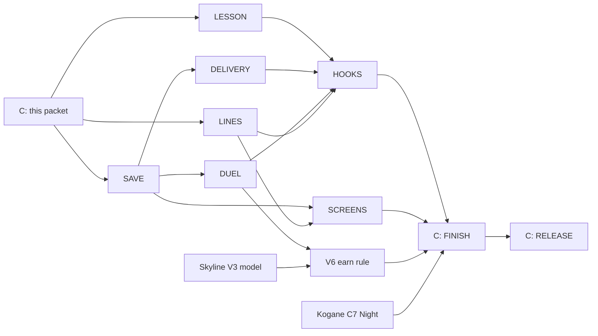

# The Kogane Invitation: story and mission packet

Claude, 28 October 2026, for Kyle's story run (`docs/board/next-run.md`, "The
story"). Design only: no game code. It follows the packet checklist of
`docs/FACTORY.md` section 6, so the build cards can start without asking.

Sections 1 to 7 are for Kyle and Gratian: plain words, what you see and do.
Sections 8 to 14 are for the builders: numbers, files, saves, cards and checks.

## 1. The story in one breath

A Japanese night racer, **Daichi Mori**, drives a Bayside Blue Nissan Skyline
GT-R R34 down Kogane Pass after dark. When you buy Kogane Pass he sends you a
letter: race me. But the pass has four hairpins and he wants you to arrive
ready. So the story takes you through four parts of the game, one after
another, and each part opens the next:

1. **Brian's Hairpin Lesson.** Brian teaches you to brake for hairpins, on
   Kogane Pass itself.
2. **Supplies for the Summit.** Kestrel One flies a crate of race tyres and
   tea-house supplies from the home helipad up to the tea house car park at the
   top of the pass, at dusk. (Daichi's Skyline is too heavy for the helicopter's
   hook, which is a true fact: it weighs 1,560 kilos and the hook lifts 1,500.)
3. **The Night Duel.** You and Daichi, one on one, down Kogane Pass at night.
   Win and he hands you the Skyline.
4. **Ana's message.** Ana from the Deep radios: the crater lake at the top
   has something long and dark on its bed. It goes in her log as a lead for a
   future Deep coast. Nothing to play yet, only a seed.

Kyle and Gratian each have their own story progress, because every named
player has their own save. Nothing in it needs two players at once.

## 2. What you do, step by step

| Step | You | It opens when | It ends when | You get |
| --- | --- | --- | --- | --- |
| 0 The letter | Read Daichi's letter on the Story card | You own Kogane Pass | You open it (only a dot goes away) | Nothing yet |
| 1 Brian's Hairpin Lesson | Do the four runs (Watch me, Follow me, Your turn, Beat me) on the Kogane road | You own Kogane Pass | You pass "Beat me" on the Kogane road | Step 2 opens. The lesson's usual reward (a free brake level, or 600 credits) only if you have never had it |
| 2 Supplies for the Summit | Take the job at the home helipad, hook the crate, fly it to Kogane, set it down in the circle by the tea house | Step 1 done, and the helicopter's carry lesson done | The crate is down inside the circle | The usual crate pay, 2,100 credits, plus 550 for a clean delivery. Kogane Pass Night opens for you (the helicopter's map shows it found) |
| 3 The Night Duel | Pick your own car and Easy, Medium or Hard, then "Race Daichi" | Step 2 done | You finish ahead of Daichi | The Skyline, and the normal Rival Duel pay and medal for that level. Lose and you can try again any time |
| 4 Ana's message | Hear Ana the next time the main menu opens | Step 3 won | She finishes | The lead is logged |

Notes a child can use:

- You can leave and come back at any step. Nothing is timed.
- A crash with the helicopter costs the usual repair. The crate goes back by the
  pad and the job stays yours. Nobody is ever stranded.
- Easy is made to be won by a young driver who has done the lesson (section 5).

## 3. Where each step shows up

Only screens that exist today, and one small new one.

| Where | What shows |
| --- | --- |
| **Main menu** | A new **STORY** button beside INSTRUCTOR and HELIPAD, with a red dot while there is a message. It appears only once you own Kogane Pass. This opens the one new screen, the **Story card** |
| **The Story card** (new, small) | Daichi's letter, then the four steps as a short list with ticks. Each step has one button: "Start the lesson", "Go to the helipad", "Race Daichi", and for step 4 only the words of Ana's message. Locked steps say what to do first, in plain words |
| **Instructor board** (existing) | Kogane Pass appears in Lesson 1's list of roads, named "Kogane Pass, the hairpins". The Story card's button opens the board with it chosen |
| **Helipad dispatch board** (existing) | One extra job on top of the day's jobs: "Supplies for the Summit". It stays until you finish it (the car-recovery job already sits on the board this way) |
| **Pilot's map** (existing) | A pin at Kogane Pass with "Daichi's tea house" while the job is yours; "found" mark on Kogane Pass Night when you finish step 2 |
| **Arrival panel at Kogane** (existing) | One line while the crate is in hand: "The tea house is waiting. Set the crate down in the circle." |
| **Race setup** (existing) | "Race Daichi" fills in Kogane Pass Night, Rival Duel and Daichi's Skyline for you. You still press START ENGINE. If you change the road, the mode or the rival, the story race is cancelled so it cannot be won by accident |
| **During the race** (existing race callout) | Daichi's grid line, and nothing else. The race itself is the normal Rival Duel |
| **Results screen** (existing) | On a win: a "NEW CAR" card, "Nissan Skyline GT-R R34, won from Daichi Mori", and his line. On a loss: his line and the usual buttons |
| **Garage** (existing) | While the story is open: a small "THE KOGANE INVITATION" panel with the prize. After the win: the Skyline joins the car list, and a plaque on its page reads "Won from Daichi Mori, Kogane Pass at night" (the Sirena's Coast Cup plaque is the model) |
| **Deep log** (existing) | After step 4: a grey line "LEAD: Lake Kogane. A long dark shape on the lake bed. Not dived yet." |

If a forest fire has closed Kogane Pass, the Story card says so in plain words
("Kogane Pass is closed after the fire and opens again in N play days") and
the lesson and the duel wait. Your progress is kept.

## 4. The Skyline becomes a prize, not a shop car

The car packet (`docs/cars/nissan-skyline-gtr-r34.md`) made the Skyline a 6,000
credit shop car. This story changes that. It becomes a **story car, earned by
winning the Night Duel**, the way the Sirena is earned from the Deep.

| | Car packet (V0) | With this story |
| --- | --- | --- |
| How you get it | Buy for 6,000 credits | Win the Night Duel (step 3) |
| Price in the garage | 6,000 CR | None. No price, no Buy button |
| Where it shows before you own it | In the car list, with its price | Nowhere (like the Sirena), except the Story card and the garage panel that show the prize |
| After you own it | Like any bought car | Same: seven upgrades at 350, 600 and 950 credits, three paint finishes at 250 credits, a medal sheet, Grand Prix, Mad Max armour |
| Arrives | Stock | Stock (level 0 upgrades). Daichi hands over his road car; you tune it yourself |
| Helicopter | Never a customer car (1,560 kg, over the hook limit), races anywhere | Unchanged. Not on the air-only list |
| The Jesko's list | Stays at eight (a note on the car keeps it off the list) | **Stays at eight.** The Skyline is an earned car, so it was never going to be on the Jesko's list. Nobody's Jesko progress changes |
| Card V6 | "buy rule, garage and shop" | Becomes "earn rule": the price and the Buy button are dropped, the hiding rules are added (section 11) |

Players who already have the Skyline (from the dev build or from Kyle's
restore) **keep it**. The story never removes a car, and it never takes
anything from a save. If you already own one, the story still plays, and
Daichi's winning line changes to a kind one (section 6). Nobody gets a second
car or a refund.

## 5. How hard Daichi is

Daichi drives the real Skyline in the game's own rival rules. Nothing about
other races changes. Three levers set his pace, all of them already in the game:

1. **The level you pick** (Easy, Medium, Hard). This sets how fast he takes
   straights and, more important here, how close to the limit he takes
   corners. In the game's numbers: Easy cruises at 73% of the car's top speed
   and takes corners at 78% of what the grip allows; Medium 88% and 91%; Hard
   102% and 100%. On Kogane the corners are what matter.
2. **His tuning.** Easy: untuned Skyline. Medium: tuning level 1 of 3. Hard:
   level 2. (Full tuning is never used, so no level makes him unbeatable.)
3. **The catch-up rule** every rival has: if you pull far ahead he speeds up a
   little (up to 8 mph), and if he is far ahead he slows a little. So the race
   stays close and you can always see him.

**Easy must be winnable by a child after the lesson.** The card that builds the
duel has to prove it with a driver who drives at the lesson's pace (about 92%
of the line the instructor shows), and it must win at least 9 races in 10 on
Easy. If it cannot, the card stops and asks Claude. It may not make Daichi slower
by changing the shared difficulty numbers, because that would change every
other race. The levers are only his tuning level and the level you pick.

The fair curve the cards must meet (30 seeded duels per level, the usual test
driver in the Stuttgart 959-S, section 12): Easy 85 to 100% wins for the
player, Medium 35 to 60%, Hard 10 to 30%. Daichi himself must finish at least
95% of races and must not crash at the first hairpin.

## 6. Every line, word for word

Spoken lines need voice credits, and those wait for Kyle. So every new line is
a **caption with the radio sound**: the radio clicks on, the words show, the
radio clicks off. No voice file. The game already has this radio sound (the
click and hiss that the instructor's voice goes through), so it needs no new
sound. Where an existing recorded line fits, the story uses it instead, and
those are listed in 6.2. When Kyle gives voice credits, each caption can get a
voice with no other change (6.3).

Reading time on screen: 2.5 seconds plus 0.045 seconds a character, at most
10 seconds. Captions never need a key press, so a child can read them while
playing.

### 6.1 New lines (10 captions and 1 letter)

| Id | Who | Where it plays | Text |
| --- | --- | --- | --- |
| `story.kogane.letter` | Daichi (a letter, never spoken) | The Story card, first thing | Dear driver, I am Daichi Mori. I drive Kogane Pass at night in my blue Skyline. I heard you bought the road, so you must love hairpins as much as I do. Come and race me down the mountain! But first learn to brake at the board. Brian will teach you. Then the tea house at the top needs a crate of tyres and tea, and the road is too steep for the truck. Kestrel One can fly it up. After that, the night is ours. Daichi |
| `story.kogane.brian.intro` | Brian | A note on the lesson's opening card (text only, so it does not talk over his recorded intro) | Daichi Mori sent word. His road has four hairpins, and the brake boards are your friends. We will learn three of them first, while there is still some light. |
| `story.kogane.brian.pass` | Brian | After the Kogane lesson is passed | That was clean. Daichi will be pleased. Tell Roger at the helipad you are ready, because the tea house needs a delivery. |
| `story.kogane.roger.offer` | Roger, the dispatcher | The text on the pinned job; also shown as a caption when you take it | Kestrel One, the tea house on Kogane Pass is out of tyres and tea. Daichi's Skyline is too heavy for our hook, so he wants a crate instead. Can you fly it up? |
| `story.kogane.daichi.thanks` | Daichi | When the crate is set down | Tyres and tea, right on time! Thank you, Kestrel One. The road is empty tonight. Come and race me down it. |
| `story.kogane.daichi.grid` | Daichi | At the start of the Night Duel (race callout) | Four hairpins, one road. Brake at the board, turn in late, and get on the power early. See you at the bottom. |
| `story.kogane.daichi.win` | Daichi | Results, you won | You braked later than me and stayed clean. The Skyline is yours. Look after her. |
| `story.kogane.daichi.owned` | Daichi | Results, you won but already own a Skyline | You already have a Skyline? Then keep it shiny. The road is yours whenever you want it. |
| `story.kogane.daichi.lose` | Daichi | Results, you lost | Good run. The mountain will wait for you. Come back and try again whenever you like. |
| `story.kogane.ana.call` | Ana | The next time the main menu opens after the win | Hello, it's Ana, from the field station! Congratulations on the Skyline. Roger sent me the pictures from your flight. In the clear water by the red gate, there is a long, dark shape on the lake bed. |
| `story.kogane.ana.lead` | Ana | Straight after her first line | I do not know what it is yet. I have written it in my log as a lead. One day we might dive it. Keep your eyes open. |

About 1,200 characters of captions, so about 1,200 voice credits for one take
of each if Kyle later wants them spoken (the Deep's takes cost one credit a
character). The letter is never recorded.

Notes: Daichi Mori is a made-up person. The name is plain and no real racer's
likeness is used; Kyle can rename him. The lines name no prices, no times and no
speeds, as the other radio lines do.

### 6.2 Recorded lines the story reuses (no new voice)

| Moment | Existing line | Voice |
| --- | --- | --- |
| The lesson opens, and each run | `drive.radio.v2.corner.intro`, `drive.radio.v2.shared.watch`, `.follow`, `.your-turn`, `.beat`, and the miss lines (`.late`, `.early`, `.fast`, `.slid`, `.off`) | Brian |
| The lesson is passed | `drive.radio.v2.corner.pass` ("...you have earned your braking reward") **only if the reward is new**; if the reward was already taken the caption `brian.pass` plays alone | Brian |
| You take the job | `heli.radio.job.taken` ("Job is on the board. Hook up and head out when you are ready.") | Brian |
| You arrive at Kogane | `heli.radio.arrived` ("Landing zone in sight. Bring her in nice and slow.") | Brian |
| Hard landing, drop, cargo knock, crash | `heli.radio.landing.hard`, `heli.radio.drop`, `heli.radio.cargo.hit`, `heli.radio.crash` | Brian |
| The crate is down | `heli.radio.job.done` ("Delivered. Nice flying, Kestrel One. The pay is in your account."), then the caption `daichi.thanks` | Brian |

Nothing recorded fits Daichi or Ana, so their lines are captions only. The
Deep's `deep.ana.*` lines are about diving and are not reused. The game's
rival sounds are engine noise, not speech, so Daichi has no speaking path today
and captions are the right size of job.

### 6.3 If voice credits arrive later

Roger keeps his stock voice, Brian keeps his, Ana uses Bella (the Deep's
voice), and Daichi needs one new stock man's voice that no one else uses.
Voices ship without Kyle listening first (his standing rule). Recording a line
means adding its catalogue entry and file and, in the same change, removing the
caption-only marker. No other code changes.

## 7. What each part feels like

- **The lesson** is the normal Lesson 1 (Braking), only on Kogane Pass. Brian
  walks you through the same four runs you know. The road is dusk to night,
  the line and the brake zones are painted on it, and the target speed sits
  beside your speedometer. The only difference is the road.
- **The delivery** is a crate job: about six minutes of work at the helicopter's
  usual pay rate (350 credits a minute). Kogane is a moderate height (1,300 m),
  so the air is only a little thin: Kestrel One has about 2,900 kilos of lift
  there and the loaded helicopter is about 2,050, so a full tank is fine.
- **The duel** is a downhill sprint of about 4.7 km, around a minute and
  forty-five seconds at a good pace. Four tight hairpins, long straights between
  them, lamps on the lower road. Daichi starts on the grid with you. Brake at the board,
  turn in late, get on the power early: it is the same advice Brian gave.

---

## 8. For the builders: numbers and facts from the code

Everything here was read from the code on integration `76facb04`; where a
number is a design choice it says so.

### 8.1 The lesson (Brian's Hairpin Lesson)

Lesson 1 is `corner` in `src/lessons/drive-lessons.js`. Its roads are
`DRIVE_LESSON_CORNERS` (Panorama Ridge, Tremblant Woods, Ardennes Forest after
LESSONS-MORE-ROADS). The instructor drives every row in the player's own car
and the board lists a row when the player owns that course (`ownedCourseIds` in
`src/app.js`).

**Row to add (required), lesson 1, "Kogane Pass, the hairpins":**

```js
sectionRow('kogane-pass',
  ['Car Park Corner', 'Cedar Hairpin', 'Cedar Bend', 'Maple Hairpin', 'Maple Bend', 'Tea House Hairpin'],
  'Shrine Straight', 0, 'Tea House Hairpin', 60)
```

and in `LESSON_TURN_NAMES`, because the track script leaves two bends unnamed:

```js
'kogane-pass': {'Cedar Bend': 1206, 'Maple Bend': 1782}
```

(Metres where each turn begins, from the course file `src/circuits/kogane-pass.js`
and `docs/courses/kogane-pass.md` 2.3: R43 r60 after Cedar Hairpin, L44 r55 after
Maple Hairpin. The course itself is unchanged, as for Summit Run.)

- The section runs from the start of Shrine Straight (410 m) to 60 m past Tea
  House Hairpin (2,260 m), about 1,850 m, six corners, three of them hairpins
  (radius 15, 14 and 16 m). The 320 m of Shrine Straight gives a long run
  before the first brake zone.
- The builder measures the instructor's time in the Falcone F42 and the Koenigsegg
  Jesko, Casual and Pro, as `docs/DRIVING_LESSONS.md` 14.13 did, and records it
  in the change note. The rule from 14.3 holds: 30 to 75 seconds. If the row is
  over 75 s, finish after Maple Bend (four corners, two hairpins) instead.
- **Risk to prove, not assume:** the three hairpins are 14 to 16 m on a 12 m
  road. At the line speed of about 79 km/h the steering limit (1.35 radians a
  second) is a circle of about 16 m, so the instructor's plan must go slower
  there. The existing every-car test (`tools/test-lesson-instructor-any-car.mjs`)
  must pass for this row in every car, on Casual and Pro. If one hairpin cannot
  be driven in every car (as Summit's snow hairpins could not), drop that
  hairpin from the row. Never change the road.
- **Optional, not needed for the story:** a Racing line row (lesson 2) for Stone
  Wall Right, Stone Wall Left and Bridge Corner can ride along later. The story
  does not use it.
- The lesson's own reward (one free brake level, or 600 credits when already at
  level 3) is unchanged and is paid once per player, as today
  (`grantDriveLessonReward`). Passing on Kogane after passing elsewhere pays
  nothing more.
- **Story completion** is its own mark. `finishDriveLesson` marks the whole
  lesson `corner` done, so it cannot tell the Kogane run from any other. The
  story step is done when "Beat me" is passed on the **Kogane row**. The
  completion record from `driveLessonCompletion` in `src/lessons/drive-lesson-ui.js`
  gains `courseId`, and the app (next to the existing `finishDriveLesson`
  call, `src/app.js` about line 573) writes the story mark.

### 8.2 The delivery (Supplies for the Summit)

Facts that settle it:

- The job uses the existing crate rules (`docs/HELICOPTER.md` 13.2): a crate
  needs no owner, uses the lesson 4 crate and the same hook rules, weighs 300
  to 600 kg. The story crate is **420 kg**: "race tyres and tea-house supplies".
- It leaves **the home pad** (Tremblant Woods), where the lesson crate site is.
  It goes to the **Kogane landing circle** (the first clear, level 12 m circle
  beside the start line, `docs/HELICOPTER.md` 6). The tea house stands at 110 m
  along the road, 22 m to the right (`src/circuits/kogane-pass.js`), so the
  circle must lie within about 60 m of it; KOGANE-PASS-C5 (landmark and map
  place) is asked to keep it on the car park (Open 1).
- **Pay.** A delivery from the home pad is leave 1, hook 1, carry out 1, one
  cruise leg 1, arrive 1, set down 1: **6 minutes at 350 credits** =
  `payForMinutes(deliveryMinutes(false))` = **2,100 credits**; a clean
  delivery adds `cleanBonusFor(pay)` = **550**; Real mode adds a quarter (2,625
  and 688). Read from `src/heli/heli-pay.js` live, never typed in, so it
  follows any later change to the rate. Checked: pay 2,100, bonus 550.
- **Lift at Kogane.** Altitude 1,300 m (the pilot's map place, `docs/courses/kogane-pass.md`
  4). Thrust is 1.08 x 3,130 kg x e^(-1300/8500) = about 2,900 kg. Loaded: 1,150
  empty + 80 pilot + 400 full tank + 420 crate = 2,050. Spare lift about 850 kg:
  no thin-air trouble.
- **The job in hand** is the helicopter's ordinary taken job:
  `profile.heli.jobs.taken = 'story-kogane-supplies'` through the existing
  `takeJob`, so one job at a time and "Drop job" work as they do. It is offered
  only when the story says step 1 is done and the helicopter's carry lesson
  (lesson 4) is done; until then the Story card says "Finish Brian's flying
  lessons at the helipad first".
- **Finishing** (one atomic profile change, `finishStorySupplies`): pay and clean
  bonus (credit cap 1,000,000,000), the day's job list marks it done, the
  logbook counts it as one crate job (it is one), the story mark `supplies`
  rises, and `kogane-pass-night` is added to `profile.heli.map.found` through
  `writeMapRecord`, so the existing "found from the air" rule opens the Night
  version for this player with no change to `src/course-access.js` (no
  `circuit-registry` lock). If the map record belongs to a newer game the write
  is refused (the existing rule); the Story card then says the helicopter record
  belongs to a newer version and nothing is lost or half-written.
- A crate dropped from more than 1 m is charged as a drop and pays nothing; the
  job stays in hand and the crate is lifted and set down again, exactly as the
  car jobs behave (HELI-DISPATCH).
- **Import rule.** `tools/test-heli-mode.mjs` allows helicopter files to import
  only each other and a short list. `src/heli/heli-story.js` takes story state in
  as arguments and imports nothing outside `src/heli/`. The one session call that
  writes the story mark imports `../story/story-save.js`, which joins that short
  list as a reviewed changed assertion (the way `../lessons/` did).

### 8.3 The duel (The Night Duel)

- **Where and what.** Course `kogane-pass-night` (free variant, full night from
  the start, `docs/courses/kogane-pass.md` 2.5), mode `duel` (Rival Duel),
  one rival. Open road, 4,684 m, one run. The player's own car, transmission
  (Arcade or Pro) and CPU level are whatever is chosen in the race setup.
- **Daichi's settings** use the rival settings the game already has
  (`startCampaign({rival})`, `src/rival-settings.js`: car, driver, upgrade
  level): `{car: 'nissan_skyline_gtr_r34', driverId: 'club', upgradeLevel}`.
  He uses the Club driver (no skill bonus), so no new driver is added and the
  garage's driver list is unchanged. His name is only on screen.

  | CPU level | `upgradeLevel` (all seven systems) | Cruise target (stock top 205 mph x skill) | Corner speed (x grip limit) | Launch |
  | --- | --- | --- | --- | --- |
  | Easy | 0 | 150 mph | x .78 | x1 |
  | Medium | 1 | 180 mph before tuning | x .91 | x1.3 |
  | Hard | 2 | 209 mph before tuning | x 1.00 | x1.6 |

  The upgrade levels are starting values. The duel card tunes only the upgrade
  level (0 to 3) and records the final numbers. The shared `CPU_DIFFICULTY` numbers
  (`src/config.js`) are never touched.
- **What else the code does to a rival** (`_rival` in `src/sim-rival.js`):
  a catch-up rule of 0.012 mph per metre of gap, at most 8 mph either way; on
  Medium and Hard a route planner; and a **custom rival spends nitro on clear
  straights** (top speed x 1.12 plus 0.025 per nitro level). Easy at level 0 with
  nitro could reach about 168 mph on Kogane's long straights (they allow 147 to
  172 mph on the racing line). The card measures with nitro on. If Easy is
  too quick for the 9-in-10 target, the story rival may be given no nitro on Easy
  (a one-line setting in the rival's build, see Open 4).
- **Only the story path grants.** The race starts from the Story card's "Race
  Daichi", which sets a story mark on the race (`story: 'kogane-night-duel'` in
  the race start and again in the result payload). Choosing the same rival by hand
  in "Customize your rival" never grants anything, because no mark is set.
  The mark is cleared if the player changes road, mode or rival before starting.
- **The grant** is inside `settleRace` in `src/progression.js`, beside the medal
  count, after all its checks (abandoned, practice, duplicate, invalid finish),
  once per race (`settledResults`). It needs a valid win, the story marks for
  steps 1 and 2, and the story mark. It adds
  `nissan_skyline_gtr_r34` to `unlockedCars` if absent, with default upgrades
  (the Sirena restore's pattern: `src/lab/restore.js`), changes no credits itself
  (the normal Rival Duel pay is paid by the existing settlement), and raises
  `story.kogane.duel` to the level won if higher. The result gains `storyCar` for
  the results card.
- **Pay.** A Rival Duel win pays by CPU level as everywhere (600, 1,000 or 1,500
  credits, `CPU_DIFFICULTY.winReward`, plus the usual bonuses), and counts for
  the car's medal sheet like any Duel win. There is no story bonus: the car is the
  prize.
- **Start.** The rival starts as in every Rival Duel (`rivalStartS` -20 m in
  the other lane). Whether a staggered or level start suits a 10 m road is a
  tuning choice for the card (Open 5).

### 8.4 Ana's message

At the first main menu after a win, `story.kogane.ana` is shown once as two
captions in a row (`ana.call`, then `ana.lead`), then the mark rises. The
lead is read, not stored twice: the Deep log, the Story card and the garage read
`story.kogane.ana` and show the line "LEAD: Lake Kogane". The Deep's own save
(`profile.deep`) is not touched, and no dive exists yet. When a future coast is
built it replaces the lead.

## 9. The save (`save-shape`)

The pattern is the Deep's: an optional field, normalised only when it is
already saved, never created by loading, a newer version kept exactly as it is,
unknown names kept. (The Deep keeps `raised`, `sonar` and `coastCup` in
`profile.deep` with `normalizeDeep`; the Sirena itself is just one more id in
`unlockedCars`, added by the Lab's one-step restore.)

```js
profile.story = {
  version: 1,
  kogane: {
    read: true,        // the letter was opened
    lesson: true,      // "Beat me" passed on the Kogane lesson road
    supplies: true,    // the crate was set down in the Kogane circle
    duel: 'easy',      // the hardest CPU level won ('easy' | 'medium' | 'hard'), absent if none
    ana: true,         // Ana's message was shown
  },
}
```

Rules (`src/story/story-save.js`, new):

- **Optional.** An older save has no `story` and loads exactly as today. One
  line in `normalizeProfile` reads it when present
  (`if (Object.hasOwn(value, 'story')) profile.story = normalizeStory(value.story)`).
  Nothing creates the field until the first write (opening the letter or
  finishing a step).
- **Per named player**, like every profile field.
- **Order is enforced.** `supplies` can only be written when `lesson` is true,
  `duel` when `supplies` is true, `ana` when `duel` is set. A hand-edited save
  that skips a step is not repaired, but no writer follows the skip.
- **Marks only rise.** A flag never goes back to false. `duel` only moves
  easy to medium to hard. Replaying a finished step changes nothing.
- **Newer version.** A `story.version` above 1 is kept untouched: no step is
  shown or written, and the Story card is hidden, as other features treat a
  save from a newer game.
- **Unknown names** inside `story` and `kogane` are kept (a later build's steps
  survive a one-release rollback, which also keeps unknown top-level fields).
- **The car** is just an id in `unlockedCars`; no copy of ownership is kept in
  `story`. A player who already owns the Skyline keeps it, the grant is a
  no-op for the car, and `daichi.owned` shows instead of `daichi.win`.
- **Other fields touched, each by an existing writer:** `credits` (the delivery
  pay and the duel pay), `heli.jobs` and `heli.map.found` (the delivery),
  `drivingLessons` (the lesson's own reward), `unlockedCars` (the Skyline).
  Nothing else.
- **Release order, as `docs/EARNED_CARS.md` 6.4:** the Skyline is known to the
  game only while the `nissan-skyline` switch is on, and `normalizeProfile`
  drops car ids the build does not know. So `nissan-skyline` goes on in a release
  **before** `kogane-invitation` does, with the car hidden and unearnable in
  between. Then a save with the Skyline never meets a build that drops it.
- **Fixture:** `tools/fixtures/saves/23-story-kogane.json` (next free number
  today): a player part way through (lesson and supplies done, an unknown name
  inside `kogane`, the Night version found, no Skyline). The finished player, the
  player who owned the Skyline first, and a newer-version story are built in the
  test, as `docs/EARNED_CARS.md` 6.5 did for malformed sheets. The save checker
  runs and one independent review is required (rule 17, saves).

## 10. The switch

`kogane-invitation`, in `src/feature-flags.js`, state `dev`. It does anything only
when these are also on: `kogane-pass` and its Night version
(`kogane-pass-night`), `nissan-skyline`, `helicopter`, `pilot-map` and
`driving-lessons`.

- **Off:** no Story button, no card, no pinned job, no map pin, no hidden-car
  rule changes the player can see. The lesson road, the delivery and the duel are
  not offered. A Skyline already owned (dev build, Kyle's restore) is shown like
  any owned car. Every list is today's.
- **On:** the Story button appears for a player who owns Kogane Pass, with the
  card, the lesson row, the pinned job, the pin, the duel button, the garage
  panel and the Deep lead line.
- **Counts that move:** the feature-flag count in `tools/test-feature-flags.mjs`
  goes up by one. Counts that read the car list do not move because of the story
  (the Skyline's own card V6 moves them, section 11). Every changed assertion is
  named in the change note.

## 11. What stays exact, and the card V6 rewrite

- Every other course: roads, signatures, reference laps, replay fingerprints,
  pace rows. The two bend names go in the lesson file, not the course.
- The seeded dispatch jobs (`dayJobs`) and their fingerprints; the pinned job is
  added the way the recovery job is, beside them.
- The shared `CPU_DIFFICULTY` and `DIFFICULTY` numbers and every other rival.
- The Jesko's rule and the number eight (`completionCarProgress` already leaves
  out any car with an `unlockRequirement`, so the Skyline is out of the list
  twice over; the explicit `excludeFromCompletion: true` stays as a second guard).
- The Deep's save, the Lab's save, medal sheets and the earned-car ladder.
- Existing saves, including players who own the Skyline.

**V6 rewrite (`NISSAN-SKYLINE-GTR-R34-V6`, "earn rule").** The Skyline's config
entry swaps its planned price for `unlockRequirement: 'kogane-duel'`. That keeps
it out of `CAR_PRICES` (the existing rule: no price for any car with an
`unlockRequirement`). The car is hidden until owned in the same places the Sirena
is: the garage list (`src/screen-garage.js`, pushed onto the list when owned),
the menu car picker (`src/screen-menu.js`), and `isShownCar` in
`src/earned-cars-ui.js`. The three paint finishes, the paint panel and the
"EARNABLE CARS" count follow. The test that the Jesko's progress reads "of 8" is
kept. The Buy path, the "UNLOCK CAR" card and the 6,000 price line are not
built. V6 keeps its other work (the `ROAD_CLASS` line for Grand Prix fields, the
three paint finishes at 250 credits).

A thing to know before V6: the handling preview entry in `src/config.js` has no
price and no `unlockRequirement`, and three files (`src/race-settings.js`,
`src/paint-presets.js`, `src/yeti.js`) treat such a car as owned. That is fine
while the switch is dev, and it is exactly why the `unlockRequirement` line must
land before the car is ever switched on.

## 12. Cards, owners, files, locks and checks

Owner `claude` means a Claude build lane (Sonnet) in its own folder under
`wasteland-integration/`; Codex is out of quota until about 4 November and may
take LESSON, LINES or SCREENS after that. Lane names follow the board.



SAVE, LINES and LESSON start at once (three lanes, within the six-lane limit).
DELIVERY, DUEL and SCREENS start when SAVE merges.

| Card | Owner and lane | Needs | Locks | Files it owns | Done when |
| --- | --- | --- | --- | --- | --- |
| **STORY-KOGANE-SAVE** | claude, SAVE, M | none | `save-shape` | `src/story/story-save.js` (new: `normalizeStory`, `storyOf`, `koganeStep`, the five writers of 12.1, `grantKoganeSkyline`), one line in `normalizeProfile` (`src/progression.js`), `tools/test-story-save.mjs`, `tools/fixtures/saves/23-story-kogane.json`, the fixture-count assertion in `tools/test-save-fixtures.mjs` | Section 9 rules proved: old saves load unchanged and gain no `story`; newer version kept; order enforced; marks only rise; Skyline already owned; the finished and half-way players; the save checker; one independent save review |
| **STORY-KOGANE-LINES** | claude, AUDIO, S | none | none (no new cue) | `src/story/story-lines.js` (the ten captions and the letter, the reuse table of 6.2), `src/story/story-radio.js` (key the radio on, show, key it off, using `createRadioChain`'s `keyOn` and `keyOff` from `src/lessons/radio-voice.js`; reading time of section 6), `tools/test-story-lines.mjs` | Every id unique; no em dash; no caption over 260 characters; every reused id exists in the recorded sets; the radio keys on and off in order and always keys off (leave, pause, mute); the Story card's letter present |
| **STORY-KOGANE-LESSON** | claude, SIM, S | KOGANE-PASS-C2 (merged) | none | The Kogane row and `LESSON_TURN_NAMES` in `src/lessons/drive-lessons.js`; `courseId` in the completion record in `src/lessons/drive-lesson-ui.js`; the row in `tools/test-drive-lessons.mjs`, `tools/test-lesson-instructor-any-car.mjs`, `tools/test-lessons-v2-view.mjs` | Every car, Casual and Pro: the instructor completes the row and gets the same run twice; the row is 30 to 75 s with times in the change note; a hairpin that fails in some car is dropped and recorded; the lesson reward unchanged |
| **STORY-KOGANE-DELIVERY** | claude, SIM, M (the Flying line is Claude's) | SAVE, KOGANE-PASS-C5 (map place and landing circle) | none | `src/heli/heli-story.js` (new: the job, the crate, the pay, `finishStorySupplies`), its board entry in `src/heli/heli-board.js` and session hook in `src/heli/heli-session.js`, the map pin in `src/heli/pilot-map-view.js`, the import-list line in `tools/test-heli-mode.mjs`, `tools/test-heli-story.mjs` | Job offered only after step 1 and the carry lesson, never with the switch off; pay equals `payForMinutes(deliveryMinutes(false))` (2,100) and the clean bonus (550); lift margin at Kogane at least 600 kg with a full tank; a clean set-down finishes it once and a second cannot pay; a drop keeps the job; the Night version is found; credits capped; counts as a crate job; `dayJobs` fingerprints unchanged |
| **STORY-KOGANE-DUEL** | claude, SIM, M | SAVE, KOGANE-PASS-C3 (pace), NISSAN-SKYLINE-GTR-R34-V4 (done) | `save-shape` (after SAVE; the settle hook) | `src/story/kogane-duel.js` (new: Daichi's settings by level, the story mark, the grant rule), the hook in `settleRace` (`src/progression.js`), `tools/test-story-kogane-duel.mjs` | Section 5 curve proved on Kogane Pass Night (day version while C7 is open): 30 seeded duels per level, test driver wins Easy 85 to 100%, Medium 35 to 60%, Hard 10 to 30%; the lesson-pace driver wins Easy in at least 9 of 10; Daichi finishes at least 95% and never crashes at the first hairpin; only the story path grants; abandoned, practice, duplicate and invalid finishes do not; a win while owning the Skyline changes only `duel`; replay fingerprints of every other course unchanged; changed assertions named |
| **STORY-KOGANE-HOOKS** | claude, UI, M | LESSON, DELIVERY, DUEL, LINES | `busy-game-files` | `src/app.js` and `src/game.js`: "Race Daichi" (fill the setup, set and clear the story mark), pass the mark through `startCampaign` and into the result payload, write the story mark after `finishDriveLesson`, call the captions at the right moments, the grid line in the race callout | Real App, memory-only storage, `tools/test-story-hooks.mjs`: the full chain from a fresh player; changing road, mode or rival clears the mark; losing, abandoning and quitting grant nothing; the lesson mark writes only for the Kogane row |
| **STORY-KOGANE-SCREENS** | claude, UI, M | SAVE, LINES | none (the busy game files stay with HOOKS) | `src/story/story-ui.js` and `src/story/story-ui.css` (the Story card), `src/screen-menu.js` (button and dot), `src/screen-garage.js` (the panel, the plaque, the hidden-until-owned list), `src/earned-cars-ui.js` (`isShownCar`), `src/screen-results.js` (the new-car card and Daichi's line), the Deep log line, `tools/test-story-ui.mjs` | Real App and screens, memory-only: nothing shows with the switch off; each step's state and button; locked steps say what to do; the closed-by-fire message; the Skyline hidden until owned and shown after; no screen text uses an em dash or developer words |
| **NISSAN-SKYLINE-GTR-R34-V6** (rewrite) | claude, UI, M | V3, STORY-KOGANE-DUEL | none | As section 11 | The car appears nowhere unowned; owned it works like any car (upgrades, paints, medals, Grand Prix); Jesko "of 8"; all save fixtures load; the lane tier and a build |
| **STORY-KOGANE-FINISH** | claude (Director), FINISH, M | HOOKS, SCREENS, V6, KOGANE-PASS-C7 | none | `docs/changes/STORY-KOGANE-FINISH.md` | Claude plays the whole chain on a memory-only career: as a young driver on Easy (lesson, flight, win) and as a parent on Hard; checks the pacing, the captions, the screens; sends Kyle a sheet; prepares the switch |
| **STORY-KOGANE-RELEASE** | claude, OPS, S | FINISH | `release` | The switch flip and the release note | See section 14 |

### 12.1 Contracts between the lanes

So the lanes that start together never wait on each other:

- **Names.** Switch `kogane-invitation`. Save field `profile.story.kogane` with
  the keys of section 9. Job id `story-kogane-supplies`. Race mark
  `story: 'kogane-night-duel'`. Car key `nissan_skyline_gtr_r34` with
  `unlockRequirement: 'kogane-duel'`. Variant id `kogane-pass-night`. Caption ids
  `story.kogane.*` (section 6.1).
- **Story state** (`src/story/story-save.js`, written first by SAVE, then read by
  everyone): `storyOf(profile)`, `koganeStep(profile)` returning one of
  `'invite' | 'lesson' | 'supplies' | 'duel' | 'ana' | 'done'`, and writers
  `readKoganeLetter`, `markKoganeLesson`, `markKoganeSupplies`, `markKoganeDuel`
  and `markKoganeAna`, each returning `{ok, changed, profile, reason}` as the
  lesson save does. `grantKoganeSkyline(profile)` adds the car and is a no-op when
  owned. The writers set flags only; credits, the helicopter record and the lesson
  reward stay with their own writers.
- **What the app offers** (HOOKS writes it; SCREENS reads a plain object, so both
  can be built against the shape first): `app.storyProps()` giving
  `{available, step, read, steps: [{id, state: 'locked' | 'open' | 'done', note,
  button}], fireClosed, skylineOwned, lead}`; `app.openStory()`;
  `app.startStoryDuel()`.
- **Events and result fields.** `{storyStep: 'lesson' | 'supplies' | 'duel' |
  'ana'}` and `{storyCaption: id}` on the duel's event stream; the settlement
  result gains `storyCar` (the car id, when granted) and `storyOwned` (true when
  it was already owned).

Sound cues (every event names one, none is new):

| Event | Cue |
| --- | --- |
| The letter arrives (the red dot) | none; the Story button only shows |
| A caption | The radio click on and off from the radio chain |
| A step is done | `interface.bonus` (once per step) |
| The Night version is found | `heli.found` (the helicopter's rising three notes, as for a found secret) |
| The Skyline is won | `interface.win` already plays for the finish; the new-car card adds one `interface.bonus` |

No new loudness work: nothing here is a new sound.

## 13. Water, trees, art

- **Water:** the story adds no water. The lake at Kogane (`docs/courses/kogane-pass.md`
  10) is the lake of Ana's lead; nothing is placed in it and the fire bucket is
  unaffected. The lead is a line of text until a Deep coast is designed.
- **Trees and fire:** Kogane's forest stays burnable. If it burns, the course
  closes for ten play days as for any course; the story waits (section 3) and
  nothing is lost.
- **Art:** no new art. The Skyline model comes from the car packet's cards
  (V2, V3 and the round 4 Kyle ordered). The Story card uses the menu's own
  look with a small red seal; no portrait of Daichi is made. The Night version's
  look is Kogane C4 to C7.

## 14. How it is checked, "Playable when", and release

Checks by card are in section 12. Frame checks: none for the story (the duel has
two cars, fewer than the six-car Grand Prix field that Kogane C7 already frames,
and AGENTS rule 9 keeps frame timing for what players can reach; the Night
version's frames belong to C7). Lane tier and a build before every merge; one
independent review for SAVE, DUEL and V6 (saves and the grant).

**Playable when** (for the Cockpit milestone, all true):

1. Kogane Pass and Kogane Pass Night are live (C7), with the Night version
   findable from the air.
2. The Skyline model is accepted and `nissan-skyline` is on in an earlier
   release (V3, round 4, V7), so no save meets a build that drops the car.
3. The seven story cards are merged and `kogane-invitation` is `dev` with the
   chain playable end to end on a fresh memory-only career.
4. Claude has played it as a young driver on Easy and as a parent on Hard, and
   the curve of section 5 held in the test.
5. The full check passed on the release commit or a later commit with only
   changes the rule 19 list allows.

Release: Claude decides go-live (rule 18) and tells Kyle afterwards, with the
sheet. This story touches saves only by additive fields and a car id, so it is
not one of the items that wait for Kyle.

## Open for Claude

1. **Where Kogane sits on the pilot's map, and the landing circle.** KOGANE-PASS-C5
   places it and finds the circle. The delivery needs the circle on the tea house
   car park (within about 60 m of the tea house at 110 m along the road). A leg
   costs 12 kg a km plus 5, rounded up to 5 kg, and the tank holds 400 kg, so a
   place within 16 km of the home pad is one tank out and back. The course packet
   suggested the far east past the harbour city, which is about 24 km and 305 kg a
   leg: the player could fly there but not home on one tank. Home has the only
   pump, and the fuel truck calls only when the tank is empty. I recommend a
   place within 16 km (it can still be east). Your call on how to trade the
   map's look against the first trip.
2. **"At dusk."** The course's light starts at dusk, but I did not find where the
   helicopter's world takes its light. If it does not follow the course's first
   light path value, the line "at dusk" in section 1 should say "in the evening"
   or the helicopter scene needs a light setting. The delivery card checks and
   reports; nothing else depends on it.
3. **The Night version must exist.** The duel needs `kogane-pass-night` (C7, built
   with `lightVariant`). If C7 cannot make it, the duel would have to run on the
   day course, which starts at dusk and darkens by 2.6 km. Decide then.
4. **Daichi's nitro on Easy.** A custom rival spends nitro on straights, which
   adds 12% to its straight speed. If the lesson-pace driver cannot win Easy 9
   times in 10 with nitro on, give the story rival no nitro on Easy only. That is
   one setting in the rival's build, not a change to CPU levels.
5. **Start positions.** Rival Duel starts the rival 20 m back in the other lane,
   which on a 10 m road may be too tame or too tight. The duel card may choose a
   level start; say if you want one.
6. **The lesson row's length and hairpin fit** are measured by the LESSON card
   (section 8.1). If a hairpin is dropped, the letter and Brian's intro say
   "four" (the road has four) and "three" (the lesson row), which still fits a
   two-hairpin row only loosely: reword to "some of them" if the row falls to
   two hairpins.
7. **The Skyline's release order.** `nissan-skyline` has to be live and the car
   hidden before `kogane-invitation` is switched on (section 9). Kyle's restore
   file (`src/career-restore-2026-10-28.js`) lists no Skyline today, so no
   restored player depends on it; if a profile from the dev build holds one, it is
   dropped by any build that has the switch off. I recommend never letting that
   happen to a real save; V7's release must name it.
8. **A reward for the lesson step beyond the lesson's own.** I added none. If you
   want Brian's Kogane pass to give something (a paint, a trophy), say so; it
   would be one more optional name in `story.kogane`.
9. **Daichi Mori** is invented. Check that you like the name before the voice is
   cast; renaming means changing ten captions and the plaque.
10. **A garage plaque and a trophy.** The plaque (section 3) is cheap and
    included. An Achievements-shelf trophy for each step (the Deep has one) is
    not included; it would touch the achievements save. Your call.

## Removed

Nothing is removed. The 6,000 credit shop rule of the car packet (2.3, V6) is
replaced by section 4 and 11 above; the car packet's own text is stamped with a
one-line pointer when the cards are cut, and the V6 card is rewritten, in the same
change that cuts them.
